# 计算机发展史

来源 PDF：计算机发展史.pdf（原文件位于课程目录，本文件夹不包含 PDF）

> 第 1 页

计算机发展史-Jaden

## 一、计算机进化史

计算机的发展流程大致可以分为：计算工具、机械计算机、电子计算机。我们现在都处于电子计算机时代，因为现在的计算机基本都是通过电力来维持运作的。

### 1.1 计算工具

算筹

最早的时候其实不是算筹，古代最早的时候用绳子打结的方式来计数，打结的方式来计数太笨，所以发展出来了算筹，运筹帷幄的筹就是值得算筹，在军帐中通过计算、计谋来对军略做全面的计划。

守夜人 Jaden（吴老板）

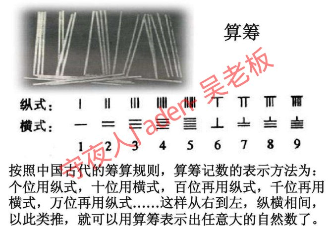

算盘

> 第 2 页

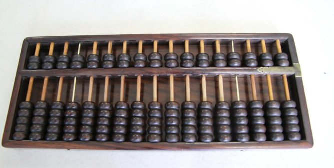

为什么算筹、算盘等都叫做计算工具，而不是叫计算机呢？因为它没有灵魂，是一个死的部件，只能帮我们做结果记录，但是计算的过程还是需要我们通过大脑来计算，也就是还需要靠人来进行算数，所以只能算是个计算工具，辅助人来做计算。而现在的计算机呢？只需要我们会输入，计算机就自动帮我们计算出来了，然后你能看懂结果即可。哪怕我不会加减乘除的计算过程，我只要会使用计算机就够了，

计算机中内置了计算逻辑。比如我们经常看到计算器，只需要输入数字和运算符号即可得到结果，现在手机和电脑上都有也都有这个东西。

守夜人 Jaden（吴老板）

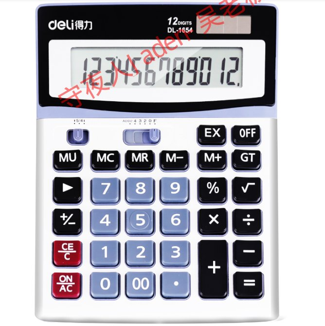

> 第 3 页

其实除了算筹和算盘之外，还有很多其他的计算工具，这里就不多提了，有兴趣的可以自行去了解一

下。

计算工具特点：它是辅助工具，不包含计算程序，主要靠人脑来计算。

计算机(包含计算器)：包含计算程序，不需要靠人脑来计算，为什么需要计算器呢？简单的计算人可以完成，但是复杂的运算，或者大一些的数据计算的时候就很难完成了，比如69999*18888，我问你结果是什么，是不是一时难以算出结果，即便是努力算出来了，也很容易出现不准确的情况，但是如果交给机器，只要机器设定好计算程序逻辑，并且运算速度够快，那么只要输入好要计算的数据，它就能又快又准确的计算出结果，所以计算器、计算机是历史发展中的必然产物。

计算机特点：含计算程序，学会人工输入，并看懂计算的输出结果即可，那有人说，看懂还不简单吗？

其实也没那么简单昂，很早的时候是没有显示器的，你看的时候也不是那么容易，所以显示器也是历史发展的必然产物。

我们现在使用的计算机有个核心部件或者说核心零件，叫做CPU，它就是用来做计算的。但是这个CPU

的计算过程是相对比较复杂的，这个后面我们讲到CPU的时候再提。

### 1.2 机械计算机

那么后来人们发现，类似算盘的这种计算工具还是太慢了，计算个数值需要手动拨动好多次才行，所以随着历史发展出现了机械计算器，计算效率提高了很多。

帕斯卡计算器

也叫滚轮式加法器。

在1642年由年仅19岁的法国科学家、数学家布莱斯·帕斯卡（Blaise Pascal）引用算盘的原理，发明了第一部机械式计算器。帕斯卡加法器是由齿轮组成、以发条为动力、通过转动齿轮来实现加减运算、用

连杆实现进位的计算装置。有兴趣的可以看看这个视频：https://www.bilibili.com/video/av1897906/

守夜人 Jaden（吴老板）

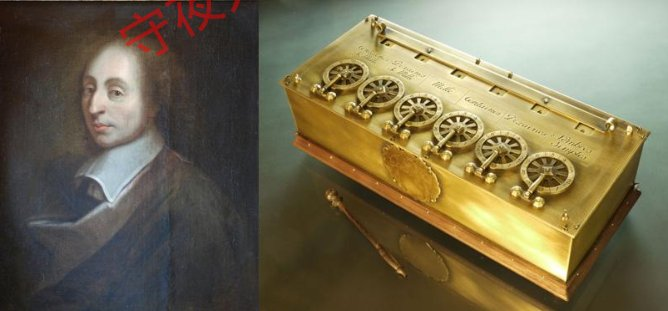

莱布尼茨乘法器

在1673年，德国数学家莱布尼茨设计了一架可以进行乘法，最终答案可以最大达到16位。莱布尼茨是现代机器数学的先驱，他在帕斯卡加、减法机械计算机的基础上进行改进，使这种机械计算机能进行乘法、除法、平方的演算。他造出的计算器样机达到了可以进行四则运算的水平。

帕斯卡的加法器，没有莱布尼茨的"步进计算器"影响力大。步进计算器俗称乘法器，所以也可以叫做莱布尼茨乘法器。

> 第 4 页

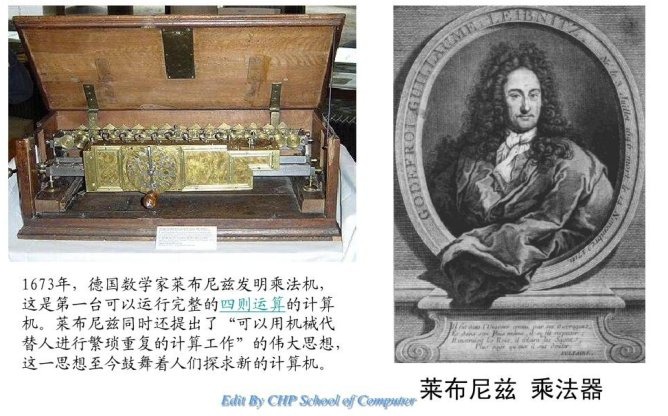

影响了机械计算设备的发展达3个世纪，在这段时间内机械计算器也发展出了很多其他的机械计算器。比如下面这个知名的Curta计算器。

Curta计算器

Curta是一台可单手操作的手摇式精确计算器，可用于加减乘除四则运算和乘方开方运算。它将瑞士手表的精确、LEICA相机的工艺，以及机械的精密全部集中在一个圆柱体中，代表了西方机械技术顶峰。

它是由奥地利工程师Curt Herzstark发明，据说当时处于二战时期，他被纳粹关在Buchenwald集中营，

期间就在头脑中完成了其设计的大部分。1947年被释放后，完成了剩下的部分并制造面世。它小巧到可以单手握住，这是阶梯式齿轮计算结构的一个重要发展。

守夜人 Jaden（吴老板）

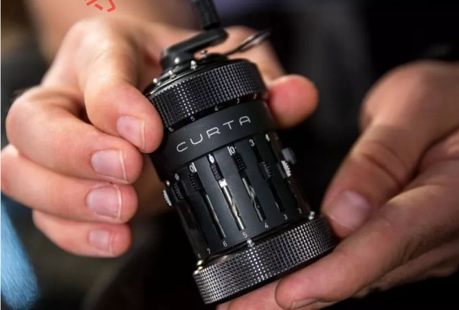

> 第 5 页

Curta的制作非常复杂，大家有兴趣的可以看看这个视频：https://www.bilibili.com/video/BV1if4y1A7

xJ

巴贝奇差分机

1819年，英国科学家巴贝奇设计"差分机"，并于1822年制造出可动模型。 这台机器能提高乘法速度和改进对数表等数字表的精确度，还可以进行函数运算。1991年，为纪念巴贝奇诞辰200周年，伦敦科学博物馆制作了完整差分机，它包含4000多个零件，重2.5吨。英国人查尔斯·巴贝奇研制出差分机和分析机为现代计算机设计思想的发展奠定基础。受限于当时的工业水平，这个差分机当时没有做出来，但是若干年后人们按照巴贝奇的思想做出了这个计算机，后来有人称他为计算机之父。虽然他没有成功，但是他的理论和思想对后台的影响是非常大的。

守夜人 Jaden（吴老板）

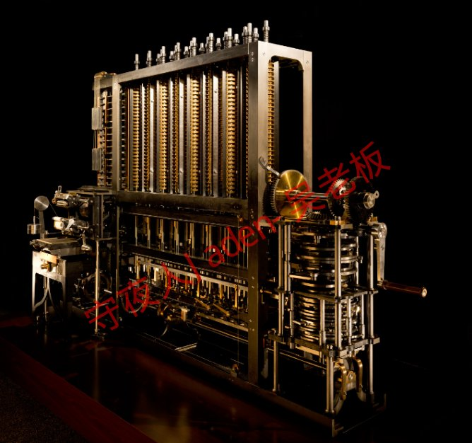

机械计算器继续在 1960 年代使用，但很快被 1960 年代中期出现的使用阴极射线管输出的电子计算器取代。1970 年代，随着低廉的手持式电子计算器推出，这一发展达到顶峰。机械计算器在 1970 年代逐渐消失，到 1980 年代基本上绝迹了。

### 1.3 电子计算机

前面说到的机械计算机，人们发现它的效率还是低了，后面就想到能不能用速度最快的电来完成计算

呢？那样的话效率不就更高了吗。所以随着科学的发展和进步，终于迎来了电子计算机的时代。

世界第一台电子计算机：是在1935~1939年间由美国阿塔纳索夫和克利福德·贝瑞共同研发的，阿塔纳索夫-贝瑞计算机（Atanasoff–Berry Computer，通常简称ABC计算机）是世界上第一台电子数字计算设备，也就是电子计算机。这台计算机在1937年设计，仅仅设计用于求解线性方程组，并在1942年成功进行了测试。

> 第 6 页

图灵机：艾伦·麦席森·图灵（英语：Alan Mathison Turing，1912年6月23日~1954年6月7日），英国数学家、逻辑学家，被称为计算机科学之父，人工智能之父，在1939年时，因战争需要，图灵临危受命，

从事军事工作，负责破译敌方情报，图灵专门设计、建造了一台机器--图灵机，破解德军的英格尔码

（ENIGMA）密码，当时都是通过电台电报的形式来进行军事指令的下发，需要加密处理，不然被截获后很容易破译战斗策略，希特勒号称他们的ENIGMA密码是无人能够破解的，a -- 转盘设备加密 -- b -- 转盘设备解密 -- a，结果被图灵发明的图灵机给破解了，图灵机通过暴力破解的形式来进行解密，需要的计算量特别的大，不仅破解了，还修改了指令，这就出现了著名的诺曼底登陆行动，通过篡改的信息来告诉敌人不在诺曼底登录，在其他地方登录，这样的德国的军力就没有部署在诺曼底，所以登录很成功，当时这个破译机器非常的大，后来二战技术之后，被丘吉尔给炸了，他觉得没有实际用途了，后来图灵也比较惨，并且吃了带毒的苹果，我们其实也知道某个品牌的计算机就是咬了一口的苹果，这都是历史昂，图灵对计算机的发展是有非常大的影响的。图灵还提出，计算机能够帮我们做运算，能不能做其他的逻辑呢，人工智能这个概念就是图灵提出来的，测试电脑是否能够和人一样，只要做一下图灵测试即可，所谓图灵测试是一种测试机器是不是具备人类智能的方法，它是一种确定计算机是否会思考的实验．一个人向计算机发问，另一个不知情的人试图从回答中区分是人还是计算机．如果计算机没有被辨认出，便通过了图灵实验。有一部电影诠释了图灵的一生，叫做模仿游戏，有兴趣的朋友可以去看一

看。

我们知道1945年，在日本爆炸了两颗原子弹，投弹的轨道、飞机的速度、风速、高度、弹头的角度等等各种计算指标，需要大量的计算才可以精准的投弹，如果用人工来计算的话，出错的概率太高了，而且计算速度很慢，这就需要靠计算器了，大量的精准的运算，所以其实战争带动了计算机的发展。当时的计算器只能做数学运算，为了在战争中处于领先的地位，科学家们一致在进行计算器的研究，那么计算机除了多用于战争之外能不能用于其他的领域呢，科学家们也是一直在研究，并在1946年，世界第一台电子计算机就出现了。

世界第一台通用电子计算机：ENIAC（埃尼阿克），于1946年2月14日在美国宾夕法尼亚大学诞生。发明人是美国人莫克利（JohnW.Mauchly）和艾克特（J.PresperEckert）。 美国国防部用它来进行弹道计算。它是一个庞然大物，用了18000个电子管，占地170平方米，重达30吨，耗电功率约150千瓦，每秒钟可进行5000次运算，这在现在看来微不足道，但在当时却是破天荒的。 ENIAC以电子管作为元器件，

所以又被称为电子管计算机，是计算机的第一代。电子管计算机由于使用的电子管体积很大，耗电量

大，易发热，因而工作的时间不能太长。

守夜人 Jaden（吴老板）

> 第 7 页

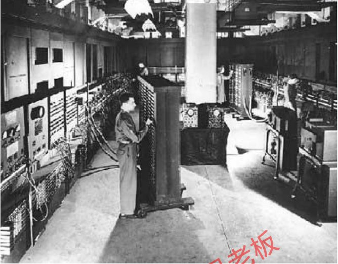

ENIAC是世界上第一台通用电子计算机，是世界第二台电子计算机，第一台是ABC，那么什么是通用计算机呢？这里主要是理解通用两个字，他和专用是相对的，比如ABC就是一台专门用来进行方程运算的电子计算机，属于专用计算机，专用计算机，专为解决某一特定问题而设计制造的电子计算机，如控制轧钢过程的轧钢控制计算机，计算导弹弹道的专用计算机，解决特定问题的速度快、可靠性高，且结构简单、价格便宜，而通用计算机是指各行业、各种工作环境都能使用的计算机，结构就比专用计算机要复杂了。

我们现在使用的计算机都是通用电子计算机，而通用电子计算机也是经历很多年的发展，一直到现

在，包括我们使用的手机、ipad、笔记本、台式机等等都是。

守夜人 Jaden（吴老板）

ENIAC，在做不同计算的时候，需要进行大量的布线工作，很麻烦，并且不具备程序数据和结果数据的存储功能，如果想要对ENIAC编程(编写计算过程)，必须在一个插线板上面拔插电路，也就是布线，改变机器的电路结构，进行各种运算。也就是两个缺点：不能存储、布线复杂。

接下来我们看一下电子计算机的发展历史。

## 二、通用电子计算机发展史

第一台通用计算机出来之后，计算机迎来了高速发展的时代。

### 2.1 第一代计算机

第一代计算机（1946-1958），它的基本电子元件为真空管(也叫电子管，1907年德福雷斯发明的)，管子越多，计算能力越强，但是真空管个头比较大、容易坏、维修起来也比较麻烦，后面用更好的材料来代替它，后面这几代的发展，其实也是材料的发展。苏联和美国在这里有分歧，苏联想的是将真空管做小一些，美国想的是换材料。

> 第 8 页

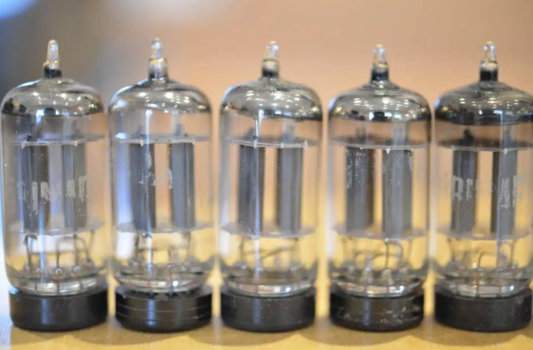

0000 0010 - 0000 0001   程序员

二进制

1

0000 0001

2

0000 0010

当时内部存储器采用的是水银延迟线，外部存储器主要用的纸带、卡片、磁带等。由于当时电子技术的守夜人 Jaden（吴老板）限制，它的运算速度只有每秒几千次至几万次基本运算，内存容量仅数千字，程序设计处于最低级的阶段，早先的时候使用主要使用二进制表示机器语言编程，0代表低电压、1代表高电压，后阶段采用汇编语言进行程序设计。第一代计算机使用语言编写操作指令，每种机器有各自不同的机器语言，既复杂又繁琐，需要工作人员有很高的水平、受过专门训练的人才能操作，主要局限于一些军事和科研部门的科学计算领域。

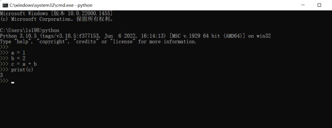

对应二进制，看ascii码对照表就能找到。

> 第 9 页

a -- 01100001

b -- 01100010

\+ -- 00101011

= -- 00111101

c -- 01100011

...

通过二进制的形式编写一个简单的加法都是难上加难。关于编程的这些内容，我会在后续阶段给大家专门的进行讲解。

### 2.2 第二代计算机

第二代计算机（1958-1964），用了比真空管更好的材料，晶体管(二极管、三极管等)，体积变小了，就可以放的更多，电路多了，计算能力也就变强了，而且材质的使用周期也越发持久了。

守夜人 Jaden（吴老板）

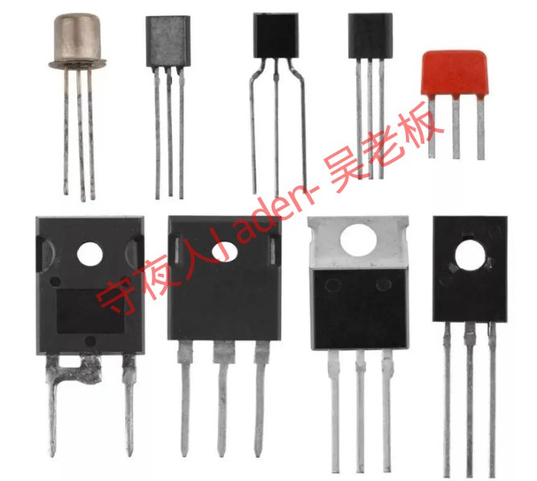

人们将这一时代称为晶体管计算机时代。此时的计算机体积和耗电量都大大减少，运算速度明显提高，

性能更加稳定，存储容量有了很大的增长。由于硬件技术的该井，相应的软件技术也有了极大的提高。

随着FORTRAN、COBOL、ALGOL等高级语言的出现，单词、语句和数学公式代替了二进制编码，主要熟悉通用的高级语言，就可以编写程序，让计算机帮我们完成各种工作任务。

> 第 10 页

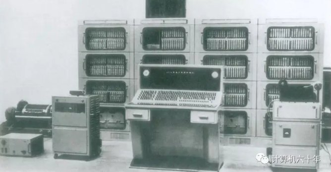

### 2.3 第三代计算机

第三代计算机（1964-1971），中小规模集成电路计算机诞生。在仅仅几平方毫米的单晶硅片上集成十几个甚至上百个电子元件，集成电路使计算机体积更小，运算速度更快，程序、应用迈上一个大台阶。

主存储器仍采用磁心，并逐渐被半导体存储器取代。软件方面：出现了操作系统以及结构化、规模化程序设计方法，并出现了多种高级程序设计语言，如BASIC语言等；使用图形用户界面（Graphical User

Interface-GUI）。应用领域：科学技术计算、数据处理、图像处理、信息管理、工业控制。从这一代开始，机器可以根据性能分为巨型机、大型机、中型机和小型机。了解一些电脑的同学可能知道有个大头机，一般是白色的，就是这一代的产物。

守夜人 Jaden（吴老板）

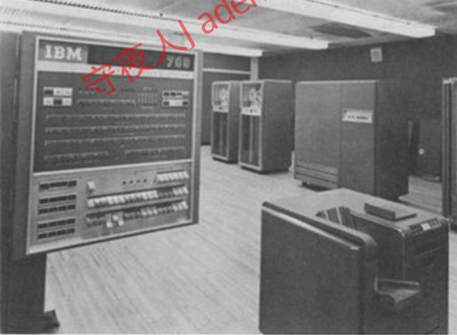

> 第 11 页

### 2.4 第四代计算机

第四代计算机（1971-至今），超大规模集成电路，可以理解为同一个大小的板子上，可以放的部件更多了，里面的晶体管肉眼都看不到了，就是我们现在经常听到的芯片技术，芯片就是集成电路板产品，主要应用在cpu上，但是不仅仅限于cpu，好多其他的地方都要用，现在国家推行的信创工程，非常重点一个工作就是做中国自己的芯片，我们现在用的都是第四代，做计算的是要是计算的cpu，大家可以查看一下i5、i7处理器(cpu)或者苹果的a1cpu5等里面有多少个晶体管。都是通过晶体管都是通过光刻机等各种高端机器搞上去的，有些高端精密的仪器国内没有，所以中国的芯片一直被卡脖子，正在努力的突破

中。

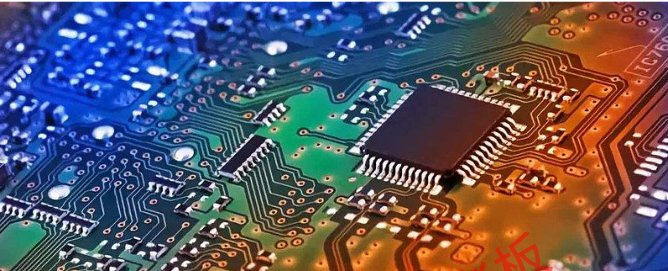

### 2.5 第五代计算机

属于未来的展望，人工智能计算机、生物计算机、量子计算机、非冯诺依曼结构模式的计算机。

守夜人 Jaden（吴老板）

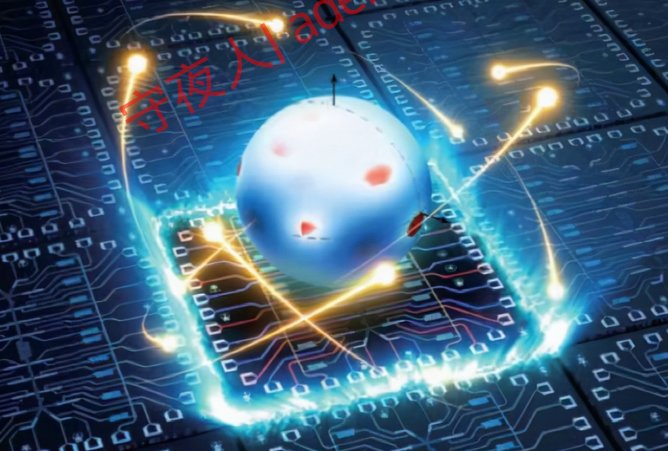

20世纪80年代初，人们提出发明与人脑神经网络类似的新型超大规模集成电路的设想，即生物芯片制造方法的构思，并开始着手研究由蛋白质分子或传导化合物元件组成的生物计算机，与此同时，人们也开始研制光计算机和量子计算机。光计算机是用管子代替电子来传递信息。量子计算机是一类遵循量子力学规律进行高速数学和逻辑运算、存储级处理量子信息的物理装置。当某个装置处理和计算的是量子信

> 第 12 页

息，运行的是量子算法时，它就是量子计算机。量子计算机的概念源于对可逆计算机的研究。研究可逆计算机的目的是解决计算机的耗能问题。

总结一下：

运算

发展阶

逻辑

速度

软件  
应用  
输入输出设备

段

元件  
主存储器

（每

秒）

军事

几千

研

第一代

电子射线

次到

机器语言、汇编语

电子

究、

穿孔卡片和纸带

管、磁

（1946-

言

几万

管

科学

鼓、磁带

1958）

次

计算

数据

处

第二代

晶体

磁芯和磁

几十

监控程序、高级语

理、

穿孔卡片和磁带

（1958-

管

万次

言

带/磁盘

事务

1964）

处理

有较

几十

半导体材

大发

中小

万次

质存储

第三代

磁带、键盘、显

操作系统、编辑系

展开

规模

到几

器、大磁

（1964-

示器、打印机等

统、应用程序

始广

集成

百万

芯、磁带/

1971）

泛应

电路

次

磁盘

用

大规

模超

上千

操作系统完善、数

渗入

键盘、鼠标、光

集成度更

第四代

万次

据库系统、高级语

社会

学扫描、触摸

大规

守夜人 Jaden（吴老板）

高的半导

（1971-

模集

到上

言发展、应用程序

各级

屏、显示器、打

体存储器

至今）

亿次

发展

领域

印机等

成电

路

## 三、CPU发展史

CPU叫做中央处理器，这个CPU就是我们前面看到的ENIAC那种的大型计算机器的浓缩，为什么我的电脑和手机都这么小，甚至还有了掌上电脑，虽然体积很小，但是计算能力非常强，功能也很多，非常重要的一个原因就是将计算部件全部浓缩了，压缩到了一个小小的芯片里面，而这个芯片应用到的最多的产品就是CPU，所以我们每个人的电脑和手机上都是有这个CPU芯片的，那么接下来我们来了解一下

CPU的发展历程，做CPU最知名的两个公司：Intel和AMD。

CPU发展史简单来说就是Intel公司和AMD公司的发展历史。CPU从最初发展已经有四十多年的历史了，

这期间，按照其处理信息的字长，CPU可以分为：四位微处理器、八位微处理器、十六位微处理器、三十二位微处理器以及六十四位微处理器等等。这个四位、八位、十六位的都是什么呢？前面我们提到过二进制，1的二进制是00000001 ，一个字节，1B，KB，MB，GB，TB，这是8位的二进制数字，也叫做

8比特(英文：bit，中文：位)，一个二进制数字是8位，最早先是4位，现在基本都是8位，按照8位和16

> 第 13 页

位给大家解释一下表示，CPU一次性可以处理8位的二进制数，那么他就是8位微处理器的计算机，一次性能处理16位的就是16位微处理器，这样说大家明白了吗，现在基本都是64位的，一次性能够处理的数据越多，表示CPU的能力越强大，计算速度也越快。那么接下来我们通过Intel公司CPU的发展历程来了解一下CPU发展史。

守夜人 Jaden（吴老板）

> 第 14 页

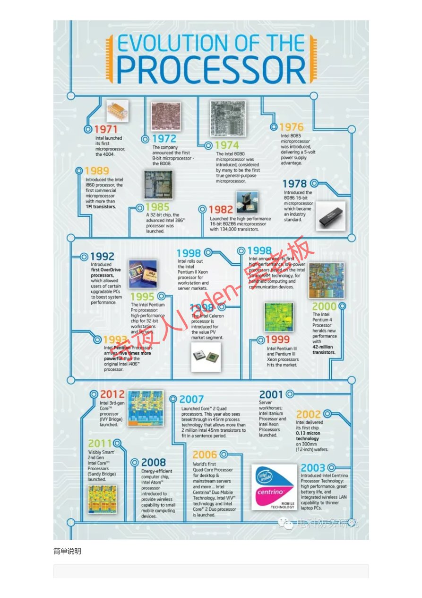

> 第 15 页

4004  4位处理器

8008  8位处理器

8080  16位处理器

8086  16位处理器 1978年出的一个划时代的处理器，这时候开始就出现了x86系列的CPU

80186

80286

80386

80486

80586

80686 --> 由于被别人抢先注册了这个系列号，所以改名为奔腾处理器，Pentium，并在1992年发布，奔腾用了很多年，属于intel的高端系列产品，由于奔腾比较贵，后面又出了一些低端的，比如赛扬(celeron)系列的处理器。再后来奔腾和赛扬也淘汰出局了，出现了酷睿(core)系列，不过一些低端的电脑上可能还能看到奔腾，在某些地方应该还能买得到。

上面这些86结尾的型号，都成为x86架构系列

酷睿  intel core，2011年3月，使用32nm工艺全新桌面级和移动端处理器采用了i3、i5和i7的产品分级架构，i3、i5和i7的产品又分很多代，比如i5第十一代处理器是2020年发布的。其中i3主攻低端市场，采用双核处理器架构，约2MB二级缓存；i5处理器主攻主流市场，采用四核处理器架构，4MB二级缓存；i7主攻高端市场，采用四核八线程或六核十二线程架构，二级缓存不少于8MB。但是现在i7也普及的比较好了。后来还出现了i9，i9的出现主要是竞争对手AMD的压力下出现的。 有一家叫做AMD的公司也是做处理器的，现在也挺牛，之前都是被Intel吊打的，后来有个中国女人叫苏姿丰的当上了AMD的CEO，然后致力于提高处理器的性能，现在和Intel可以平起平坐了。intel 酷睿i9的出现也是被AMD竞争挤出来的。intel我们有时候也会称之为牙膏厂，因为intel处理器的性能明明可以一下子提升很多，并且发布，但是它每年处理器的性能只提升一点，像挤牙膏似的。32nm、22nm、14nm、10nm等，intel的cpu研发、生产、销售都是自己的，AMD只做

CPU研发、生产是交给了其他厂家，比如台积电，现在AMD的技术可以达到7nm，直接弯道超车，现在intel还是10nm技术，而且在硬件圈里面好多人支持AMD，还喊出了个梗，叫AMD YES！，AMD牛b、AMD加油、AMD好样的等意思。

intel

第一代： i3-530  32nm

第二代： i3-2120  22nm

第三代： i3-3220  22nm 优化版，还是同样的工艺，就是优化了一下，比如效率提升了5%，有些客户也会

买的

第四代： ...

...

守夜人 Jaden（吴老板）

第十代： i3-10500

...

再比如，你看到i5 6500u，表示i5的第六代CPU，再比如i5 11500，就是i5的第十一代CPU。

i3 i5 i7 i9系列，都有好几代

intel  cpu研发  cpu生产  cpu销售，intel全部自己搞，成本比较高，好处就是口碑很好，产品耐用，

其实电脑最不容易坏的就是cpu，用个10-20几年都是可以的。

AMD  cpu研发  由合作的代工厂台积电负责生产  自己负责cpu销售，这样成本低一些，intel在32nm的时

候，AMD在32nm，intel在22nm的时候，AMD在32nm，当intel在14nm的时候，AMD弯道超车，直接出了

7nm，成熟工艺

我的电脑-->右键-->属性，就能看到系统信息，里面有CPU的型号，就是那个系统类型部分，x64是x86-

64的简称，表示86系列的64位的微处理器，也就是CPU。

> 第 16 页

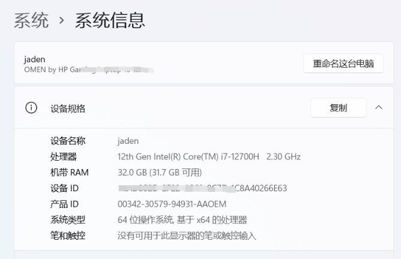

守夜人 Jaden（吴老板）

> 第 17 页

