# 计算机硬件组成

来源 PDF：计算机硬件组成.pdf（原文件位于课程目录，本文件夹不包含 PDF）

> 第 1 页

计算机硬件组成（作者：守夜人Jaden、吴老  
板）

## 一、冯诺依曼计算机

对计算机的发展影响比较大的、比较知名的两个人有：图灵、冯诺依曼。

冯诺依曼是现代计算机之父（百度去了解一下），继图灵之后对计算机影响最大的人物。世界上第一台通用计算机Eniac，就有冯诺依曼的参与。他提出的思想，将数据和程序分离开了，程序是程序，数据是数据，数据可以由程序打开和保存，比如计算器、word等等，以前不是这样的，程序和数据是一体的，

导致一个问题就是，如果想以某种形式呈现某些数据，那么就需要自己写程序，并且将数据提前编辑到程序里面才行，那这样的话计算机只能是高手才能用，普通人用不了。并且他将计算机的各个部件分割开了，不管是在使用、维护和功能扩展上都是非常便利的，这就是冯诺依曼体系计算机，我们现在用的都是这种形式的计算机。程序数据分类来进行数据处理工作是从第二代计算开始的。冯·诺依曼提出了计算机制造的三个基本原则，即采用二进制逻辑、程序存储执行以及计算机由五个部分组成（运算器、控制器、存储器、输入设备、输出设备），这套理论被称为冯·诺依曼体系结构。

运算器

控制器

存储器

输入设备

输出设备

看图，计算机组成原理

守夜人 Jaden（吴老板）

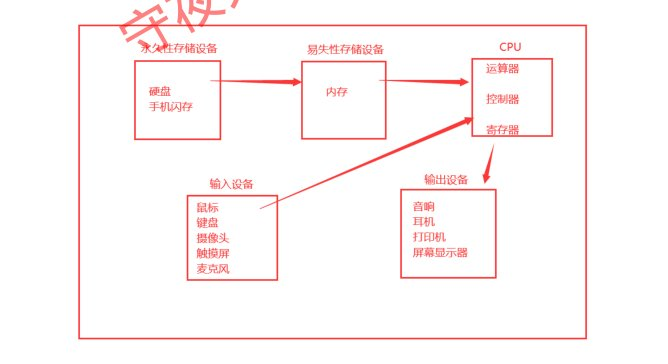

这是按照冯诺依曼体系来划分的5个硬件部分的分类。

台式机、笔记本、手机、ipad、服务器

台式机硬件组成图解，主板是用来连接所有硬件的

> 第 2 页

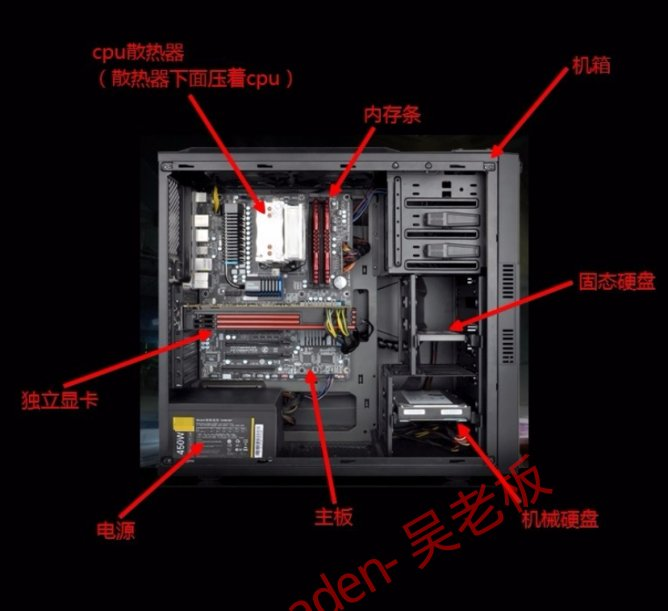

再看下图

守夜人 Jaden（吴老板）

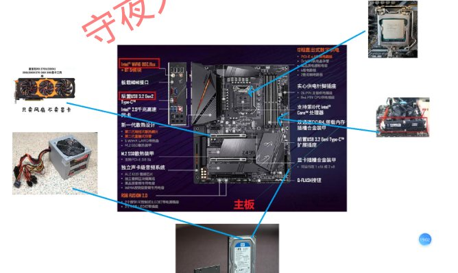

那么接下来，我们将计算机的这些硬件部件都给大家说明一下。

> 第 3 页

## 二、软硬件工作流程

现在的计算机主要是由两部分组成：软件系统和硬件系统。这里先捋清楚硬件和软件的关系，以及电脑各个组成部分是如何配合工作的，这个流程要明白。方便后续的学习，并且能够让你更加清晰的知道电脑是如何工作的。软件系统其实又可以细分为系统软件和应用软件，系统软件就是我们的操作系统，比如win10、win11、linux等等，应用软件就是我们用户自己用电脑的时候会自行安装或者系统给你自动安装的一些工具软件，比如你的word、excel、qq、微信、王者荣耀、LOL、网易云音乐等等。没有安装操作系统的电脑称之为裸机，裸机是不能直接安装应用软件的，裸机就是一堆烂铁，不会自己干活的，因为没有灵魂，而操作系统就是灵魂，关于操作系统，我后面也会给大家详细的讲解，现在先看一下他们的大致关系。

比如，我们举个例子，就拿我们经常会用到的，打开一个word文档，都发生了哪些事情来看吧。

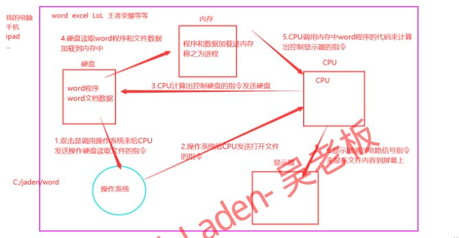

当我们通过鼠标双击打开某个word文档时，比如jaden.docx吧，会经历如下事情

守夜人 Jaden（吴老板）

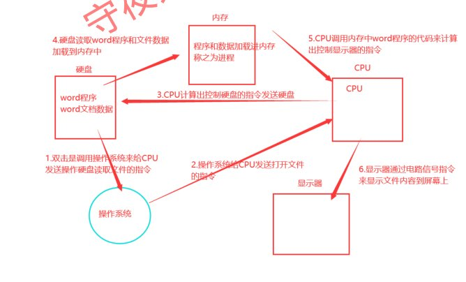

> 第 4 页

为什么有了硬盘来存储程序和数据，还需要内存呢？因为CPU的计算速度很快，硬盘受限于物理技术，

速度相对CPU来讲，很慢，那么就需要一个中间区域来作为CPU和硬盘之间数据交互的缓冲区，你硬盘不是慢吗，你把想要运行的程序或者数据放到内存中，内存的制作材质很好，存取速度也比硬盘快很多，那么CPU直接去内存中取数据即可，这样就能很好的平衡硬盘和CPU的速度差距问题，但是内存不能永久存储数据，断电之后内存中的数据会丢失，比如我们用word程序打开了一个文档并写入了一些数据，这个数据是先写入到内存中的，如果不保存的话(也就是不写入到硬盘上)，突然断电的话，内存中的数据就会丢失，写了好多数据都白写了。以前的机械硬盘很慢，现在出现了固态硬盘，存取速度也提高了很多。运行速度相比：CPU > 内存 > 硬盘。

## 三、CPU中央处理器

中央处理器（central processing unit，简称CPU）作为计算机系统的运算和控制核心，是信息处理、程序运行的最终执行单元。

### 3.1 CPU架构

CPU架构是什么？CPU架构是CPU厂商给属于同一系列的CPU产品定的一个制作规范，主要目的是为了作为区分不同类型CPU的重要标示。市面上的CPU分类主要分有两大阵营，一个是Intel、AMD为首的复杂指令集CPU，另一个是以IBM、ARM为首的精简指令集CPU。两个不同品牌的CPU，其产品的架构也不相同，例如，Intel、AMD的CPU是X86架构的，而IBM公司的CPU是PowerPC架构，ARM公司是ARM

架构。不同架构的CPU在制作的时候元件的材质、个数、处理指令的流程、指令集等偏重点可能都会有所不同，虽然得到的结果是相同的，但是过程不同，就各有优劣，这就是所谓的CPU架构。

指令集：CPU是负责运算的，但是它需要在什么时候运算，具体做哪些运算，得听操作系统指令。系统程序发出的各种指令，在被执行前，需要翻译成CPU能听懂的语言。这个翻译官，就是指令集（英文缩写ISA），那么其实就是系统和CPU约定好了一些命令所对应的代码指令，内置在CPU中了(二进制的机器码指令)，你系统只要告诉我需要我做什么，那么CPU会调用自己内置的指令集来完成指令的运算和控制。常见的指令集有两种，

一种是复杂指令集（CISC），X86就属于复杂指令集；一种是精简指令集（RISC），家族成员有ARM、RISC-

V、MIPS等。

复杂指令集：指令集中的一条指令可以完成一个复杂的动作，比如说，屏幕显示A字母，那么复杂指令集可能一条指令就搞定了。

精简指令集：要完成一个动作，需要很多条指令集里面的指令才能完成，比如屏幕显示A字母，那么可能需要三条指令才能搞定。

守夜人 Jaden（吴老板）

CPU有多个架构，下面我简单介绍几个：

X86架构: intel、AMD都生产并主攻这个架构的，中国也有一个这样的厂商，叫做海光，海光x86，只有x86

架构的cpu才能和windows操作系统兼容，并且x86是人家国外的专利，中国拿到这个授权是挺艰难的。

    特点：功耗高、性能高   现在的台式机、笔记本基本都是X86架构的CPU

ARM架构: 这个架构用的也挺多，比如苹果的A系列。国产的：高通的骁龙(android手机的处理器)、华为的麒麟、联发科的天玑(可以和高通平起平坐)、三星的猎户座、紫光展锐的虎贲，大家都是买的arm的授权，然后自己制作智能芯片，添加上自己的各种自定义的功能，这个是用的最广泛的cpu架构，主要应用在手机上，

现在电脑领域也有了ARM的身影(比如华为的鲲鹏处理器，可以用在台式机服务器上)，Intel就有点慌了。

    特点：功耗低、性能相对低(但是有反超x86的趋势)，这个功耗低、性能相对低的情况正好适应智能手机，而且正好也赶上了智能手机的兴起，比如苹果手机的A15处理器是基于arm架构的cpu模仿改造(模改)出来

的。

    手机芯片叫做SoC，从狭义角度讲，它是信息系统核心的芯片集成，是将系统关键部件集成在一块芯片上，从广义角度讲，SoC是一个微小型系统，如果说中央处理器(CPU)是大脑，那么SoC就是包括大脑、心脏、

眼睛和手的系统。国内外学术界一般倾向将SoC定义为将微处理器、模拟IP（Intellectual Property）

核、数字IP核和存储器(或片外存储控制接口)集成在单一芯片上，这个芯片其实就是很多功能的集合。

> 第 5 页

以前windows只支持x86架构的，现在支持x86和arm架构(从win8开始的，但是从win10才算是兼容的比较好一些)的，CPU的架构不同，那么是不能兼容相关软件的，软件是依赖于底层硬件的。手机是arm架构的，是可以安装win10、win11等系统的，这是微软在做支持，为了兼容各种软件，现在新的软件基本都可以兼容了，

老的软件还有很多不兼容。

mips：这个的市场份额很少了，国产的有一个叫做龙芯的CPU就是这个架构的，中科院牵头研发的，主要应用在国防科技上面、交换机、路由器，龙芯拥有自主知识产权，也不是自己创新出来的，也是买的，买的mips，

然后改出来的。不然从0摸索的话需要很多年。

RISC-V：这是一个新的架构，近几年才出现，前景巨大，开源免费的，不需要授权费。很多公司都在研究这个，比如阿里达摩院的玄铁910就是这个架构的。

...

这些架构都应用于服务器、台式机、笔记本、手机、嵌入式设备等。

我们下载安装某些软件的时候，要注意看自己的平台环境(操作系统+硬件(CPU))，找对应的架构的版本下载，不然不能使用，比如promethues这个工具：

守夜人 Jaden（吴老板）

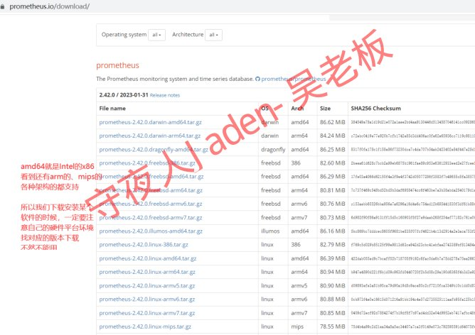

关于CPU架构，我们就简单说这么多，还有很多其他的架构，比如苹果电脑的CPU，最开始用的是IBM

power架构的CPU，后来由于性能和功耗不好，改用Intel的，再后来好像是2020年吧，开始使用自研的处理器，比如M1等等，但是很多软件出现了兼容性的问题，现在优化的也挺好的了，这里我就不多提了，了解到这里即可。

> 第 6 页

### 3.2 CPU针脚

电脑的两大厂商是Intel、AMD，区分他们两家的CPU，最简单的就是看CPU的针脚。

从形状上也大致能够看出来，AMD的logo占满了CPU的框框，Intel的是没有占满的。

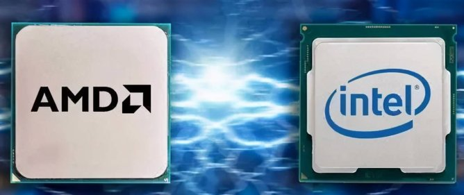

CPU针脚

针脚是什么呢？如下，这一个个和小针一样的东西就是针脚，AMD的CPU一直都有针脚，Intel早期的

CPU有，现在的基本都没有，Intel的针脚都封装到主板上去了，没在CPU上面了。

守夜人 Jaden（吴老板）

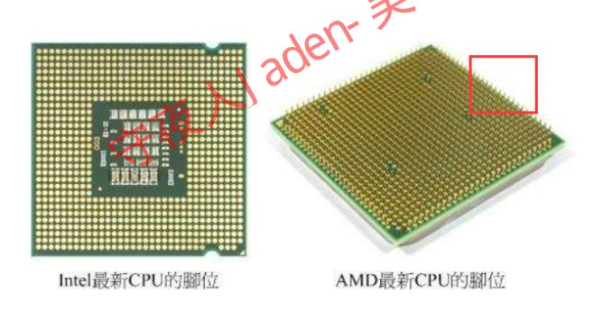

Intel早期，比如奔腾CPU看一下，如图

> 第 7 页

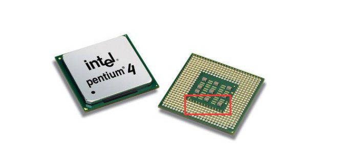

针脚是CPU的封装工艺，大家有兴趣的可以去搜索查看一下封装工艺是什么意思，其中针脚形式的就是里面典型的一种，带针脚的叫PGA封装，不带针脚的叫LGA封装，带阵脚的是比较老的一种，针脚如果不小心坏了，那么这个CPU其实基本就算是报废了，以前CPU是很贵的，那么Intel这种方式就安全了很多，将风险转移到了主板上，如果针脚坏了，换个主板就行了。现在AMD的锐龙(ryzen 7)说是已经改了，和Intel的一样了。

### 3.3 CPU性能参数介绍

中关村在线，搜索某一款电脑，关于这个电脑cpu的介绍如下：

守夜人 Jaden（吴老板）

> 第 8 页

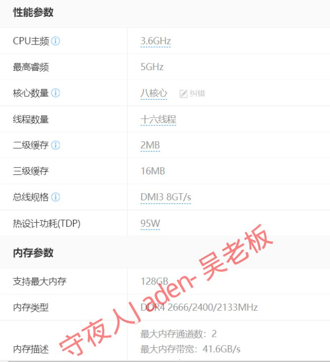

守夜人 Jaden（吴老板）

看CPU的个数，可以在我的电脑-->右键-->管理-->设备管理器-->处理器

> 第 9 页

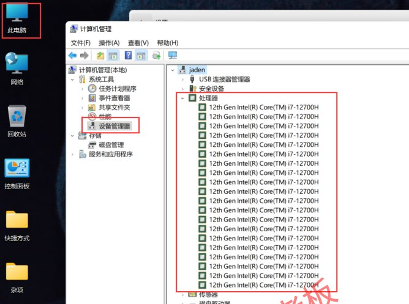

看CPU的性能信息，看这里，我的电脑-->属性

守夜人 Jaden（吴老板）

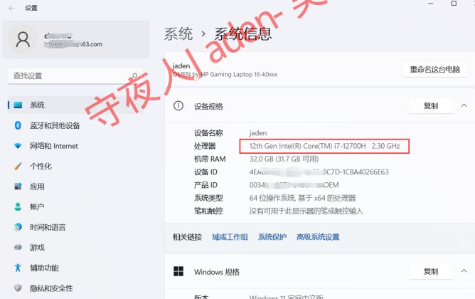

#### 3.3.1 主频和睿频

> 第 10 页

CPU主频：主频越高，功耗越高，也就是能力越强，但是耗电越高，热量也越大，我的主频是2.30GHz，Hz是频率单位，赫兹，GHz是千兆赫

    千兆赫，缩写为GHz，是等于十亿赫兹(1,000,000,000 Hz)的交流(AC)或电磁(EM)波频率的单位。

可以理解为1秒钟可以进行23亿次运算。

    GHz是CPU的处理频率，换言之，即CPU的电波处理速度。现今大多CPU是多核的，如双核、4核、 8核、

16核等。若为此况，则CPU的实际频率等于主频乘以核值再乘以0.8左右。譬如，4核1.5GHz的CPU的实际处理速度为： 4X1.5X0.8=4.8 (GHz) 。该数值愈大，则CPU的运行速度就愈快，性能便愈强。可以看看某些

CPU的对比，比如Intel 酷睿i7的各代性能对比：

https://detail.zol.com.cn/series/28/125/param_26802_0_1.html

    Intel 酷睿i7 10700：标准版，多用于台式机

    Intel 酷睿i7 10700K：带超频，多用于台式机。Intel的CPU型号，尾号带K的，表示可以超频，比

如我们刚才看CPU参数，主频为2.30GHz，表示推荐使用的主频大小，带K的话，可以通过控制主板的一些参数，让CPU的主频增大，比如可以让他工作到2.40、2.50GHz等，甚至更高，带K的也是卖的最贵的。

    Intel 酷睿i7 10700F：不带核显。CPU里面集成显卡，以前CPU和显卡是分开的，近几年有了这种集

成显卡的出现，我们管这种集成显卡也叫做核显，因为集成在CPU核心中了，带F的表示不带核显，减少了制作工艺，更便宜了。建议大家买带核显的，更好一些，大家可以自行查一下核显和独显的区别。Intel系列是不带F的都带核显，AMD系列是带有字母G的表示带核显，没有字母G的都不带核显。大家可以看到我的是带核显

的。

    Intel 酷睿i7 10750H：主频低一些。多用于笔记本。因为笔记本的体积小，散热空间少，需要主频低

一些。

    Intel 酷睿i7 10510U：主频更低，多用于笔记本。主打低功耗，待机时间更长，计算能力相对差一

些，但是对于普通人来说，感知差不多。当我们把电脑的CPU性能跑满的时候，比如玩大型游戏的时候，CPU主频高就顺畅一些，CPU主频低就可能会感受到卡顿，有时候可能会看到打开的软件比较多的时候，鼠标开始转圈圈，再点击屏幕变白，再点击可能死机、蓝屏，这也是受到CPU主频的参数的影响。

    Intel 酷睿i7 1068G7：带G的以前是没有的，最近几年才出现的，多用于笔记本。表示带有Intel的

锐炬核显，比普通的核显好一个档次。G7是现在比较高的核显版本，还有G1、G4等低版本的。

    通过主频性能来排行：带K的 > 标准版 > 带F的 > 用于笔记本的，买电脑要看各种参数，找到最合适的，不是性能最好就最适合你。

最高睿频：早期的CPU是支持超频的，玩家可以自己调整主板上的电压设置，来升压，控制超频，如果超频的过程中不小心把电压升多了，CPU会直接烧毁，那就报废了。所以以前玩超频的人都是一点点的提高，担心超多了，后来官方说，你们别自己超了，我帮你们超，当我们CPU过载时，官方自动帮我们超频，CPU最高超频到

5GHz，这就是睿频。

守夜人 Jaden（吴老板）

 看睿频，打开任务管理器，可以看到我的CPU的某个核心已经超频了。说明我的支持超频。

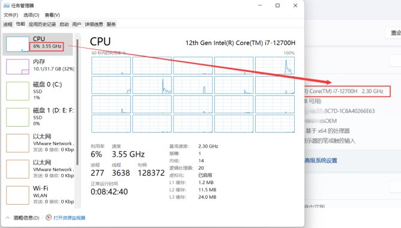

> 第 11 页

#### 3.3.2 核心数量

核心数，表示CPU内置的处理器个数

核心数：核心越多，性能越强

看任务管理器-->性能，内核这个数字就是核心数量：

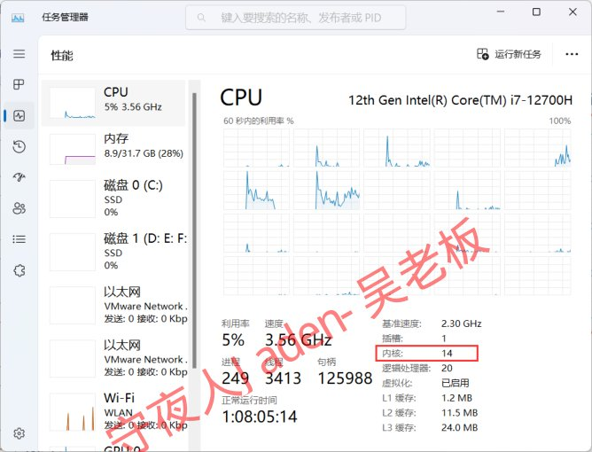

守夜人 Jaden（吴老板）

那核心数有什么用呢？多核心其实是根据多任务来的，我们的电脑或者手机都是可以同时打开很多个程序的(qq、微信、游戏、音乐等等)，打开的程序运行起来进入到了内存，就是行进当中的程序，称之为进程，每个进程都需要CPU进行一些计算处理，那么这些进程都称之为CPU的任务，运行多个进程可以说是多个任务。核心数越多，能够同时处理的任务就越多。

> 第 12 页

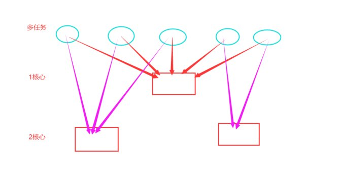

运行起来的进程或者说任务在哪里看呢？打开任务管理器，如下

守夜人 Jaden（吴老板）

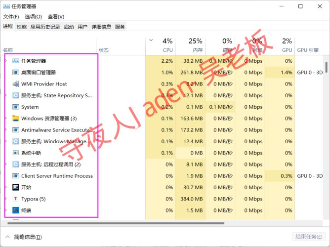

多任务：电脑可以同时运行多个程序，到底你的电脑可以同时开启多少个任务，看电脑配置，配置越

好，能够同时运行的就越多。

单任务：电脑同一时间只能运行一个程序，比如很早之前的Dos系统，一开机就是如下的黑窗口

> 第 13 页

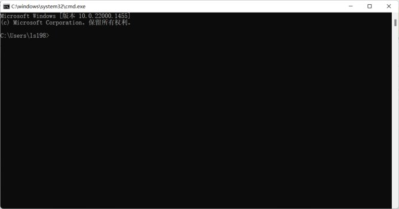

启动某个程序，需要输入程序的路径或者程序的名称，如下

守夜人 Jaden（吴老板）

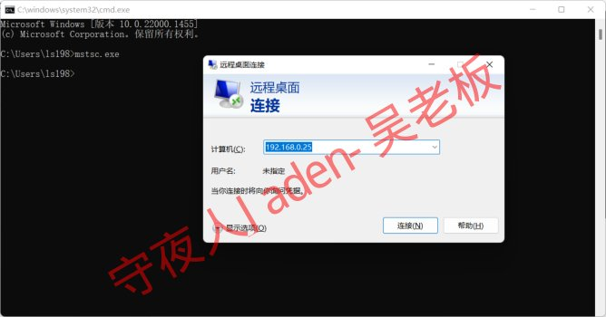

再比如

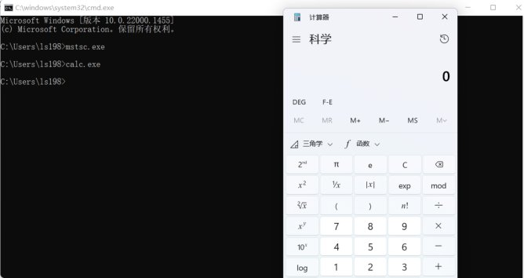

> 第 14 页

现在我们看到的是这个软件的小窗口，表示我们现在的电脑支持多任务，有窗口的概念，以前没有窗口的概念，运行起来这个软件之后，软件的窗口会占满整个屏幕， 只能使用这个软件，退出这个软件之后又回到了dos界面，也就是同一时间只能用一个软件，这种就是单任务系统。

其实多任务这个性质，我们可以从微观、宏观两个角度来看：

宏观：看上去，打开的所有的程序都在同时运行着

微观：其实一个CPU在处理多个任务，每个任务切换执行，CPU运行处理速度很快，让你感觉所有任务都在同时运行。用4核CPU来说，如果运行着8个任务，其实只有4个任务在同时运行，8个任务其实可以理解为，每两个任务在一个CPU核心上切换执行。核心数量一般都是偶数，这是设计的原因，长方形或者正方形的CPU，上下或者所有摆放核心，都是对称的，所以不存在奇数的数值。

这些东西大家先简单理解一下，等我讲到操作系统的时候，再给大家细致的讲解其中原理。

#### 3.3.3 线程数量

我们看到上面截图的参数中有个线程数量，8核心，16线程。这是CPU的超线程技术。

超线程技术就是在一颗CPU同时执行多个程序而共同分享一颗CPU内核内的资源，这一技术可以把一个实体核心的处理器划分为两个裸机核心，从而便可以在单位时间内同时处理两个线程，理论上要像两颗

CPU一样在同一时间执行两个线程，而线程是什么呢？其实进入到CPU中进行计算处理的程序就叫做线程，那有同学可能会想到，刚才不是说叫做任务吗？任务不是对应着进程吗？怎么又来个线程，这个我们看图解守夜人 Jaden（吴老板）

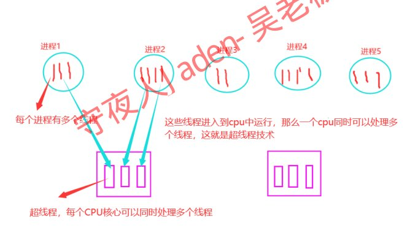

以前一个cpu核心只能处理一个线程，那么其他线程就需要等待，现在有了超线程技术，一个cpu核心可以同时处理两个线程了，cpu的运行效率提高了。官方介绍，采用超线程技术，性能提升了40%，后面可能会越来越高。那怎么只提升了40%呢？不应该是100%，注意，只是逻辑单元变成了两个，其他的没有变化，一个CPU除了逻辑单元之外，还有很多其他的组成部件，不能和真实的两个物理cpu核心一样，可以理解为假双核，但是性能确实是提升了。

有了超线程技术之后，我们描述CPU，就不是单纯的说，你的电脑是几个CPU了，而是几核几线程，比如8核16线程。

比如看看我的，打开任务管理器

> 第 15 页

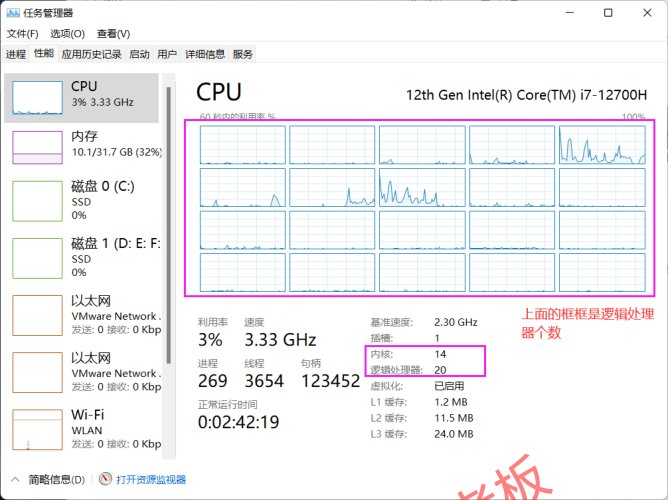

有些CPU启用了超线程，有些没有，而且不是所有的CPU都支持超线程技术，有些早期的CPU确实不支

持。

#### 3.3.4 三级缓存

性能越好的CPU，三级缓存越大，缓存的意思就是CPU在计算过程中产生的中间结果数据、后续需要参与计算的数据等等需要临时存放到某个地方，这个地方就是缓存。

三级缓存（包括L1一级缓存、L2二级缓存、L3三级缓存）都是集成在CPU内的缓存，它们的作用都是作守夜人 Jaden（吴老板）为CPU与主内存之间的高速数据缓冲区，L1最靠近CPU核心；L2其次；L3再次。运行速度方面：L1最快、L2次快、L3最慢；容量大小方面：L1最小、L2较大、L3最大。CPU会先在最快的L1中寻找需要的数据，找不到再去找次快的L2，还找不到再去找L3，L3都没有那就只能去内存找了。

缓存和内存都是会在断电之后，数据消失。任务管理器-->性能可以看到缓存大小。

> 第 16 页

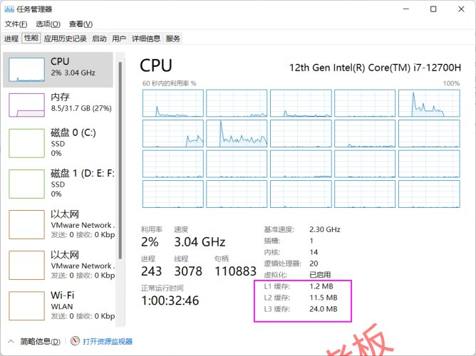

Intel的CPU核心的缓存是多核共享的，而AMD的缓存是单核独享的

守夜人 Jaden（吴老板）

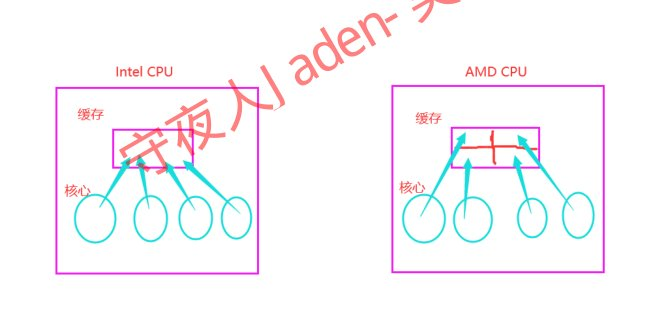

比如Intel的三级缓存为32M，由于这个缓存是所有核心共享的，那么每个核心利用缓存的最大极限就是

32M，而AMD为了超越Intel，出的缓存可能比Intel的大，比如64M，但是架构不同，比如上面的4核心的CPU，每个核心可利用缓存的最大极限只有8M，那么体现出来的效果就是，当我们玩大型游戏或者做大型计算的时候，AMD的核心所占用的缓存很快就达到了极限，容易卡顿，而Intel的缓存虽然小，但是每个核心的缓存利用极限就相对比较大，那么实际上Intel的性能在缓存这个指标上更有优势，性能也越高，就不容易由于缓存不足而导致卡顿。后来AMD的制造工艺也调整了，共享缓存的形式，性能也跟着提升了。

> 第 17 页

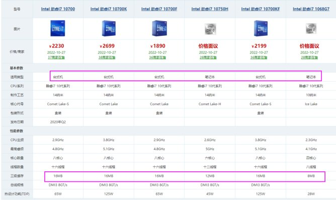

CPU整体性能到底哪个好，可以参考CPU性能天梯图：http://tool.139sl.cn/tianti/cpu/index.html

总线规格那个参数我们就不需要关注了。

#### 3.3.5 热设计功耗(TDP)

TDP的英文全称是“Thermal Design Power”，中文直译是“散热设计功耗”。主要是提供给计算机系统厂商，散热片/风扇厂商，以及机箱厂商等等进行系统设计时使用的。热设计功耗的含义是当芯片达到最大负荷的时候〔单位为瓦（W）〕热量释放的指标，是电脑的冷却系统必须有能力驱散热量的最大限度，

但不是芯片释放热量的功率。

可以看到，我上面截图中的这个参数的值为95w，如果我们的电脑只是用来做一些简单的办公工作，那么就可以选择功耗低的，因为待机时间长，一般笔记本都会选择功耗低一些的。如果想要兼顾性能和便携的话，你就选择CPU型号中带H字母的，属于标压U，比如Intel 酷睿i7 10750H，如果你想追求超长续守夜人 Jaden（吴老板）航，性能要求不高，只要不是特别卡即可，那么就选择CPU型号中带U字母的，比如Intel 酷睿i7

10510U，低频U，功耗低。

由于CPU的核心电压与核心电流时刻都处于变化之中，这样CPU的实际功耗（其值：功率P=电流I×电压

U）也会不断变化，因此TDP值并不等同于CPU的实际功耗，更没有算术关系。

举例来说，Pentium E2160 TDP为65W，而实际运行中的平均功耗仅19W。

然后我们看一下内存参数。

#### 3.3.5 内存参数

> 第 18 页

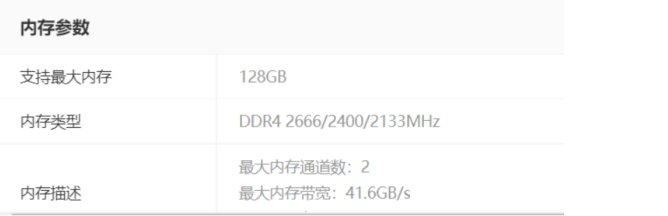

支持的最大内存128GB，也就是说你的CPU能够支持的最大内存是这个值，即便是你的电脑上有多个内存插槽，内存最大不能超过128GB，超过了的部分也是用不了的。以前可支持的内存其实相对很小，比如8G、16G、32G什么的，现在越来越大了，以前单根内存2-8G，现在单个内存可以达到32G这么大，

如果有四个内存插槽，总内存就可以达到128G。然后还有内存类型、最大内存通道数等等，我们后面讲内存的时候再提。

总结

主频：主频越高，性能越高，功耗越高

核心数：核心越多，性能越高

缓存：缓存越大，性能越高

工艺：7nm  10nm  14纳米 22纳米 32纳米 65纳米

扩展性：最大支持内存

散热：cpu过热会自动断点保护，给你的感觉就是电脑突然黑了，自动重启，现在的电脑基本很少出现这种问

题。

守夜人 Jaden（吴老板）

## 四、内存(memory)

### 4.1 内存说明

易失性存储设备

永久性存储设备

内存，是作为CPU和硬盘之间交互数据时的缓冲区，提高CPU的使用效率，本身是存储设备，有个特点就是内存中的数据断电会丢失，硬盘中的数据不会断电消失。运行起来的程序和程序中临时产生的数据都会先保存在内存中。手机上我们不叫内存，叫做运行内存，好多人说手机内存其实它说的是手机磁盘的存储容量，比如我们可能听过什么8+256，8表示的是8G运行内存，256G说的是存储，也就是硬盘容

量。

接下来我们用笔记本电脑的内存来给大家说明一下内存的一些概念：

> 第 19 页

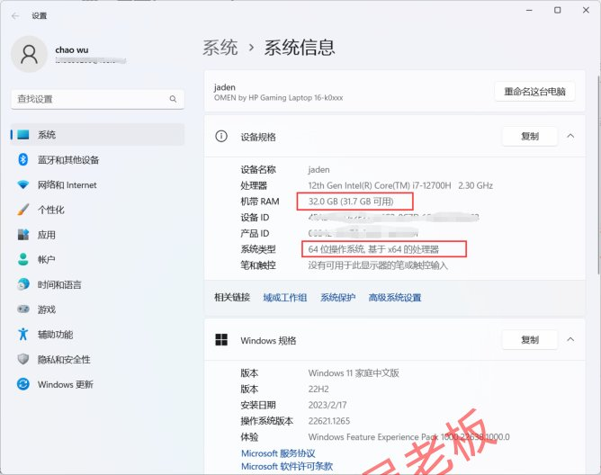

a  11

我们有看到有个机带RAM，这就是内存了，我的内存是32GB大小，内存这个东西到底可以有多大呢？

有大小边界吗？内存的大小主要受限于这几个因子：操作系统、总线、CPU，我们可以看到，我上面图中系统类型位64位操作系统，基于x64的处理器，这个x64是x86_64位的简写形式，说的是这个电脑的

CPU是x86架构的，具备64位处理能力的。而我们安装软件，也就是程序员开发的软件也是分32位和64

位的。比如QQ、微信、网易云音乐等等。我们自己现在安装一些常用软件的时候，基本看不到这个位数守夜人 Jaden（吴老板）的体现了，因为我们现在的电脑系统大多数都是64位的了，而不管是32位的软件还是64位的软件都是支持安装在64位的系统上运行的。但是如果你的系统是32位的，那么是无法安装运行64位的软件的，这又是为什么呢？接下来我们讲解一下，看图：

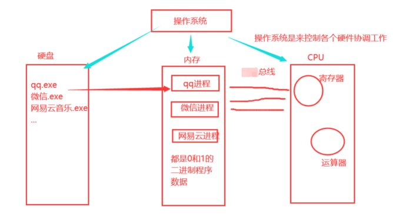

> 第 20 页

CPU是64位的表示CPU寄存器存储的数据和CPU一次性计算的数据大小为64位的二进制数据，既然CPU

能够一次性操作64位的数据，那么数据总线和操作系统也应该按照64位来进行设计，数据总线是CPU去内存中获取数据的电路线，64位地址总线表示的是数据总线一次性传输数据的大小为64位的，而操作操作系统作为各个硬件的控制程序，它应该也要支持64位数据的控制。那么也就是说操作系统能够在内存中找到64位的数据，这个我们叫做系统在内存中的寻址空间，然后数据总线将64位的数据传输给CPU，

CPU正好也可以一次性加工处理64位的数据，这样CPU的使用效率就很高。

操作系统的寻址空间直接决定着所能够支持的最大内存是多少，并且决定着这个系统上可以安装的软件是64位的还是23位的，我们拿64位操作系统来举例，计算机底层存储、加工处理的数据都是二进制数据，0和1，是因为通过0和1这样的二进制方便对应控制电路的低电压和高电压，只要是运行起来进入到内存中的程序都已经是二进制的数据。

32位操作系统所能支持的最大内存为2的32次方。

64位操作系统所能支持的最大内存为2的64次方。

为什么是这样的？64位系统使用64位地址线的最大寻址空间为2的64次方，寻址空间指的是

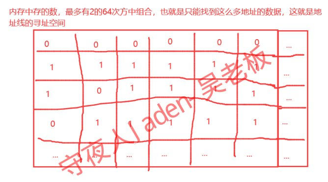

守夜人 Jaden（吴老板）

那么这就决定了按照32位开发的软件，它在内存中可能使用的空间组合是2的32次方，而系统的寻址空间位2的64次方种可能的组合，完全可以涵盖32位的组合，所以对于在内存中的32位的软件程序数据，

操作系统是都可以寻址到对应的数据，反之，如果是32位的操作系统，64位的软件，那么软件需要的可能的存储空间组合为2的64次方，但是系统只能找到2的32次方种可能的空间地址，那么抱歉，系统就无法完成软件的正常寻址空间需求，导致软件不能正常安装和使用。

32位操作系统地址线最大寻址空间为4GB，即便是我们加了8G的内存条，那么也只能用4GB的内存。理论上，64位操作系统的最大寻址空间位2的64次方，大家可以算算可以使用多大的内存。

单位换算：

1bit: 0或者1

1B = 8bit

1KB = 1024B

1MB = 1024KB

1GB = 1024MB

1TB = 1024GB

1PB = 1024TB

我们的计算机是按照B位单位进行数据加工处理和存储的。

> 第 21 页

目前内存分如下几代

内存的代数：内存主频和CPU主频一样，用来表示内存的速度，它代表着该内存所能达到的最高工作频率。内存主频是以MHz（兆赫）为单位来计量的

DDR   133MHZ、266MHz等频率

DDR2  533MHZ、800MHZ等频率

DDR3  1066MHz、1333、1600等频率

DDR4  2400Mhz、2933Mhz、4300MHZ等频率，目前内存的规格主要是DDR4。

DDR5  6400MHz等频率

DDR内存一开始生产出来的时候频率是比较低的，因为当时的CPU频率也低，后来慢慢升级，越来越高。

比如如下主板支持的内存规格中显示的内存描述，主要描述的就是内存频率

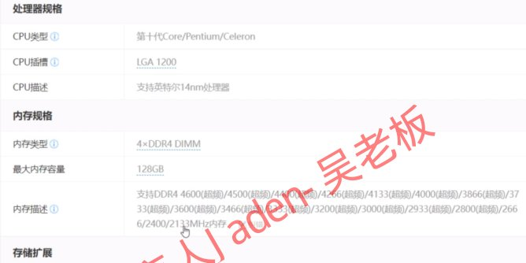

DDR3和DDR4图片对比

守夜人 Jaden（吴老板）

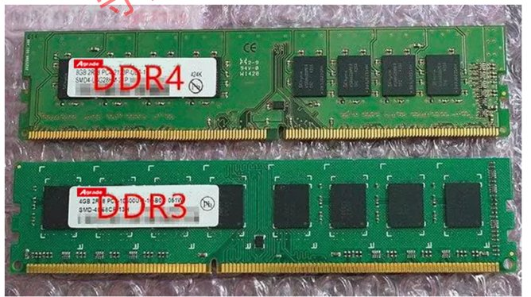

内存厂商：三星、海力士、镁光、凯侠(原来的东芝)、长江等等原厂厂商，还有一些二次加工的厂商，比如金士顿等等好多。原厂生产的内存还是比较好一些的。

> 第 22 页

加内存或者说升级内存的注意问题：

1.买同品牌同型号同频率的、最好还是同电压的，如何知道自己的内存型号：拆机直接看、安装鲁大师软件进行硬件检测。

鲁大师如下，看到内存是海力士DDR4的，DDR4的频率一般不会达到4267MHz的，但是很明显我的超频了，并且显示出了很多个内存插槽通道，说明我的内存是焊死在主板上的，不可以更换。如果你的只看到了ChannelA或者ChannelA和channelB，那么说明你的内存条是可以拆下来更换升级的。

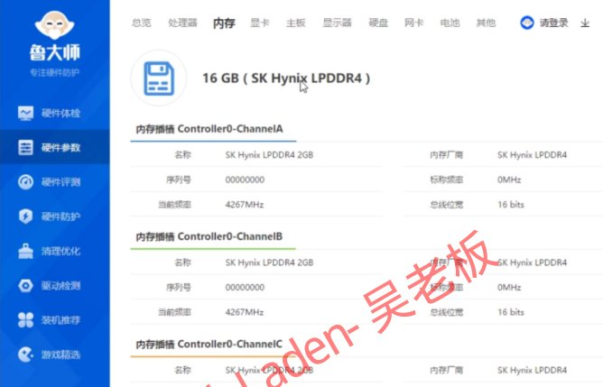

有时候看不到电压，有的可以看到，如下1.1v。不考虑电压的话，很容易蓝屏。

守夜人 Jaden（吴老板）

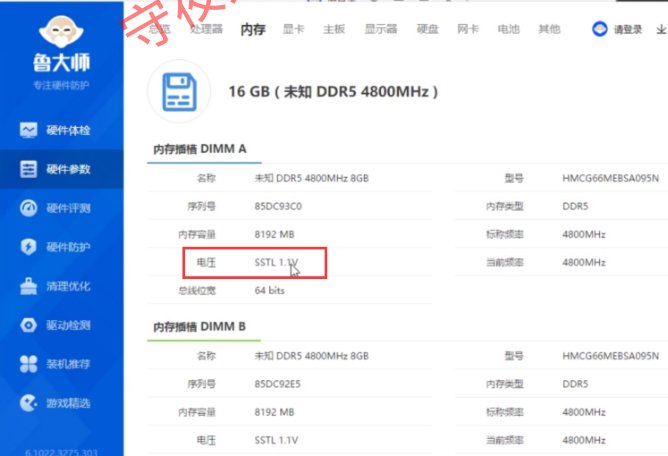

工作电压，点进去可以看到详细电压数：

> 第 23 页

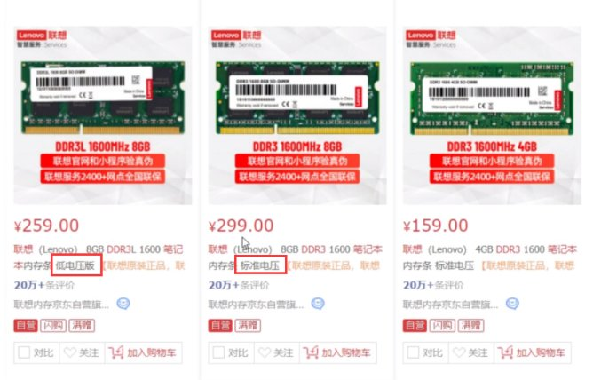

如果我们升级内存时，比如8G升级到16G，可以选择买一个相同的8G的，但是买不到相应的内存怎么办，那就看看能不能找到同型号、同电压的，看看内存颗粒的原厂是不是同一个厂家的。如果还是买不到，那么我直接买一个16G内存条，之前的那个8G的不要了，就不需要考虑什么型号问题了。

### 4.2 内存颗粒

内存颗粒：其实就是内存中的芯片，内存的存储能力就靠它。4G的内存，如果有8个内存颗粒，那么每个内存颗粒的空间大小为4*1024/8=512MB。

金士顿的内存颗粒

守夜人 Jaden（吴老板）

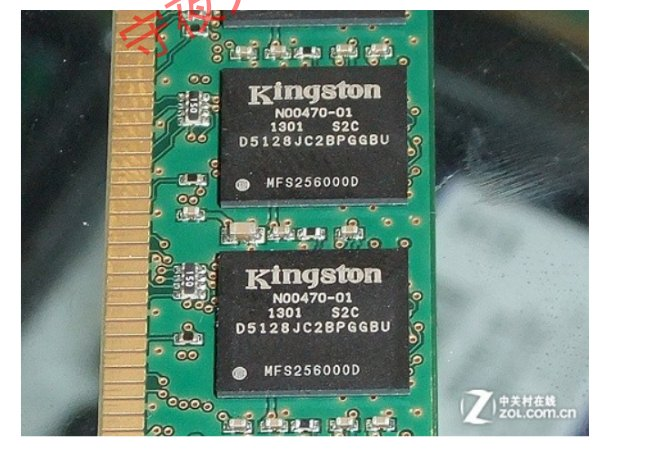

三星的内存颗粒

> 第 24 页

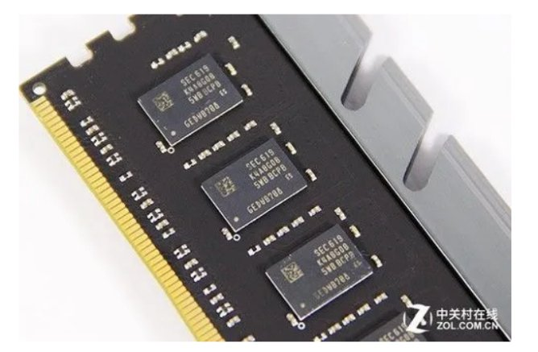

### 4.3 内存双通道技术

当我们有两根内存时，就可以使用到双通道技术，一块数据可以分两部分写入到两个内存中，速度更

快，效率更高

守夜人 Jaden（吴老板）

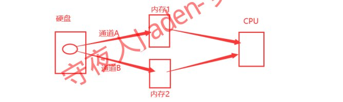

如何知道你的电脑是否支持双通道呢，看下面这个主板的内存插槽

> 第 25 页

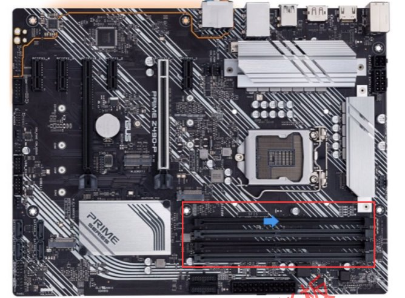

两个灰色的，两个黑色的，两个同颜色的组成双通道，比如两个灰色的就可以组成双通道，比如你插入两根内存条，那么插内存的时候，选择同色的插入。如果是一根内存条，那么随便插。两个双通道叫做四通道，上面这个就支持四通道。但是不管是双通道还是四通道，都要求内存条的容量是相等的。

所以如果说同样16G的内存，两根8G内存条比一根16G内存效率高，但是稳定性差一些，有一个有问题，电脑都容易崩溃。

## 五、硬盘(disk)

守夜人 Jaden（吴老板）

永久存储性设备：电脑硬盘、移动硬盘、U盘、机身内存...

世界第一块硬盘叫做350RAMAC，是1956年诞生的，IBM公司生产的，比冰箱大，1吨重，只有5MB的

容量。

> 第 26 页

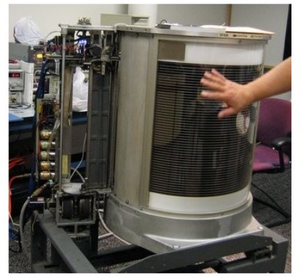

可以清楚的看到一圈圈的盘片，不知道大家小时候有没有听说过或者看到过光盘，这个盘片和光盘很类

似。

### 5.1 机械硬盘(HDD)

机械硬盘(Hard Disk Drive，简称HDD)

守夜人 Jaden（吴老板）

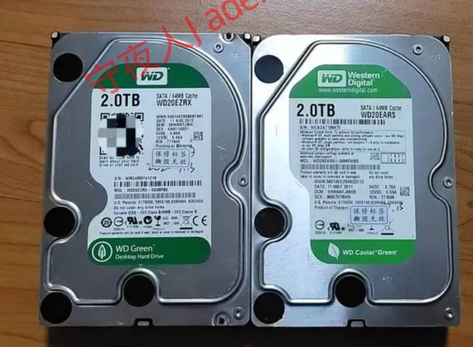

看一下机械硬盘内部结构：

> 第 27 页

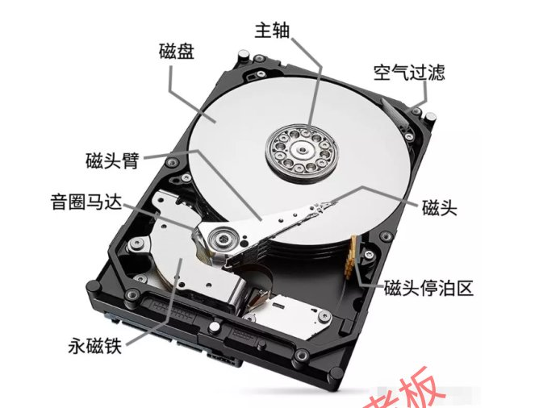

机械硬盘的内部结构主要由马达、磁盘、磁头臂、磁头组成。

守夜人 Jaden（吴老板）

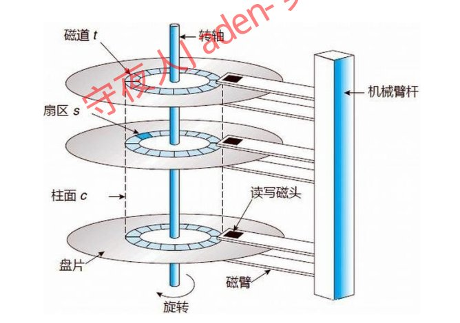

磁盘上是磁性物质，通过磁性物质来进行数据的存储，通过写磁头写入数据，通过读磁头，读取数据。

> 第 28 页

工作原理：

    机械硬盘在工作的时候，磁头会悬浮于磁盘面上方几纳米的距离。磁盘面上有很多的小格子，小格子内有很多的小磁粒。这些磁盘上的磁粒有一定的极性，当磁粒极性朝下的时候记为0，磁粒极性朝上的时候记为1，

这样磁头就可以通过识别磁盘磁粒的极性读取数据了。而磁头也可以利用其变化的磁场改变磁盘磁粒的极性，

这样就做到写入和改写磁盘数据了。

磁盘是密封的，里面一般都是填充氮气，氦气的密度更低，磁盘旋转的阻力更小，磁头可以悬停在盘面上更近的距离，于是就可以在相同的体积的盘腔内，安装更多的盘片和磁头，实现更大的磁盘容量。降低存储成本。磁盘虽然是全密封结构，但是还是难免会有氦气泄漏的问题，氦气盘的质保一般是5年，对于厂家来说，只要5年内，氦气没有漏光就可以。氦气泄漏后，空气会进入，空气进入后，气体的密度增加，影响磁盘的正常运行，氮气泄漏到一定程度后，磁盘会进入写保护的状态，同时磁盘告警，这个时候，只能将磁盘的数据读取出来，抓紧时间进行数据备份。

我们买机械硬盘，他有一些指标，IDC机房

转速：硬盘转速以每分钟多少转来表示，单位表示为RPM

    比如：7200RPM，那么就是一分钟硬盘的转轴可以旋转7200转

    7200转的一般是给台式机安装用的，5400转的一般是给笔记本准备的，因为硬盘转速越快，声音越大，

所以笔记本为了静音，会用转速相对低的硬盘，而台式机一般不考虑这个，因为台式机的CPU风扇、显卡风扇等都会响，不差硬盘这点声音。服务器的专用硬盘一般是10000转、15000转的。

    大小分类：台式机上硬盘为3.5寸，笔记本上是2.5寸

    接口分类：IDE接口、SATA接口、SCSI接口、SAS接口、M.2接口，IDE接口比较老，现在主流硬盘接口为SATA3.0接口，SAS接口主要用在服务器上，普通电脑没有SAS接口，M.2是现在比较新的接口，传输速度比

SATA快很多，SATA接口的传输速度极限也超不过700M/s，M.2接口的速度轻松达到上千M/s，以后M.2接口会成为趋势。IDE接口的只有机械硬盘，SATA接口有机械硬盘、也有固态硬盘，而且IDE接口的硬盘只有3.5

寸的，SATA的是2.5和3.5寸的都有，我们买什么样的硬盘也要看主板上有什么样的接口。M.2接口的只有固态硬盘。

    硬盘传输速度：100M-300M不等，极限的时候一般也超不过300M，而现在固态硬盘轻轻松松就能达到

300M的速度，那么其实你会发现，以前没有固态硬盘的时候你不管买再好的CPU、内存、显卡等，有时候速度，比如开机速度还是提不上去，那就是因为机械硬盘本身的速度就比较低。有了固态硬盘之后，加载速度提升了太多了。

几个接口的简单介绍，参考：https://baijiahao.baidu.com/s?id=1727107686222207048&wfr=spider

守夜人 Jaden（吴老板）

&for=pc

### 5.2 固态硬盘(SSD)

固态硬盘：Solid State Disk或Solid State Drive，简称SSD，原理是电子存贮，将电子通过绝缘层囚禁起来来完成数据的存储，里面用到的是和手机中闪存一样的材质。比机械硬盘更稳定耐用，也更薄，但是

更贵。

> 第 29 页

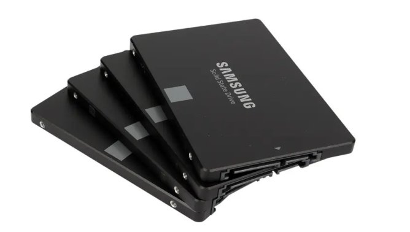

## 六、显卡

### 6.1 显卡说明

守夜人 Jaden（吴老板）

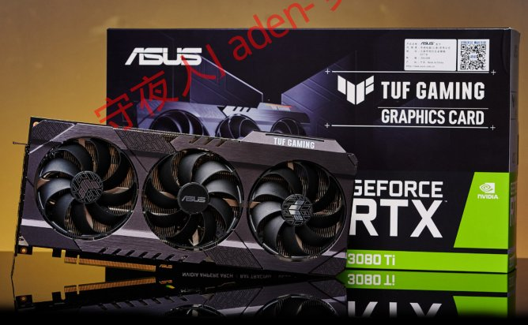

显卡的好坏直接影响画面的流畅度，一般大型游戏都会有一些电脑的推荐配置，里面就会说到显卡。

> 第 30 页

    显卡是个人计算机基础的组成部分之一，将计算机系统需要的显示信息进行转换加工处理并且驱动显示器，并向显示器提供逐行或隔行扫描信号，控制显示器的正确显示，是连接显示器和个人计算机主板的重要组

件.

    显卡又称显示卡(Video card)，是计算机中一个重要的组成部分，承担输出显示图形的任务，对喜欢玩游戏和从事专业图形设计的人来说，显卡非常重要。主流显卡的显示芯片主要由NVIDIA（英伟达）和AMD（超威半导体）两大厂商制造，通常将采用NVIDIA显示芯片的显卡称为N卡，而将采用AMD显示芯片的显卡称为A

卡。现在Intel也开始做显卡了，比如笔记本的有个锐炬显卡就是Intel的、还有arc显卡等。英伟达之前也想进军CPU领域，之前想收购ARM，但是没有收购成功。

    显卡是插在主板上的扩展槽里的（一般是PCI-E插槽，此前还有AGP、PCI、ISA等插槽）。它主要负责把主机向显示器发出的显示信号转化为一般电气信号，使得显示器能明白个人计算机在让它做什么。显卡主要由显卡主板、显示芯片、显示存储器、散热器（散热片、风扇）等部分组成。显卡的主要芯片叫“显示芯片”

（Video chipset，也叫GPU或VPU，图形处理器或视觉处理器），是显卡的主要处理单元。显卡上也有和计算机存储器相似的存储器，称为“显示存储器”，简称显存。

英伟达显卡历史：

    200系列： gt210、gt220...gtx280

    300系列： gt310、gt320...

    ...

    900系列： gt940、gtx950、gtx960...

    1000系列：gt1030、1050...1080、1080ti，ti我们有时候叫做泰坦(titan)，就是加强版的意

思。

    RTX 2000系列：2060、2070、2080...之前是gtx系列，到了2000系列之后叫RTX了，支持光追技

术，让游戏的画面更加逼真。

    RTX 3000系列：3050、3060...3090ti

显卡性能天梯图：https://m.somode.com/course/5620.html?ivk_sa=1024320u，这天梯图里面写的

基本都是台式机的显卡，一般笔记本的显卡型号后面都会带一个M，比如GTX980M，带M的表示这是移动端使用的显卡型号，由于笔记本要考虑散热问题，所有性能比台式机的都要低一些，比如GTX980M和台式机的GTX970性能差不多。

### 6.2 性能参数

守夜人 Jaden（吴老板）

> 第 31 页

显存：

    显存，也被叫做帧缓存，它的作用是用来存储显卡芯片处理过或者即将提取的渲染数据。如同计算机的内存一样，显存是用来存储要处理的图形信息的部件。我们做图像处理、观看视频等一秒24帧(一帧可以理解为一个图片或者说一个静止的画面，通常用fps（Frames Per Second）表示)的频率才能用肉眼看上去比较流畅，但其实现在很多电影一般都不低于每秒30帧，玩游戏的时候也会问多少帧，有的显示器每秒钟最多显示60

帧就打满了，高性能一些的可能能够达到fps90、120等，但是如果只是显卡fps高也不一定就不卡，还要看显示器能支持多大的fps，比如显卡支持90fps，但是显示器只支持60fps，那么就会丢失30帧，看上去画面就卡。比如我的显示器是1080p，显示器所谓的1080P显示是指达到1920×1080的分辨率的显示，是数字电影成像技术和计算机技术的完美融合。还有2k显示器，分辨率为2560*1440，4k的分辨率为4096*2160，还有非标准的分辨率也当作4k，比如3840*1920。分辨率越高的图片，图片的大小越大，占用的空间也会越大，这就是为什么显存的大小一直在增大，有4G、8G、12G、24G等等，那么你玩游戏比如需要fps为90，那么也就是说每秒钟要显示90张图片，这些图片数据要缓存一下的，分辨率要求越高，那么就需要更大的显存空间。买显卡的时候，自己要先把想买的显卡详细型号查一下，别被忽悠了。显存决定最大支持的分辨率。

显存频率：显存频率是指默认情况下,该显存在显卡上工作时的处理数据的频率,以MHz(兆赫兹)为单位。显存频率一定程度上反应着该显存的速度，频率越高，处理速度越快。

显存位宽：位宽就是内存或显存一次能传输的数据量。简单地讲就是一次能传递的数据宽度，就像公路的车道宽度，双向四车道、双向六车道，当然车道越多一次能通过的汽车就越大，所以位宽越大，一次性能舆的数据就越多,对显卡来说对性能的提高很明显。64位、128位、192位、256位、512位等。

显存带宽=显存频率X显存位宽/8，那么在显存频率相当的情况下，显存位宽将决定显存带宽的大小。同样显存频率为500MHz的128位和256位显存，那么它俩的显存带宽将分别为：128位=500MHz*128∕8=8GiB/s，而

256位=500MHz*256∕8=16GiB/s，是128位的2倍，可见显存位宽在显存数据中的重要性。

CUDA核心：显卡内部的处理器，这个数量越多，处理能力越强，显卡越好，4864个

显卡接口：VGA、HDMI、DVI、DP

比如我的显示器分辨率

守夜人 Jaden（吴老板）

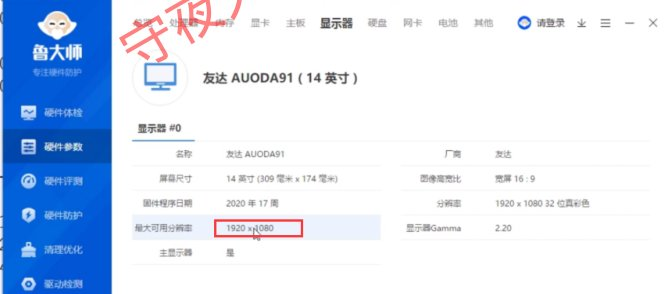

### 6.3 显卡接口类型

也就是我们主板上插显示器的插口，现在最新的电脑基本没有VGA接口了，基本淘汰了。VGA接口接收的模拟信号，HTMI、DP、DVI都是数字信号。

> 第 32 页

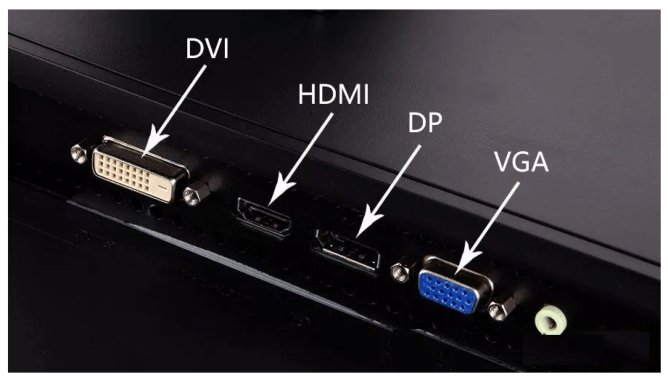

模拟信号和数字信号

模拟信号和数字信号的区别

1、时间连续性不同：

1）模拟信号时间上是连续的；

2）数字信号时间上不是连续的。

2、幅度变化不同：

1）模拟信号指幅度的取值是连续的（幅值可由无限个数值表示）。

2）数字信号指幅度的取值是离散的，幅值表示被限制在有限个数值之内。

3、信号传输方式不同：

1）模拟信号是用模拟量的电压或电流来表示的电视信号；

2）数字信号是通过0和1的数字串所构成的数字流来传输的。

4、保密性不同：

守夜人 Jaden（吴老板）

1）模拟信号的微波通信和有线明线通信，很容易被窃听。只要收到模拟信号，就容易得到通信内容。

2）数字信号保密性较强，语音信号可以先进行加密处理，再进行传输，在接收端解密后再变换还原成模拟信

号。

模拟信号特点：其精确的分辨率，在理想情况下，它具有无穷大的分辨率；当达到相同的效果，模拟信号处理比数字信号处理更简单。

数字信号特点：抗干扰能力强、无噪声积累。

## 七、主板

> 第 33 页

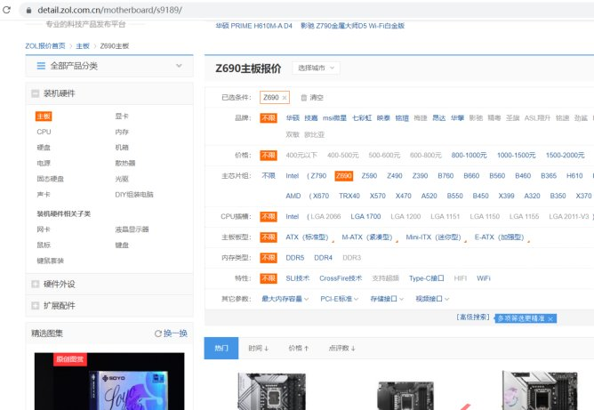

CPU是电脑的核心，主板是电脑的框架或者说总管，所有的电脑元件都是通过它来进行联通的，主板上有很多的接口，硬件直接插到接口上来进行使用。

守夜人 Jaden（吴老板）

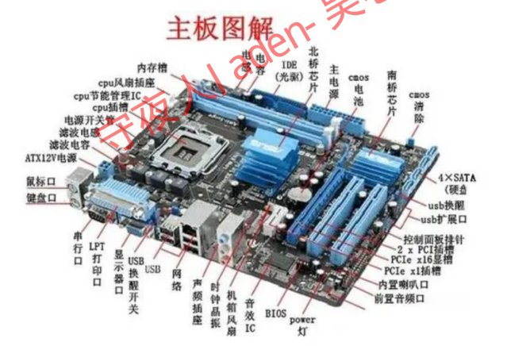

生成主板的厂商有很多，主板要和CPU接口类型一致，不然CPU不能用，所以每当Intel发布一款新的

CPU之后，很多下游主板厂商都会抢着生产对应的主板。主板也分档次：高端、中端、低端。比如Z690

等Z系列的属于高端、B660等B系列的属于中端、H610等H系列的属于低端的，这些是Intel划分出来的，然后各个厂商按照这个档次来进行生产。越高端的板子可以使用的功能越多，同功能的性能越好，

扩展性也好，比如插槽多、网卡支持的带宽高、最大支持的内存容量也大等等，我们一般都会选择中端

B系列，性价比相对好一些。

> 第 34 页

intel: 对应的主板厂商：华硕、技嘉、七彩虹、微星、铭瑄、盈通、昂达等等

AMD:  对应的主板厂商：华硕、技嘉、七彩虹、微星、铭瑄、盈通、昂达等等

结实耐用的话首选华硕，但是相对贵，如果考虑性价比，就用其他几个的

CPU插槽：插槽是按照CPU的针脚来的，也分很多代，intel基本上两代换一个插槽，比如LGA1700是针对12代处理器的，LGA1200是针对10和11代处理的。如果我们的电脑出版坏了，CPU挺不错，那么就可以换一个主板即可，但是主板也是要针对CPU的版本来。

支持的内存类型：主板支持什么样的内存类型，你买对应内存时，也要对应好类型，内存类型目前主要有DDR3、DDR4、DDR5三种。

主板支持的内存容量主要是看CPU和主板插槽的数量。

主板支持的显卡数量，比如支持插入两块显卡，那么比一块显卡的效率就高一些，大概能提升60%，两个显卡配合使用，我们称之为交火(CrossFire)。不是说随便两个显卡就能交火，这个要看显卡是否支持。双显卡适合打大型游戏的朋友。

## 八、其他设备

电源：这个主要看CPU的功耗和显卡的功耗，其他的部件功耗比较低，CPU功耗+显卡功耗 < 电源瓦数还有一些其他部件，比如主机箱、键鼠、键盘、显示器、声卡、网卡等就先不多提了。

功耗我们可以通过鲁大师等工具来进行计算

守夜人 Jaden（吴老板）

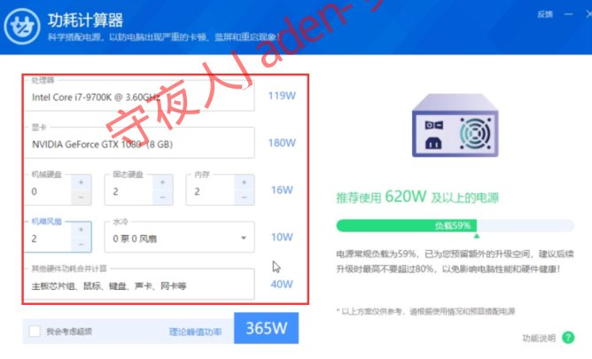

## 九、计算机分类

> 第 35 页

### 9.1 按照性能和用途分类

计算机目前分为巨型机、大型机、小型机、微型机

1、巨型机：也叫超算，即超级计算机，采用大规模并行处理的体系结构，是运算速度最快、体积最大、价格最昂贵的主机，主要用于尖端科学研究领域，比如灾难预测、天气预报、军事等等。中国有银河II、神威的太湖之光等，太湖之光有40个计算机仓，每个机舱包含1024颗处理器，共40960个神威CPU。

2、大型机：是指运算速度快、处理能力强、存储容量大、功能完善的计算机，多采用对称多处理器结构，有数十个处理器。比如IBM z15 大型机。

3、小型机：是一种供部门使用的计算机，规模较小、结构简单、成本较低、操作简便、维护容易，能满足部门的要求，可供中小企事业单位使用。比如IBM的小型机，这个小机的小是相对于巨型机和大型机对比来说的，

实际上也不是很小昂。

4、微型计算机：又称为个人电脑或微型计算机。这类计算机面向个人、家庭、学校等，应用十分广泛。它由微处理器、半导体存储器和输入输出接口等芯片组成，因此其体积更小、价格更低、通用性更强、可靠性更高、

使用更加方便。比如台式机、笔记本、智能手机等

按照功能来分类：

    服务器：它并不代表计算机的一种类型,小型机、微机都可以作为服务器来使用。如果硬要说的话pc服务器属于微型计算机。比如dell的R740服务器。

    工作站：20世纪70年代后期出现的一种新塑的计算机系统，配有大屏幕显示器和大容量存储器，有较强的网络通信能力，主要适用于CAD/CAM和办公自动化等领域，如美国SUN公司的SUN-3、SUN-4，还有联想的

ThinkStation，还有戴尔的一些工作站，还有苹果的mac studio工作站等等，现在在视频剪辑领域会有一些人在使用，不适用于玩游戏，适用于办公。

    信息设备：它们是便携式设备，旨在执行一组有限的任务，如基本计算、播放多媒体、浏览互联网等。它们通常被称为移动设备。它们的内存和灵活性非常有限，通常按“原样”运行。

    嵌入式计算机：它们是用于其他机器以满足有限需求的计算设备。它们遵循非易失性存储器的指令，不需要执行重启或重置。此类设备中使用的处理单元仅满足这些基本要求，并且与个人计算机中使用的处理单元不同 - 更为人所知的是工作站。

### 9.2 服务器

守夜人 Jaden（吴老板）

有些大一点的服务器，长度、宽度会都大一些。下面这个图片可以看到，有8个硬盘插槽，可以插8块硬盘，有些可以插的更多。

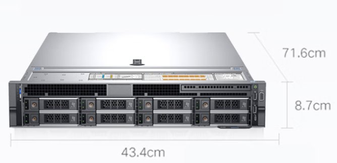

> 第 36 页

再看内部，服务器一般有两颗CPU，有的甚至有4个CPU，是专用CPU，和个人电脑的CPU不同，也不是按照什么i7、i9来分的，服务器的CPU性能更高、更贵，比如Intel的至强CPU、AMD的锐龙CPU等，有些服务器可以有18个内存插槽，如果每个内存条为16G，那么18*16=288G运行内存，有些最新的服务器甚至能够支持1TB的运行内存。服务器使用的是ECC内存和我们个人使用的普通电脑的内存不同，ECC

内存条有纠错功能，它添置ECC错误校验技术，经过错误校验、纠正，可以有效的保证服务器系统的稳定性和可靠性。而普通内存条不配备校正错误技术，因此字检测到错误时，并不能确定错误位置，也无法修正错误。

我们普通电脑都是单路的，一个电源接口，服务器一般都是双路电源，两个电源接口，一个接国家电网的电路，另一个接备用电源的电路，这样如果国家电网停电了，另外一个接口的电源能够立马接上使用，让服务器可以一直运行。服务器都是按照长期稳定运行来设计的。服务器一般有更高的性能、更高的稳定性、功耗大、噪音大，好多公司都会把服务器放到专门的IDC机房去管理，机房里面说话的时候要声音很大，要不听不到。

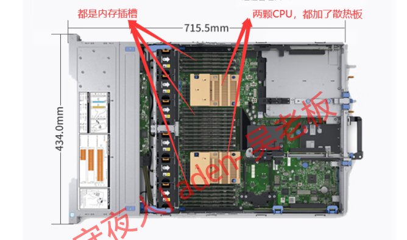

守夜人 Jaden（吴老板）

> 第 37 页

守夜人 Jaden（吴老板）
