# 安装操作系统

来源 PDF：安装操作系统.pdf（原文件位于课程目录，本文件夹不包含 PDF）

> 第 1 页

安装操作系统(守夜人 Jaden（吴老板）)

## 一、操作系统简单介绍

何为操作系统呢？前面我们学习了计算机的基础硬件组成，而这些硬件按照标准流程来配合工作是需要依赖一个控制程序来控制的，这个控制程序就是我们的操作系统，所以操作系统本身就是程序员开发的一套程序软件，这个软件的主要功能就是控制硬件工作，但是随着技术的进步，现在的操作系统不仅仅可以控制硬件的工作，还可以做很多其他的事情，这些功能后面我们会陆续的学习，现在主流的操作系统有这么几个主要分支：windows、linux、macos等，windows是微软研发的，也是我们普通人常用的一个操作系统，因为它操作简单，有桌面，提供的功能多，因为windows历史比较悠久，很多工具只有在windows上才能安装使用，但是正版系统是收费的。而linux操作系统操作复杂，但是性能和稳定性更优，并且开源免费，主要是企业在使用，而且需要一些专业人士才可以操作，主要以命令行的形式进行控制操作，当然，linux现在也都有桌面版的，但是相比windows，linux的桌面版入场比较晚，所以普通人还是更多使用windows系统。macos和linux的前身都是一个叫做unix的系统核心，所以他们操作是差不多的，mac电脑性能也很优质，很多普通人也在用，不过就是比较贵。企业用linux居多、然后是

windows、mac用的很少，所以我们主要讲解的就是windows和linux。

我们想学习一下操作系统的知识，首先要学会自己安装操作系统，安装上之后才可以对操作系统进行各种操作和学习，操作系统是软件，叫做系统软件，是电脑的灵魂，没有它，电脑就是一堆废铜烂铁，有了操作系统，这些硬件才能协调工作，有了操作系统，才可以安装其他的应用软件(qq、微信、各种影音软件、游戏等)。关于操作系统的发展和原理，我稍后给大家讲解，先来看看如何安装。

## 二、光盘安装

这种方式由于比较麻烦、速度又慢等原因基本上淘汰了，我们自己的物理机，也就是你自己的电脑本机的系统，一般都不会使用光盘安装这种方式了，下面就是我们给自己当前的物理机，也就是你当前的电脑通过光盘安装系统或者重装系统的时候的操作步骤，如下：

### 1、真机光盘安装系统

守夜人 Jaden（吴老板）

1.1 下载iso系统镜像文件

.iso是电脑上光盘镜像（CD Mirror）的存储格式之一，因为其是根据ISO-9660国际标准规范有关CD-

ROM文件系统标准存储的文件，所以通常在电脑中以后缀.iso命名，俗称iso镜像文件。它形式上只有一个文件，可以真实反映光盘的内容，可由刻录软件或者镜像文件制作工具创建。

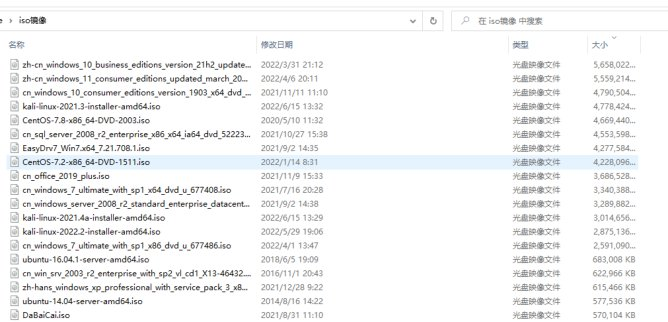

> 第 2 页

1.2 将iso文件刻录到光盘，做成系统安装光盘

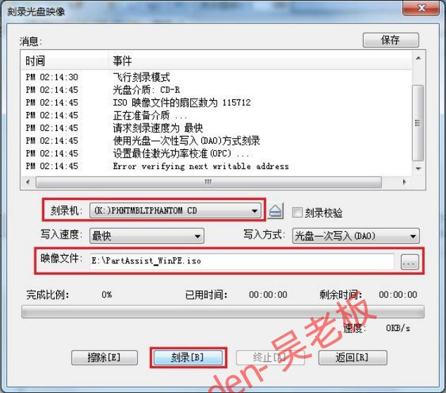

1.3 放入安装光盘

守夜人 Jaden（吴老板）

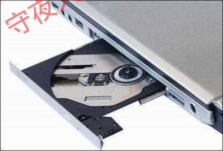

1.4 修改BIOS光盘优先启动

> 第 3 页

BIOS是个很小的操作系统，电脑开机的时候，首先加载运行的就是BIOS这个系统，然后BIOS系统会引导你的

操作系统(windows\mac\linux等)的启动运行，BIOS是英文"Basic Input Output System"的缩略

词，直译过来后中文名称就是"基本输入输出系统"。它保存着计算机最重要的基本输入输出的程序、开机后自检程序和系统自启动程序，其主要功能是为计算机提供最底层的、最直接的硬件设置和控制。

自检程序：自动检测电源、显卡、内存、硬盘、CPU等等各类硬件的完整性和正确性等。

如何进入BIOS系统界面？参考：

    https://www.xitongcheng.com/jiaocheng/win10_article_77088.html

    https://www.hwips.com/4910.html

下面看一个bios的图，注意，不同电脑，bios界面都是有些差异的，但是基本功能都是还是相同的。

守夜人 Jaden（吴老板）

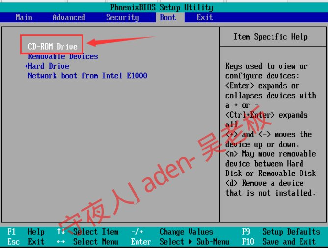

上面这个Boot部分就是启动项部分，后面操作系统到底从哪里启动安装是根据bios的启动项设置有关系

的

CD-ROM Drive：表示光盘启动系统

Kemovable Devices：表示移动设备启动，也就是我们的U盘或者移动硬盘等

Hard Drive： 表示硬盘启动，也就是从电脑本上的硬盘上来启动操作系统，这个选项前面有个*，表示现在

设置的是硬盘启动方式

Network boot from InTel E1000：表示通过网卡启动系统，很多网吧都是通过网卡来启动系统的

Bios启动系统的时候，会根据我们自己设置的启动项位置来启动，如果我们设置的位置没有操作系统文件，那么它会按照设备的优先级来挨个尝试启动，比如上面这个的优先级是光盘启动--U盘启动--硬盘启动--网卡启

动。

> 第 4 页

1.5 安装系统

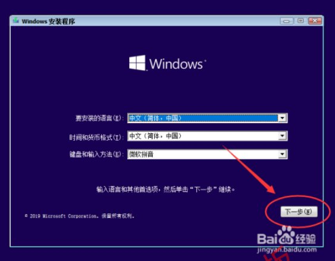

1.6 系统初始化设置

守夜人 Jaden（吴老板）

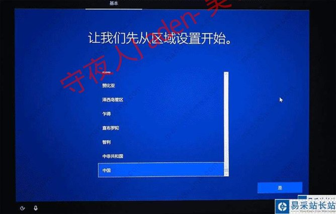

虽然这种方式在物理机上安装系统时已经基本淘汰了，但是安装虚拟机系统我们一般采用的是光盘安

装，所以我们就通过虚拟机的安装过程来演示一下这种光盘安装的方式。

> 第 5 页

### 2、虚拟机光盘安装系统

2.1 安装vmware workstation pro

有时候我们做一些操作不方便在我们自己的电脑上直接搞，比如学习如何重装系统这个事情，如果我用我的物理机真机来搞的话，我就没办法录频了，这样大家学习的时候也看不到，但是我还只有一个电脑，这怎么办，那么我们可以在我们自己的电脑上虚拟出来几个相同的电脑，在虚拟出来的电脑上来玩，又不耽误物理机本机的使用，又可以进行系统安装的学习，后面我们很多安全靶场环境也会用虚拟机来玩，那么在windows上，我们就可以用这个vmware工具来进行虚拟机创建，这个软件可以让我们在windows电脑上虚拟出来好多个电脑，供我们学习、工作的时候使用，如果你是mac电脑，你可以安装VMware fusion或者Parallels Desktop这两款软件来进行虚拟机的安装。

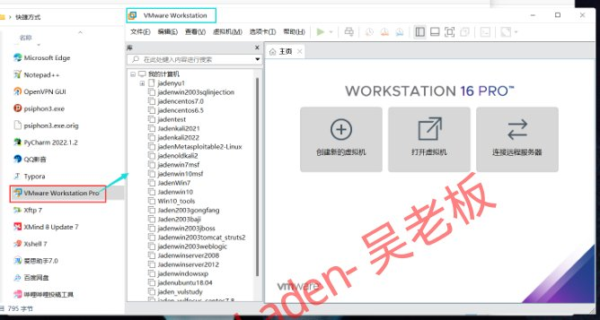

大家可以自行去百度下载这个工具，我也给大家提供好了

守夜人 Jaden（吴老板）

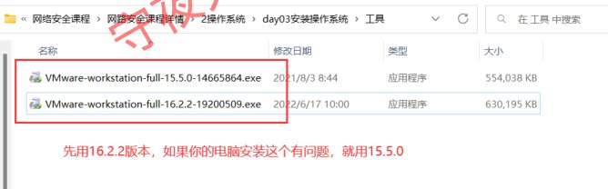

关于这个工具的安装，请查看我给大家提供的安装教程，里面就有Wmware workstation的安装，只写

了windows系统的，mac系统的大家百度一下，有很多教程，比如：https://juejin.cn/post/691001813

4191636488

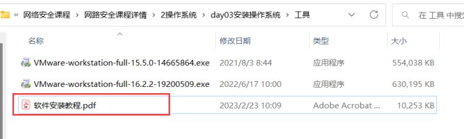

> 第 6 页

2.2 创建虚拟机并安装系统

创建虚拟机就是通过技术手段，在我们自己的物理机上虚拟出来几个电脑，并安装上想要的操作系统。

关于虚拟电脑的说明，看图：

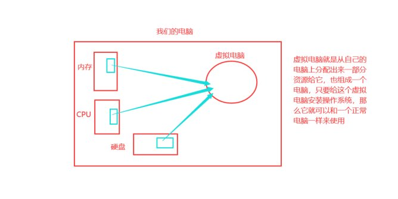

这个直接按照我的文档来进行安装即可，我们演示其中一个，剩下的安装过程都是一样的，大家自行安

装。

守夜人 Jaden（吴老板）

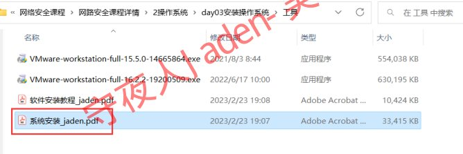

## 三、U盘安装

我们这里就先演示一下windows系统的安装方式。

U盘安装系统的这种方式用的比较多，最常见的是通过pe微系统来进行系统的安装，pe是一个专门的系统，这个系统的功能主要就是给电脑安装操作系统，比如我们有些同学可能知道的老毛桃、大白菜等，

但是这几款pe安装的系统经常是会自带一些额外的软件，比如装好系统后经常弹出广告、安装系统之后直接就装上了360全家桶(360浏览器、安全卫士等等软件)，比较让人讨厌，这里我推荐两个：

pe下载地址1：微PE工具箱：https://www.wepe.com.cn/download.html

pe下载地址2：优启通：https://www.itsk.com/thread-421538-1-1.html

> 第 7 页

### 1、把U盘制作成启动盘

就是把pe刻录到U盘里面，U盘刚开始最好是空白的，里面没有其他的内容，重要的内容自行先保存到其他地方，不然会丢失的。我们用上面的其中一个pe来做演示，比如就第一个微pe工具箱吧。

1.1 下载pe工具

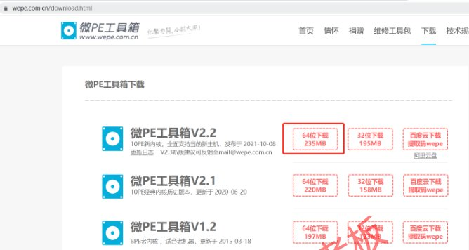

1.2 格式化U盘

先将U盘格式化一下，清空里面的内容，如果你U盘中有重要的东西，我们可以提前保存到其他的地方昂守夜人 Jaden（吴老板）

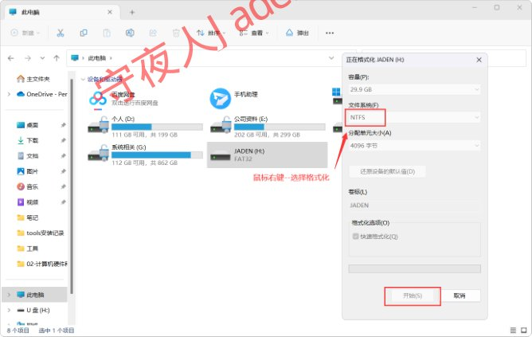

 格式化之后，就跟一个新买的U盘是一样的。

> 第 8 页

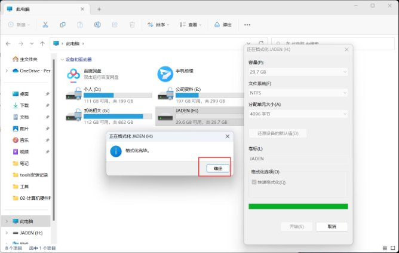

格式化完毕。

1.3 安装pe到U盘中

守夜人 Jaden（吴老板）

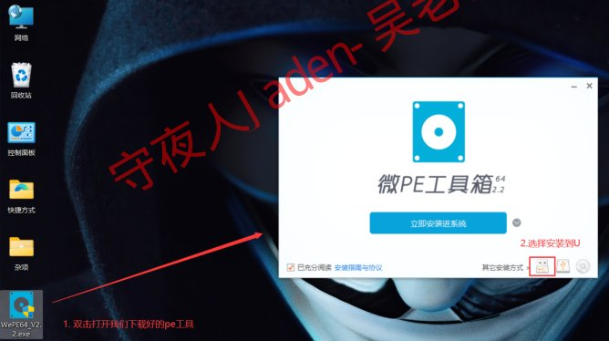

选中好对应的u盘，然后点击安装即可

> 第 9 页

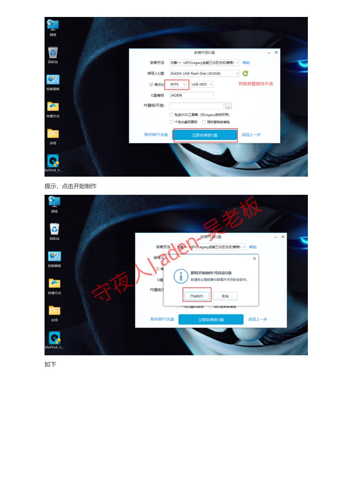

> 第 10 页

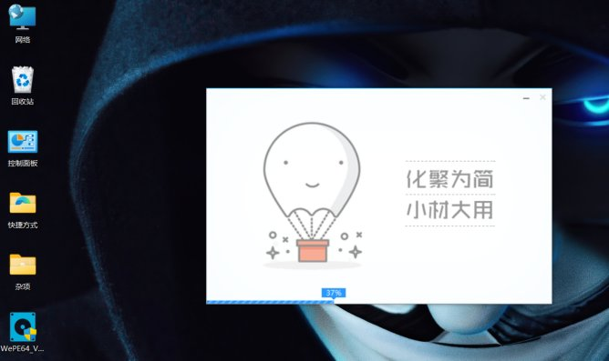

等待一会后，看到如下效果

守夜人 Jaden（吴老板）

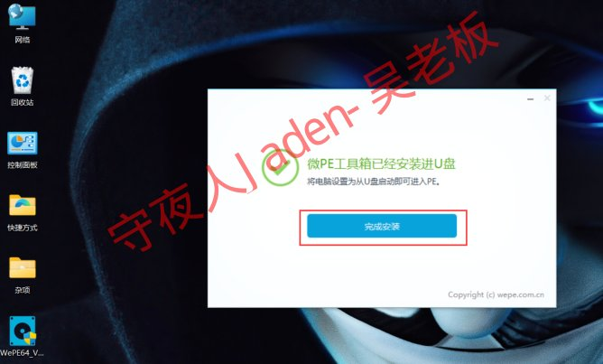

然后我们可以查看一下，U盘发生了什么变化，打开计算机管理

> 第 11 页

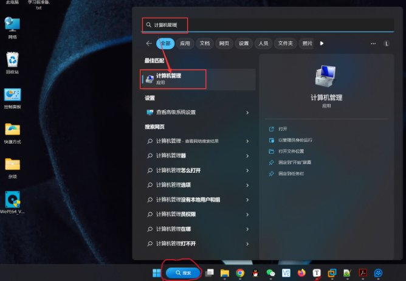

找到磁盘管理，可以看到我们这个U盘被分成了两个区，有的人可能看到自己的被分成了三个区，没

事，效果是一样的，如下：

守夜人 Jaden（吴老板）

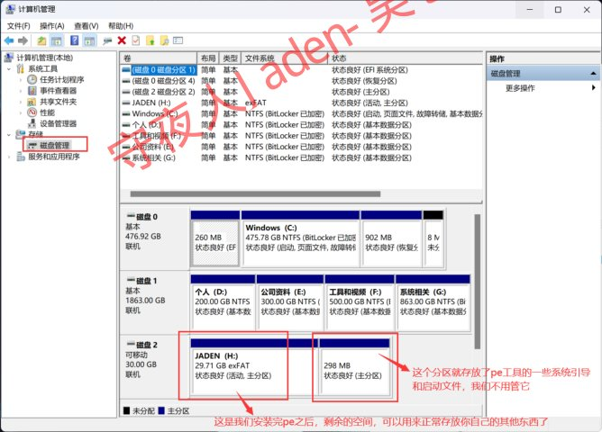

到这里我们的pe启动盘就做好了。我们这个制作pe启动盘的过程叫做一键制作启动U盘。

> 第 12 页

1.4 下载ISO镜像文件

下载windows系统iso：https://msdn.itellyou.cn/，大家可以在网站中下载，或者找吴老板要一下百度

网盘连接地址，各种系统的ISO镜像文件，我都给大家准备好了。

ed2k://|file|zh-

cn_windows_11_business_editions_version_22h2_updated_feb_2023_x64_dvd_632649a2.i

so|5644044288|8C21F04E76174F373B0E5BF19E42C4AB|/

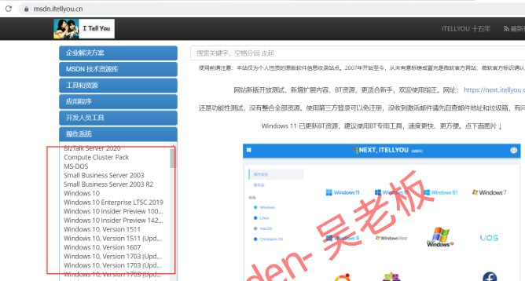

注意：我们给某个电脑安装操作系统，并不是随随便便就安装的，系统和硬件要对应的上才可以，可以说操作系统和硬件是捆绑的，比如现在比较新的硬件就没有办法安装比较老的系统，比如windows xp，

因为没有xp上没有这些硬件对应的驱动程序，是不能调用这些硬件的。包括win7，现在很多新的硬件在

win7上也识别不出来了，官网在2020年已经对win7停止支持了，也就是新硬件不在支持win7了。现在守夜人 Jaden（吴老板）安装windows的系统最少都是win10系统起步了。并且我测试了一下，如果你的cpu是12代的，那么需要搭配win11才好用。不过还好的是，windows系统安装方法都是一样的。

我们想安装什么操作系统，如果不知道自己的硬件是否支持的话，可以查一下，比如安装win11的硬件

要求是什么：https://www.knowbaike.com/it/27394.html

windows有两个下载版本

business editions: 商业版本  面向企业的，这里面包含企业版、专业版

consumer editions: 消费者版本   面向个人的，这里面包含家庭版，我们下载这个版本来玩一下系统安

装即可

比如我们点击上面网站https://next.itellyou.cn中的win11，如图

> 第 13 页

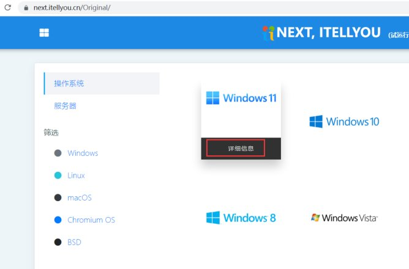

看到如下内容

守夜人 Jaden（吴老板）

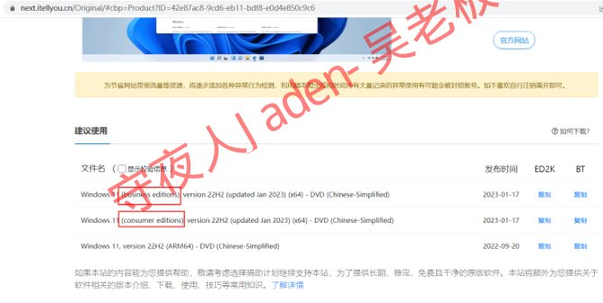

我们买的电脑，如果是自带windows系统的话，一般都是家庭版的，因为家庭版最便宜。关于企业版、

专业版、家庭版等到底多少钱，大家可以查一下。我们一般都不花钱来装这些系统，后面教大家办法。

上面这些版本我们看到下载的地方都是复制链接地址，复制完连接地址之后，可以用迅雷来进行下载。

> 第 14 页

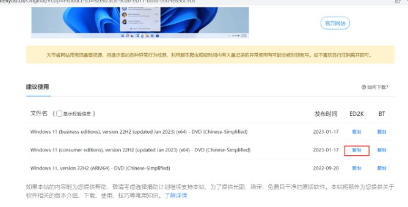

把复制的地址放到迅雷上下载，一般你打开迅雷之后，一你点击复制，迅雷会自动添加这个下载连接地

址。

守夜人 Jaden（吴老板）

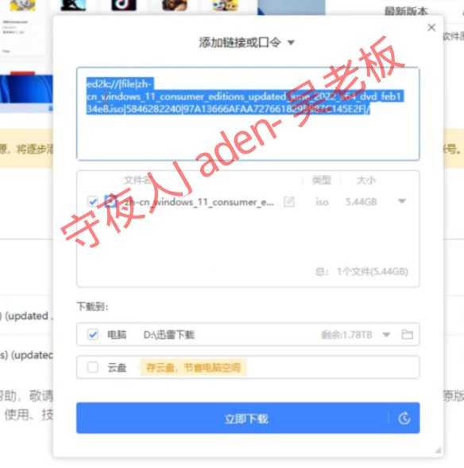

这里我就不下载了，只是跟大家说一下，大家以后自己下载系统的时候可以这么搞。我已经给大家准备

好了：

> 第 15 页

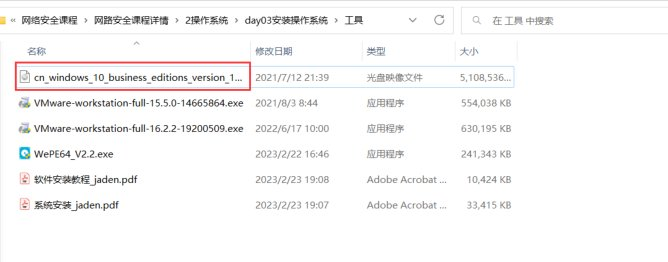

1.5 把系统iso镜像文件复制到U盘中

我们装一下win10的系统吧。先把我们下载的ios镜像文件放到u盘中。

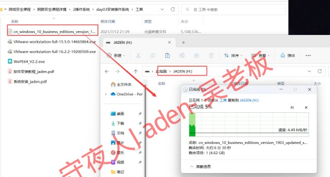

守夜人 Jaden（吴老板）

拷贝完成

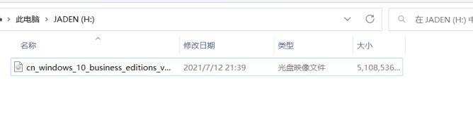

然后U盘继续插在我们的电脑上，我们先通过虚拟机来演示一下pe装系统。关于真机pe装系统，我单独在给大家录制一个视频，有需要的再按照安装或者重装系统，不需要的就看看即可。

### 2、创建虚拟机

首先我们先去创建一个文件夹，存放我们安装虚拟机时产生的各类文件。如图

> 第 16 页

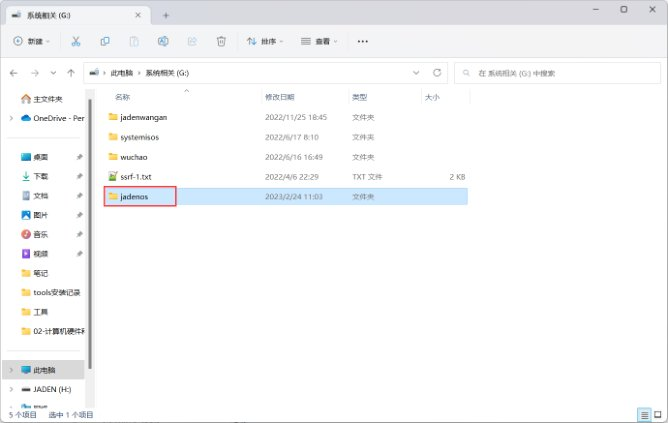

其实每个虚拟机都应该单独给一个目录文件夹，这样方便我们管理。

接下来我们打开Vmware，创建虚拟机：

守夜人 Jaden（吴老板）

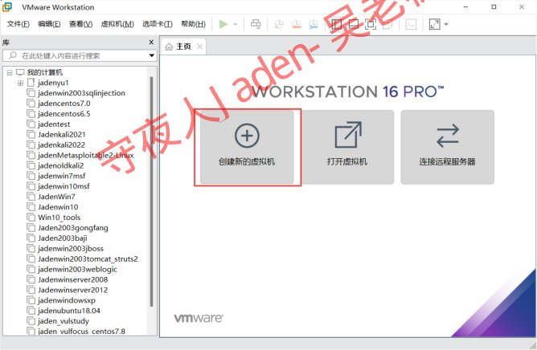

如下

> 第 17 页

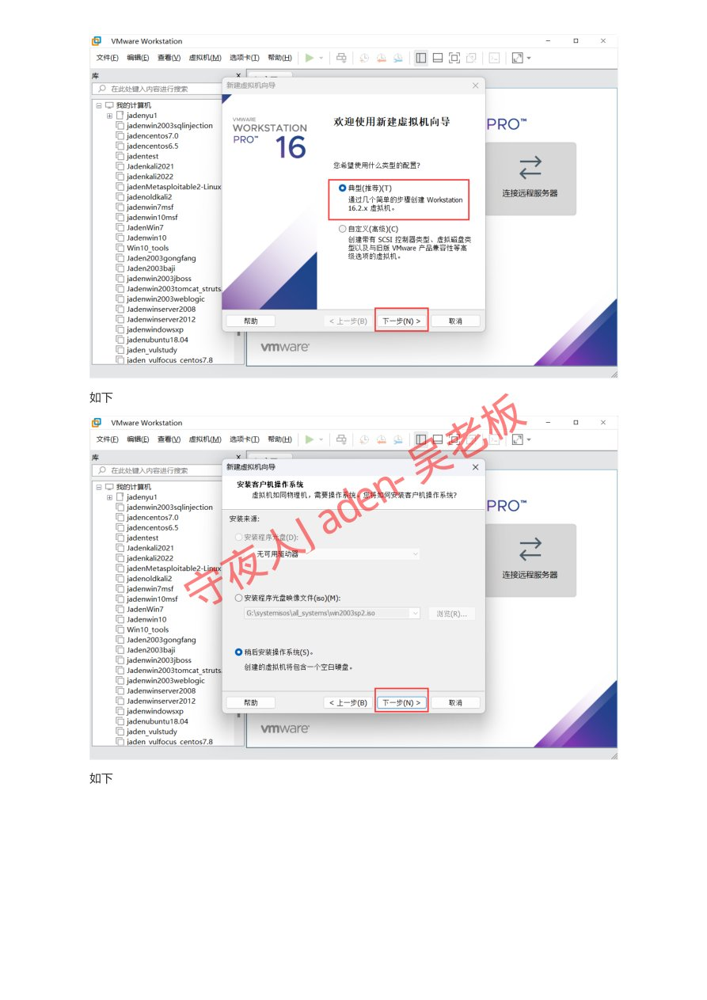

> 第 18 页

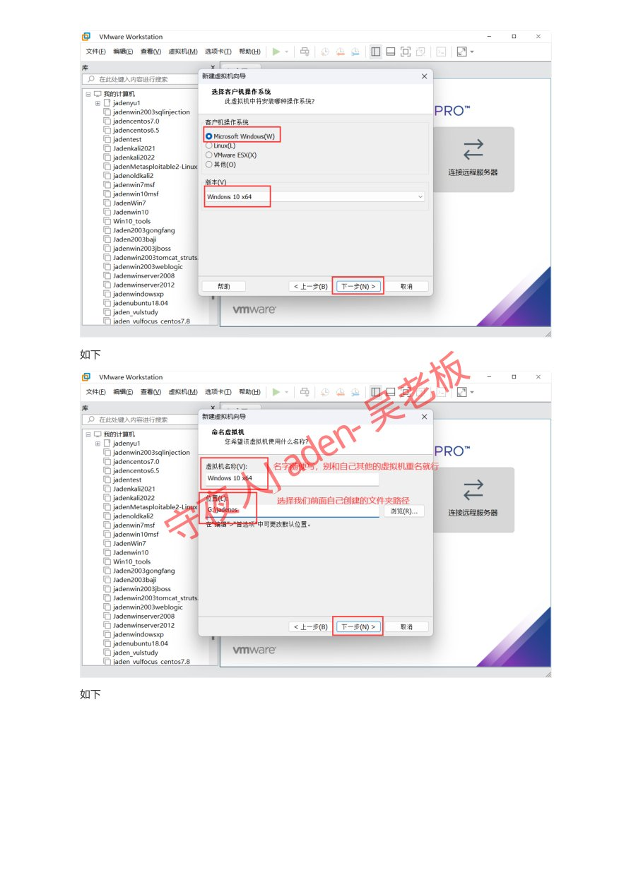

> 第 19 页

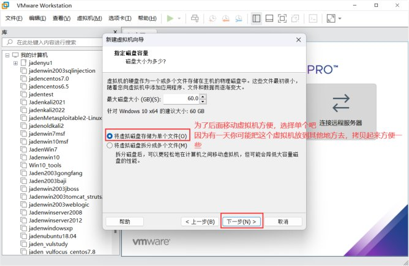

如下

守夜人 Jaden（吴老板）

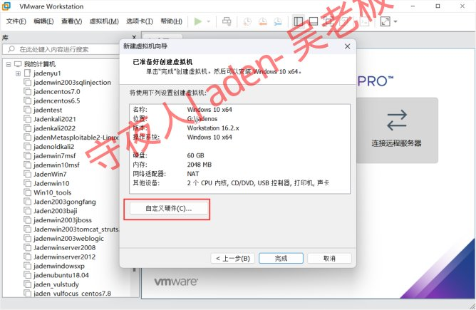

如下，为了说明我们不是光盘安装，而是pe安装的方式，我们先把虚拟机的CD盘的硬件删除掉

> 第 20 页

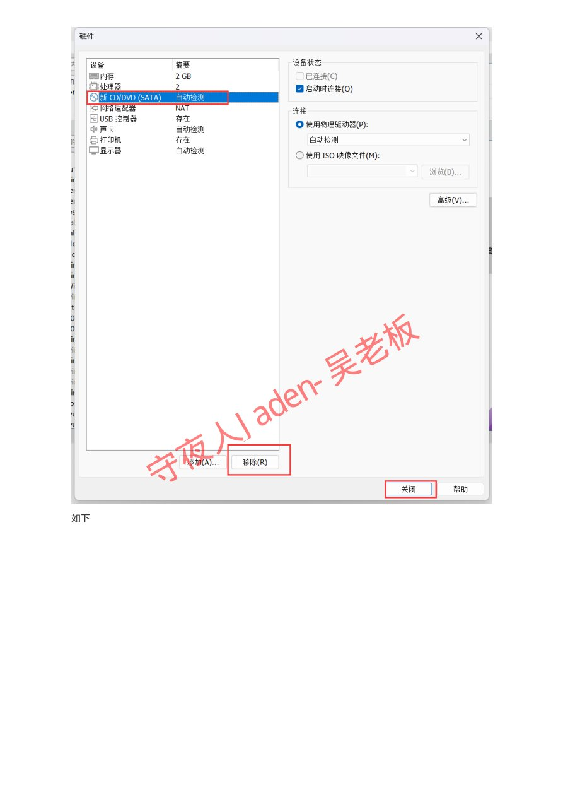

> 第 21 页

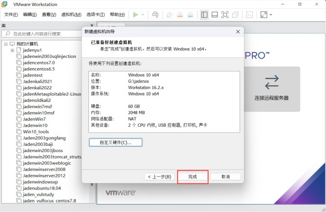

如下

守夜人 Jaden（吴老板）

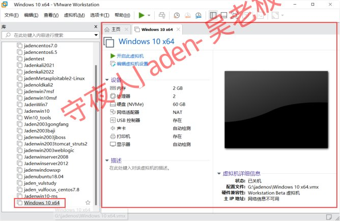

这就表示虚拟机新建完成，接下来安装操作系统。

### 3、修改bios设置U盘启动

任何电脑刚开始即便是没有安装操作系统的时候，都是可以进入BIOS的，那么接下来，我们先进入到虚拟机的BIOS中，不同牌子的电脑进入bios的方法不同，大家自行查阅。

找到虚拟机-->电源-->选择打开电源时进入固件

> 第 22 页

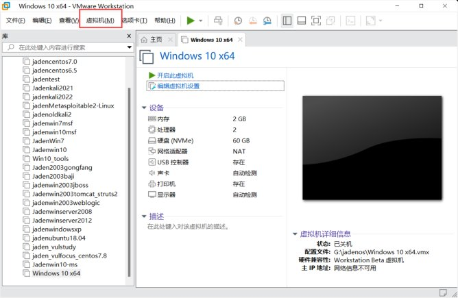

可能会弹出如下提示

守夜人 Jaden（吴老板）

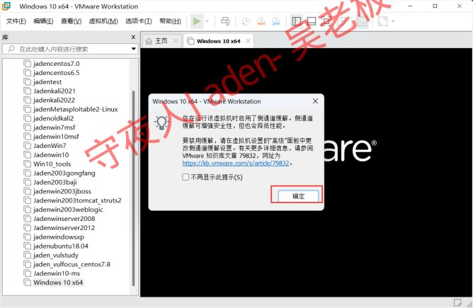

点击确定之后，就看到如下效果，这就进入bios了。

> 第 23 页

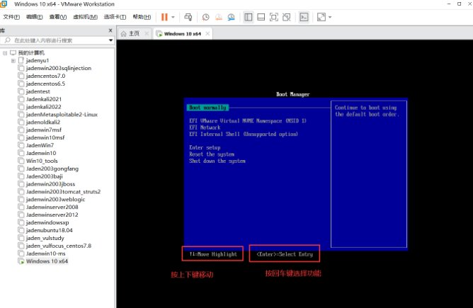

接下来我们插入U盘，其实刚刚我的U盘一直插在电脑上呢，现在通过我们制作的pe U盘对用虚拟机来安装系统。首先将U盘连接到虚拟机上来。

守夜人 Jaden（吴老板）

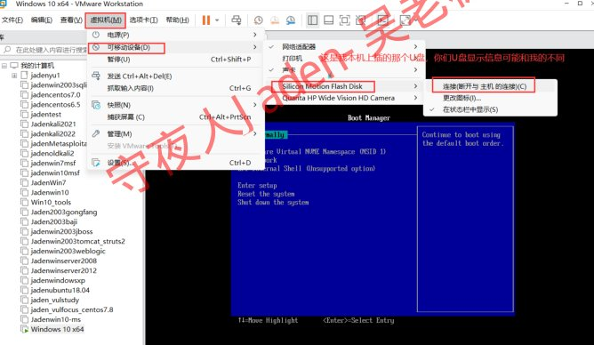

如下，有一些提示，点击确定即可

> 第 24 页

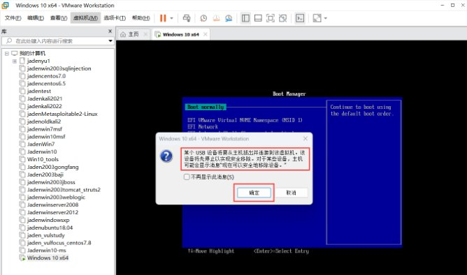

如下

守夜人 Jaden（吴老板）

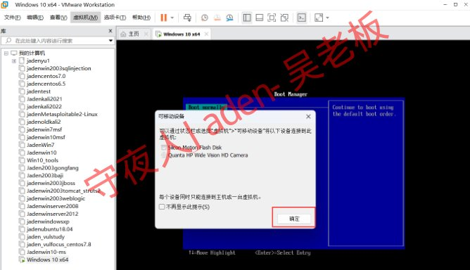

这就可以了，可以在如下地方，看到U盘前面多了一个对勾符号，表示你的U盘连接到虚拟机上了。

> 第 25 页

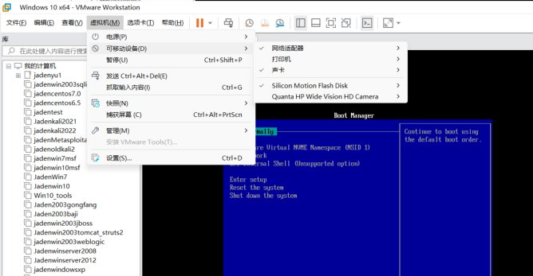

接下来，我们通过bios直接重启系统应该就可以自动通过U盘启动了，我们先重启，如下

守夜人 Jaden（吴老板）

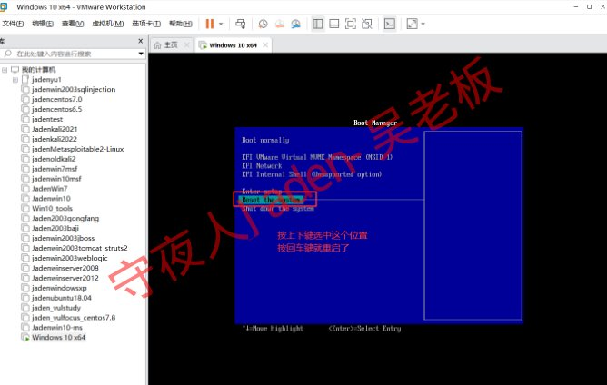

如下，需要等待一会，然后就看到如下界面了，等待的时间长短和你的U盘的读写性能有关系，因为我们安装系统，相当于把U盘中那个iso镜像文件拷贝到我们虚拟机的硬盘上，U盘性能越好，读取速度就越快，不过这个不用着急，等一会就好。

> 第 26 页

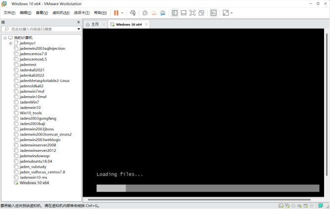

这就是自动加载U盘启动了，等待一会后看到如下效果

守夜人 Jaden（吴老板）

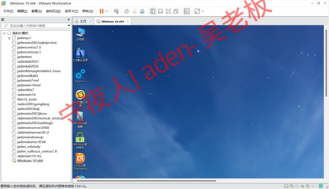

看到上面的图，就表示我们进入pe系统了，看起来和win10很像，但不是win10昂，这是用来装系统的一个小系统，这个pe系统的分辨率比较大，所以窗口会突然变的很大，我们把窗口拉小一些，两边会出现滚动条。

### 4、在PE中安装系统

PE装好之后，接下来我们要安装win10操作系统了，首先进行磁盘分区，因为安装的win10系统，要安装到我们的硬盘中，需要先把硬盘给它划分出来。有些人买的电脑只有一个C盘，有的人买的电脑有C、

D、E等盘符，这个就看我们买电脑的时候，帮你安装操作系统之前,商家给你怎么划分了，这个买的时候也可以和商家提，或者先一个分区，然后安装完操作系统之后，买回来之后自行再分区。

打开我的电脑看一下磁盘分区，如下

> 第 27 页

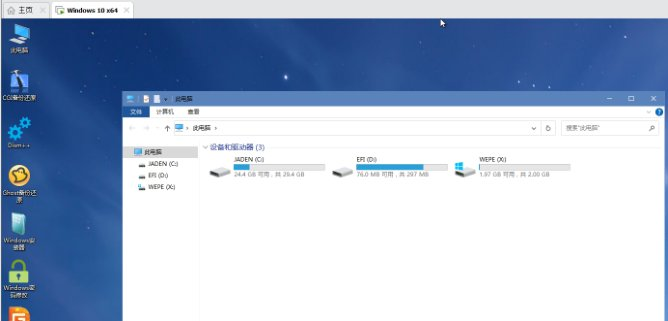

三个区，但并不是我们想要的区。接下来我们分区。

4.1 硬盘分区

首先打开桌面的分区工具

守夜人 Jaden（吴老板）

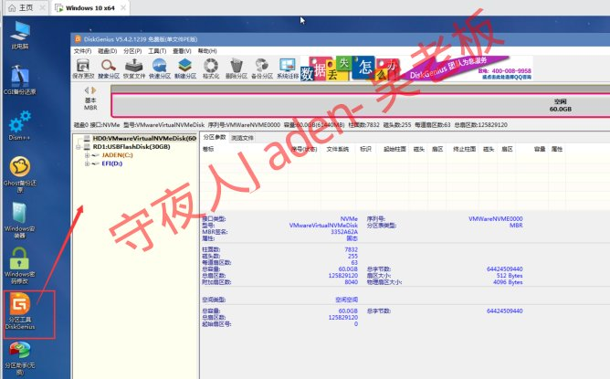

先将磁盘的MBR格式改为GUID格式

> 第 28 页

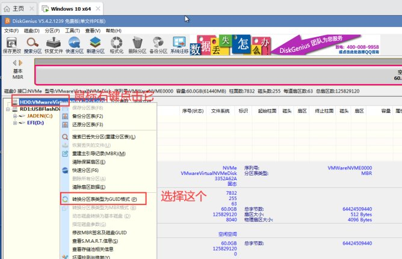

会看到如下这里发生了变化，变成GPT表示设置成功

守夜人 Jaden（吴老板）

然后保存一下

> 第 29 页

MBR格式和GUID格式是分区的两种方式而已，现在建议都是使用GUID模式，想多了解一下的可以参

考：https://zhuanlan.zhihu.com/p/598045295

接下来进行分区

守夜人 Jaden（吴老板）

如下

> 第 30 页

这样就分好了，可以关闭这个分区工具了，然后查看一下我的电脑，就可以看到E盘了

守夜人 Jaden（吴老板）

话说为什么是E盘呢，这是pe系统上显示的E盘，等我们退出pe系统之后，正常系统中它就是C盘了。E

盘上面的三个盘是我们的U盘。

分区好了之后，接下来我们要安装操作系统。

4.2 安装操作系统

打开C盘，也就是我们的U盘，找到ISO系统镜像文件，双击打开，如下

> 第 31 页

我们安装某些程序，一般都是点击程序文件夹中的一个叫做setup.exe的程序，这个一般都是安装程序。

弹出如下窗口，点击下一步

守夜人 Jaden（吴老板）

如下

> 第 32 页

稍等一会之后，会弹出如下窗口，选择个专业版的，专业版的比家庭版或者教育版的功能要齐全，消费者版本的系统中就是这三种：家庭版、教育版、专业版。企业版里面含有专业版、企业版等，企业版的更能做多最强大，我们一般也就用个专业版即可。

守夜人 Jaden（吴老板）

如下

> 第 33 页

如下

守夜人 Jaden（吴老板）

如下，选择安装到哪个磁盘，肯定是安装到我们自己分出来的那个分区中。

> 第 34 页

然后来到如下窗口

守夜人 Jaden（吴老板）

这个需要等待一会，速度取决于U盘的速度，因为主要的动作就是将系统文件拷贝到我们的磁盘分区

中，我这个U盘就比较慢，所以等待的时间长一些。我这里是给大家演示一下pe工具安装操作系统的方法，过程略显复杂，但是对于以后大家想给自己的电脑重新安装操作系统时提供了一种通用方便的手段，其实我们玩虚拟机的话，直接安装上面我们学到的光盘安装即可，简单方便。

等待一会后来到如下页面，提示重启，我们等待它自动重启即可。

重启的时候，系统加载会优先从硬盘加载，那么我们的u盘其实就没用了，可以拔出去了

接下来到了系统初始化的阶段。

> 第 35 页

来到如下的系统初始化界面，这个大家买过电脑的人应该都不陌生了，刚买回来电脑，都需要进行一些系统初始化设置，按照自己的习惯和爱好对系统做一些设置。

守夜人 Jaden（吴老板）

总结：

新硬盘-->分区---分区格式guid(gpt)--->快速分区--> 安装系统

老硬盘-->重新分区--->格式化-->安装系统

> 第 36 页

4.3 系统初始化设置

我们来到这个阶段的时候，建议大家先把电脑断网，真机就把网线、断wifi，我这里是在虚拟机上设置的，那么我就给虚拟机断网即可，在如下位置：

先断网：以防我们安装的过程中，windows系统会自动给微软发送一些我们自己的电脑信息，并且在初始化的过程中如果联网状态的话，会提示你必须先注册一个微软的账号，不然就不能正常安装过去，我们为了绕过这个账号问题，可以选择断网。

守夜人 Jaden（吴老板）

接下来初始化

> 第 37 页

如下

守夜人 Jaden（吴老板）

如下，不需要添加额外的键盘

> 第 38 页

如下，提示你去联网

守夜人 Jaden（吴老板）

如下，再次提示你联网安装的好处，我们还是选择继续执行

> 第 39 页

来到如下窗口，给电脑起名字，注意都要英文或者拼音，尽量不要出现中文

守夜人 Jaden（吴老板）

如下，密码可以不用设置，直接下一步即可

> 第 40 页

如下，你可能会看到如下页面，也可能看不到，这是提示你可以帮你做一些记录，这里直接选择否即

可，如果你想留下就点击是，我一般不需要它帮我们做一些活动记录。

守夜人 Jaden（吴老板）

如下，提示你可以帮你安装Cortana这个语音助理，用不用都行，自行选择，我这里就不要了，它和语音助手小爱同学、小度什么的类似。

> 第 41 页

如下，隐私设置，这些大家按需设置即可：

守夜人 Jaden（吴老板）

来到如下窗口

> 第 42 页

表示系统正在自行初始化，在这个过程中尽量不要关机什么的，容易导致系统崩溃，等待一会就可以看到如下窗口了，表示系统安装完毕，来到了桌面，这时候我们就可以联网玩了。

守夜人 Jaden（吴老板）

> 第 43 页

联网会有如下提示，按需选择即可，我这里选择是

联网之后可能还会有如下提示，点击跳过就行

守夜人 Jaden（吴老板）

> 第 44 页

来到如下窗口

到这里，我们的系统就初始化完毕了，可以正常使用了，注意在虚拟机上暂时先不要调屏幕分辨率，因为还没有安装显卡驱动，一调分辨率，容易花屏，下面我们去进行一些系统安装之后的操作来进行完善。大家玩的时候，注意，pe工具制作好启动盘之后，这个启动盘到哪个电脑上都可以一直用，只需要做一次即可。有些同学练习的时候，每次都重新做一个pe启动盘，哈哈，多余了昂。

大家下来之后，将我给大家准备的windows2003、win7、win10等都通过虚拟机安装好，光盘安装即可，这些虚拟机后面备用。

## 四、系统安装后操作

守夜人 Jaden（吴老板）

### 1、安装驱动(安装Vmware Tools)

什么是驱动：驱动叫做驱动程序，比如声卡、显卡、网卡等等，并不是我们插在电脑主板上就能使用，而是需要对应的驱动程序来进行控制，没有驱动程序，电脑连你的硬件都识别不出来，驱动程序一般指的是硬件设备驱动程序（Device Driver），是一种可以使计算机和设备进行相互通信的特殊程序。相当于硬件的接口，

操作系统只有通过这个接口，才能控制硬件设备的工作，假如某设备的驱动程序未能正确安装，便不能正常工作。因此，驱动程序被比作“ 硬件的灵魂”、“硬件的主宰”、“硬件和系统之间的桥梁”等。

在管理这个界面，可以看到我们安装的声卡、显卡等硬件设施的信息：

> 第 45 页

如下

守夜人 Jaden（吴老板）

比如拿显卡来说，显卡驱动有很多种，但是如果驱动程序做的不好，也会影响显卡的性能，所以网上经常有人说，安装什么样的驱动能让显卡的性能更高。比如N卡的鸡血驱动，这是很好的驱动，N卡是英伟达的显卡。有时候电脑蓝屏的原因也可能是驱动安装的不对。驱动一般去哪里下载呢？一律推荐找官网，比如联想的电脑，专门去联想的官网下载即可，联想的很简单，官网有个工具可以一键安装所有驱动。如果驱动不对，那么可能一重启就蓝屏，导致我们没办法卸载重新安装，那怎么办呢？比如

windows，就可以开机进入安全模式，安全模式，可以禁用或者卸载所有驱动，这个知道一下即可，遇到这种问题就按照找个思路去搞。

对于虚拟机来说，其实我们给虚拟机安装Vmware Tools这个工具就可以自动完成各个硬件的驱动程序的

安装。

> 第 46 页

虚拟机有一个工具是专门用来进行虚拟机的一些操作的，叫做VMware Tools，这个工具我们来安装一下，就给我们上面安装的win10系统来安装吧。在如下位置点击安装：

但是发现是灰色的，不能安装，这是因为我们前面为了演示U盘安装的方式，将这个虚拟机的光盘驱动删除了，我们重新装回来即可：

守夜人 Jaden（吴老板）

如下

> 第 47 页

如下，看到已经有了光盘驱动，真机中如果要加光驱的话，需要花钱买一个加上，虚拟机就不用了，虚拟机想加啥加啥。

守夜人 Jaden（吴老板）

提示如下，下面这个提示直接点击是即可，这个没所谓。

> 第 48 页

有可能会报错，重启一下即可。

守夜人 Jaden（吴老板）

发现可以点击安装了，那么点击安装，安装之前先把桌面的一些常用图标显示出来

> 第 49 页

> 第 50 页

桌面图标就显示出来了，然后安装VMware Tools，点击安装之后，打开我的电脑，看到一个CD盘符，

如下

双击一下这个盘符，就等于进行了安装动作

守夜人 Jaden（吴老板）

如下

> 第 51 页

稍等一下，提示如下

守夜人 Jaden（吴老板）

一路点击下一步即可

> 第 52 页

> 第 53 页

等待即可，它会自动安装各种硬件的驱动程序，安装完之后，你可能会感觉到屏幕大小有变化，因为这个过程中显卡驱动就安装好了，显卡驱动安装好之后，会自动调整屏幕最优的分辨率，如下守夜人 Jaden（吴老板）

如下

> 第 54 页

重启一下就安装好了。

有了Vmware tools这个工具之后，就可以直接和我们的物理机进行各种文件交互，比如复制一个文件到

虚拟机

守夜人 Jaden（吴老板）

这个工具很好用，虚拟机中我们必须要安装的一个工具，所以大家都要安装上。

### 2、激活

激活操作系统的正规操作就是花钱买正版的操作系统，厂家会给你序列号来进行激活。花钱这个事情对我们穷人来说比较吃力，所以我们采用不花钱的激活方法，为什么要激活呢？因为不激活的话，很多系统功能我们是没有办法使用的，下面就是查看自己的电脑系统是否已经激活的地方：

> 第 55 页

如下，可以看到我们还没有激活

守夜人 Jaden（吴老板）

接下来我们激活一下。注意：要保证我们现在的虚拟机是可以上网的状态。

用到如下文件，这个文件我也给大家准备好了，拷贝到虚拟机：

> 第 56 页

管理员身份运行这个工具

守夜人 Jaden（吴老板）

如下

> 第 57 页

如下

守夜人 Jaden（吴老板）

如下，这个工具就会自动去尝试激活，但是需要有网才行。

> 第 58 页

按任意键继续，回到如下页面，输入9退出即可

守夜人 Jaden（吴老板）

再看系统的激活状态，重新打开个性化这个地方：

> 第 59 页

已经看不到提示激活的信息了，表示激活成功。

### 3、安装常用软件

当前的电脑基本没有安装任何我们自己平常使用的软件，按照需求自行安装即可。常用的工具我给大家放了一些。

大家安装软件的时候，注意自己单独将所有工具安装到一个目录中，比如c:\\tools ，然后每个工具专

门创建一个文件夹，比如安装微信的时候，提前到tools文件夹中创建一个wexin文件夹，将微信安装到

c:\\tools\wexin 中，这样方便自己管理。

守夜人 Jaden（吴老板）

比如我给大家演示一下winrar压缩软件的安装和我现在使用的这个文档编辑工具typora的安装吧

3.1 安装winrar

安装winrar，先创建文件夹

> 第 60 页

> 第 61 页

这样就安装完毕了

3.2 安装typora

现在c:\\tools 下面创建一个叫做typora的文件夹

守夜人 Jaden（吴老板）

如下

> 第 62 页

> 第 63 页

> 第 64 页

等待一会后，如下，注意这个工具是收费的工具，我们安装的是破解版的，先不要勾选启动这个程序。

守夜人 Jaden（吴老板）

破解typora

将crack破解文件夹里的app.asar 复制到软件安装路径下的resources 文件夹内替换原文件，我的文件

夹路径是C:\tools\typora\Typora\resources

> 第 65 页

然后打开软件，点击输入序列号

守夜人 Jaden（吴老板）

如下，使用crack破解文件夹中的key文件中的序列号，选择其中一行序列号即可：

> 第 66 页

如下，邮箱随便输入，符合邮箱格式即可，可以是不存在的假的邮箱：

守夜人 Jaden（吴老板）

如下

> 第 67 页

点击关闭，然后就可以正常使用了，如果你的没有激活成功，那么卸载之后重新安装，重新激活一遍，

或者换一个序列号。

关于软件安装，我们先说这么多，后面课程中需要哪些，我们在安装哪些。

守夜人 Jaden（吴老板）

> 第 68 页

守夜人 Jaden（吴老板）
