# 系统安装_jaden

来源 PDF：系统安装_jaden.pdf（原文件位于课程目录，本文件夹不包含 PDF）

> 第 1 页

各系统安装

## windows server 2003

### 打开vm

注意我的VM版本是15.5版本，最好和我的一样

守夜人 Jaden（吴老板）

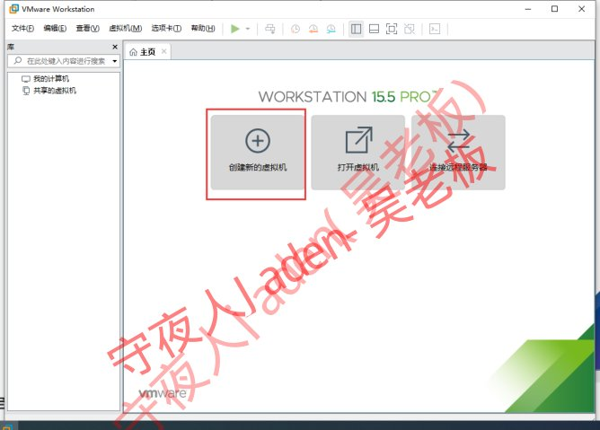

守夜人 Jaden（吴老板）

### 自定义安装

> 第 2 页

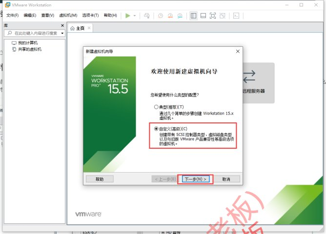

上面选择自定义，因为典型的方式对老版本的操作系统兼容性不好。

### 硬件兼容性选择

硬件兼容性选择和我们当前vmware相同的版本(如果你需要安装的虚拟机操作系统版本比较低的话，比如我们的windows 2003、win7、windows-xp等，那么我们把硬件兼容性的版本调低，硬件版本和

vmware workstation的对应关系https://www.vmware.com/resources/compatibility/search.php)

守夜人 Jaden（吴老板）

守夜人 Jaden（吴老板）

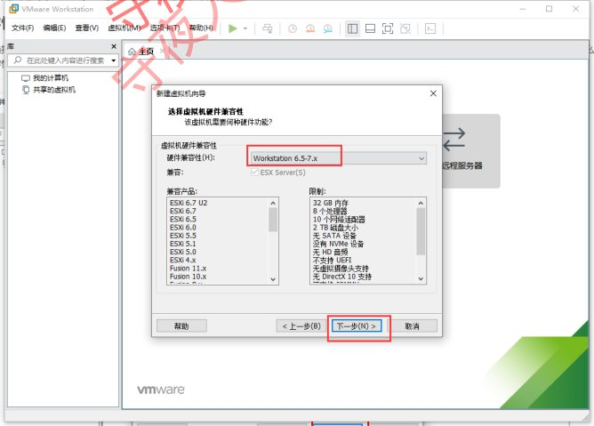

> 第 3 页

### 安装客户端操作系统

稍后安装操作系统(这一步安装操作系统也可以)

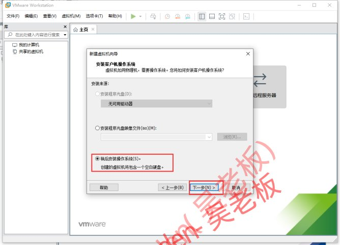

### 选择windows系统

守夜人 Jaden（吴老板）

守夜人 Jaden（吴老板）

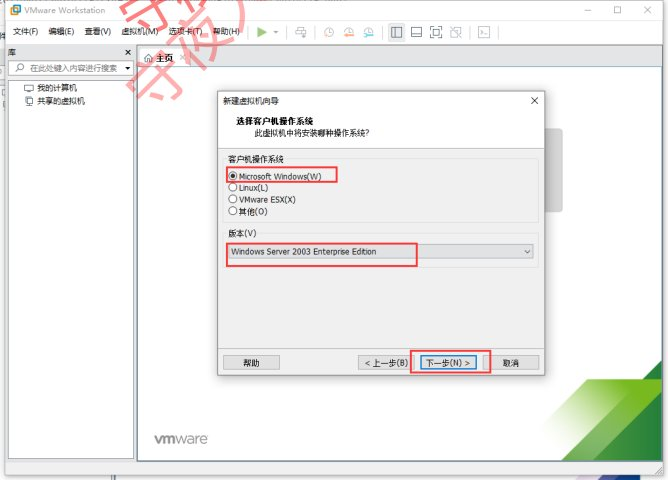

> 第 4 页

### 选择windows版本

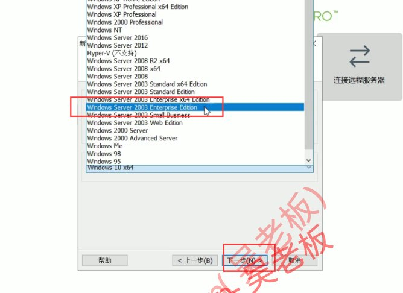

这几个版本的区别：除了具有 Windows Server 2003 Standard Edition 中的所有功能之外，

Windows Server 2003 Enterprise Edition 还增强了可用性、可伸缩性和可靠性，Windows

Server 2003 Datacenter Edition 也具有这些特性。

就功能来看: Datacenter > Enterprise > Standard,但是个人使用,基本上Standard就够了,想功能更多一些,那么选择Enterprise也就够了,具体功能我没有进行描述,有兴趣的朋友可以自行去查一下守夜人 Jaden（吴老板）

提前去创建一个文件夹目录，方便存放我们的虚拟机相关文件，比如我的：E:\wuchao\oss\win2003

守夜人 Jaden（吴老板）

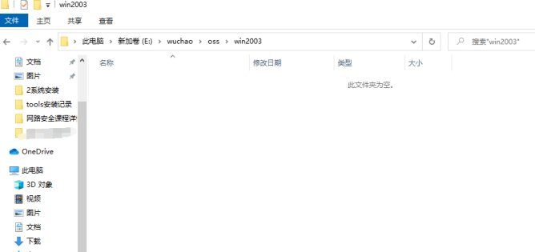

> 第 5 页

### 选择虚拟机的安装目录

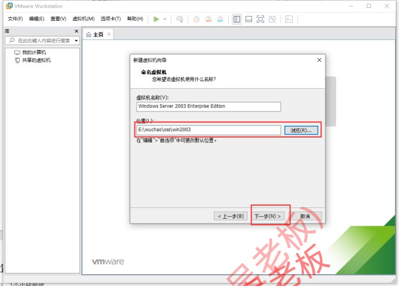

### 处理器设置

windows2003，1个内核就够。

守夜人 Jaden（吴老板）

守夜人 Jaden（吴老板）

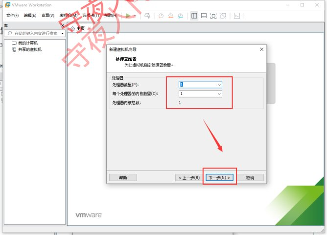

> 第 6 页

### 设置内存

给2G即可

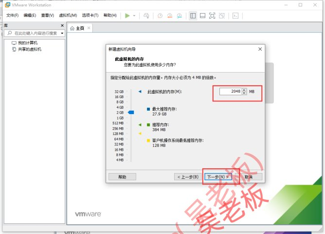

### 配置网络

选择桥接模式：

守夜人 Jaden（吴老板）

守夜人 Jaden（吴老板）

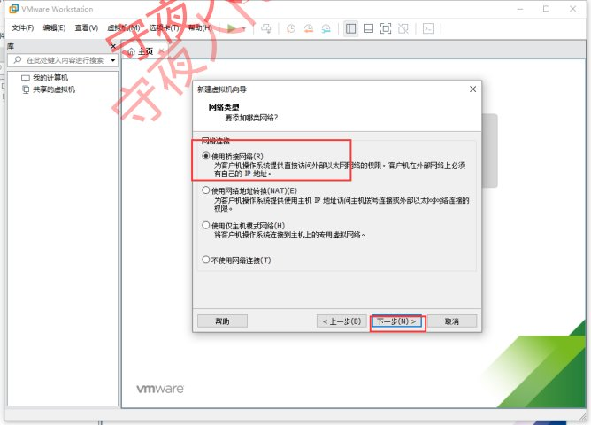

> 第 7 页

### 四种网络模式详解

在VMware中，虚拟机的网络连接主要是由VMware创建的虚拟交换机(也叫做虚拟网络)负责实现的，

VMware可以根据需要创建多个虚拟网络。在Windows系统的主机上，VMware最多可以创建20个虚拟网络，每个虚拟网络可以连接任意数量的虚拟机网络设备；在Linux系统的主机上，VMware最多可以创建255个虚拟网络，但每个虚拟网络仅能连接32个虚拟机网络设备。

VMware的虚拟网络中的虚拟网卡名称都是以"VMnet+数字"的形式来命名的，例如 VMnet0、

VMnet1、VMnet2……以此类推(在Linux系统的主机上，虚拟网络的名称均采用小写形式，例如 vmnet0

)。

当我们安装VMware时，VMware会自动为3种网络连接模式各自创建1个虚拟机网络，也就是说每个模式有一个对应的虚拟网卡：VMnet0(桥接模式)、VMnet8(NAT模式)、VMnet1(仅主机模式)。此外，我们也可以根据需要自行创建更多的虚拟网络。

介绍一下这四种模式

桥接模式：对应的虚拟网卡名称为VMnet0，虚拟机可以直接连接物理网络，也就是将虚拟机的虚拟网络适配器与主机的物理网络适配器进行交接，虚拟机中的虚拟网络适配器可通过主机中的物理网络适配器直接访问到外部网络。简而言之，这就好像在局域网中添加了一台新的、独立的计算机一样。因此，虚拟机也会占用局域网中的一个IP地址，并且可以和其他终端进行相互访问。桥接模式网络连接支持有线和无线主机网络适配器。如果你想把虚拟机当做一台完全独立的计算机看待，并且允许它和其他终端一样的进行网络通信，那么桥接模式通常是虚拟机访问网络的最简单途径。如果您的主机系统位于网络中，而且你拥有可用于虚拟机的单独 IP 地址（或者可以从 DHCP 服务器获得 IP 地址），请选择此设置。网络中的其他计算机将能够与该虚拟机直接通信。

通俗解释：桥接模式的虚拟机，就像一个在路由器"民政局"那里"上过户口"的成年人，有自己单独的居住地址，虽然和主机住在同一个大院里，但好歹是有户口的人，可以大摇大摆地直接和外面通信。

NAT模式：对应的虚拟网卡名称为VMnet8，NAT是Network Address Translation的缩写，意即网络地址转换。NAT模式也是VMware创建虚拟机的默认网络连接模式。使用NAT模式网络连接时，VMware会在主机上建立单独的专用网络，用以在主机和虚拟机之间相互通信。虚拟机向外部网络发送的请求数据包，都会交由NAT网络适配器加上"特殊标记"并以主机的名义转发出去，外部网络返回的响应数据包，

也是先由主机接收，然后交由虚拟网卡VMnet8的NAT网络适配器根据"特殊标记"进行识别并转发给对应守夜人 Jaden（吴老板）的虚拟机，因此，虚拟机在外部网络中不必具有自己的IP地址。从外部网络来看，虚拟机和主机在共享一个IP地址，默认情况下，外部网络终端设备也无法直接访问到虚拟机。如果你没有可用于虚拟机的单独 IP 地址，但又希望能够连接到 Internet，请选择 NAT。

守夜人 Jaden（吴老板）

通俗解释：NAT模式的虚拟机，纯粹就是一个没上过户口的黑户，路由器"民政局"根本不知道有这么个人，自然也不会主动和它通信。即使虚拟机偶尔要向外面发送点的信件，都得交给主机以主机的名义转发出去，主机还专门请了一位叫做NAT的老大爷来专门负责这些虚拟机的发信、收信事宜。

仅主机模式是一种比NAT模式更加封闭的网络连接模式，它将创建完全包含在主机中的专用网络。仅主机模式的虚拟网络适配器仅对主机可见，并在虚拟机和主机系统之间提供网络连接。相对于NAT模式而言，仅主机模式不具备NAT功能，因此在默认情况下，使用仅主机模式网络连接的虚拟机无法连接到

Internet(在主机上安装合适的路由或代理软件，或者在Windows系统的主机上使用Internet连接共享功能，仍然可以让虚拟机连接到Internet或其他网络)。

在同一台主机上可以创建多个仅主机模式的虚拟网络，如果多个虚拟机处于同一个仅主机模式网络中(也就是同一个物理机创建的多个仅主机模式的虚拟机)，那么它们之间是可以相互通信的；如果它们处于不同的仅主机模式网络(不同主机创建的仅主机模式的虚拟机)，则默认情况下无法进行相互通信(可通过在它们之间设置路由器来实现相互通信)。

> 第 8 页

通俗解释：仅主机模式的虚拟机，纯粹是一个彻彻底底的黑奴，不仅没有户口、路由器"民政局"不知道这么号人，还被主机关在小黑屋里，连信件也不准往外发，只能主机自己和他玩。

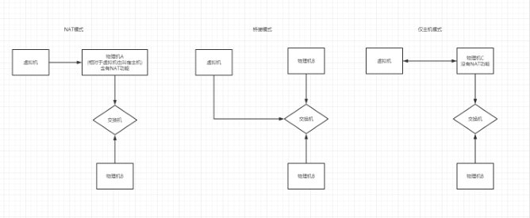

不使用网络连接：这个简单，就是不上网，跟谁也不一起玩，就是个单独的不能联网的机器。

另外还有一些自定义的网络连接模式，这里我们就不提了，因为一般我们涉及不到这种需求。

### IO控制器类型

其实指的是虚拟机磁盘格式(主要是指的接口类型，接口类型指的是：从磁盘读写数据肯定要有个口来写啊，不然怎么进入到磁盘中的，那个口就是接口，接口又分以下几种类型)

我的电脑打开这个步骤的时候，选项是如下四个：

守夜人 Jaden（吴老板）

守夜人 Jaden（吴老板）

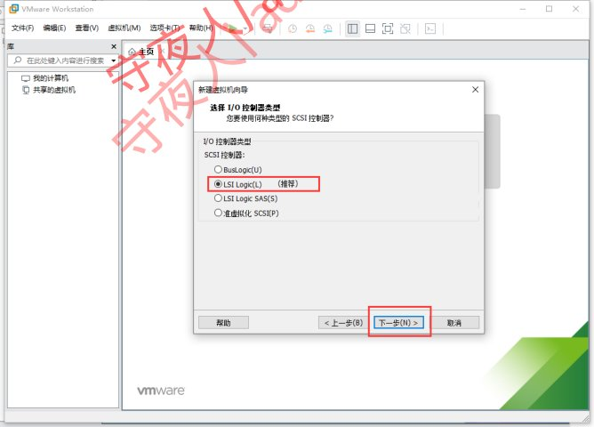

> 第 9 页

### 选择磁盘类型

磁盘类型选择的时候，要和上面的IO控制器类型相同，他们两个如果类型不同的话，你的虚拟机是不能和磁盘交互的。

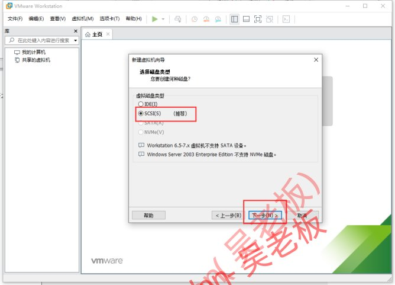

简单了解一下上面四个接口的区别，注意，只是了解即可

1、IDE：即Integrated Drive Electronics，它的本意是指把控制器与盘体集成在一起的硬盘驱动器，

守夜人 Jaden（吴老板）

IDE是表示硬盘的传输接口。我们常说的IDE接口，也叫ATA（Advanced Technology Attachment）、

PATA接口，现在PC机使用的硬盘大多数都是IDE兼容的，只需用一根电缆将它们与主板或接口卡连起来就可以了。它是SATA磁盘接口的上一代接口标准,基本属于淘汰的接口了.

  优点:易于使用、价格低廉、兼容性强、性价比高等

守夜人 Jaden（吴老板）

  缺点：速度慢、只能内置使用、不支持热插拔、冗错性差、功耗高、影响散热及连接线长度有限等

2、SCSI(S)：SCSI硬盘是采用SCSI接口的硬盘，SCSI是Small Computer System Interface（小型计算机系统接口）的缩写，使用50针接口，外观和普通硬盘接口有些相似。

  优点:性能好、稳定性高、硬盘转速快、缓存容量大、CPU占用率低、扩展性远优于IDE硬盘、支持热插拔

  缺点：价格昂贵

  IO控制类型图中的：

    Bus logic:最老的SCSI磁盘控制器设备，如果虚拟的是很老的操作系统，可以选Bus logic,比如

windows 2000。

    LSI logic :LSI是一家SCSI卡（适配器）厂家,它生产了这种磁盘控制器，由于市场占有率极高，后

来成为事实上的标准,并且它的兼容性很好,能兼容一些老系统,安装windows2003的时候,默认的IO控制类型是LSI,windows2008 默认的是LSI logic SAS(S).其实LSI和SAS的性能差的不多

    LSI logic SAS: SAS是新一代的SCSI技术，和现在流行的Serial ATA（SATA）硬盘相同，都是采

用串行技术以获得更高的传输速度，并通过缩短连结线改善内部空间等。SAS是并行SCSI接口之后开发出的全新接口。此接口的设计是为了改善存储系统的效能、可用性和扩充性，提供与串行ATA （Serial ATA，缩写为SATA）硬盘的兼容性。

> 第 10 页

3、SATA(A)

SATA，即Serial ATA（串行 ATA），全称是Serial Advanced Technology Attachment，是由

Intel、IBM、Maxtor 和 Seagate等公司共同提出的硬盘接口新规范。因为采用串行连接方式，所以使用

SATA 接口的硬盘又叫串口硬盘，我们现在的笔记本电脑基本都是SATA接口。

  优点:支持热插拔 、传输速度快、执行效率高、结构简单

  缺点:机械性能不强，可维护性不强

SATA硬盘主要是应用于PC机上面的，SATA硬盘的工作强度和服务器SCSI/SAS硬盘的工作强度是不可比拟的。而且由于SCSI/SAS具有CPU占用率低，多任务并发操作效率高，连接设备多，连接距离长等优点。因此，

对于服务器硬盘可靠性、扩展性以及性能要求较高的企业，建议采用SCSI/SAS硬盘

4、NVMe(V)

NVMe是一种接口协议，不是指的接口，NVMe标准是面向PCI-E固态硬盘的，解除了旧标准施放在SSD上的各种限制,NVMe是当前主流存储接口协议，但只能接电子硬盘SSD，磁性硬盘依然用SATA接口

  优点:支持所有常见的操作系统、良好的可拓展性、具有低延迟，低能耗，高性能等优点、自动功耗状态切换和动态能耗管理功能大大降低功耗、解决了不同PCIe SSD之间的驱动适用性问题

  缺点:价格昂贵

查看自己的电脑磁盘接口的方法,参

考:https://jingyan.baidu.com/article/8cdccae9160ecf315513cd77.html

速率对比

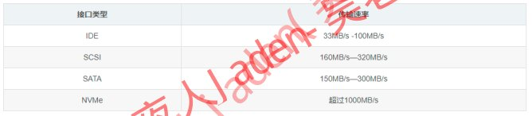

守夜人 Jaden（吴老板）

### 选择磁盘

这个地方没什么太多可说的，直接看每个选项的提示信息即可

守夜人 Jaden（吴老板）

> 第 11 页

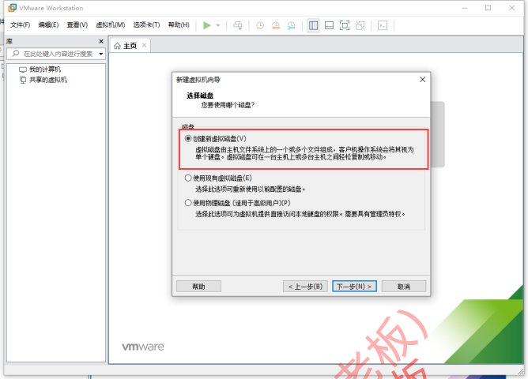

### 指定磁盘容量

磁盘大小默认即可，分配磁盘大小的时候，我们只要不选择第一个立即分配选项，那么我们虚拟占用的本机磁盘大小是随着虚拟机的容量增加，主机一点点分配给虚拟机的，不会一下子给虚拟机40G。

守夜人 Jaden（吴老板）

守夜人 Jaden（吴老板）

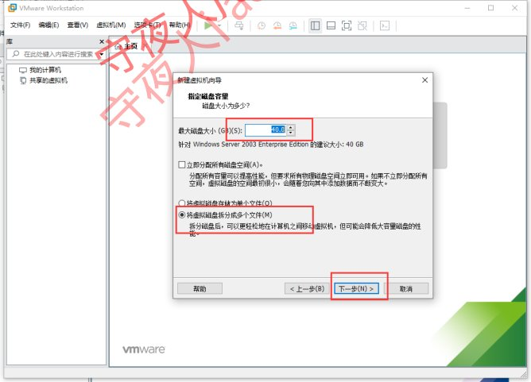

那么后面两个选项，选单个文件还是多个文件呢？看对比：了解即可，不要深究。

> 第 12 页

\1. 现在的计算机一般都是采用的是ntfs文件系统。比如安装VM的时候我们可以采用单个文件格式，便于存

储。但是前提是磁盘使用ntfs文件格式。如果你计算机是采用FAT32文件格式，那么最大单文件大小： 4 GB

(Fat16分区是2 GB )，分区大小不超过32GB左右。也就是说你的虚拟机磁盘空间不可能大于这个数字。否则就会出错。而ntfs格式的文件系统支持文件大小均在2TB上。

\2. 个人觉得储存为多个文件好。多文件可以减轻压力，单文件容易造成系统负载大。单文件占用的是磁盘上

的某一连续区域，读取速度快但是占用内存大。多文件分散在各个扇区读取速度一般但是占用内存小。单个文件的优点是在磁盘内容相对稳定时，其访问速度相对会快一点，但是如果虚拟磁盘增长很快，或容量变化很大，容易产生大量碎片内容，性能下降会很明显。另一个缺点是如果单文件受损，相当于整个磁盘丢失，代价较大，恢复起来也很费劲，但如果拆分为多个文件了，那么其中一个文件损坏，恢复起来也简单很多。拆分为多个文件，确实也会降低一些磁盘的性能，因为但我们需要这些文件数据的时候，磁盘要找多个文件来拼凑数据，比单个文件的效率要低一些。

综上所述，推荐讲虚拟磁盘拆分成多个文件，即便是拆分为多个文件，这些文件也在一个文件夹里面呢，移动到其他主机上也方便。

如何查看自己的主机采用的是什么文件系统呢？看图：

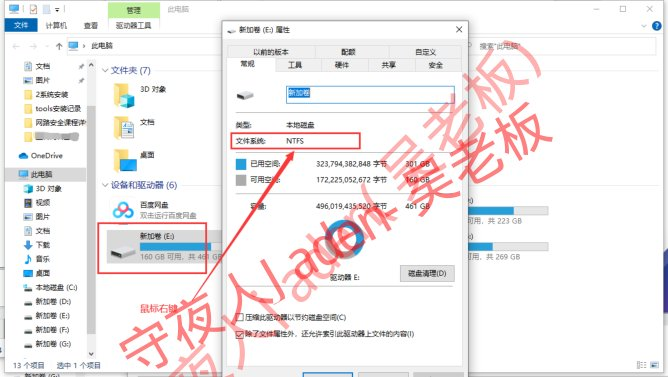

守夜人 Jaden（吴老板）

### 指定磁盘文件

守夜人 Jaden（吴老板）

默认即可，直接下一步

> 第 13 页

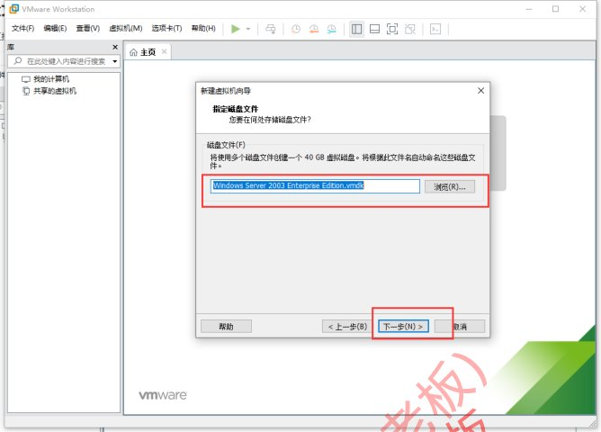

来到如下页面

### 自定义硬件

守夜人 Jaden（吴老板）

守夜人 Jaden（吴老板）

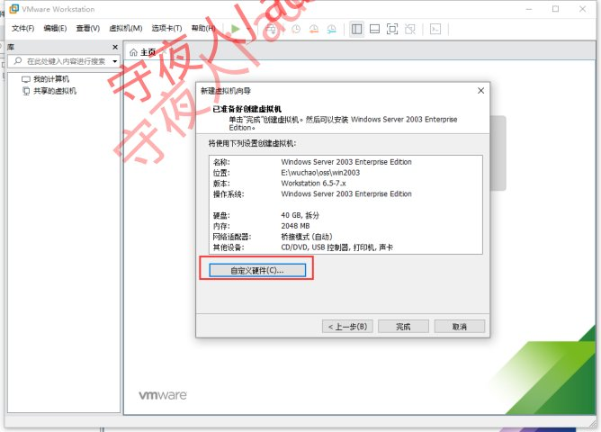

> 第 14 页

### 自定义硬件页面

去掉打印机，因为我们不用，所以就不要让虚拟机安装这个功能了，还能节省一些虚拟机性能。

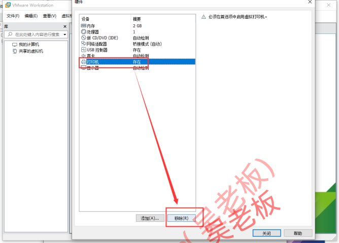

然后其他的先不用设置了，直接关闭该窗口。

守夜人 Jaden（吴老板）

守夜人 Jaden（吴老板）

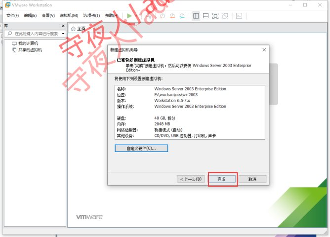

完成后来到如下页面

> 第 15 页

### 完成

完成后页面

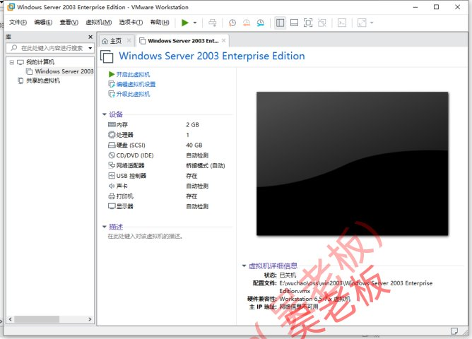

如果你觉得这个虚拟机的名字你觉的不太好记，可以给虚拟机改名字

### 改虚拟机名称

看图，对这个窗口上点击右键，选择设置

守夜人 Jaden（吴老板）

守夜人 Jaden（吴老板）

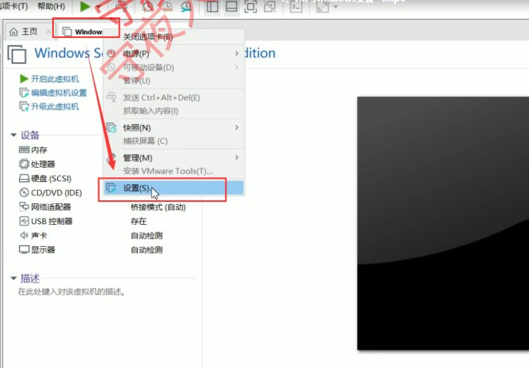

> 第 16 页

来到设置页面，找到选项

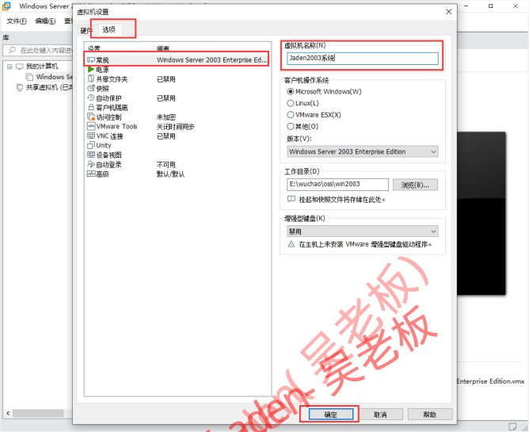

### 加载CD选择镜像

守夜人 Jaden（吴老板）

我们虚拟创建好了，只是一个裸机(只有硬件，没有系统)，我们安装什么系统给他，就给他指定什么镜像，镜像文件我都给大家准备好了，大家不需要去下载，入如果想自己去下载镜像，告诉大家在哪了下载，一般的镜像都是.iso结尾的文件，而且体积很大，网络不太好最好就直接用我的。

守夜人 Jaden（吴老板）

镜像地址

微软官方地址：https://www.microsoft.com/zh-cn/software-download/windows10

阿里系统镜像站： https://developer.aliyun.com/mirror/   但是这里面没有什么windows的

其他的一些：

  https://msdn.itellyou.cn/   这个还不错

  http://win.bbshch.cn/

或者通过软件来下载

Windows ISO Downloader是一个可以下载微软官方 Windows、Office 镜像的下载工具，这个工具可以

让你很方便地直接地从微软服务器上下载原版 Windows 7，8.1 和 10，以及 Microsoft Office

2007、2010、2013、2016、2019 光盘镜像。

不管怎么说，找到对应版本的iso文件，下载下来即可，最好和我的版本一致，还有就是去某些网站下载某些资源的时候，一定要注意，别被黑了，有些软件被别人加上了木马之类的病毒，所以还是按照我和你说的来下

载吧。

> 第 17 页

给虚拟机安装系统操作如下：

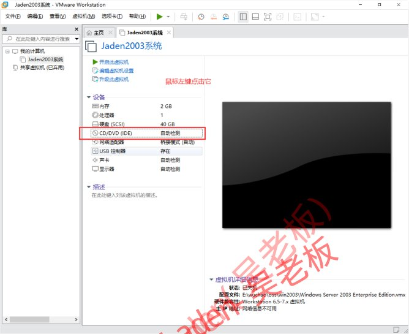

弹出如下窗口，选择浏览，找到镜像文件路径，选择打开：

守夜人 Jaden（吴老板）

守夜人 Jaden（吴老板）

> 第 18 页

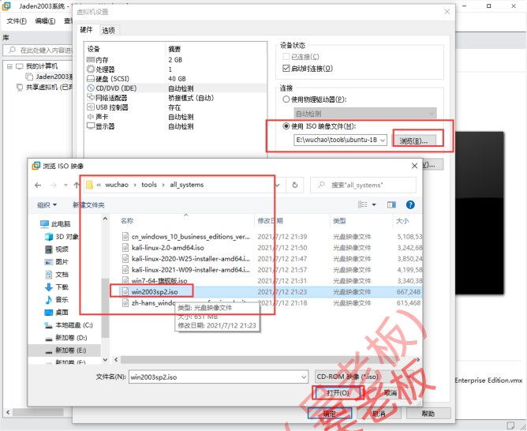

点击确定即可

守夜人 Jaden（吴老板）

守夜人 Jaden（吴老板）

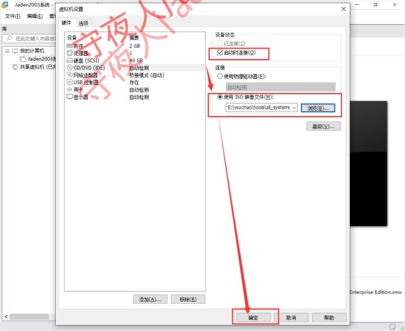

> 第 19 页

### 安装系统

好，点击启动

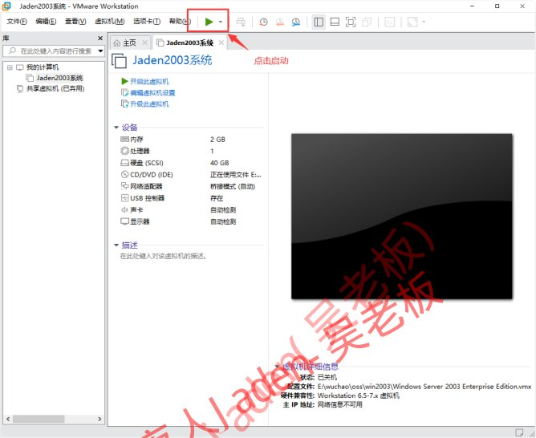

然后到下面这个界面

守夜人 Jaden（吴老板）

安装

守夜人 Jaden（吴老板）

> 第 20 页

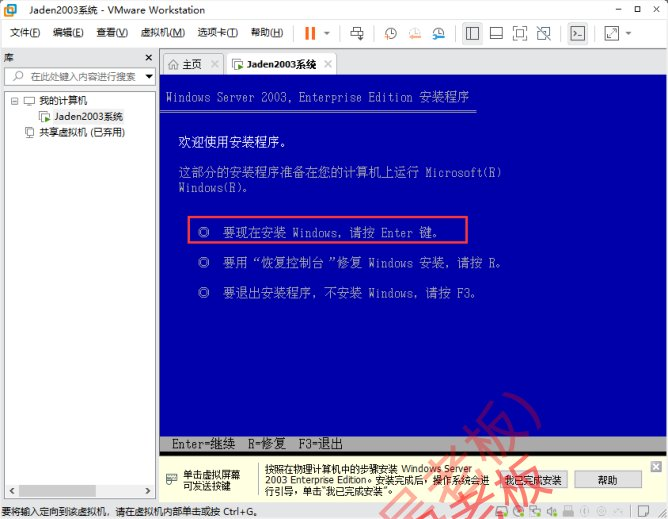

我们鼠标现在应该是在虚拟机之外的，我们自己的主机上，现在点击虚拟机中的蓝色区域，让鼠标进入到虚拟机中，此时你是看不到鼠标的，我们直接回车(键盘的enter键)，就开始安装了，看到如下界面，

如果想让鼠标出来，不让鼠标虚拟机里面了，按住键盘的Ctrl+Alt两个键，就看到自己的鼠标了。

提示同意

守夜人 Jaden（吴老板）

守夜人 Jaden（吴老板）

> 第 21 页

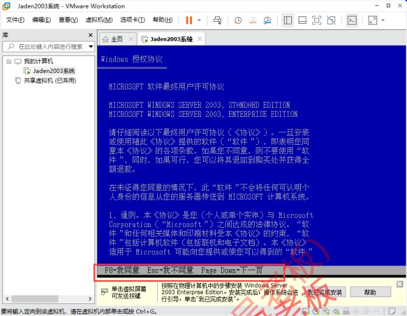

还是鼠标点进去，然后按键盘的F8键,，有些电脑没有F8键，上面会提示你按什么键，还有些同学还能按

F8键不好用，可能是因为的键盘中多了一个叫做Fn的键，按住Fn键别松开，再按F8键即可(尤其是联想的电脑，一般都有)。

来到如下界面，选择一下你的系统安装到哪个磁盘上，我们就一个磁盘，不多说了，直接回车键。

守夜人 Jaden（吴老板）

守夜人 Jaden（吴老板）

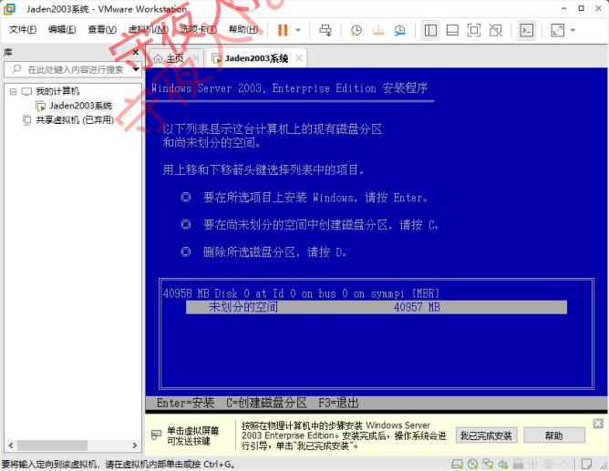

> 第 22 页

快速分区

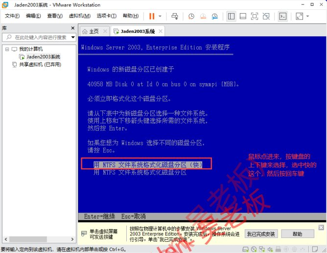

来到这个页面

守夜人 Jaden（吴老板）

守夜人 Jaden（吴老板）

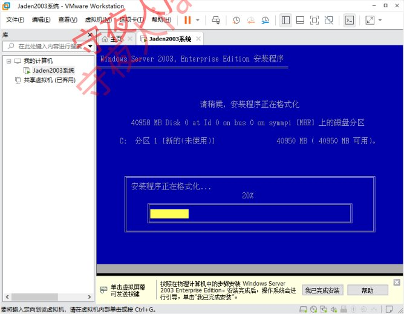

> 第 23 页

我们等着它装完即可，上面这个页面完事儿之后，看到下面的页面

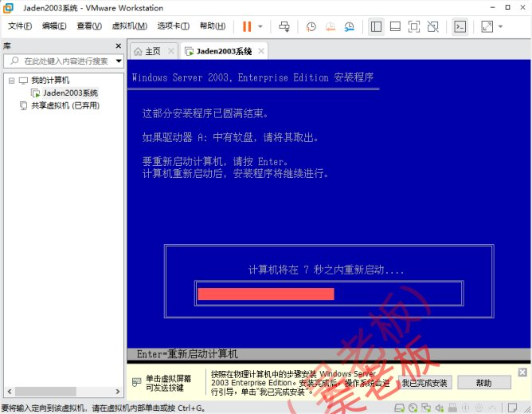

还是等着它自己安装完事儿，就看到下面的页面了

守夜人 Jaden（吴老板）

守夜人 Jaden（吴老板）

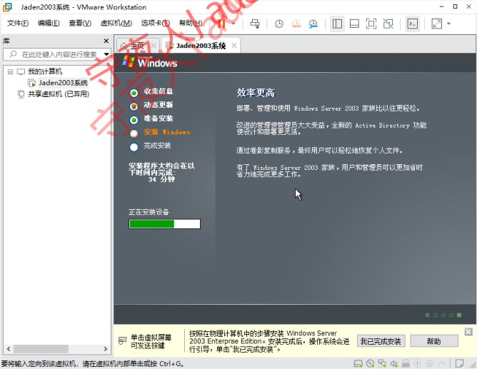

这时候还是在自行安装一些系统工具，不管它，等待完成即可

> 第 24 页

完成之后，进入如下页面

选择语言

默认就是中文，直接下一步即可

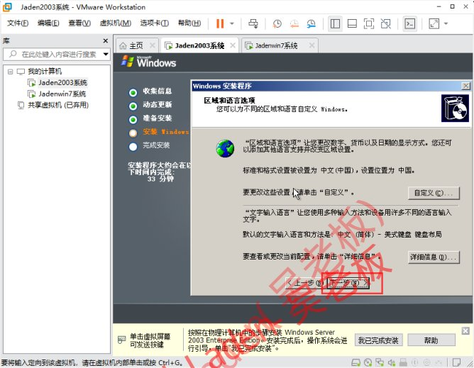

设置用户名和单位

这里随便写，但是尽量不要用中文

守夜人 Jaden（吴老板）

守夜人 Jaden（吴老板）

> 第 25 页

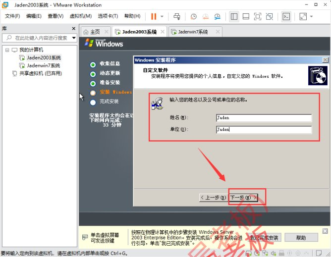

提示你输入密钥，密钥给大家准备好了，其实在网上随便一搜就有了，我的放在这里

守夜人 Jaden（吴老板）

守夜人 Jaden（吴老板）

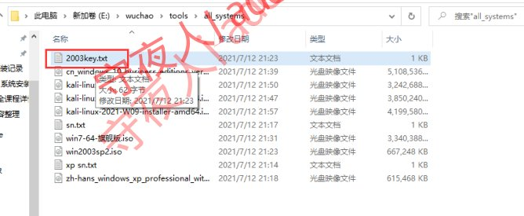

打开这个文件：

> 第 26 页

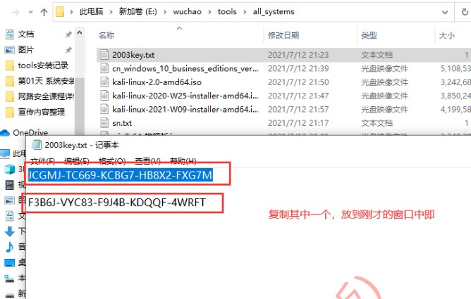

这个文件我们放在了我们的物理机上了，现在虚拟机和物理机之间还不能进行复制黏贴，也就是你在物理机上复制段文本，是不能直接黏贴到你的虚拟机里面去的，所以目前我们先手动输入吧，后面教大家如果能够进行复制黏贴。

守夜人 Jaden（吴老板）

守夜人 Jaden（吴老板）

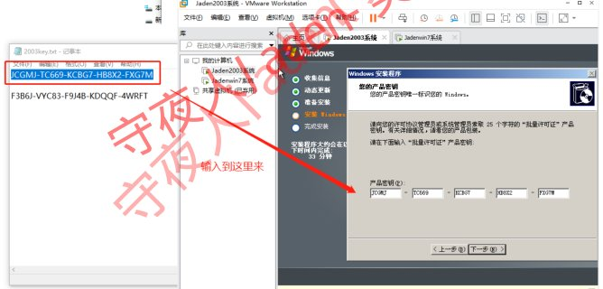

客户端连接数

默认即可

> 第 27 页

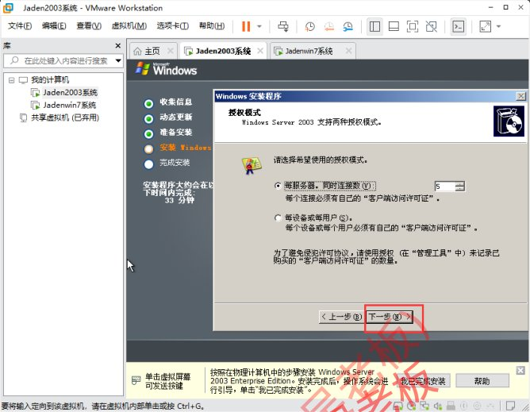

设置密码

密码我们设置的简单一些，比如123，由于我们现在做的是实验环境，所以密码简单一些，好记，以后到工作中，密码一定要复杂一些。计算机名称随便了就，改不改都行，我这里就不改了，但是大家尽量改一改，因为如果在同一个局域网中，有几个电脑的计算机名称相同，容易产生冲突问题。

守夜人 Jaden（吴老板）

守夜人 Jaden（吴老板）

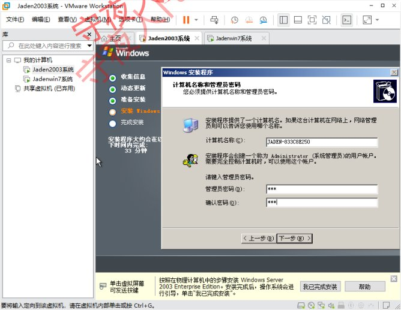

> 第 28 页

会看到提示，说密码太简单啦，确认使用吗，我们确认使用，点击是即可，然后点击下一步。

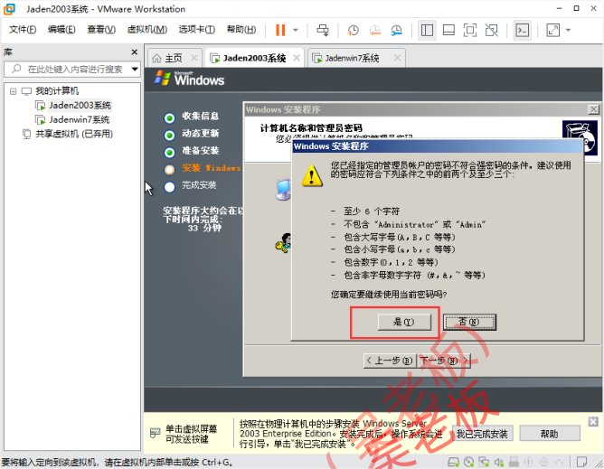

来到如下页面

设置日期

默认即可，计算机自动会检测你的主机时间来进行设置。

守夜人 Jaden（吴老板）

守夜人 Jaden（吴老板）

> 第 29 页

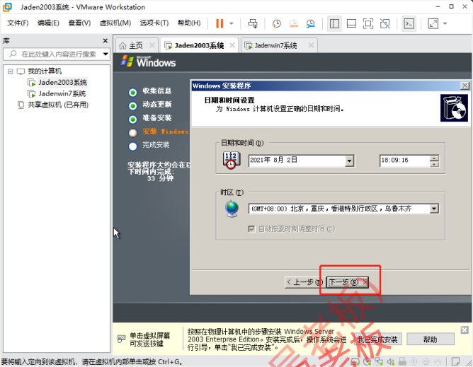

网络设置

直接下一步

守夜人 Jaden（吴老板）

守夜人 Jaden（吴老板）

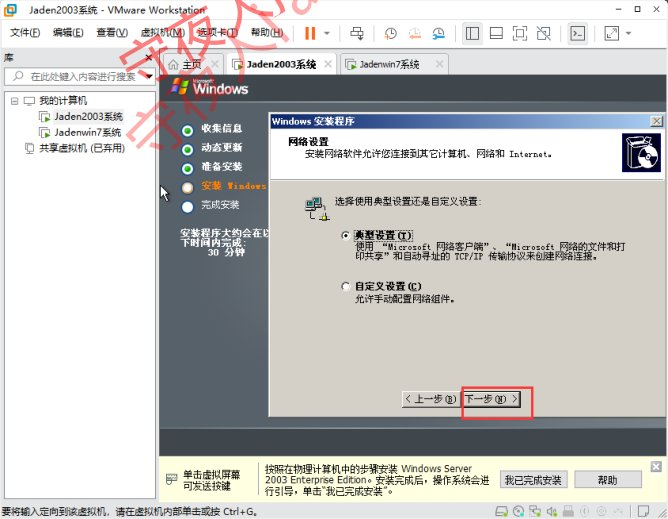

> 第 30 页

工作组设置

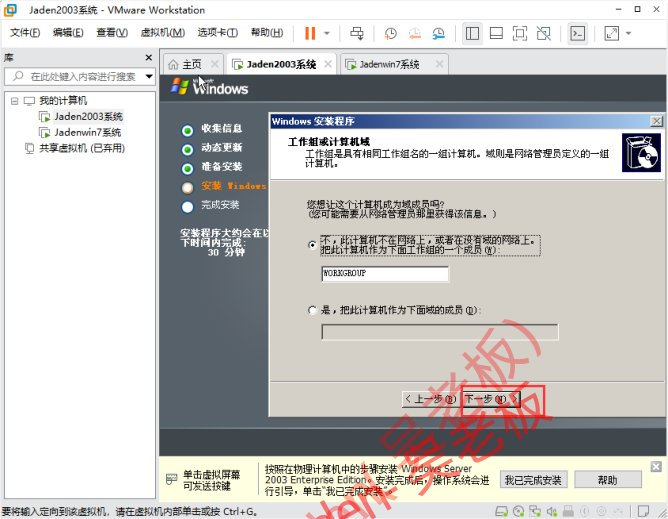

来到如下页面，继续等到即可

守夜人 Jaden（吴老板）

守夜人 Jaden（吴老板）

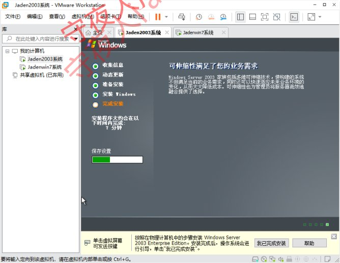

> 第 31 页

等半天，来到这个页面

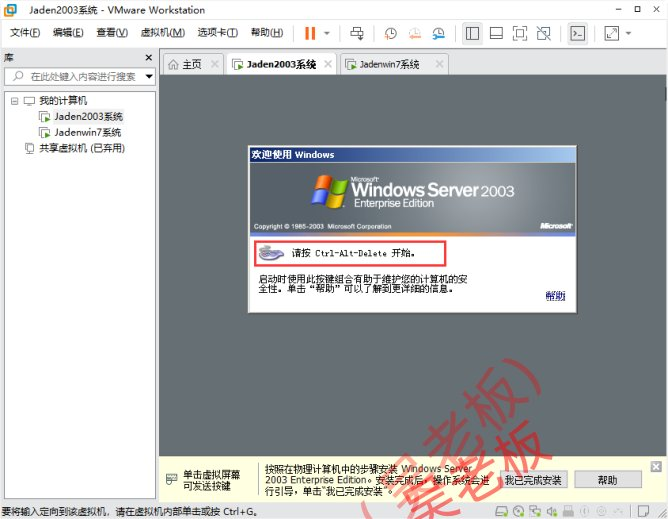

按照提示，鼠标点进去，然后在键盘上按下他们三个键即可，或者直接按下回车键试试。

登录系统

来到如下页面，输入密码，123

守夜人 Jaden（吴老板）

守夜人 Jaden（吴老板）

> 第 32 页

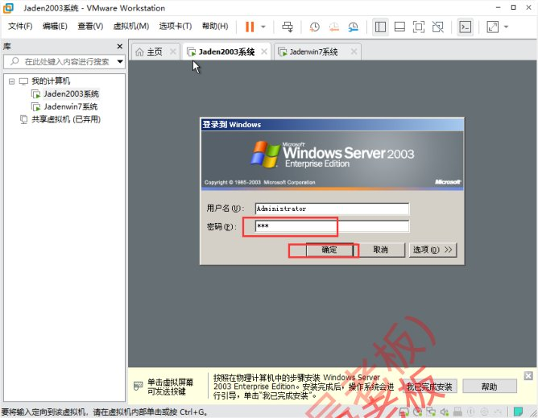

来到入下页面，点击完成

守夜人 Jaden（吴老板）

守夜人 Jaden（吴老板）

> 第 33 页

看到如下页面之后，把提示信息关掉

守夜人 Jaden（吴老板）

守夜人 Jaden（吴老板）

然后就看到我们的桌面了

> 第 34 页

设置桌面图标

选择自定义桌面

守夜人 Jaden（吴老板）

守夜人 Jaden（吴老板）

> 第 35 页

守夜人 Jaden（吴老板）

守夜人 Jaden（吴老板）

> 第 36 页

### 安装VMware tools

守夜人 Jaden（吴老板）

守夜人 Jaden（吴老板）

下一步

> 第 37 页

典型安装即可

守夜人 Jaden（吴老板）

守夜人 Jaden（吴老板）

点击安装即可

> 第 38 页

点击完成

守夜人 Jaden（吴老板）

守夜人 Jaden（吴老板）

提示重启，点击是

> 第 39 页

然后重新登录

守夜人 Jaden（吴老板）

守夜人 Jaden（吴老板）

此时，我们不管怎么变大变小当前窗口，桌面的大小和窗口大小自行调整，这就是VMware tools的其中一个功能，桌面大小自适应窗口大小。

> 第 40 页

如果此时桌面大小还是没有适应好，那么我们可以自行设置

守夜人 Jaden（吴老板）

守夜人 Jaden（吴老板）

此时，我们也可以很方便的将我们主机的文件拷贝到虚拟机当中了

> 第 41 页

好，到目前为止，我们windows 2003系统就算是安装完成了，最后一步，保存快照

### 拍摄快照

快照：通俗的讲就是拍个照片，给系统拍照片，目的是为了做备份，将来我们的系统如果奔溃了，或者你安装了一些来源不明的软件，你想让你的系统回到之前某个时期的样子，挨个卸载软件吗？太麻烦了，这时候快照就有作用了，通过快照就立马能让系统回滚到之前拍快照时的状态，吊吧，并且我们可以拍很多的快照。

守夜人 Jaden（吴老板）

守夜人 Jaden（吴老板）

看到如下页面，点击拍摄快照

> 第 42 页

来到如下页面

守夜人 Jaden（吴老板）

守夜人 Jaden（吴老板）

关闭窗口，看左下角的进度即可。

> 第 43 页

如何通过快照恢复这个时候的系统状态呢？

守夜人 Jaden（吴老板）

守夜人 Jaden（吴老板）

> 第 44 页

完全可以理解为数据备份和恢复。不信我们可以在2003上面创建一个文件，然后通过快照恢复一下，你就会发现文件消失了。

补充：如果你的电脑报了如下错误，那么去看我们VMware安装的哪一节课中提到的，bios虚拟化开启设置，这是因为你的电脑bios中没开启虚拟化技术。

守夜人 Jaden（吴老板）

守夜人 Jaden（吴老板）

## Window2008

> 第 45 页

### 新建虚拟机

### 硬件兼容性

守夜人 Jaden（吴老板）

守夜人 Jaden（吴老板）

> 第 46 页

### 操作系统

### 系统版本

守夜人 Jaden（吴老板）

守夜人 Jaden（吴老板）

> 第 47 页

### 存放位置和名称

### 固件类型

守夜人 Jaden（吴老板）

守夜人 Jaden（吴老板）

> 第 48 页

### 处理器

### 内存

守夜人 Jaden（吴老板）

守夜人 Jaden（吴老板）

> 第 49 页

### 网络类型

### IO控制器类型

守夜人 Jaden（吴老板）

守夜人 Jaden（吴老板）

> 第 50 页

### 磁盘类型

### 创建磁盘

守夜人 Jaden（吴老板）

守夜人 Jaden（吴老板）

> 第 51 页

### 磁盘容量

### 磁盘文件

守夜人 Jaden（吴老板）

守夜人 Jaden（吴老板）

> 第 52 页

### 自定义硬件

### 选择镜像

守夜人 Jaden（吴老板）

守夜人 Jaden（吴老板）

然后点击关闭，在点击完成

> 第 53 页

### 安装系统

守夜人 Jaden（吴老板）

守夜人 Jaden（吴老板）

选择语言

> 第 54 页

守夜人 Jaden（吴老板）

守夜人 Jaden（吴老板）

选择操作系统

> 第 55 页

功能对比

安装过程中，选择需要哪个版本。功能来看，datacenter>enterprise>standard。enterprise足够满足你的需求了.具体功能我没有列举出来,有兴趣的朋友可以去查一下

许可证

守夜人 Jaden（吴老板）

守夜人 Jaden（吴老板）

> 第 56 页

自定义高级

安装位置

直接下一步

守夜人 Jaden（吴老板）

守夜人 Jaden（吴老板）

> 第 57 页

来到如下页面,等待一会

守夜人 Jaden（吴老板）

守夜人 Jaden（吴老板）

> 第 58 页

修改密码

默认用为admnistrator

Jaden的密码设置为了123,但是会设置不上,看下图

守夜人 Jaden（吴老板）

守夜人 Jaden（吴老板）

按回车之后提示如下

> 第 59 页

没办法,我们设置一个复杂一点的密码,后面再修改为简单的,这次设置的密码是jaden123! (注意:字母+数字+特殊符号组合密码)

守夜人 Jaden（吴老板）

守夜人 Jaden（吴老板）

成功了

> 第 60 页

点击确定之后,等待一会就出现了如下页面

关闭提示

守夜人 Jaden（吴老板）

守夜人 Jaden（吴老板）

> 第 61 页

关闭控制台

好,安装完成

守夜人 Jaden（吴老板）

守夜人 Jaden（吴老板）

> 第 62 页

展示图标

将控制面板也显示出来

守夜人 Jaden（吴老板）

守夜人 Jaden（吴老板）

> 第 63 页

### 安装VMware tools

等待一会,提示如下,点击运行setup64.exe

守夜人 Jaden（吴老板）

守夜人 Jaden（吴老板）

然后在等待

> 第 64 页

出现如下提示,点击下一步

守夜人 Jaden（吴老板）

守夜人 Jaden（吴老板）

选择典型,然后下一步

> 第 65 页

点击安装

守夜人 Jaden（吴老板）

守夜人 Jaden（吴老板）

等待一会后就好了,点击完成

> 第 66 页

然后重启虚拟机即可

### 拍摄快照

守夜人 Jaden（吴老板）

守夜人 Jaden（吴老板）

在弹出窗口中填写一些描述信息

> 第 67 页

ok,搞定

## win7

### 新建虚拟机

守夜人 Jaden（吴老板）

安装步骤和2003的相同，

守夜人 Jaden（吴老板）

> 第 68 页

和2003安装时相同部分我就省略了

### 选择兼容性

守夜人 Jaden（吴老板）

守夜人 Jaden（吴老板）

> 第 69 页

### 创建目录

创建一个文件夹，存放win7的虚拟机文件

守夜人 Jaden（吴老板）

守夜人 Jaden（吴老板）

在这里我们可以多创建几个文件夹，留着用

> 第 70 页

### 虚拟机名称

下一步来到如下页面

### 处理器设置

选好目录，点击下一步，分配2核给win7吧

守夜人 Jaden（吴老板）

守夜人 Jaden（吴老板）

> 第 71 页

### 设置内存

守夜人 Jaden（吴老板）

守夜人 Jaden（吴老板）

> 第 72 页

### 网络模式

然后一直下一步，直到如下页面

移除打印机

守夜人 Jaden（吴老板）

守夜人 Jaden（吴老板）

> 第 73 页

守夜人 Jaden（吴老板）

选择镜像

守夜人 Jaden（吴老板）

> 第 74 页

点击打开，点击完成，即可

守夜人 Jaden（吴老板）

守夜人 Jaden（吴老板）

> 第 75 页

### 安装系统

点击开始

选择语言

看到如下页面，直接下一步

守夜人 Jaden（吴老板）

守夜人 Jaden（吴老板）

> 第 76 页

点击现在安装

守夜人 Jaden（吴老板）

守夜人 Jaden（吴老板）

看到如下页面，进行等待

> 第 77 页

接受许可

守夜人 Jaden（吴老板）

守夜人 Jaden（吴老板）

> 第 78 页

点击自定义高级

磁盘分区

守夜人 Jaden（吴老板）

守夜人 Jaden（吴老板）

> 第 79 页

来到如下页面，等待即可

输入用户名

守夜人 Jaden（吴老板）

守夜人 Jaden（吴老板）

> 第 80 页

输入密码

守夜人 Jaden（吴老板）

守夜人 Jaden（吴老板）

> 第 81 页

输入产品密钥

密钥数据我放到了下面的文件中，大家直接可以使用

然后看到如下页面

守夜人 Jaden（吴老板）

守夜人 Jaden（吴老板）

> 第 82 页

日期时间设置

默认即可，直接下一步

选择网络

守夜人 Jaden（吴老板）

守夜人 Jaden（吴老板）

> 第 83 页

就来到如下页面了，等待即可

安装好了

守夜人 Jaden（吴老板）

守夜人 Jaden（吴老板）

> 第 84 页

显示图标

在页面中勾选想显示的图标

守夜人 Jaden（吴老板）

守夜人 Jaden（吴老板）

把输入法的提示移动到最下面

> 第 85 页

就变成这样了

守夜人 Jaden（吴老板）

守夜人 Jaden（吴老板）

测试上网

然后测试一下能不能上网：

> 第 86 页

看到如下效果，表示能够正常上网

守夜人 Jaden（吴老板）

守夜人 Jaden（吴老板）

> 第 87 页

切换管理员

而且上面的指令前面显示的内容，我们发现，我们不是管理员，这会影响我们的一些操作权限，改为管

理员

在弹出的窗口中选择

守夜人 Jaden（吴老板）

把勾选的取消掉

守夜人 Jaden（吴老板）

> 第 88 页

然后给管理员设置密码

守夜人 Jaden（吴老板）

守夜人 Jaden（吴老板）

弹出如下页面

> 第 89 页

输入密码，简单一些即可，我的123

守夜人 Jaden（吴老板）

守夜人 Jaden（吴老板）

提示如下

> 第 90 页

点击确定即可

然后我们切换为管理员用户

守夜人 Jaden（吴老板）

守夜人 Jaden（吴老板）

弹出如下页面

> 第 91 页

输入密码然后回车即可

守夜人 Jaden（吴老板）

守夜人 Jaden（吴老板）

登录之后，等一会就看到如下页面，每个用户的桌面都是不同的，需要显示哪些内容，都需要切换到对应的用户上去，并自行设置。

> 第 92 页

显示图标

步骤和上面显示图标的步骤相同，我就不截图了，大家搞一搞，结果如下

守夜人 Jaden（吴老板）

守夜人 Jaden（吴老板）

> 第 93 页

### 安装Vmware tools

看图

弹出如下页面，点击红框中的选项

守夜人 Jaden（吴老板）

守夜人 Jaden（吴老板）

> 第 94 页

提示正在安装

守夜人 Jaden（吴老板）

守夜人 Jaden（吴老板）

等待一会，出现如下页面，点击下一步

> 第 95 页

然后

守夜人 Jaden（吴老板）

守夜人 Jaden（吴老板）

然后点击安装

> 第 96 页

等待即可

守夜人 Jaden（吴老板）

守夜人 Jaden（吴老板）

如果你提示如下页面，是因为你自己VMware workstation版本是16的，换成15.5版本即可。

> 第 97 页

好提示安装成功

守夜人 Jaden（吴老板）

守夜人 Jaden（吴老板）

提示重启，点击是即可

> 第 98 页

登录之后，最后一步，拍摄快照

### 拍摄快照

守夜人 Jaden（吴老板）

守夜人 Jaden（吴老板）

ok，搞定

> 第 99 页

## Win10

### 新建虚拟机

### 硬件兼容性

win10系统版本比较高了，硬件版本也会比较高，所以我们选择的vmware workstation的版本也要高一

些

守夜人 Jaden（吴老板）

守夜人 Jaden（吴老板）

### 选择系统

> 第 100 页

### 选择虚拟机安装目录

守夜人 Jaden（吴老板）

守夜人 Jaden（吴老板）

> 第 101 页

### 固件类型

选择处理器

守夜人 Jaden（吴老板）

守夜人 Jaden（吴老板）

> 第 102 页

### 设置内存

电脑内存足够大的话，内存给大一些

### IO控制器类型

守夜人 Jaden（吴老板）

守夜人 Jaden（吴老板）

> 第 103 页

按照推荐直接下一步即可

守夜人 Jaden（吴老板）

守夜人 Jaden（吴老板）

移除打印机

> 第 104 页

### 选择镜像文件

点击启动

守夜人 Jaden（吴老板）

守夜人 Jaden（吴老板）

> 第 105 页

启动之后，等待一会看到如下页面

### 安装系统

选择安装

守夜人 Jaden（吴老板）

守夜人 Jaden（吴老板）

> 第 106 页

选择版本

注意：有些同学自己本机安装的系统是win10家庭版，家庭版的功能比企业版或者专业版的功能要少很多，所以建议大家安装企业版或者专业版，如果你主机不是专业版，建议升级为专业版，这里我就不带着升级了，大家问度娘吧，这里我们就安装个企业版的。

家庭版、专业版、企业版的功能对比介绍，了解即可。

Win10家庭版（称之为Win10 Home）：对普通用户来讲，Win10家庭版就是最佳选择。包括全新的Windows

通用应用商店、Microsoft Edge网页浏览器、Cortana个人助理、Continuum平板模式、Windows

Hello生物识别等等。

守夜人 Jaden（吴老板）

Win10专业版（称之为Win10 Pro）：面向技术爱好者和企业/技术人员，内置一系列Win10增强的技术，包括组策略、Bitlocker驱动器加密、远程访问服务、域名连接，以及全新的Windows Update for

Business。

守夜人 Jaden（吴老板）

Win10企业版（称之为Win10 Enterprise）：包括Win10专业版的所有功能，另外为了满足企业的需求，企业版还将增加PC管理和部署，先进的安全性，虚拟化等功能。

查看自己本机是什么win10版本

找到我的电脑，右键，点击属性

> 第 107 页

看到如下页面

或者你看到的是这样的

守夜人 Jaden（吴老板）

守夜人 Jaden（吴老板）

如何升级为专业版：去淘宝上买个密钥，然后在这里替换一下，它自己就能替换为专业版了，其实也很

简单

> 第 108 页

当然了，不升级也没有关系，通过cmd的系统指令也是可以切换用户的。

我们继续安装啊，下一步就来到如下页面，勾选同意然后继续

守夜人 Jaden（吴老板）

守夜人 Jaden（吴老板）

选择自定义

然后看到如下页面

> 第 109 页

磁盘分区

默认即可，不做磁盘分区，一个C盘就够了。

守夜人 Jaden（吴老板）

守夜人 Jaden（吴老板）

然后来到这个窗口。等待即可

> 第 110 页

区域设置

守夜人 Jaden（吴老板）

守夜人 Jaden（吴老板）

> 第 111 页

键盘设置

守夜人 Jaden（吴老板）

守夜人 Jaden（吴老板）

> 第 112 页

创建用户

输入用户名，点击下一步

守夜人 Jaden（吴老板）

守夜人 Jaden（吴老板）

输入密码，简单一点，我这里是123

> 第 113 页

确认密码

守夜人 Jaden（吴老板）

守夜人 Jaden（吴老板）

安全问题设置

一共要设置三个安全问题，这个自行选择即可。

> 第 114 页

第一个问题：

守夜人 Jaden（吴老板）

守夜人 Jaden（吴老板）

第二个问题

> 第 115 页

第三个问题

守夜人 Jaden（吴老板）

守夜人 Jaden（吴老板）

看到如下页面，直接点击是

> 第 116 页

看到如下页面直接点击接受

守夜人 Jaden（吴老板）

守夜人 Jaden（吴老板）

同样，下面的页面直接点击接受

> 第 117 页

看到如下页面，是正在安装，等待即可

守夜人 Jaden（吴老板）

守夜人 Jaden（吴老板）

等待一会就好了，看到如下页面

> 第 118 页

显示图标

蓝色区域点击鼠标右键，选择个性化

守夜人 Jaden（吴老板）

守夜人 Jaden（吴老板）

看到如下页面

> 第 119 页

如下页面：

守夜人 Jaden（吴老板）

守夜人 Jaden（吴老板）

看到效果

> 第 120 页

### 安装vmware tools

守夜人 Jaden（吴老板）

守夜人 Jaden（吴老板）

然后等待即可

和win2003跟win7的相同，我就不多累述啦

> 第 121 页

注：windows2008、2012、2016等系统的安装和上面基本差不多，这里我就不一个一个的演示啦，大家自行安装吧。

## Kali系统2020版

### Kali Linux系统介绍

    Kali Linux是一个基于Debian的Linux发行版本，旨在进行高级渗透测试和安全审计。Kali包含数百种

(900多种)渗透测试工具，适用于各种信息安全任务，如渗透测试，安全研究，计算机取证、逆向功能等等。它是在2013年3月分发布的，开源并且免费，并且这个系统的安全性极高，是在多个安全协议下开发出来的。

### 新建虚拟机

守夜人 Jaden（吴老板）

守夜人 Jaden（吴老板）

硬件兼容性

因为我们使用的kali系统版本比较高，所以我们选择的时候，保持15.x不变即可

> 第 122 页

### 客户机系统设置

守夜人 Jaden（吴老板）

守夜人 Jaden（吴老板）

> 第 123 页

### 选择操作系统

Kali系统属于debian系统之一，所以我们要算则debian，版本的话选哪个都可以，我选择的是6 64位，

大家可能这里对版本有疑问，可自行查询对比一下他们的区别。

### 选择虚拟机安装目录

守夜人 Jaden（吴老板）

守夜人 Jaden（吴老板）

> 第 124 页

### 设置处理器

### 设置内存

守夜人 Jaden（吴老板）

守夜人 Jaden（吴老板）

> 第 125 页

### 设置网络模式

### IO控制向导

按照推荐即可

守夜人 Jaden（吴老板）

守夜人 Jaden（吴老板）

> 第 126 页

### 磁盘类型

### 选择磁盘

守夜人 Jaden（吴老板）

守夜人 Jaden（吴老板）

> 第 127 页

### 磁盘容量

我们给kali大一些的空间吧，留着备用

### 指定磁盘文件

直接下一步即可

守夜人 Jaden（吴老板）

守夜人 Jaden（吴老板）

> 第 128 页

### 自定义硬件

移除打印机

守夜人 Jaden（吴老板）

守夜人 Jaden（吴老板）

> 第 129 页

### 选择系统镜像

kali系统经常更新，所以可以选择最新版本下载下来玩，网址：https://cdimage.kali.org/kali-weekly/，

国内的某些镜像源，它不会将最新的kali系统放上去让你下载，国家限制了，因为最新的kali里面经常会有一些新的攻击手段来攻击新的系统。

下载好之后，选择使用即可，这里我没去用最新的，大家可以玩玩最新的

守夜人 Jaden（吴老板）

守夜人 Jaden（吴老板）

选好镜像之后，关闭窗口

> 第 130 页

点击完成

守夜人 Jaden（吴老板）

守夜人 Jaden（吴老板）

> 第 131 页

### 安装系统

点击启动

等待一会，看到如下页面，我们选择图形化界面安装，操作起来更方便一些

鼠标点进去，上下键控制选择，选好之后，回车即可。

守夜人 Jaden（吴老板）

守夜人 Jaden（吴老板）

> 第 132 页

选择语言

为了方便大家来学习，我们选择中文简体

选择地区

选择中国，(台湾和香港我觉得以后应该给它去掉，都是中国的)

守夜人 Jaden（吴老板）

守夜人 Jaden（吴老板）

> 第 133 页

配置键盘

守夜人 Jaden（吴老板）

守夜人 Jaden（吴老板）

> 第 134 页

看到如下页面，等待即可

主机名

填写一个主机名，如果你还有其他虚拟机，或者你所在的局域网中有一些其他的电脑主机之类的，那么我们的主机名字尽量和别人不一样，不然容易在网络方便产生冲突。

守夜人 Jaden（吴老板）

守夜人 Jaden（吴老板）

> 第 135 页

域名

不需要配置域名，直接点击继续

守夜人 Jaden（吴老板）

守夜人 Jaden（吴老板）

> 第 136 页

输入用户名

注意：下面这个小写的才是我们将来登录系统的用户名

守夜人 Jaden（吴老板）

守夜人 Jaden（吴老板）

> 第 137 页

输入密码

还是一样的，我都设置为了123

看到如下页面，等待即可

守夜人 Jaden（吴老板）

守夜人 Jaden（吴老板）

> 第 138 页

磁盘分区

守夜人 Jaden（吴老板）

守夜人 Jaden（吴老板）

> 第 139 页

守夜人 Jaden（吴老板）

守夜人 Jaden（吴老板）

> 第 140 页

注意，下面选择是，保存改动，kali自行对磁盘分区进行了一些改动，我们不用管，选择是即可。

守夜人 Jaden（吴老板）

守夜人 Jaden（吴老板）

看到如下页面，等待即可。

> 第 141 页

看到如下提示，不用管，选择继续

守夜人 Jaden（吴老板）

守夜人 Jaden（吴老板）

> 第 142 页

软件选择

然后等待一会出现如下画面，点击继续，默认即可

注意：如果你安装的过程中出现了如下错误

守夜人 Jaden（吴老板）

守夜人 Jaden（吴老板）

> 第 143 页

问题原因有两个：1.你当前的网络环境不佳    2.你安装kali系统的时候，选择的硬件兼容性高了，弄低一些，试试，或者重新安装一下即可。

### 驱动引导

### 驱动引导器

守夜人 Jaden（吴老板）

守夜人 Jaden（吴老板）

> 第 144 页

然后看到如下页面，等待即可

守夜人 Jaden（吴老板）

守夜人 Jaden（吴老板）

> 第 145 页

### 重启

提示重启，点击继续

### 登录

重启之后，输入用户名和密码登录(jaden/123，注意：之前设置的那个小写的才是我们的用户名)

守夜人 Jaden（吴老板）

守夜人 Jaden（吴老板）

> 第 146 页

### 查看是否能上网

守夜人 Jaden（吴老板）

守夜人 Jaden（吴老板）

### 安装VMware tools

> 第 147 页

等待一会就看到如下内容

守夜人 Jaden（吴老板）

守夜人 Jaden（吴老板）

拷贝文件

> 第 148 页

然后在终端执行解压指令

tar -zxvf  跟上那个.tar.gz的文件名称

图示：

然后运行驱动程序

守夜人 Jaden（吴老板）

指令如下

守夜人 Jaden（吴老板）

cd vmware-tools-distrib

./vmware-install.pl

如果不是root用户，执行sudo ./vmware-install.pl

安装过程中一直卡住，这是在等待你输入指令

> 第 149 页

后面这几步，直接回车就行，表示按照默认的安装

守夜人 Jaden（吴老板）

守夜人 Jaden（吴老板）

提示了[yes]的输入yes，提示了[no]的输入no，没有这两个提示的直接回车，默认安装直到看到如下结果，表示成功了

> 第 150 页

然后重启我们的虚拟机就够啦。然后可以高高兴兴的和本机传输文件了。

### 快照

守夜人 Jaden（吴老板）

### 修改root密码

守夜人 Jaden（吴老板）

刚开始登录进来时，我们是以普通管理员账号登录的，超级管理员root的密码我们是不知道的，我们改一下，方便以后使用root用户来操作，不然有些涉及到操作权限的问题比较恶心。

sudo passwd root 123

如图

> 第 151 页

或者这样的

### 开启ssh服务

为了方便后面我们使用xshell来进行kali系统的操作，我们给kali系统开启ssh服务，让xshell能够连接到

kali系统。配置方式如下，注意，以后操作要以root用户的身份来做，不然有些文件你修改不了。

\1. 切换到管理员用户：su root

   提示输入root密码： 123

\2. 配置SSH参数

    修改sshd_config文件，命令为：vi /etc/ssh/sshd_config

守夜人 Jaden（吴老板）

    将#PasswordAuthentication no的注释去掉，并且将NO修改为YES //kali中默认是yes

    将PermitRootLogin without-password修改为PermitRootLogin yes

    然后，保存，退出vi

守夜人 Jaden（吴老板）

\4. 启动SSH服务

    命令为：

    /etc/init.d/ssh start

    或者

    systemctl start ssh

    查看SSH服务状态是否正常运行，命令为：

    /etc/init.d/ssh status

    或者

    systemctl status ssh

\5. 设置系统自动启动SSH服务

    update-rc.d ssh enable  //系统自动启动SSH服务

    或者sudo systemctl enable ssh  # 在2020版中用它

    update-rc.d ssh disabled // 关闭系统自动启动SSH服务

    或者sudo systemctl disable ssh

> 第 152 页

看下图，表示成功开启了ssh

设置系统自启动

守夜人 Jaden（吴老板）

守夜人 Jaden（吴老板）

### xshell连接

查看ip地址

> 第 153 页

### 配置xshell连接

参照下面的2021版的连接方式，一摸一样。

### 再次快照

守夜人 Jaden（吴老板）

守夜人 Jaden（吴老板）

## Kali系统2021版

> 第 154 页

### 新建虚拟机

### 硬件兼容性

守夜人 Jaden（吴老板）

守夜人 Jaden（吴老板）

> 第 155 页

### 操作系统选择

### 选择存放位置

守夜人 Jaden（吴老板）

守夜人 Jaden（吴老板）

> 第 156 页

### 设置处理器

### 设置内存

守夜人 Jaden（吴老板）

守夜人 Jaden（吴老板）

> 第 157 页

### 设置网络模式

### 磁盘

守夜人 Jaden（吴老板）

守夜人 Jaden（吴老板）

> 第 158 页

### 选择镜像

别忘了移除打印机

### 安装系统

守夜人 Jaden（吴老板）

守夜人 Jaden（吴老板）

> 第 159 页

如下页面

守夜人 Jaden（吴老板）

守夜人 Jaden（吴老板）

> 第 160 页

### 设置域名

直接继续

### 设置用户名和密码

密码还是123

守夜人 Jaden（吴老板）

守夜人 Jaden（吴老板）

> 第 161 页

守夜人 Jaden（吴老板）

守夜人 Jaden（吴老板）

> 第 162 页

### 设置磁盘

守夜人 Jaden（吴老板）

守夜人 Jaden（吴老板）

> 第 163 页

守夜人 Jaden（吴老板）

守夜人 Jaden（吴老板）

> 第 164 页

### 软件选择

守夜人 Jaden（吴老板）

守夜人 Jaden（吴老板）

看到如下页面进行等待

> 第 165 页

### 驱动引导

守夜人 Jaden（吴老板）

守夜人 Jaden（吴老板）

> 第 166 页

### 驱动引导器

出现如下页面，等待即可

守夜人 Jaden（吴老板）

守夜人 Jaden（吴老板）

> 第 167 页

### 重启

### 登录

守夜人 Jaden（吴老板）

守夜人 Jaden（吴老板）

查看是否能上网，和2020版本的一样，我就不演示啦，ping指令。

> 第 168 页

### VMware tools

2021版本的Kali是不需要安装VMware tools的，默认就安装好了，你会看到下面是灰色的。

最后：如果你的vm安装系统（兼容性也调了也没有用，还是安装系统时候提示少文件），我个人建议大家直接下载别人已经安装好的系统，导入到你的vm里面(其实就是用的vm打开别人装好的系统)，这样就可以了。

### 快照

守夜人 Jaden（吴老板）

守夜人 Jaden（吴老板）

> 第 169 页

### 修改root密码

sudo passwd root 123

如图

### 开启ssh服务

守夜人 Jaden（吴老板）

设置系统自启动

守夜人 Jaden（吴老板）

> 第 170 页

### xshell测试连接

获取kali的ip地址

守夜人 Jaden（吴老板）

守夜人 Jaden（吴老板）

> 第 171 页

xshell连接

守夜人 Jaden（吴老板）

守夜人 Jaden（吴老板）

提示如下，点击接受并保存

> 第 172 页

提示输入用户名

守夜人 Jaden（吴老板）

守夜人 Jaden（吴老板）

提示输入密码

> 第 173 页

连接成功

守夜人 Jaden（吴老板）

守夜人 Jaden（吴老板）

> 第 174 页

但是注意一个问题，就是你的ip地址可能会发生变化，这里讲网络的时候我们说过，dhcp，所以我们如果换了工作地点，连接不同网络的时候，会导致我们的kali的ip地址发生变化，这时候别忘了修改xshell

的连接地址，不然连不上的。

### 再次快照

守夜人 Jaden（吴老板）

守夜人 Jaden（吴老板）

> 第 175 页

守夜人 Jaden（吴老板）

守夜人 Jaden（吴老板）
