# Windows基础操作

来源 PDF：Windows基础操作.pdf（原文件位于课程目录，本文件夹不包含 PDF）

> 第 1 页

Windows基础操作(守夜人 Jaden（吴老板）)

对于一些电脑小白来讲，我们还是有必要学习一些基础的电脑操作，比如我们常用的windows操作系统，接下来我们就学习一下。

## 一、文件、文件夹和目录等基本概念说明

文件夹：存放文件的容器

文件： 存放数据的容器

目录和目录文件：目录也是文件，是一种特殊文件，叫目录文件，简称目录。目录文件是全部文件目录组成的文件，用于整个文件系统的管理。也就是说，目录文件记录着文件所在的具体位置。术语来说目录指的是文档文件和文件夹的结构化列表存储在计算机上的方式，并且不包含实际文件本身。这就像新华字典前面的目录，

存的是字所在页数的位置信息。这也说明了一个点，就是为什么你1TB的硬盘，其实存不了1TB的数据，因为还有一些目录信息数据需要存储，它也是占用空间的。

文件目录(也叫文件路径)：文件目录用于对单个文件的控制，它记录文件的名字、文件长度、文件存放在外存上的物理地址，以及文件属性和文件建立时间、日期等信息。

## 二、文件基本操作

首先我们要学的就应该是文件操作，什么音频、视频、文档、办公文档等等，都是文件。

### 1、增删改查

增：新建、复制

删：临时删除、永久删除

改：改内容、改属性

守夜人 Jaden（吴老板）

查：查位置、查看属性、查看内容

1.1 增加

1.1.1 新建

> 第 2 页

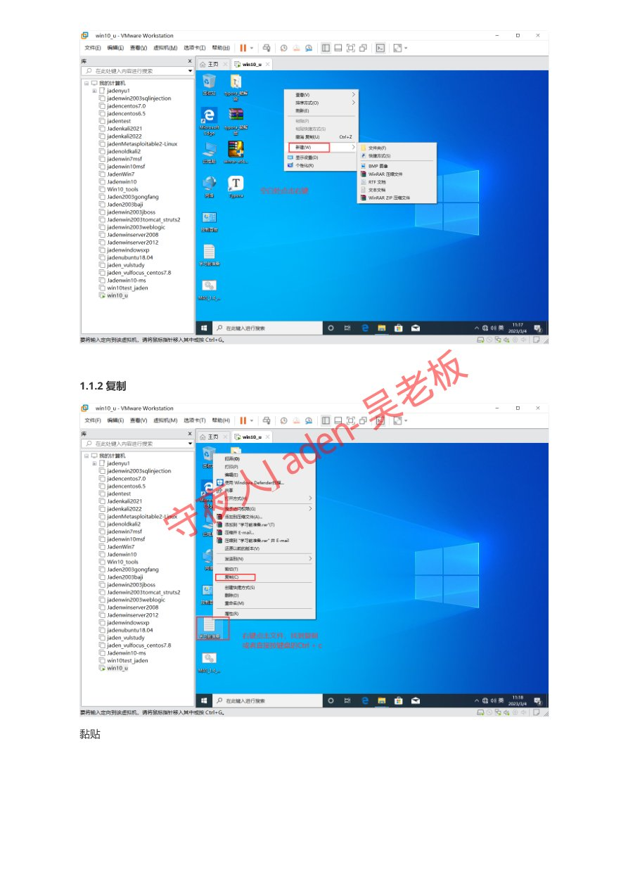

> 第 3 页

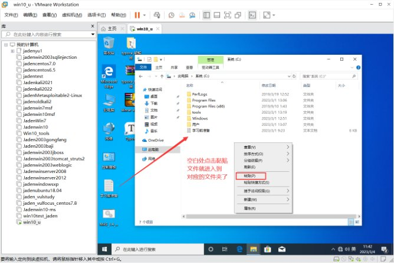

1.1.3 复制黏贴时的速度

复制黏贴时的速度，也就是拷贝文件到某个目录下的速度，主要受到如下几个因素的影响

\1. 磁盘材料：

    固态硬盘比机械硬盘读写速度快，一般机械硬盘读数据的极限速度约为300M/s左右，写入速度约为

120M/s左右，固态硬盘读取速度可达500M/s以上，写入速度也可达400M/s以上，现在随着技术的更新，固态硬盘的读写速度更快了，极限的速度有的可以达到1GB/s以上。

\2. 磁盘接口类型：

    https://www.luyouqi.com/shezhi/24804.html

    USB3.0接口主要用于外接硬盘接口，SATA接口等主要用于内置硬盘接口。USB接口使用方便，但是一般没有SATA接口速度快。

守夜人 Jaden（吴老板）

\3. 文件数量：对于机械硬盘来讲体现的很明显，对于固态硬盘来讲不那么明显，这个硬盘的材质和工作原理

有关系。

    A: 多个文件，B：单个文件，比如A有10个文件，总共1GB大小的数据，B也是1GB大小的数据，但是只有一个文件，那么其他拷贝条件都相同的情况下，拷贝B的速度比拷贝A的速度要快，因为单个文件数据在磁盘上一般是连续存储的，拷贝是读取文件、黏贴是写入文件，不管是读取还是写入，磁盘上连续，那么速度就快，多个文件的话，每次拷贝完一个文件，那么需要切换拷贝下一个文件，这几个文件不是连续的磁盘块，所以你会看到磁盘拷贝速度忽高忽低的，拷贝的时候速度高，切换文件的时候速度又降下来了。

\4. 复制黏贴的目录位置：两块硬盘之前复制黏贴数据，比同一块磁盘上不同目录中复制黏贴数据要快很多。

因为同一磁盘不同目录互相复制黏贴数据时，那么意味着这一块硬盘既要进行读数据的动作同时进行写数据的动作，切换读写是消耗硬盘性能的。

文件越大拷贝的时间越长，但是不代表拷贝的速度慢。

我们看一下复制黏贴不同的目录位置对速度的影响。

首先，我这个电脑有两块盘，都是固态硬盘，所以速度肯定是比较快的，但是速度也是受到目录位置影响的。如何查看自己有几块硬盘，注意硬盘不是盘符昂。

几个盘符：

> 第 4 页

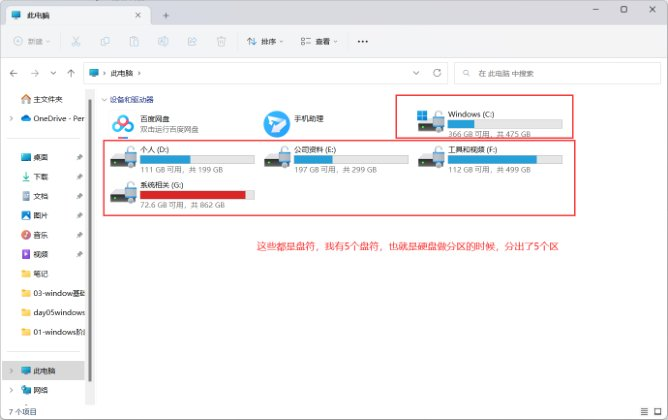

几块硬盘：我的电脑-->鼠标右键-->管理-->磁盘管理

守夜人 Jaden（吴老板）

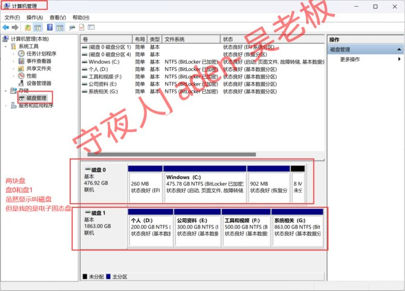

可以看到，我的C盘符在磁盘0，其他盘符在磁盘1上。

不同磁盘互相拷贝

比如将G盘的某个大一些的文件拷贝到C盘，如下

> 第 5 页

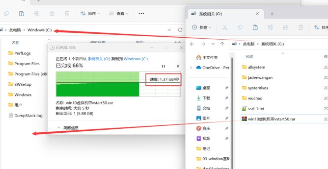

同一磁盘不同目录之间互相拷贝

比如将G盘目录下的文件拷贝到E盘的jaden文件夹中：G盘和E盘是在同一块磁盘

守夜人 Jaden（吴老板）

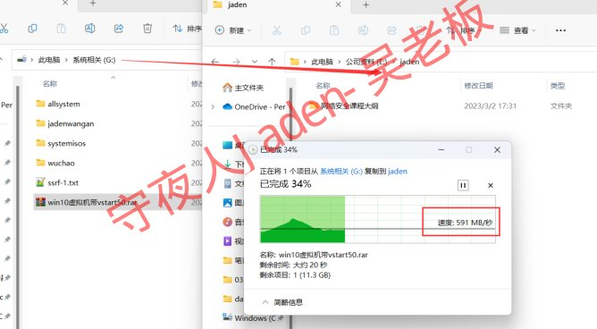

1.2 删除

删除数据的速度是比复制黏贴要快很多的，因为其实就是在磁盘中抹除数据而已。

1.2.1 临时删除

> 第 6 页

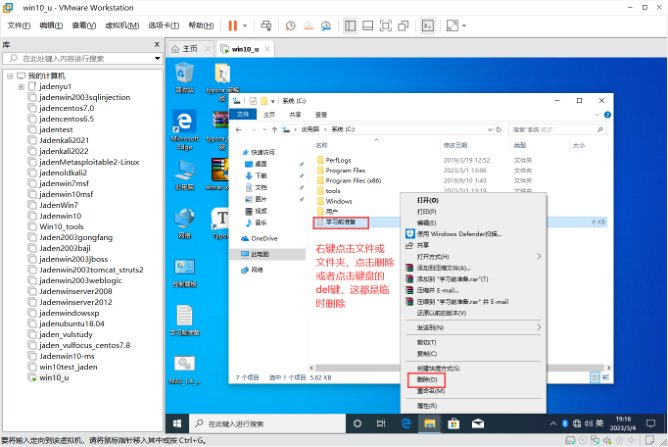

临时删除的文件或者文件夹都是先跑到了回收站，在回收站中可以进行还原

守夜人 Jaden（吴老板）

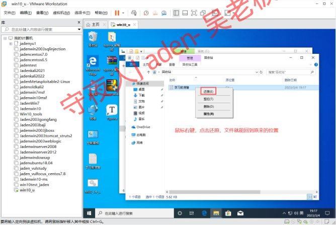

1.2.2 永久删除

> 第 7 页

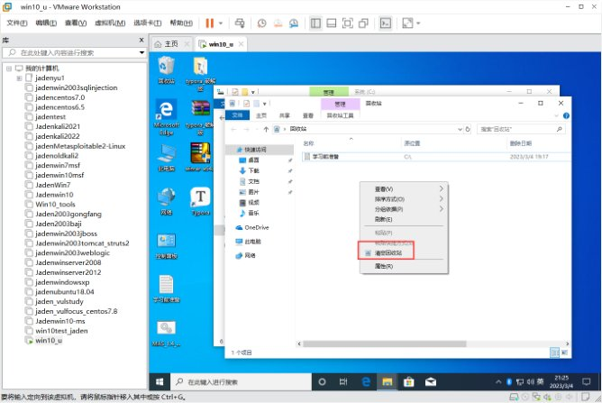

我们平常所说的永久删除是清空回收站、在回收站中删除某些文件、格式化磁盘，手机或者电脑恢复出厂设置等，这些看上去是永久删除了，但是实际上也是临时删除，这是为什么呢？其实我们会发现，删除数据比拷贝或者剪切数据要快很多，这个快的原因，是磁盘删除数据时的操作原理导致的，这个原理也是充分的说明了，我们所有的删除数据的动作，其实都是临时删除，磁盘上保存的数据都是01二进制，看原理图：

守夜人 Jaden（吴老板）

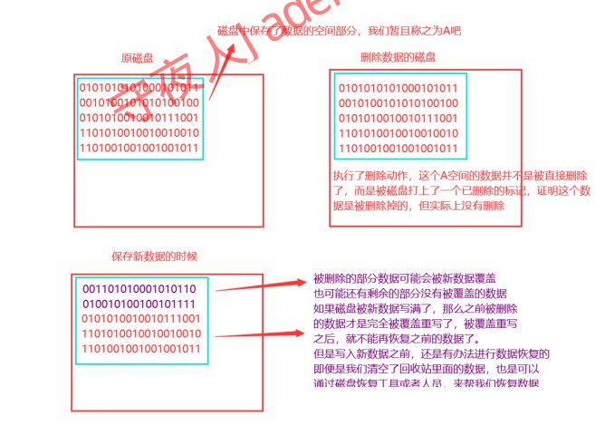

所以作为安全人员来讲，你要记住，不管你的手机还是电脑，没有永久删除数据一说，什么时候才算永久删除了呢，就是写入的新数据完全覆盖了之前删除的数据的空间，那么才算是删除了，所以我们用过的电脑、手机等不要轻易的扔掉或者卖掉，如果里面有什么重要数据，那么别人一做磁盘恢复，很有可能将你的数据拿走。所以小心回收旧手机的人，因为你不知道他用来干嘛，哈哈。

> 第 8 页

1.3 查询

1.3.1 查位置

查找某个文件在什么位置，我们可以通过磁盘搜索功能，如下

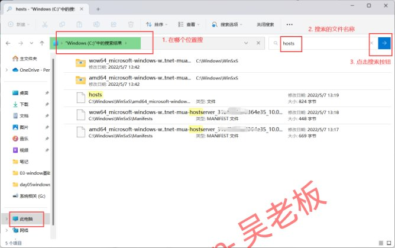

还可以借助专业的搜索工具，比如windows下有一款很好用的文件搜索工具，速度特别快，叫做

everything，我已经给大家放到工具文件夹中了

守夜人 Jaden（吴老板）

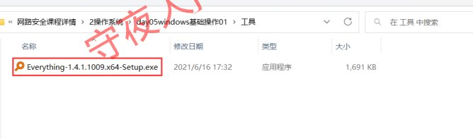

安装好上面的工具之后，打开如下

> 第 9 页

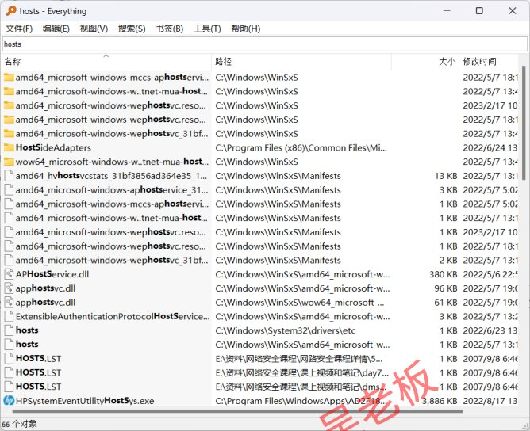

1.3.2 查看属性

鼠标右键点击文件，点击属性

守夜人 Jaden（吴老板）

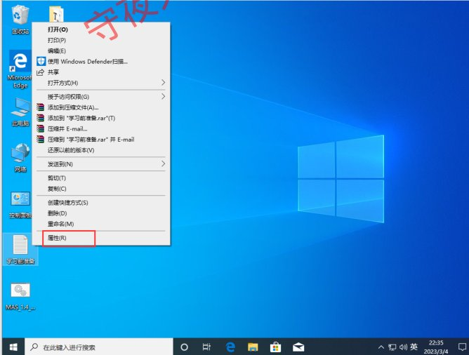

> 第 10 页

如下

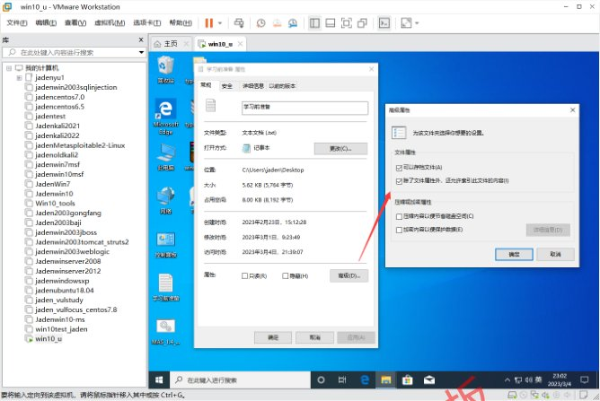

文件大小和占用空间

微软操作系统（DOS、WINDOWS等）中磁盘文件存储管理的最小单位叫做“簇”

1、为了更好地管理磁盘空间和更高效地从硬盘读取数据，操作系统规定一个簇中只能放置一个文件的内容，因此文件所占用的空间，只能是簇的整数倍；如果文件实际大小小于一簇，它也要占一簇的空间。如果文件实际大小大于一簇，根据逻辑推算，那么该文件就要占两个簇的空间。所以，一般情况下文件所占空间要略大于文件的实际大小，只有在少数情况下，即文件的实际大小恰好是簇的整数倍时，文件的实际大小才会与所占空间完全一致。簇可以理解为一个箱子，箱子大小固定，往里面放多少东西，能不能放满，都是你决定的，但是箱子的占用空间大小是固定的，如果你的数据一个箱子放不下，那么就多给你分配几个箱子。

2、簇的大小是硬盘分区在高级格式化时决定的，例如目前固态硬盘一般采用4k的簇大小，簇大和簇小没有优劣之分，存小文件居多时，簇小一些好，比如2k的簇，这样节省磁盘空间，大文件居多时，簇大一些有利于提守夜人 Jaden（吴老板）升读写速度。

3、举例说明：下图文件大小只有5.62KB，当仍然需要占用2个簇的空间，上面这个win10采用的是4KB的簇的

大小。

属性中的文件大小和详细信息中的文件大小不一致？

> 第 11 页

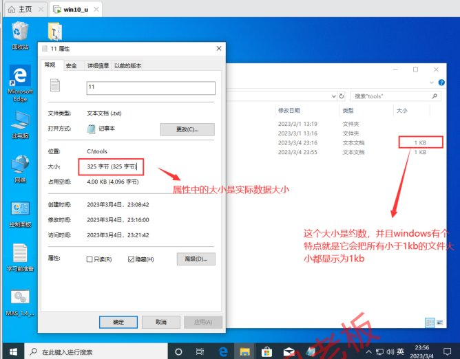

查看簇大小

方式1：新建一个文件，写上一些内容，争取不要超过1kb，然后查看属性，就知道你的簇大小了，现在主流的是2kb和4kb大小。

守夜人 Jaden（吴老板）

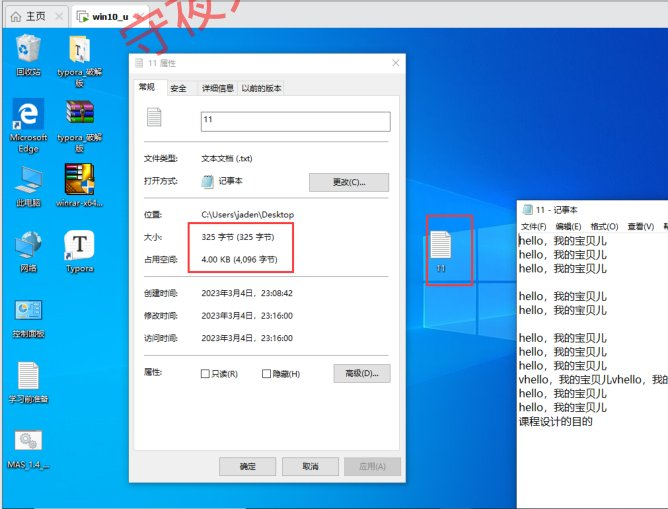

> 第 12 页

可以看到，我的系统的簇大小为4KB。

方式2：点击一下格式化，也能看到默认的簇大小

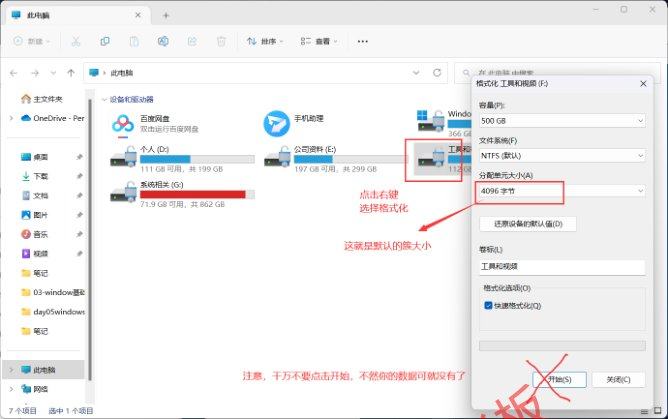

格式化的时候是可以设定簇的大小的，但是这个东西无关大雅，所以目前我们了解即可，不需要过于考

虑。

压缩文件

简单说一下压缩的原理，这个了解一下即可，简单的说，经过压缩软件压缩的文件叫压缩文件，压缩的原理是把文件的二进制代码压缩，把相邻的0,1代码减少，比如有000000,可以把它变成6个0 的写法60,

来减少该文件的空间，压缩文件的基本原理是查找文件内的重复字节,并建立一个相同字节的"词典"文件,

并用一个代码表示,比如在文件里有几处有一个相同的词"中华人民共和国"用一个代码表示并写入"词典"文件,这样就可以达到缩小文件的目的。还有就是比如多个小文件进行打包压缩，那么多个文件相当于合并到了一个文件中，这样也将每个小文件浪费的簇空间减小了，会看到很好的压缩效果。

守夜人 Jaden（吴老板）

压缩和解压文件，都需要专门的工具，这个我在前面已经给大家一个winrar工具了，市面上还有很多其他的压缩工具，可自行使用。

文件隐藏和查看隐藏文件

关于文件隐藏属性，我们先简单说一下，当你不小心安装了木马病毒的时候，这些病毒是一些恶意的程序，它的程序对你的电脑来讲也是数据，也需要存在磁盘上或者内存中的，而系统存数据就是靠文件这个抽象的单位来存的，也就说必然有一些恶意的程序文件存在你的电脑上，黑客为了不让你发现他的病毒文件，他肯定会将病毒文件隐藏的，就比如我们上面看到的隐藏属性，勾选之后，文件就看不到了，

如下：

> 第 13 页

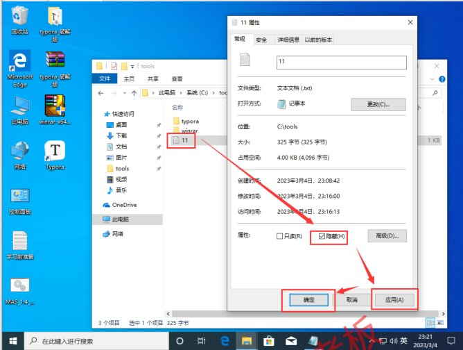

文件就看不到了：

守夜人 Jaden（吴老板）

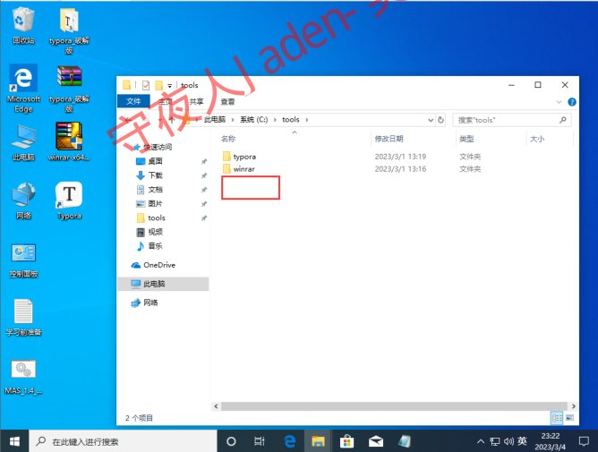

如何看到隐藏文件呢？不同版本的操作系统显示的设置略有不同，但是基本上都是找到文件夹选项-->查看隐藏的项目，比如win10的，如下

> 第 14 页

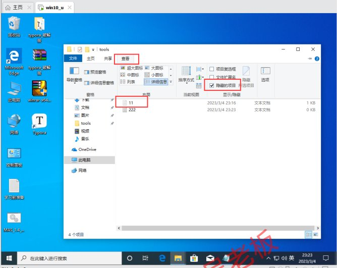

并且我们在创建一个文件，你可以看到，隐藏文件即便是显示出来了，但是比没有设置隐藏的文件，图标的颜色也是浅一些的，这就是操作系统提醒你，这是隐藏文件。

只读属性

设置了只读属性的文件是不允许修改的，只能打开看里面的内容。但是这个属性是可以修改的。

其他属性

其他的属性简单看看即可，关于下面几个属性，我们后面再讲：

守夜人 Jaden（吴老板）

> 第 15 页

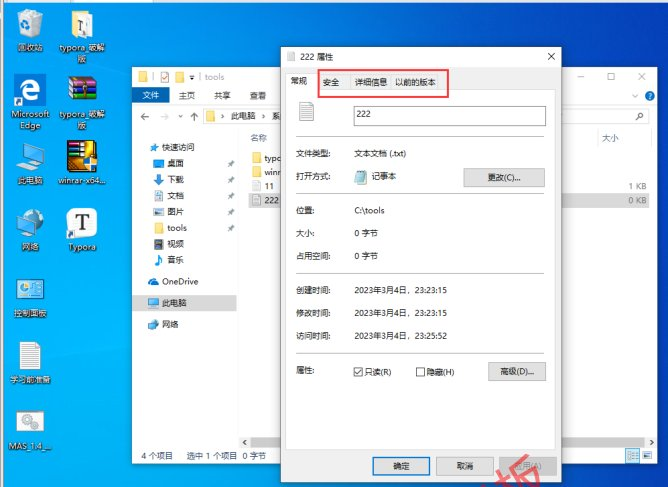

1.3.3 查看内容

不同的文件，需要专门的不同的工具来打开，才能查看和编辑文件中对应的数据，比如txt文件用记事本或者notepad++打开，我们现在的markdown笔记用typora打开，docx文档用word程序打开，xlsx用

excel工具打开等等。

1.4 修改

守夜人 Jaden（吴老板）

1.4.1 改内容

修改内容其实没有什么太多可说的，就是用某个工具打开一个文件，修改里面的内容，比如jaden.txt，

用记事本打开，修改数据。

我简单说一下修改内容原理吧，打开一个文件进行内容修改，其实是一个如下的过程

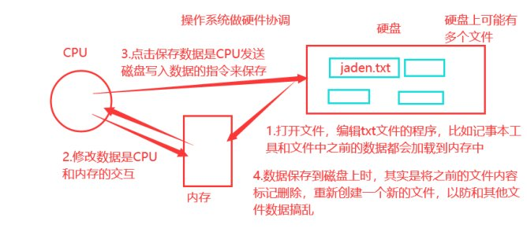

> 第 16 页

1.4.2 改属性

其实就是前面对于隐藏属性、只读属性的一些修改操作。

### 2、文件分类

2.1 程序和数据

在我们电脑或者手机上，除了硬件之外，可以说还剩两样内容，一个是数据，一个是程序，软件就是程序，安装到你电脑或者手机上的其实就是程序员写好的各种程序代码文件，运行这个软件就是运行这些代码，这些代码就是控制计算机的指令，而我们使用这些软件的功能时自己添加、修改等操作的内容，

就是数据，而数据保存在文件中。比如word是程序、doc文件是数据，专门的程序对应着专门的文件数据。所以我们计算机上所有的东西都是程序+数据。数据或者说文件可以复制给其他人，只要他电脑上安装了相应的程序即可打开操作。

守夜人 Jaden（吴老板）

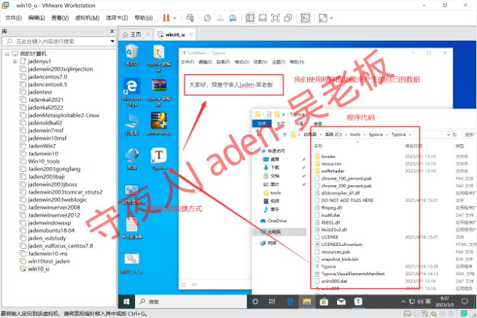

再比如文档编辑工具，有很多：记事本、notepad++、typora等等

2.

记事本一般电脑安装好系统后会自带的一个文档编辑工具，notepad++需要我们自行安装，我已经给大家下载好了：

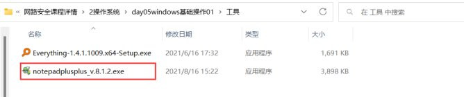

安装之后，打开某个txt文档，如下

> 第 17 页

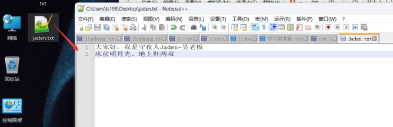

记事本和notepad++都可以打开文档文件，文档文件的类型是txt，就看文件的后缀名。比如

jaden.txt ，. 后面的txt 就是文件后缀名，也就是文件类型。

2.2 查看文件后缀名

文件后缀名，也叫文件扩展名，默认是不显示文件后缀名的，如果我们想通过文件后缀名来看看文件是什么类型的，那么就需要开启后缀名显示功能，不同系统开启方式不同，比如win10系统，开启方式如

下

守夜人 Jaden（吴老板）

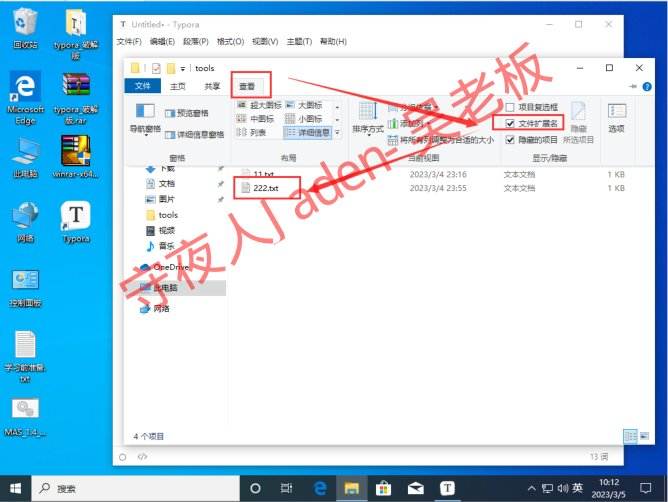

2.3 Markdown文件类型

我们使用typrora工具编辑保存的文件，都是Markdown文件，后缀名为md ，Markdown的简称，mark

是标记的意思，down是下的意思，markdown直译就是标记下来的意思，如下

> 第 18 页

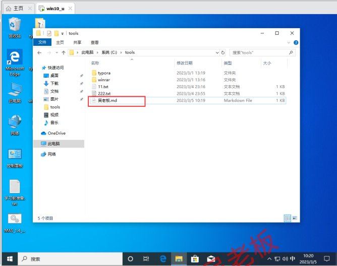

看到了md后缀名。关于Markdown，我们看一下百度百科：https://baike.baidu.com/item/markdow

n/3245829?fr=aladdin

其实md文件本质上也是文本文档，只不过只要在这个文本文档中写一些特殊的markdown语法之后，通过专业的markdown文档工具，比如typora、有道云笔记、为知笔记等打开之后，这些程序工具就会把这些特殊的语法帮我们转换成特殊的效果而已。

比如，我们创建一个md文件，写一些内容，如下，有标题、有文字加粗的效果：

守夜人 Jaden（吴老板）

> 第 19 页

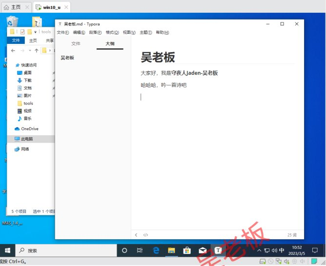

我们通过记事本打开，注意md文件直接双击打开的时候，系统会自动使用markdown工具来打开，如果想用其他工具来打开其他类型的文件，那么就需要如下操作守夜人 Jaden（吴老板）

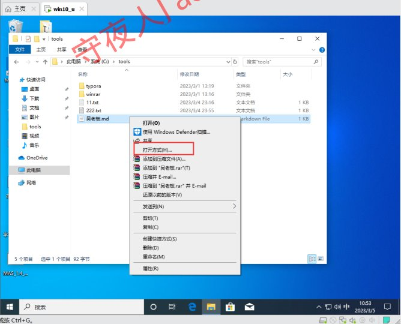

> 第 20 页

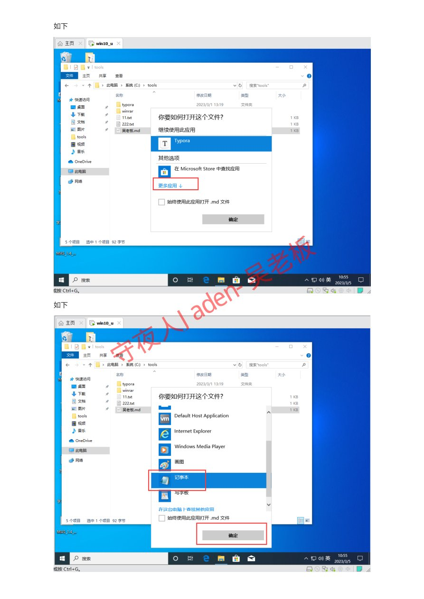

> 第 21 页

看到如下

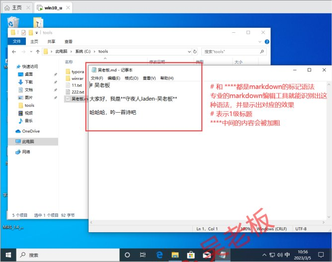

2.4 文件类型

2.4.1 文本文件

文本其实就是我们的数据，主要是记录文字信息，文本文件就是存放数据的文件，常见的文本文件格式有：txt文件、md文件、xls和xlsx、doc和docx、pdf、ppt、htm和html等等。其中txt文件是纯正的文守夜人 Jaden（吴老板）本文件，其他的都是可以带有一些特殊格式的，这些呢我们有时候也称之为文档格式。

关于文本文档，我们后面还会说到，因为有些木马病毒就是基于这些文档传播的。

2.4.2 程序文件

可以运行的文件，里面有程序代码，双击就能打开运行，不管他是用来安装某个程序的，还是来启动某个程序的，我们都叫做程序文件。

windows上程序文件扩展名为exe。

比如某些程序的安装包，就是程序文件：

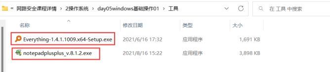

> 第 22 页

再比如某些程序安装好之后的启动文件：

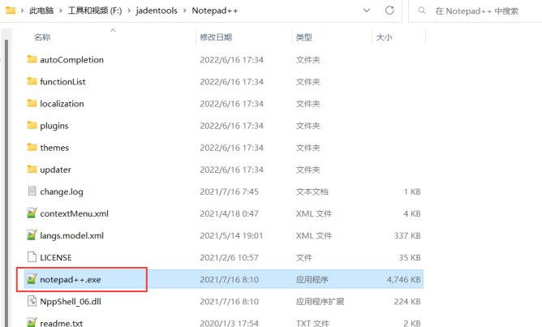

我们桌面的某些程序的快捷方式，其实就是这个启动程序文件的文件路径，打开快捷方式，其实就是打开这个exe程序。

2.4.3 快捷方式

因为我们安装的程序路径有时候我们记不清楚，所以创建一个快捷方式方便我们启动，可以看到，快捷方式其实就是指向了我们对应的程序文件。

守夜人 Jaden（吴老板）

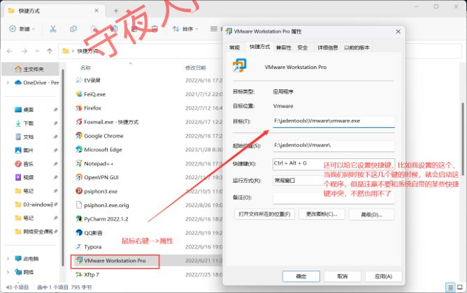

创建快捷方式：

> 第 23 页

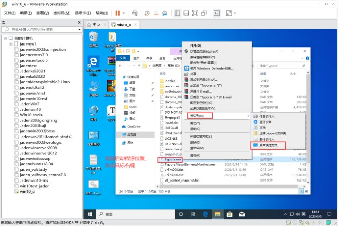

2.4.4 dll文件

关于dll文件，我们目前先了解一下即可，并且用虚拟机来完dll文件的操作，不然很容易把系统玩崩溃了，到时候基本只能重装系统了，那么dll文件到底是什么文件呢？dll文件称之为应用程序扩展文件，如

下

守夜人 Jaden（吴老板）

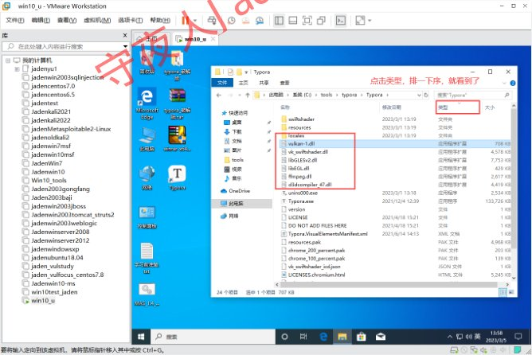

dll文件，学名是动态链接库，英文为DLL，是Dynamic Link Library的缩写。DLL是一个包含可由多个程序，同时使用的代码和数据的库。说白了就是通过这个文件封装一些公用的程序代码，其他程序想用这个功能，直接加载这个dll链接库文件即可。

> 第 24 页

比如qq需要聊天窗口功能、微信也需要聊天窗口功能，关于这个功能，程序员在开发软件的时候，不需要写两边代码，直接将这个聊天窗口程序代码封装到一个dll文件中，哪个程序用这个功能，就把这个dll

文件放到自己的程序代码目录中，调用一下即可。

我们安装的程序，好多都有dll动态链接库文件，当我们运行程序的时候，程序会自动加载这些dll文件，

如果关键性的一些dll文件缺失，那么会导致程序无法正常启动或者运行，比如我们看一下typora的dll文件，删除一下试试：

我把程序代码目录中的这些dll文件剪切到了其他地方

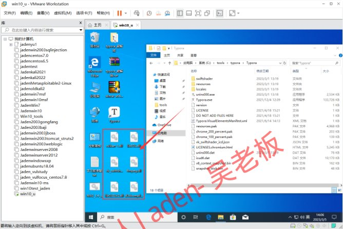

然后运行typora，看效果

守夜人 Jaden（吴老板）

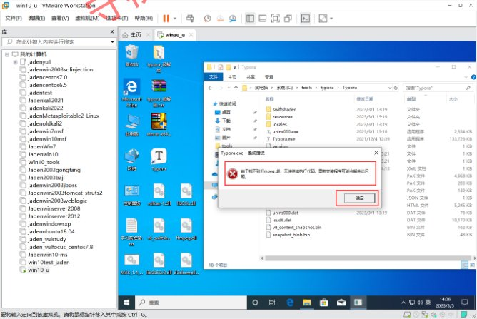

> 第 25 页

这个错误信息可能有朋友遇到过，缺少某个dll文件。我们可以怎么处理这个问题呢，将一个正常电脑或者正常程序中的dll文件拷贝到我们这个工具的目录下即可，比如我们将刚才的dll文件在放回去，然后运行看效果：

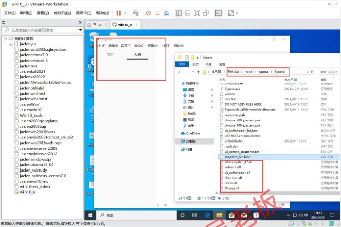

这样就正常了。这是某些程序中自带的dll文件，其实我们操作系统本身也有很多内置的软件和系统自己

本身都有很多的dll文件，这些文件轻易不要动，很容易导致系统崩溃，比如c:\\windows\\system32

目录下的dll文件，都是系统的关键dll文件，轻易不要动：

守夜人 Jaden（吴老板）

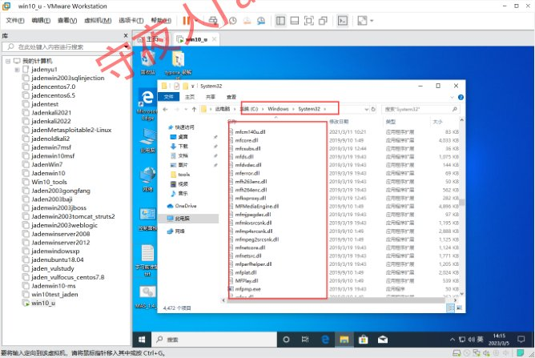

有时候我们的电脑用着用着会提示缺少某些dll文件，比如爱游戏的朋友，可能经常遇到，这时候按照dll

文件提示的名称去网上或者你朋友的电脑上，找到这个文件，放到相应的目录中即可，那么缺少dll文件的原因有很多，比如自己不小心删了、被杀毒软件当成病毒杀掉了、被黑客入侵之后删掉了或者改掉了，都有可能。杀毒软件其实有时候也是很坑的，会将一些正常文件识别成病毒然后杀掉，导致系统某

> 第 26 页

些功能不能正常使用，所以在企业的服务器上一般不会轻易的安装杀毒软件、也不会轻易使用杀毒软件杀毒，就担心杀毒软件研发的不好的话，导致系统崩溃。

2.4.5 图标文件

其实我们看到的桌面快捷方式，多数都是软件自带的图标的效果，图标文件是.ico 结尾的，如何查看图标文件和所在位置：

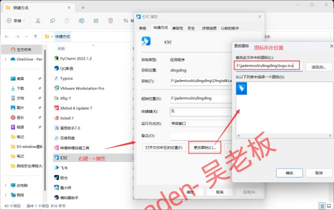

有些是看不到的，如下：

守夜人 Jaden（吴老板）

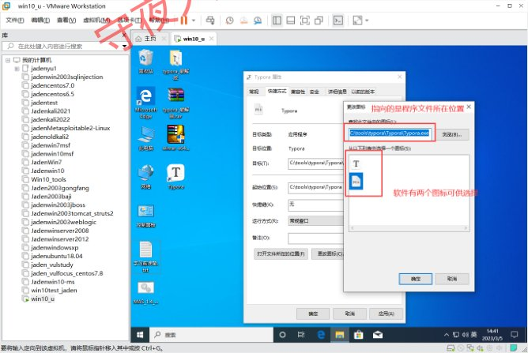

> 第 27 页

如果想更换自己设定的图标的话，就需要自己去程序目录中去找一下这个程序的图标在哪里，图标文件的名称是什么，然后自己去网上下载一些自己想用的图标，改为同名的图标，然后替换到程序的图标文件位置去即可。

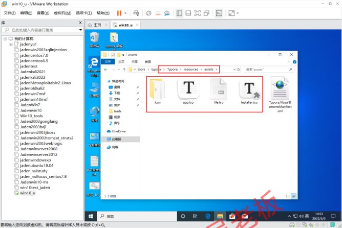

2.4.6 图片文件

后缀名为：jpg/jpeg、png、bmp、gif、weab等的文件为图片文件。

最原始的图片文件是raw类型，了解即可，但是raw文件是不能直接打开浏览的，都需要做各种加工转化才能预览，比如jpg就是由raw格式转化过来的，raw格式的图片比jpg的要大很多，因为转换为jpg时都守夜人 Jaden（吴老板）

要压缩处理，所以我们看到的图片文件其实都是压缩文件，关于raw的介绍：https://baijiahao.baidu.c

om/s?id=1642244967796567828&wfr=spider&for=pc

2.4.7 视频文件

后缀名为：mp4、vmv、rm、rmvb、3gp、flv、avi等

2.4.8 音频文件

后缀名为：mp3、flac、wav、wma、ape等

不同格式的文件需要不同的专业工具来打开，也有一些工具可以打开多种格式的文件，看软件工具所支持的格式有多少。

打开图片的工具，比如2345看图王：但是这个软件广告太多，我一般用的是系统内置的图片查看器。在网络安全领域有个专门的技术领域是逆向破解，这个东西有比较高的技术含量。

> 第 28 页

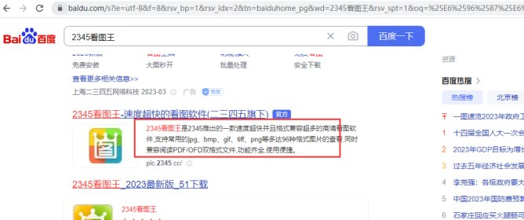

视频播放器工具：PotPlayer，我用的是QQ影音。

守夜人 Jaden（吴老板）

视频播放器一般也都能播放音频文件，不过现在看视频，好多都是在网页上或者app上来看了，基本都不用下载到电脑或者手机上，如果你需要用播放器了，就下载一个。

其实细心一些你会发现，不同类型的文件除了后缀名不同之外，文件的小图标也不同。这个图标其实表示的是，直接打开文件时默认用哪个工具打开。

## 三、重要文件夹的介绍

一般，刚安装完成的windows系统都会有如下几个目录：

Program Files  软件程序存放目录，64位程序文件默认会安装到这个目录下，安装的时候是可以自行修改

安装目录的，如果你安装的某个软件的时候，没有特意的修改安装路径，那么就去这个目录中找

Program Files (x86)   32位程序文件默认会安装到这个目录下，x86是x86_32的简写，x64是x86_64

的简写

Windows   系统程序的核心目录

用户      多用户文件(桌面)，现在的系统都支持多个用户登录操作，系统为了作区分，就在系统盘为每个用户分配一个默认的文件夹，这就是所谓的用户目录。

> 第 29 页

### 1、Windows目录

这个目录可以去了解一下，目前不用太多研究：https://baike.baidu.com/item/Windows%E7%B3%B

B%E7%BB%9F%E7%9B%AE%E5%BD%95/7304058?fr=aladdin

### 2、用户目录

这是给多用户，每个用户准备的目录

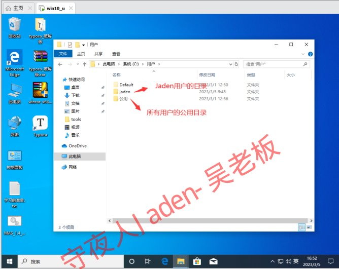

守夜人 Jaden（吴老板）

比如我们在创建一个用户。

2.1 创建并切换用户

关于用户的操作和知识点，我们后续会细讲，这里简单知道一下即可：

> 第 30 页

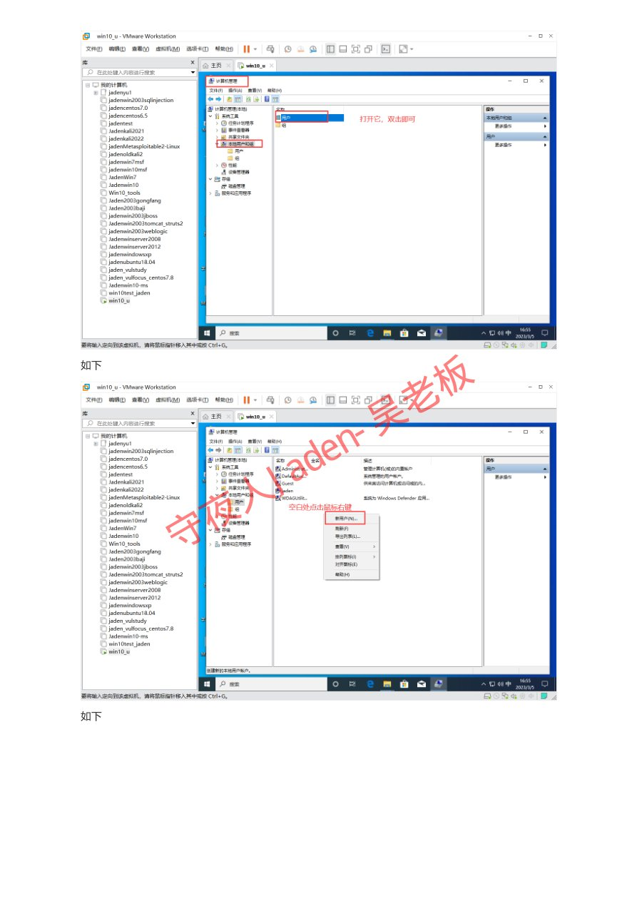

> 第 31 页

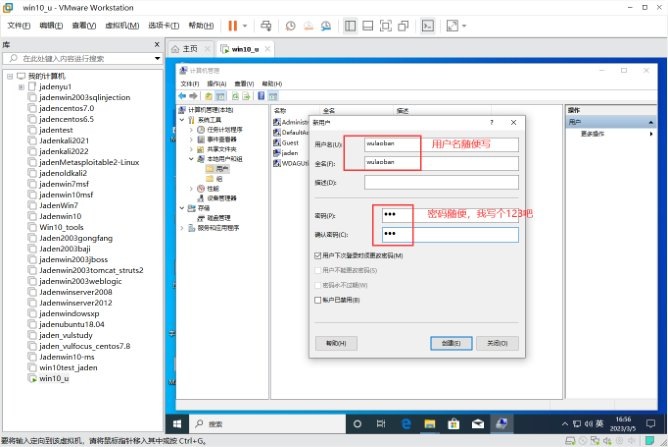

点击创建，如下

守夜人 Jaden（吴老板）

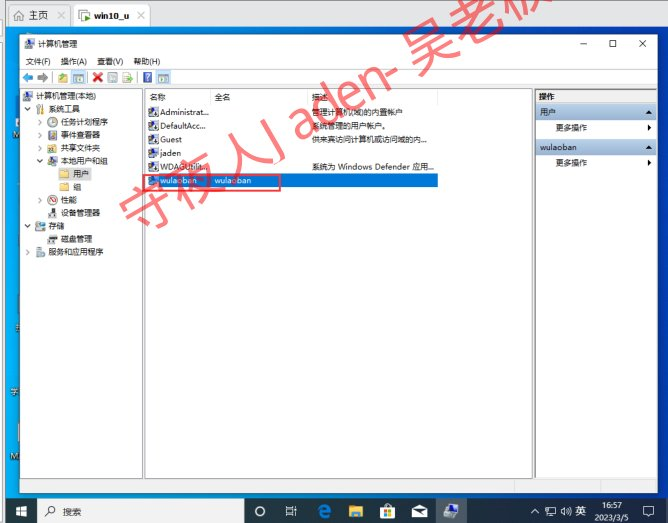

然后在开始位置看一下用户：

> 第 32 页

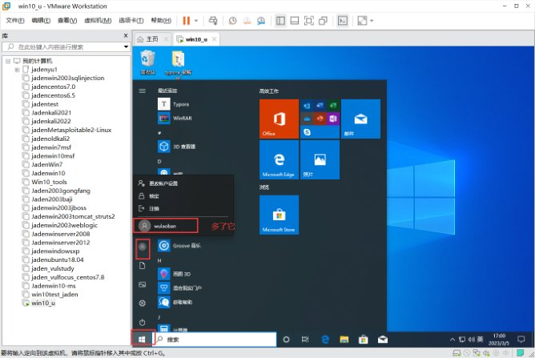

点击这个用户就可以切换到这个用户来登录控制计算机了：

守夜人 Jaden（吴老板）

如下，会做一些等待，因为系统要为这个用户准备这个用户必须的一些系统功能及目录结构。然后再看用户目录

> 第 33 页

wulaoban这个用户的目录就有了。注意，没有用这个用户登录过，是不会生成这个用户的目录的。

2.2 用户安装软件说明

每个用户都有自己的一整套系统内容，比如：

守夜人 Jaden（吴老板）

看上去好多中文，比如桌面，但其实都是英文的，只是显示给你的时候中文显示的而已

> 第 34 页

其实每个用户登录之后，用户目录中的内容都是从Default目录中拷贝来的

守夜人 Jaden（吴老板）

> 第 35 页

一般我们安装某个软件的时候，比如typora：

如果没有选择安装给所有用户，就会提示默认安装路径是当前用户名，比如我是jaden用户，安装路径

为c:\Users\jaden\AppData\Local\Programs\Typora 路径下。

如果给所有用户安装，默认安装路径就是Program Files 目录。

注意：下面这个我们前面就讲过其原理

64位操作系统：可以运行64位程序，同时还可以运行32位程序

32位操作系统：只能运行32位程序

## 四、文件下载

守夜人 Jaden（吴老板）

这个东西我相信很多都不陌生。

### 1、下载应用

大部分的软件都可以在官网下载，或者在应用商城(比如微软商城、360管家之类的)下载，搜软件名字，

下载即可。我们这里要说的是，还有很多软件并没有上架到应用商店中，并且在应用商店中也不容易找到我们想要的某些版本，所以有时候还是要靠浏览器去搜索查找对应的资源。并且网络安全方面的工具，在应用商城里面基本是找不到的。

比如下载QQ，如下

> 第 36 页

QQ官网即可下载，还能看到多个版本。注意：尽量在官网下载，在其他网站下载的话，这些软件一般会被捆绑一些广告、木马病毒之类的。

再比如notepad++，这个软件在网上很难找到官网，因为这是国外的人开发的一块软件，官网也在国外。那么就只能在一些其他网站下载了。

守夜人 Jaden（吴老板）

这个网站不是官网，也是有很多软件在这个网站上挂着，这个网站主要是为了分享某些软件的同时接广告挣钱。

再比如，有些软件是收费的，比如dreamveawer，那么我们不想缴费，就需要下载破解的，或者下载正版的，然后找一些破解方式，这就要自己在网上搜索了，但是找的时候，我们需要找一找评论比较好，

比如下面这个：

这个就很坑了：

> 第 37 页

下面这个就还可以：

守夜人 Jaden（吴老板）

还有一些网站，标着软件大小为几百M，但是下载下来也就几K或者几十K，这就更坑了，这几K本身就是一些木马文件程序，然后你需要安装这个几k的程序，这个程序执行了木马程序之后，在帮你下载。所以我们下载某些工具还是要小心一些的，并且下载下来之后最好在虚拟机上玩一玩试试，感觉没什么问题的话，再放到自己的电脑上。

> 第 38 页

### 2、下载图片

只要我们在网页上能够看到的图片，基本都是可以下载下来的，如下

图片另存为，然后改图片名称即可，后缀名也可以直接改成jpg、png等。

### 3、下载音视频

以前很容易下载，但是现在在网上很难下载音频和视频了，因为音频基本都收费了，或者基本没有地方可以下载了，不过有些网站还是可以免费下载的，不过一般都不会公开出来让大家知道，因为很容易被告侵权。这就要在网上冲浪，好好找找了。如果你有下载需求，Jaden推荐大家一个工具，叫做idm下载器，这个我就不多提了，有兴趣的可以自行搜索玩一玩。

守夜人 Jaden（吴老板）

### 4、 迅雷下载

4.1 下载安装迅雷工具

先下载迅雷

> 第 39 页

我也给大家准备好了

守夜人 Jaden（吴老板）

下载下来之后安装，我直接装在虚拟机上去给大家演示吧

> 第 40 页

> 第 41 页

接下来看一下用迅雷是如何下载资源的。

4.2 使用迅雷下载资源

比如前面我们说到的windows的iso镜像下载，网址：https://msdn.itellyou.cn/

守夜人 Jaden（吴老板）

如下

> 第 42 页

点击详细信息，如下，我给大家的都是这么下载下来的。

守夜人 Jaden（吴老板）

或者这里，如下

> 第 43 页

打开迅雷工具，然后去复制这些资源的磁力链接，复制链接地址之后，点击一下迅雷，就会自动弹出下

载窗口

守夜人 Jaden（吴老板）

点击下载即可，默认下载地址上面也有写到。

再比如想下载电影，有些网站专门提供了迅雷的下载链接，比如电影天堂、80s等，看一下电影天堂上的电影：

> 第 44 页

复制一下这个地址，迅雷就提示下载了，如下

守夜人 Jaden（吴老板）

以前这样的网站有很多，现在少了，因为不管是看电影还是听音乐，现在都是直接用app来看了，很少下载下来看了。

### 5、 网盘下载

百度网盘、阿里云盘等，这个我就不多说了，大家下载安装一个百度网盘，我后面的资料基本都是百度网盘给大家分享。

> 第 45 页

## 五、软件管理

### 1、软件安装

按照软件安装的方式来分，软件可以分为三种类型

\1. 软件安装包(软件安装包的方式是用的最多的，而且有些软件为了防止软件被第三方篡改，官网上公布了软

件的hash值)

\2. 破解软件(绿色软件)

\3. 单个文件(不需要安装，不需要破解，直接可以使用)，比如feiq.exe、psiphon3.exe等

第一个软件安装包的方式的，我们不用多说。

第二个破解软件、绿色软件这种的，我们来简单说一下

守夜人 Jaden（吴老板）

这种破解软件有软件安装包形式的，比如我们用的破解版的typora，也是需要安装的

有不需要安装的，直接解压出来处理一下就能使用，比如下面这个，CS1.6本身是收费的，需要买

CDKey来激活。

这个工具我们解压一下，不需要安装，然后直接破解激活：

> 第 46 页

如下，这是一个注册表修改操作，关于注册表，我们后面会细讲，这里先不用研究。

守夜人 Jaden（吴老板）

如下

> 第 47 页

然后直接打开主程序：

守夜人 Jaden（吴老板）

就可以玩了

> 第 48 页

这种就是绿色破解软件，而且不用安装，直接执行一些操作即可使用。所谓绿色，其实就是不含有什么广告、木马病毒之类的恶意程序。

有些软件为了防止自己的软件被人破解篡改，会将软件的hash值发布到网站，hash值可以校验文件的一

致性。

比如U启通软件：官网：https://www.upe.net/，找到下载位置

守夜人 Jaden（吴老板）

hash是一种数学计算公式，相同的数据通过hash算法得到的结果是一样的，数据只要有一点点的不同，

那么hash的结果也是不同的，这样就可以提醒用户，以防安装了被破解篡改的盗版软件。

如何计算文件数据的hash值呢？网上有很多计算hash值的工具，比如我给大家准备了一个：

> 第 49 页

那么，下载下来的文件，你计算一下hash值，和官网发布的hash值一对比，就知道这个文件是否被篡改

过了。

### 2、软件卸载

方式1：控制面板处卸载

比如我们不想用迅雷了，可以卸载，比如win10、win7等卸载方式如下

守夜人 Jaden（吴老板）

如下

> 第 50 页

> 第 51 页

等待一会之后就看到如下窗口：

守夜人 Jaden（吴老板）

这样就卸载完成了，有些软件，比如鲁大师、360等卸载的时候各种不好卸载，就比较流氓。

方式2：win10还可以在设置-->应用处卸载

> 第 52 页

> 第 53 页

也是可以卸载的，我个人还是比较喜欢控制面板的地方卸载，看着感觉更舒服。

## 六、压缩和解压缩

后面我会给大家分享很多压缩包，或者去网上下载很多学习过程中要使用的压缩包。

我们后面使用的有些工具或者文件，有些是木马病毒，因为我们要研究学习它，这样的话，我们最好对这些文件进行一些压缩处理，不然很容易被电脑上的杀毒软件给查杀掉，就丢失了，总被杀掉的话，就不容易研究其原理，所以我们也是有必要要说一下压缩和解压缩，并且其实我们平常传输一些文件，一般都压缩一下，因为一压缩，体积就变小了，传输的更快，而且多个文件可以压缩到一个压缩包中，传输、拷贝等操作都会更加快一些。

守夜人 Jaden（吴老板）

### 1、压缩

使用专门的压缩工具，比如我前面给大家的winrar，还有好多压缩工具，这些工具都是可以压缩文件和文件夹的，也自带解压功能，被压缩之后会生成一个压缩文件，我们称之为压缩包。

> 第 54 页

可以设定压缩之后的格式

常见的压缩包格式：.rar、.zip、.7z、.Gzip等，其实我们之前发的iso镜像文件也是可解压的压缩包，还有andriod手机的apk包也是压缩文件。

    一般rar和zip的居多，两个用哪个都行，但是rar的压缩包必须安装专业的压缩工具才能解压，zip的压缩包是不需要安装专业工具，直接就可以通过系统解压的。

    .7z是.7-zip的简写，有一个压缩工具叫做7zip，这个工具压缩出来的压缩包就是.7z结尾的后缀名。

如下

守夜人 Jaden（吴老板）

> 第 55 页

设置密码功能是我们如果压缩之后需要分享给某个人，那么为了安全，可以设定一个压缩密码，别人在解压这个文件时，需要输入正确的密码才能解压。设定密码还有个好处就是，如果我们压缩的是一些木马文件，压缩之后也是很有可能被杀毒软件查杀的，那么设置密码之后，杀毒软件是无法检测出里面的数据的，所以就不会查杀。

如下

如下

守夜人 Jaden（吴老板）

压缩完成。

> 第 56 页

### 2、解压

注意，是选择解压到当前文件夹还是选择解压到xxx目录呢？

这就要打开压缩包看一下，压缩的时候压缩的是文件夹，还是多个文件，如果是压缩的时候，所有文件都放到了某个文件夹中，然后压缩的文件夹，那么直接选择解压到当前文件夹。如果是多个文件，那么选择解压到xxx目录中。不然，如果压缩时选择的文件太多，我们不小心一解压到当前文件夹，那么瞬间这个文件夹中会出现好多好多文件，导致你看上去都乱套了，不知道哪些是刚解压出来的，哪些是之前的文件了。所以解压的时候还是要先打开看看压缩包里面的内容的。

守夜人 Jaden（吴老板）

## 七、建议

建议大家学一些office软件工具的使用，比如word、excel、powerpoint的基础操作，因为你参加工作之后，办公必须要会，比如网络安全领域，我们经常会出一些报告，可能需要你写，那么就是这些基础文档工具的操作，所以有时间的话还是要学一学的。不用学太多，基本操作会了即可。

> 第 57 页

