# Window进阶操作

来源 PDF：Window进阶操作.pdf（原文件位于课程目录，本文件夹不包含 PDF）

> 第 1 页

Window进阶操作(守夜人 Jaden（吴老板）)

windows进阶操作会学习到很多关于安全相关的功能点，很多功能点是电脑普通用户基本没有用过的，

这些功能点在家庭版的系统中是没有的，所以我们使用虚拟机来玩，因为虚拟机我们安装的都是专业版的，以下功能基本都有，并且可以使用。

## 一、修改密码

### 1、登录成功之后改密码

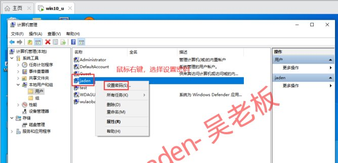

如下

守夜人 Jaden（吴老板）

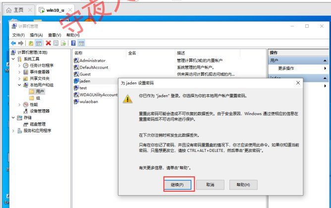

设置新密码即可，比如我设置了密码为123

> 第 2 页

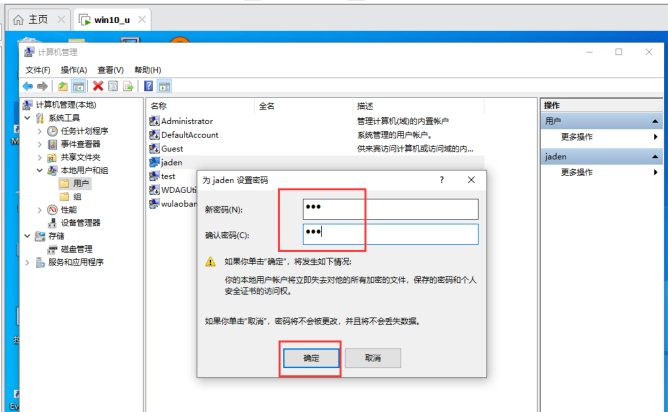

### 2、登录之前就忘记密码了怎么办

守夜人 Jaden（吴老板）

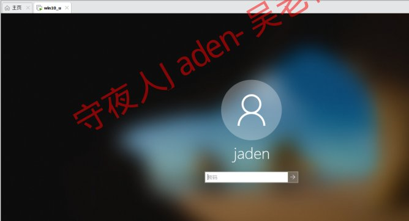

忘记密码怎么办？有些人因为这个忘记了密码的事情直接重装系统了，重装是可以的，但是太耽误时间了。

通过pe启动盘即可进行密码破解，其实比较简单，总共就这么几步：首先把电脑关机，然后插入U启动盘，重启电脑，进入BIOS选择U盘启动，进入pe来修改密码。

2.1 虚拟机加载U启动盘

这里我用虚拟机来给大家演示，先把虚拟机电脑关机，然后插入U盘，U盘先连接到我们自己的物理机

> 第 3 页

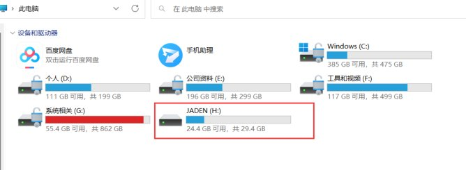

其实如果是通过U启动盘来修改真机的电脑密码，那么直接重启真机，进入bios，选择U盘启动，进入pe

系统修改密码即可，这里由于我们用虚拟机给大家演示的，所以比真机稍微麻烦一些。

首先要让虚拟机识别到我们的U启动盘，并且以U盘来启动系统，进入pe，但是虚拟机关机状态下是无法识别U盘的，不过对于虚拟机来讲，U盘其实也算是物理机的一块硬盘，那么我们就可以将U盘以硬盘的身份，连接到虚拟机，如下守夜人 Jaden（吴老板）

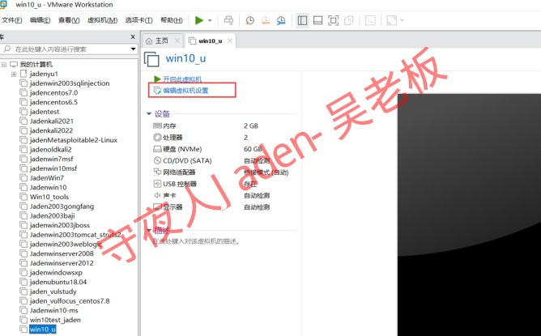

如下

> 第 4 页

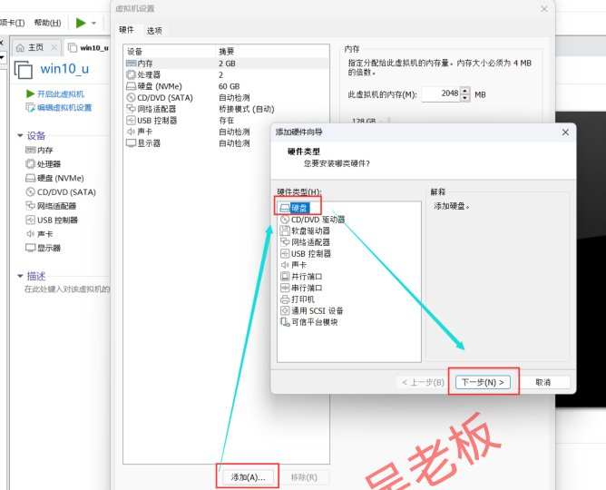

如下，这里选择硬盘类型，由于我的U盘是SCSI接口的，所以我们选择SCSI类型

守夜人 Jaden（吴老板）

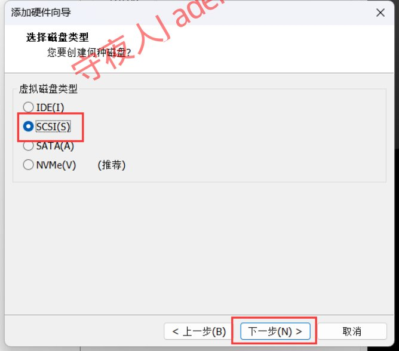

> 第 5 页

你的U盘是什么接口的，那么可以去网上搜索自己的U盘型号来进行查询，如果连型号都不知道，那么可以尝试鲁大师，看一下U盘类型

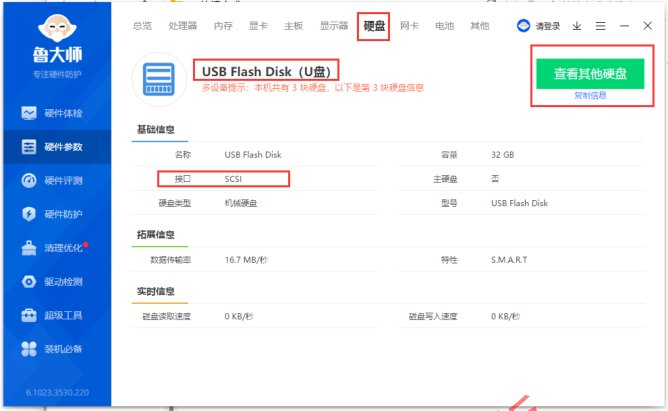

然后如下

守夜人 Jaden（吴老板）

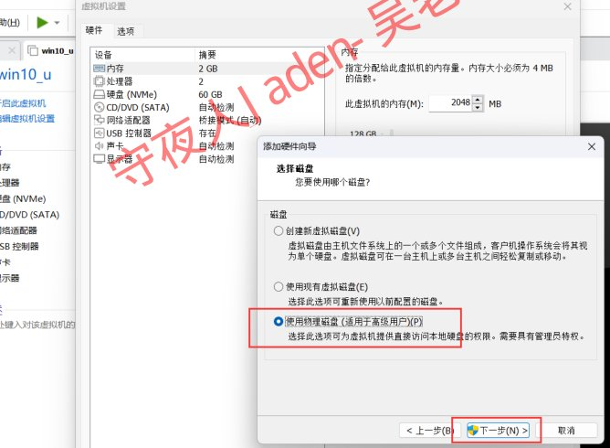

然后提示如下

> 第 6 页

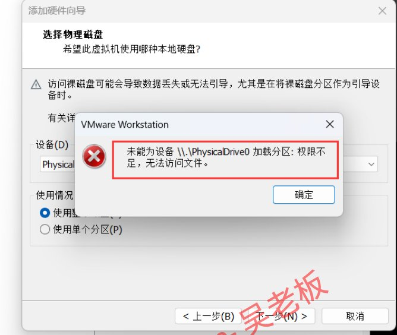

这是因为权限不足引起的，那么我们需要关闭Vmware，然后以管理员身份来打开VMware，如下守夜人 Jaden（吴老板）

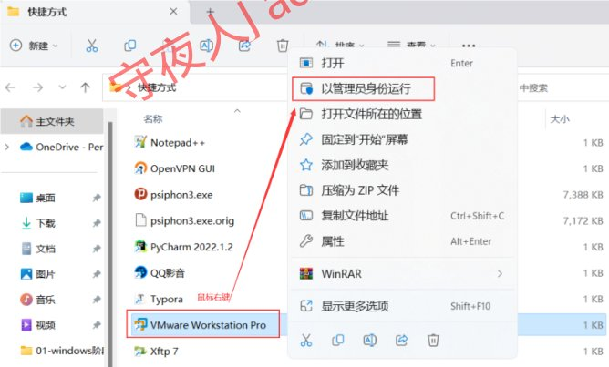

然后继续操作到刚才的虚拟机设置位置：

> 第 7 页

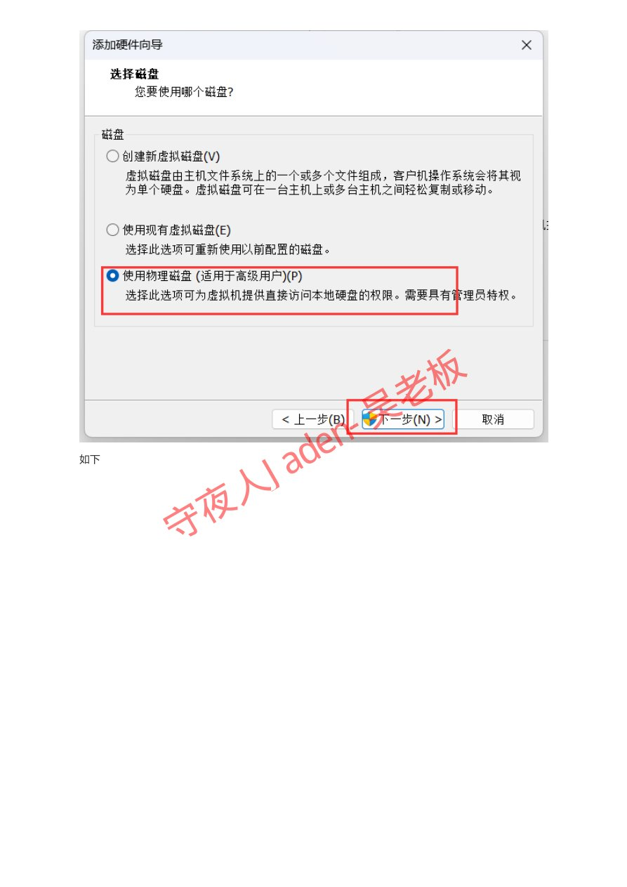

> 第 8 页

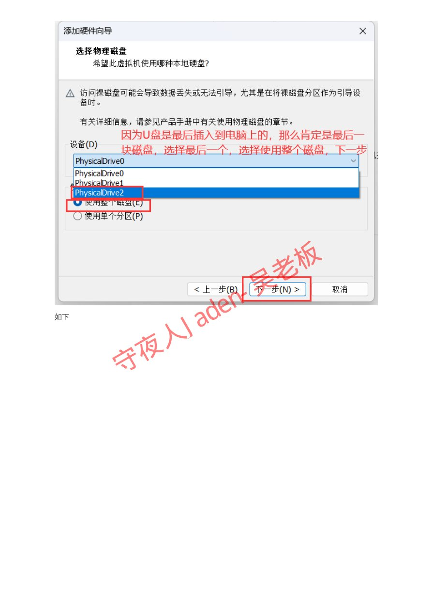

> 第 9 页

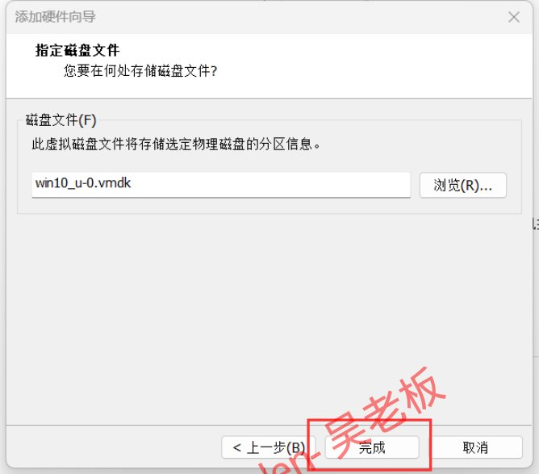

然后就可以了，查看虚拟机设置

守夜人 Jaden（吴老板）

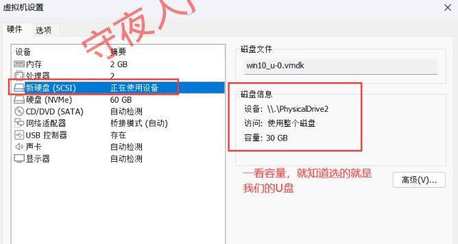

确定选中的是我们的U盘，点击确定即可。

2.2 进入虚拟机的BIOS

> 第 10 页

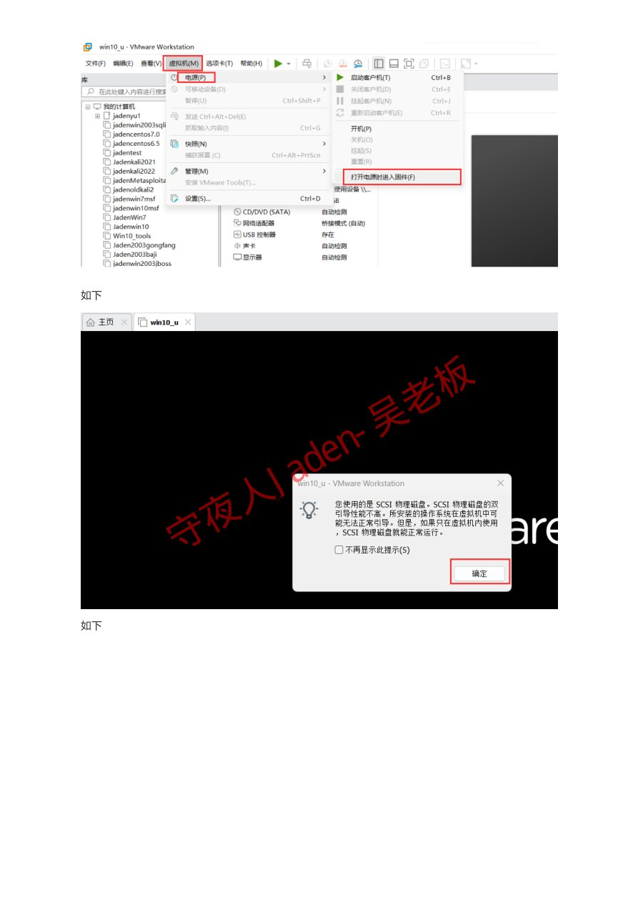

> 第 11 页

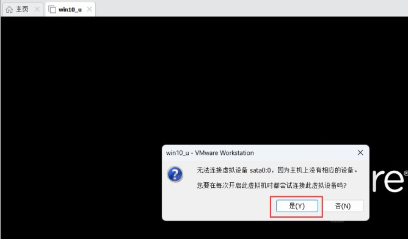

如下

守夜人 Jaden（吴老板）

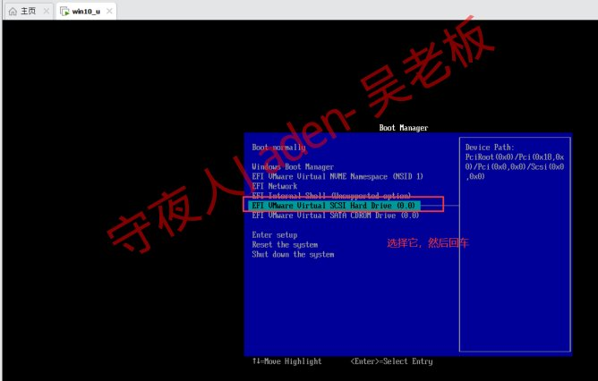

等待一会后，就进入到pe了。这里要注意，进入pe之后，你系统上的所有数据都是可以通过pe加载到的，可以拷贝出去，也可以删除。所以如果是让其他人帮你来修改密码，那么这里不太安全。

> 第 12 页

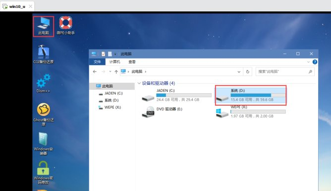

2.3 pe修改windows密码

守夜人 Jaden（吴老板）

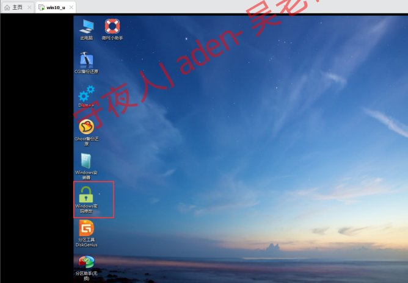

如下

> 第 13 页

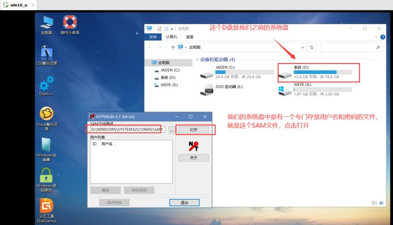

如下，就看到我们原系统中的所有用户名了，选中你想修改密码的用户，然后点击修改密码

守夜人 Jaden（吴老板）

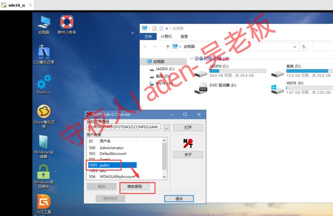

如下，设置新密码，比如我设置密码为123

> 第 14 页

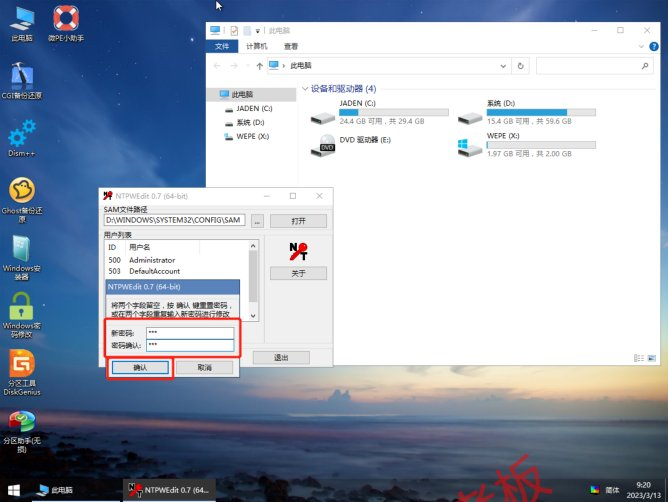

然后点击确定。点击保存修改，然后退出，如下

守夜人 Jaden（吴老板）

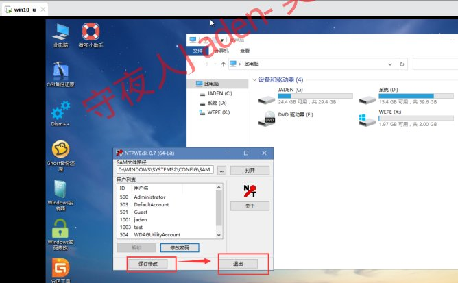

这样就修改完毕了。接下来就关机、拔掉U盘，重新启动即可，如下

> 第 15 页

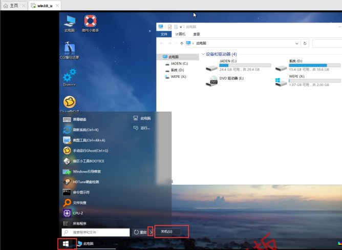

如下，然后将虚拟机的这块新添加的硬盘删除

守夜人 Jaden（吴老板）

> 第 16 页

守夜人 Jaden（吴老板）

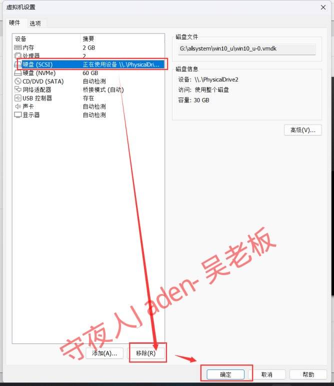

然后拔出U盘，并重启虚拟机。输入密码就可以进入系统了。

> 第 17 页

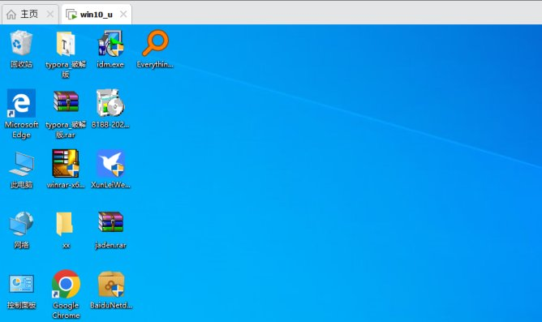

这就是忘记密码之后，我们修改密码的手段，其实对于真机来说，不需要这么复杂，我们插入U启动

盘，然后重启电脑，选择U盘启动系统，进入pe，直接修改密码即可，我们刚才通过虚拟机来演示，还多了虚拟机加载U启动盘的步骤。

2.4 防止pe修改密码

2.4.1 微软账号

看到这里有没有感觉到害怕，你的电脑给别人，别人可以破解你的密码的，进入到系统中为所欲为。

微软也考虑到了这一点，所以我们在安装系统的过程中，微软会提示你创建一个微软windows账号，这个账号是需要到微软官方注册的，有个邮箱就能注册，注意了，微软账号和电脑本地的账号是有区别的。如果你的电脑只用微软账号登录，那么通过pe也是无法修改微软账号的，pe只能修改本地账号的密码。而微软账号的密码是存在微软的远程服务器中的，pe是无法去微软的服务器上修改密码的，微软也不让。但是多数情况下，不管是个人还是企业，都是是用本地用户来登录系统，因为很方便，而且速度守夜人 Jaden（吴老板）快，微软账号每次登录都需要联网，并且用网络验证用户名和密码，就比较慢。win10 之前是没有微软账号这么一说的，win10及之后为了安全，微软推出了这么个账号。修改微软账号，可以到微软官网账户中心去修改。

> 第 18 页

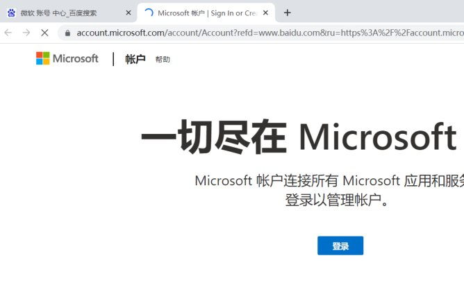

2.4.2 给BIOS设置密码

其实我们是可以被BIOS设置密码的，那么别人想通过bios进入到pe中，那么想进入bios就需要输入密码。这个示例我们就不演示了，大家知道一下即可。

守夜人 Jaden（吴老板）

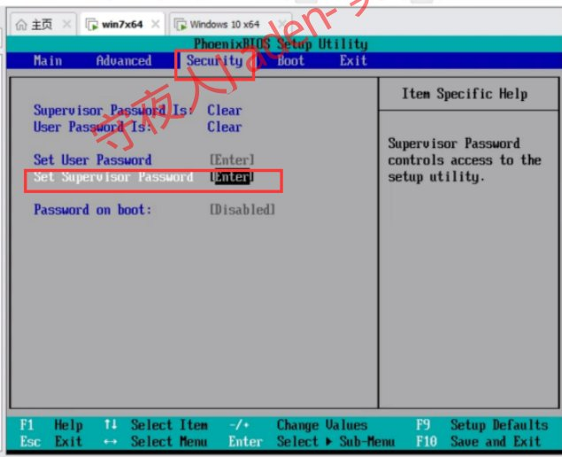

如下，设置密码

> 第 19 页

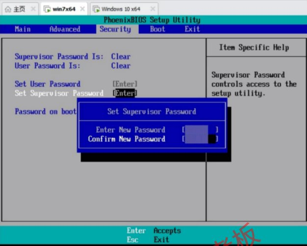

如下，将启动时需要密码的功能选项打开

守夜人 Jaden（吴老板）

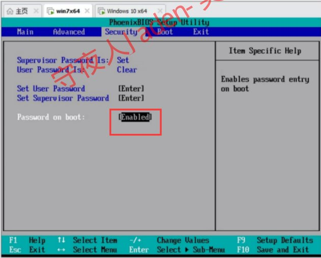

然后保存退出，电脑会自动重启，我们知道系统重启会先加载bios，然后通过bios引导进入到操作系统中，但是加载bios的时候，就看到bios的密码提示了：

> 第 20 页

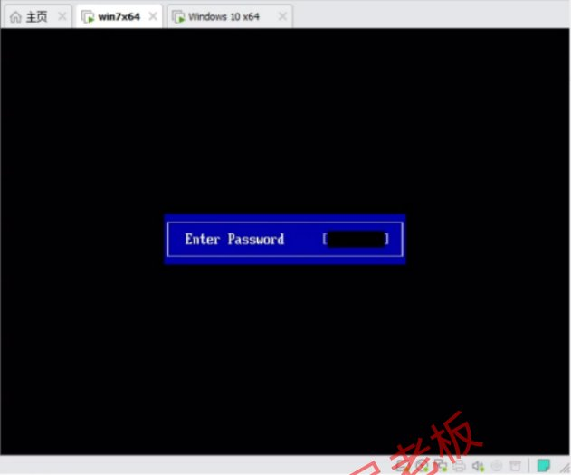

这里提示大家一下，bios的密码是通过主板上的一个小电池来保存的，这个小电池叫做纽扣电池，我们电脑关机很久之后一开机，你会发现系统时间也是正确的，这也是由于这个小电池在持续的供电，完成时钟的记录守夜人 Jaden（吴老板）

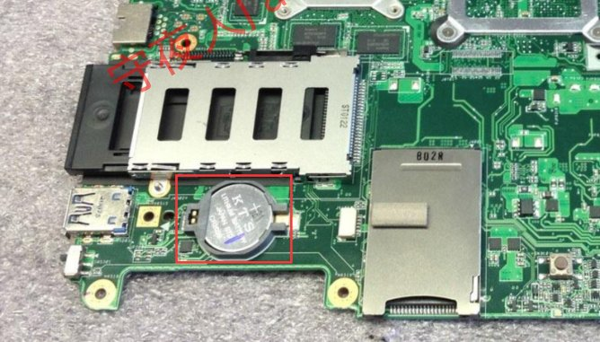

如果别人把这个小电池扣下来放电，电没有之后，再放到主板上，那么我们刚才设置的bios密码肯定就没有了，还是可以通过pe来启动的。所以我们还需要保护我们的电脑主板，哈哈，比如网吧都会给自己的电脑主机上锁。

> 第 21 页

## 二、开机自启动

开启自启动，顾名思义，某些程序在一开机的时候就自动启动，为什么要提到开机自启动呢？因为后续我们的安全课程中，会涉及到木马病毒的开机自启动行为的分析和处理，所以我们先学习一下操作系统开机自启动的机制。

### 1、具备自启动功能的软件

首先找一个默认安装之后就开机自启动的应用程序，比如我下面用的百度网盘，先放到虚拟机上玩一下守夜人 Jaden（吴老板）

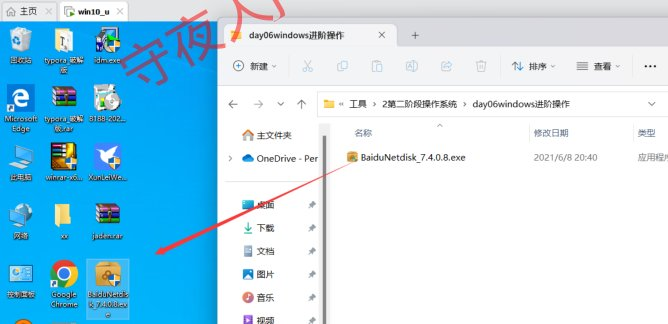

安装网盘：

> 第 22 页

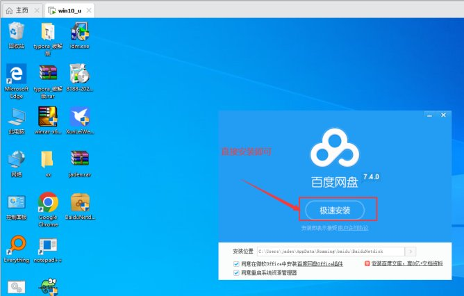

然后重启电脑，发现这个网盘安装完成之后，默认就是开机自启动的

守夜人 Jaden（吴老板）

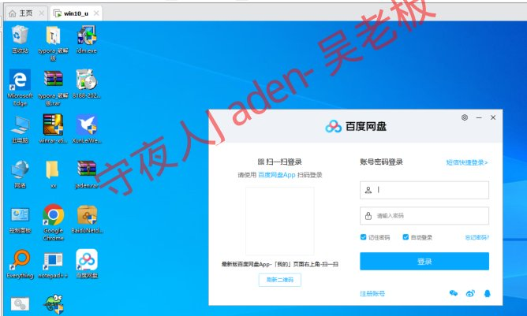

再看一个安装过程中，自行设定是否要开机自启动的软件，比如everything

> 第 23 页

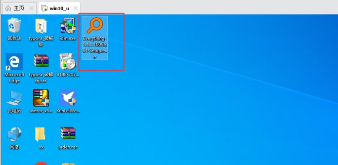

打开它进行安装，安装过程中就会看到如下一个窗口

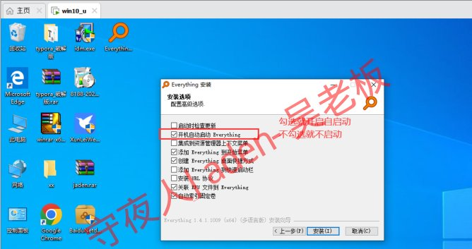

守夜人 Jaden（吴老板）

就可以在安装过程中控制是否让软件开机自启动。

### 2、查看和关闭开机自启动程序

我们用win10来举例：

方式1：设置-->应用-->启动，可以控制

> 第 24 页

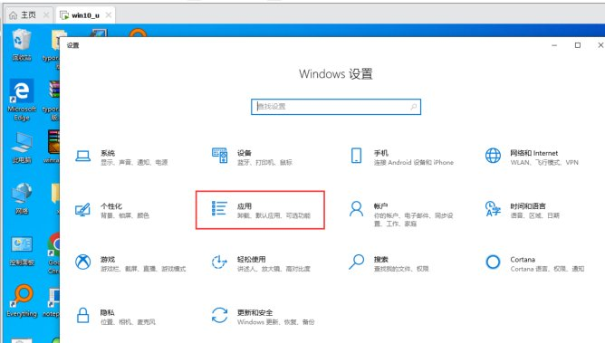

如下

守夜人 Jaden（吴老板）

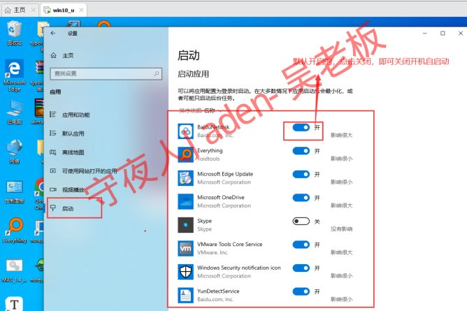

方式2：任务管理器-->启动，可以设置

> 第 25 页

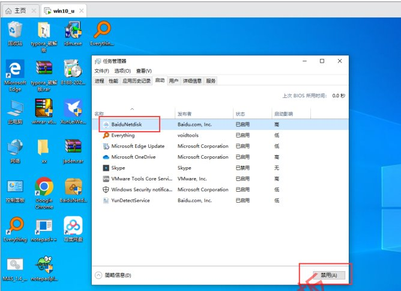

好，这是我们演示了一下win10上面软件安装时开机自启动的一些操作，接下来我们如果自己像想让某个已经安装好的程序开启自启动的话，我们如何设置呢？

### 3、设置某个程序开机自启动

让某个程序开机自启动有很多种方式，我们先说一种，在后面知识点的学习中会学到其他几种。

在键盘上按下win+r调出运行窗口，输入shell:startup 命令并点击确定，如下

守夜人 Jaden（吴老板）

> 第 26 页

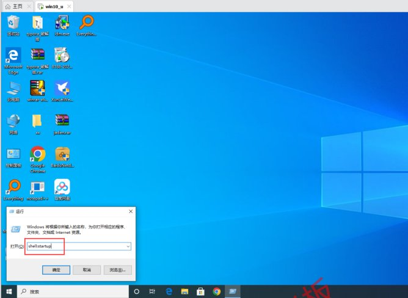

会看到打开了如下文件夹，这是我们自己指定某个程序开机自启动的存放位置。这个位置是

C:\Users\当前登录用户名称\AppData\Roaming\Microsoft\Windows\Start

Menu\Programs\Startup ，win7、win10、win11 等，都是这个目录来设置开机自启动的程序。

比如我们将chrome浏览器的快捷方式复制进去

守夜人 Jaden（吴老板）

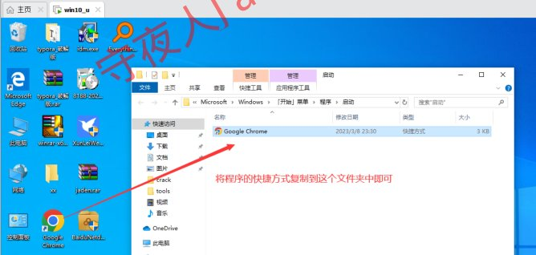

注意前面学到的安装软件过程中设置的开机自启动，并不是按照我们现在这种方式来设定的，后面会讲

到。

重启电脑，看到chrome自动启动了。

> 第 27 页

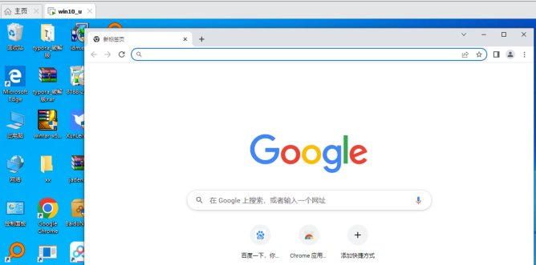

如果想取消的话，就把程序的快捷方式从这个自启动目录中移除即可。

## 三、文件共享

文件共享，顾名思义，就是将某些文件分享给其他人。

比如将电脑A的某个文件，共享给电脑B，有几种方法呢？

1.网络工具：qq\微信\百度网盘等文件传输，当我们距离很远而且处于不同网络的时候，首选

2.物理工具：U盘、移动硬盘等

3.windows文件共享

4.本地文件共享软件：feiq等

### 1、网络工具

小文件传输直接就用qq、微信等即可，大一些的可以用网盘，比如百度网盘，但是百度网盘都有上传文守夜人 Jaden（吴老板）件大小限制，比如百度网盘限制单个文件大小为30G，那么我们如果有一个超大的文件，大于了30G，

怎么办？

1.1 大文件压缩为分块小文件

就可以对文件进行压缩，如果压缩文件大小还是超过了30G怎么办，那么就可以在压缩文件的时候选择分块压缩，将大文件压缩成几个小文件，如下

> 第 28 页

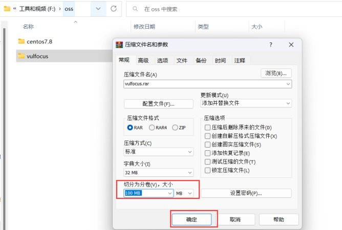

效果如下

守夜人 Jaden（吴老板）

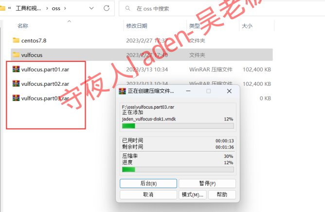

那么，这么多的压缩文件，我们怎么解压出来呢？其实很简单，选中其中任意一个，然后解压即可得到完整的解压之后的文件。

> 第 29 页

### 2、物理工具

如果我们双方距离的比较近，直接用U盘、移动硬盘等，这个就比较简单了，操作比较相对麻烦一些，

电脑A-->拷贝到U盘-->写入到电脑B。也就是说U盘等充当了一个中间人角色。那么有没有直达的呢？电脑A-->电脑B。就是我要说的windows共享功能。

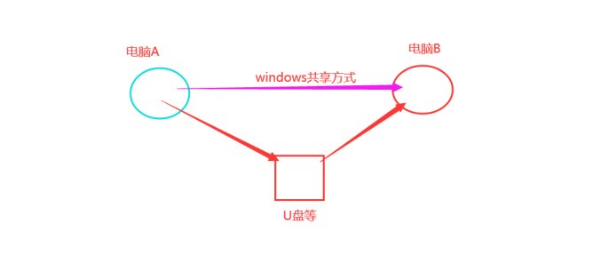

### 3、Windows共享

我通过几台虚拟机来给大家演示吧，如果按照我们之前的方式一个一个虚拟机的安装，太慢了，我们选择直接克隆虚拟机吧，快一些，但是克隆之前最好做一个快照，快照的作用，一是留作备份，以防后续我们的系统出现问题，恢复快照就能好，二是克隆的时候可以选择直接用快照克隆，也方便一些。

3.1 虚拟机快照

开机和关机时都可以做快照，开机做快照，快照占用的磁盘空间大、并且快照速度慢。

守夜人 Jaden（吴老板）

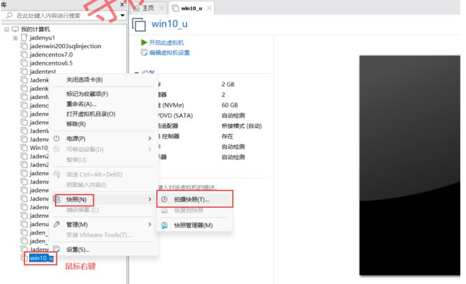

如下

> 第 30 页

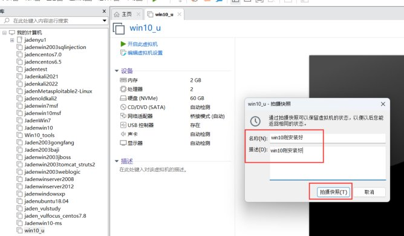

等待一会就拍好快照了，快照可以拍摄很多个，每次给系统安装一些可能会对系统有比较大影响的软件之前，最好都先拍摄一下快照。查看快照有哪些：

守夜人 Jaden（吴老板）

如下，这就能看到我们给这个虚拟机拍摄了哪些快照

> 第 31 页

3.2 虚拟机克隆

我们克隆几个虚拟机出来，先把要克隆的虚拟机关机，克隆的速度会快一些。

守夜人 Jaden（吴老板）

如下

> 第 32 页

> 第 33 页

> 第 34 页

就可以看到克隆出来的虚拟机了，克隆出来的虚拟机和前面我们使用的虚拟机快照当时的虚拟机是完全一样的。

守夜人 Jaden（吴老板）

比如我们现在就来演示一下win10_u和win10_u_02两台电脑之间设置共享目录，来进行数据传输。

> 第 35 页

3.3 设置共享目录

比如将win10_u的某个目录分享给同一网络中的其他电脑，比如让win10_u_02可以访问。

在win10_u电脑某个盘符上，比如c盘吧，创建一个文件夹，如下

里面随便创建点儿文件，如下

守夜人 Jaden（吴老板）

回到c盘，设置gongxiang文件夹为共享状态：

> 第 36 页

如下

守夜人 Jaden（吴老板）

如下，添加共享的时候可以选择哪些用户可以访问这个共享文件夹，选择everyone的话就是所有用户都可以访问，并且没有访问密码，如果你选择了jaden用户的话，那么通过jaden用户访问共享文件夹的时候，是需要输入jaden的密码的。

> 第 37 页

如下，还可以设置对共享目录的操作权限，读就是只能查看，写就是可以增删改，复制、剪切等等。

守夜人 Jaden（吴老板）

设置好权限之后，点击共享：

> 第 38 页

可能你会看到如下提示，也可能看不到，这个和我们虚拟机联网的时候，你是否选择了同一网络的发现功能相关。

守夜人 Jaden（吴老板）

然后，如下

> 第 39 页

3.4 配置网络高级共享设置

守夜人 Jaden（吴老板）

如下

> 第 40 页

如下

守夜人 Jaden（吴老板）

如下

我这个目前选择的是专用，所以我就对专用进行设置即可

> 第 41 页

然后在所有网络中勾选无密码

守夜人 Jaden（吴老板）

那么这样就属于同一个网络中的计算机就可以直接访问这个共享文件夹了，并且直接使用共享文件夹中的资源。

如何查看自己处于专用网络还是公用网络？如下

> 第 42 页

3.5 访问共享文件夹

访问共享文件夹可以使用ip地址来访问

守夜人 Jaden（吴老板）

通过win键+r键，调出运行窗口，输入如下网址，访问效果如下，

> 第 43 页

如下

守夜人 Jaden（吴老板）

然后就可以对这个文件进行操作了。拷贝速度也是不限速的，主要看磁盘读写速度和两台电脑的网络接口速度，现在的电脑一般都是千兆网口了，所以速度上肯定很快，对文件大小也没有限制。

网络接口传输速度：下面的1.0Gbps就是所谓的千兆网卡速度，其实是1000MBit/s，也就是125MB/s的意思。在网络这一块知识体系中，千兆意思是1000Mbit，百兆是100Mbit。既然速度我们知道了，那么到底用U盘、移动硬盘还是用共享方式，哪个速度快，这个就看实际情况了。

> 第 44 页

### 4、feiq等局域网共享资源工具

这是一块局域网共享资源的软件，内部使用还是很方便的，而且也支持聊天等功能。比如两个电脑想通过它共享资源，是需要两个电脑上都安装上feiq的。

守夜人 Jaden（吴老板）

如下

> 第 45 页

我也给大家下载好了，需要使用的同学可以拿去用，我们在同一个教室的时候，我分享资源也会用

feiq。

线下学生需要安装一下，线上学习的朋友就不需要安装了。

比如我放到虚拟机上给大家演示一下，线下的朋友可以直接安装到自己的物理机上。

守夜人 Jaden（吴老板）

4.1 安装feiq

双击安装，选择feiq的共享资源路径：我这里就不改路径了，默认即可

> 第 46 页

如下

守夜人 Jaden（吴老板）

这样就打开feiq了，另外一个电脑也是这样操作安装feiq。双方都安装好feiq之后，就可以通过feiq分享资源了。我这里是克隆的主机，所有主机名什么的都一样，但是ip是不同的昂，并且这些信息都是可以改的，看上去和qq差不多了，可以直接聊天，发送文件等。

> 第 47 页

4.2 feiq共享文件或文件夹

守夜人 Jaden（吴老板）

如下

> 第 48 页

如下

守夜人 Jaden（吴老板）

选好目录之后，点击确定，效果如下，还可以设置无需密码访问

> 第 49 页

如下，点击确定

守夜人 Jaden（吴老板）

关掉窗口即可

> 第 50 页

4.3 访问feiq共享目录

另外一台电脑，查看共享目录

守夜人 Jaden（吴老板）

双击文件夹名称，就可以进入到目录中查看内容，也可以直接下载目录等操作

> 第 51 页

这样就完成了feiq软件的共享文件和目录的功能。

另外还有很多类似的共享资源的工具，比如：b0pass、奶牛快传等等，我这里就不多说了。

## 四、远程控制/远程桌面

我们控制某一台电脑的时候，如果你没有在电脑所在地，那么就需要远程来进行控制，包括我们后续会学到的黑客是如何远程控制你的电脑的等手段的时候，都会用到远程控制，其中系统的远程桌面功能就是远程控制的方式之一。

守夜人 Jaden（吴老板）

远程桌面是系统自带的功能，还有一些其他的第三方工具，比如向日葵还是比较好用的，我用的比较

多，teamviewer其实也还行，但是用的比较频繁的话，会提示收费，qq远程协助有些拉跨，比较慢，

todesk也挺不多的，还支持电脑和手机之间互相控制、Android和IOS都支持。还有一个比较强的工具叫做parsec，玩游戏的经常用这个，挺好用的。feiq也是可以远控的，还有好多其他的工具，我就不多说了。这些工具都有个特点，就是需要第三方服务器中转一下，所以网络不太的时候，明显感觉卡顿。

> 第 52 页

刚才说到的parsec这个软件是可以直接在局域网使用的，可以直连，不需要走第三方服务器中转，体验会更好一些。这几个软件的使用大家自行下载玩一玩即可，我这里就不多提了。我只给大家安装使用一下向日葵吧，后面大家有问题需要我远程协助的话，就可以使用向日葵，如下

### 1、向日葵的安装和使用

两个主机之间通过它来进行互相控制的话，需要双方都安装向日葵的这个客户端程序：

守夜人 Jaden（吴老板）

如下

> 第 53 页

> 第 54 页

如下

守夜人 Jaden（吴老板）

这样就安装好了。

比如我通过我物理机来远程控制虚拟机的桌面，输入对方的识别码和验证码即可控制：

> 第 55 页

效果如下

提示我们注册个账号，登录之后才能远程控制，那么大家就注册一个即可。注册好了之后再看远程协助守夜人 Jaden（吴老板）

效果：

> 第 56 页

这样就ok了。还是很简单的。

### 2、系统自带的远程桌面功能

我们通过两台win10电脑来给大家演示一下，比如如下两个虚拟机

守夜人 Jaden（吴老板）

用win10_u来控制win10_u_02这个主机，win10_u不需要做什么配置，但是被控制的主机需要满足两个

条件

1、开启远程桌面功能

2、设置远程连接密码(不能随便让人控制)

3、还需要知道被控主机的ip地址

好，接下来给win10_u_02来进行配置

> 第 57 页

2.1 被控主机开启远程桌面功能

如下

守夜人 Jaden（吴老板）

那么我们就可以使用win10_u_02主机上已有的用户名和密码进行远程登录了。如果被控主机某个用户没有密码，我们就去设置一个密码，比如下面这个jaden用户

> 第 58 页

比如设置为123

如下

守夜人 Jaden（吴老板）

现在知道了被控主机的用户名和密码，还需要知道被控主机的ip地址和远程桌面功能的默认端口号，默认端口号为3389，这个可以修改，没改的话，默认就是3389。

> 第 59 页

然后另外一台主机来远程桌面控制该主机。

2.2 远程桌面连接功能

我们在win10_u这个控制主机上打开远程桌面连接功能：

守夜人 Jaden（吴老板）

如下，输入被控主机的ip地址

> 第 60 页

> 第 61 页

如下

守夜人 Jaden（吴老板）

这样就通过远程桌面控制了目标主机。大家玩的时候，如果觉得过程比较卡是因为虚拟机和虚拟机之间互相连接的时候就会比较卡，所以稍作等待即可，或者通过物理机连接虚拟机来试试，会快很多。但是这个远程桌面功能有些不好的地方，比如不能玩游戏，哈哈，还有就是被控主机会处于锁屏的状态，没办法看到远程桌面都在搞什么。

> 第 62 页

这就没有向日葵等第三方工具好用了。

## 五、Windows注册表

### 1、定义

注册表：

    Windows操作系统称之为登录档案。是Microsoft Windows中的一个重要的数据库，注册表是

windows操作系统中的一个核心数据库，其中存放着各种参数，直接控制着Windows的启动、硬件驱动程序的装载以及一些Windows应用程序的运行，从而在整个系统中起着核心作用。这些作用包括了软、硬件的相关配置和状态信息，比如注册表中保存有应用程序和资源管理器外壳的初始条件、首选项和卸载数据等，联网计算机的整个系统的设置和各种许可，文件扩展名与应用程序的关联，硬件部件的描述、状态和属性，性能记录和守夜人 Jaden（吴老板）其他底层的系统状态信息，以及其他数据等。注册表中还包含 Windows 在运行期间不断引用的信息，例如，

每个用户的配置文件、计算机上安装的应用程序以及每个应用程序可以创建的文档类型、文件夹和应用程序图标的属性表设置、系统上存在哪些硬件以及正在使用哪些端口。当一个用户准备运行一个应用程序，注册表提供应用程序信息给操作系统，这样应用程序可以被找到，正确数据文件的位置被规定，其他设置也都可以被使

用。

    正常情况下，你可以点击开始菜单当中的运行，然后输入regedit或regedit.exe点击确定就能打开

Windows操作系统自带的注册表编辑器了，友情慎重提醒，操作注册表有可能造成系统故障，若您是对

Windows注册表不熟悉、不了解或没有经验的Windows操作系统用户建议尽量不要随意操作注册表，即便是必须要操作，那么也要提前做好注册表的备份工作。如果上述打开注册表的方法不能使用，说明你没有管理员权限，或者注册表被锁定，如果是没有权限，那么想办法解锁权限。

简单来说：注册表是windows系统来记录和修改用户设置的，不论是软件还是硬件。

注册表的数据结构：

> 第 63 页

    注册表由项（也叫主键或称“键”）、子项（子键）和值构成。一个项就是分支中的一个文件夹，而子项就是这个文件夹当中的子文件夹，子项同样它也是一个项。一个值则是一个项的当前定义，由名称、数据类型以及分配的值组成。一个项可以有一个或多个值，每个值的名称各不相同，如果一个值的名称为空，则该值为该项的默认值。

    在注册表编辑器（regedit.exe）中，数据结构显示如下，其中，command键是open项的子项，(默认)表示该值是默认值，值名称为空，其数据类型为REG_SZ，数据值为%systemroot%/system32/notepad.exe"%1数据类型。

注册表的数据类型主要有以下四种：显示类型（在编辑器中）数据类型说明

    REG_SZ：字符串：文本字符串

    REG_MULTI_SZ：多字符串值：含有多个文本值的字符串

    REG_BINARY：二进制数：二进制值，以十六进制显示，

    REG_DWORD：双字值；一个32位的二进制值，显示为8位的十六进制值。

win+r键，运行，输入regedit，即可看到注册表

守夜人 Jaden（吴老板）

如下

> 第 64 页

比如这里我用cs1.6那个游戏软件来给大家演示一下。

### 2、游戏软件的注册表设置

前面我跟大家说过，双击打开一下如下这个文件，就能破解这个cs软件，免费来玩，不然还需要去买一个CDkey序列号输入进去才能玩，它是怎么搞的破解呢，其实就是将某个cdkey写入到了注册表中，作为这个游戏的配置项，游戏加载的时候系统会先读取注册表中的配置。

守夜人 Jaden（吴老板）

我们使用记事本打开这个文件看看：

> 第 65 页

然后到注册表中按照这个路径进行一下查找：

守夜人 Jaden（吴老板）

原来关于这个游戏软件的各种配置，都已经写入到了注册表中记录了下来，包括我们对软件的各种配置修改，其实都是修改的注册表。

### 3、修改注册表控制远程桌面功能

我们如果不知道某个功能对应的注册表项是哪些怎么办，这时候就可以到网上搜索一下，比如远程桌面对应的注册表项如下

> 第 66 页

看到这么个标题，你大概就能知道，改注册表的相关数据，就能开启和关闭系统的远程桌面功能。

好，接下来我们找一下：

守夜人 Jaden（吴老板）

修改之后，我们看一下计算机属性的远程功能，如下

> 第 67 页

远程桌面功能被开启了。注册表刚才那一项的值改为1，你再看效果

守夜人 Jaden（吴老板）

远程功能又被关闭了，也就是说，注册表不仅仅记录着系统、用户的软件和硬件的各种配置信息，还可以通过修改注册表的相关项的值来控制这些配置。注册表的功能就是这么强大。

> 第 68 页

### 4、注册表控制开机自启动

4.1 示例

查看有哪些开启自启动的程序，如下，任务管理器-->启动，这里就能看到，将启动类型勾选显示出来：

发现，这些开机自启动的程序，基本都是靠注册表来控制实现的。

守夜人 Jaden（吴老板）

注册表中关于开机启动项的配置位置在这里

HKEY_LOCAL_MACHINE\SOFTWARE\Microsoft\Windows\CurrentVersion\Run

如下

> 第 69 页

我们直接删除这些项，或者修改数值数据都是可以关闭开启自启动的，而且我们想让某个程序开启自启动，也是可以按照这种方式来添加注册表数据来完成的。

比如我们删除一下向日葵的开机启动对应的注册表项，看一下对应关系：

守夜人 Jaden（吴老板）

删除注册表项：

> 第 70 页

> 第 71 页

删除启动项成功。

4.2 启动项对应注册表的其他位置

我们发现其实还有一些开启自启动的程序在注册表的上面这个位置看不到，那么可以能在其他位置，比

如HKEY_CURRENT_USER\Software\Microsoft\Windows\CurrentVersion\Run ，如下

守夜人 Jaden（吴老板）

多数我们安装完系统之后再安装的应用软件，开机启动对应的注册标位置就在这两个地方了，但是可能还有一些放到了注册表的某些其他不常见的位置：

> 第 72 页

对于win10来讲的常见位置：

    HKEY_CURRENT_USER\Software\Microsoft\Windows\CurrentVersion\Run

    HKEY_LOCAL_MACHINE\SOFTWARE\Microsoft\Windows\CurrentVersion\Run

其他位置：这些大致了解即可，后面用到哪个就说哪个。

    Load注册键：HKEY_CURRENT_USER＼Software＼Microsoft＼WindowsNT＼CurrentVersion＼

Windows＼load

    Userinit注册键：HKEY_LOCAL_MACHINE＼SOFTWARE＼Microsoft＼WindowsNT＼

CurrentVersion＼Winlogon＼Userinit这里也能够使系统启动时自动初始化程序。通常该注册键下面有一个userinit.exe，但这个键允许指定用逗号分隔的多个程序，例如“userinit.exe,OSA.exe”(不含引

号)。

    等等...

4.3 命令行添加注册表选项

reg add HKEY_CURRENT_USER\Software\Valve\Half-Life\Settings /v dms /t REG_SZ /d

test /f

注：reg 命令;add 增加; /v 选项; /t 类型 ;/d  值;/f   不用提示就强行覆盖现有注册表项

这个我们就先不演示了，后面用到的时候再说。

## 六、Window安全组策略

### 1、定义

百度百科：组策略（英语：Group Policy）是微软Windows NT家族操作系统的一个特性，它可以控制用户帐户和计算机帐户的工作环境。组策略提供了操作系统、应用程序和活动目录中用户设置的集中化管理和配置。组策略的其中一个版本名为本地组策略（缩写“LGPO”或“LocalGPO”），这可以在独立且非域的计算机上守夜人 Jaden（吴老板）管理组策略对象。

通俗解释：组策略是一组策略的集合，策略就是制定的规则。组策略是将系统重要的配置功能汇集成各种配置模块，供用户直接使用，从而达到方便管理计算机的目的。简单点说，组策略就是修改注册表中的配置。当然，组策略使用自己更完善的管理组织方法，可以对各种对象中的设置进行统一的管理和配置，远比手工修改注册表方便、灵活，功能也更加强大这里我用win10专业版系统来演示，家庭版是不能操作这个功能的。

组策略分本地组策略和远程组策略，远程组策略我们学到域渗透的时候再讲解，先看本地组策略。

### 2、打开本地组策略的方式

方式1：搜索打开

> 第 73 页

方式2：win+r键，运行gpedit.msc ，即可打开

守夜人 Jaden（吴老板）

打开组策略之后，界面如下

> 第 74 页

### 3、组策略两大模块

计算机配置：针对于本地计算机生效

用户配置：针对于用户生效

如下

守夜人 Jaden（吴老板）

> 第 75 页

### 4、 组策略示例

4.1 禁止使用某些软件

在组策略中可以禁止用户使用某些软件，比如禁止使用feiq.exe、everything.exe、注册表等等。这是属于对用户行为的限制，在用户配置这个模块中设置，如下

将feiq等运行起来，看一下运行起来之后，这个程序在内存中叫什么名字，这个就是我们说的主程序名称，注意，不能直接使用软件名称，一定要找到它运行起来之后进程中的主程序名称的名字，因为组策略做限制的时候，是对这个名字进行限制的，如下守夜人 Jaden（吴老板）

如下

> 第 76 页

ok，它就叫做FeiQ.exe，在找一下everything.exe的主程序名称。

找程序名称：

守夜人 Jaden（吴老板）

叫做Everything.exe ，好，记住这两个名字，那么将这两个名字添加到不运行指定的windows应用程序这个组策略中，如下

> 第 77 页

如下

守夜人 Jaden（吴老板）

然后再禁用一下注册表，不允许打开，如下

> 第 78 页

如下

守夜人 Jaden（吴老板）

好，设置到这里，我们已经禁用了feiq、everything和注册表，然后我们使用当前用户查看一下注册表看看效果：

> 第 79 页

如下

守夜人 Jaden（吴老板）

退出feiq和everything，重新打开看看效果：

> 第 80 页

如下

守夜人 Jaden（吴老板）

都已经被禁用了。

换个用户登录上来，试一下能不能打开禁用的软件，如下

> 第 81 页

如下

守夜人 Jaden（吴老板）

还是被限制了。到这里这个通过组策略禁用软件的方式就搞定了。

> 第 82 页

4.2 组策略禁用软件对应注册表位置

前面定义的位置有提到过，组策略就是修改注册表中的配置。

首先把注册表打开，刚才禁用来着，别忘了取消一下，那么刚才我们演示的示例是对应修改的注册表什么位置呢？在这里

HKEY_CURRENT_USER\Software\Microsoft\Windows\CurrentVersion\Policies\Explorer\Disal

lowRun

如下

比如把everything对应的项删除掉：

守夜人 Jaden（吴老板）

如下

> 第 83 页

然后回到电脑上，启动一下everything程序，看看效果

守夜人 Jaden（吴老板）

可以正常打开了，说明修改注册表可以控制组策略设定的规则。

4.3 禁用可移动设备

这个大家知道一下即可，我就不演示了，只要禁用了可移动设备，那么不管你插入什么样的U盘、移动硬盘等，电脑都是没有反应的。有好多公司为了安全性，就会禁用移动设备，甚至有些更严格的会将

bios中关于移动设备的功能全部禁用。

> 第 84 页

组策略中还有很多其他的设置，我们就不一一演示了，感受一下，简单了解即可。

## 七、Windows服务

### 1、服务的概念

首先说一下客户端和服务端的概念，比如拿京东app来说

守夜人 Jaden（吴老板）

客户端是享受服务的，服务端是提供服务的，提供服务的一方的程序是不能停下来的，客户端什么时候想使用服务，什么时候打开程序即可。

再说windows服务

### 2、windows服务

2.1 概念

Microsoft Windows 服务（即，以前的 NT 服务）使您能够创建在它们自己的 Windows 会话中可长时

间运行的可执行应用程序。这些服务可以在计算机启动时自动启动，可以暂停和重新启动而且不显示任何用户界面。这种服务非常适合在服务器上使用，或任何时候，为了不影响在同一台计算机上工作的其他用户，需要长时间运行功能时使用。

> 第 85 页

Windows服务是一种运行于Windows操作系统之上的一种独立进程。它们不必依赖于任何界面，它们由

Windows操作系统本身负责管理维护，可以持续运行，不需要用户的参与，也可以接受来自外部的请求，一般用来运行一些持续运行的后台进程，产生一些定期调度任务或者监测一些外部事件。

2.2 打开服务程序列表

windows服务，本身就是一些服务程序，这些程序在哪里看呢？打开服务程序列表，如下

方式1：

方式2：

守夜人 Jaden（吴老板）

> 第 86 页

打开服务列表，如下

守夜人 Jaden（吴老板）

我们会看到服务程序有很多，这些服务程序都是为用户正常使用电脑的某些功能而一直在运行的程序，

当我们使用某些功能的时候，这些程序就帮我们去完成。比如常用的几个服务，如下

> 第 87 页

2.3 常见服务

DHCP Client服务

这个服务程序如果没有开启，那么我们的电脑无法得到ip地址，就无法联网。

Print Spooler服务

没有这个服务程序，我们就没有办法打印东西。

守夜人 Jaden（吴老板）

> 第 88 页

VMware Tools服务

这是我们安装VMware tools工具软件的时候，Vmware自动在系统中添加的服务程序，就是为了一开机，我们的虚拟机就能和物理主机进行数据交互等功能。

Windows Update服务

为什么我们的电脑能够自动检测到需要更新了，就是这个服务程序一直在后台默默的运行着，检测并提示系统更新。

守夜人 Jaden（吴老板）

> 第 89 页

还有好多其他的服务，我们暂且先不提了，刚才上面说的这几个服务，你会发现，其实很多的服务都是系统自带的程序，为了让系统更好的为用户服务而启动的，还有一些是我们安装某些软件之后，软件为了更方便的为用户提供某些功能而添加到系统中的服务程序。

那么某些软件将自己添加到系统服务中什么好处呢？其实主要就是可以让这个程序开机自启动，每次开机直接就为用户提供着服务，用户都不需要自己去开启，不需要自己考虑这个程序的运行，他就能默默的提供服务。

2.4 添加和删除服务

操作系统本身帮我们提供了很多服务程序，在电脑的时候过程中，我们安装的某些软件也可能会自动添加一些服务程序，比如我们安装的VMware Tools软件工具，就自动添加了服务，我们能不能手动添加服务呢，答案是可以的，比如将typora.exe添加到服务。

守夜人 Jaden（吴老板）

2.4.1 添加服务

添加服务的方式有多种，我暂且演示一种。

通过windows自带的sc指令来添加服务，比如将typora.exe作为服务程序添加到服务中，操作如下首先以管理员身份运行cmd命令行窗口：

> 第 90 页

然后在黑窗口中执行如下指令

守夜人 Jaden（吴老板）

指令解释

sc create jaden_typora binpath=C:\tools\typora\Typora\Typora.exe

sc是windows用来创建服务的关键指令

create表示创建的意思，固定搭配

jaden_typora是自己指定的服务名称(只要和系统中已经有的服务名称没有冲突即可)

binpath=程序路径

查看服务列表：

> 第 91 页

服务就有了。

2.4.2 服务的三个状态

服务的状态有：手动、自动、禁用，如下查看

守夜人 Jaden（吴老板）

如下

> 第 92 页

手动的意思是开机之后，这个程序还是需要我们手动运行才会启动这个程序。

自动的意思是开机之后程序自动启动，多数程序加入服务中的目的就是为了开机自启动。

禁用的意思就是这个服务程序不用了。

其实，并不是我们直接添加某个程序到服务中就可以使用，如果这个应用程序开发时，没有写好衔接计算机服务的程序，那么即便强行添加到服务中，也是不能启动的，会看到如下错误：

守夜人 Jaden（吴老板）

启动或者关闭服务：

> 第 93 页

2.4.3 删除服务

我们看到，在服务列表中并没有提供删除服务的功能，那么删除服务可以怎么删除呢？

方式1：sc指令删除

sc delete "服务名称"

例如： sc delete jaden_typora

如下

守夜人 Jaden（吴老板）

如下

> 第 94 页

再查看服务列表：

守夜人 Jaden（吴老板）

方式2：专业工具删除服务(HiBitStartupManager)

市面上有很多专业删除服务的工具，比如我给大家准备的这个：

在电脑上安装一下：

> 第 95 页

> 第 96 页

> 第 97 页

> 第 98 页

> 第 99 页

如下

守夜人 Jaden（吴老板）

然后重启电脑之后，就看到之前的服务没有了。

> 第 100 页

那么关于服务，就先说这么多。

## 八、计划任务

### 1、定义

计划任务是系统的常见功能，利用任务计划功能，可以将任何脚本、程序或文档安排在某个最方便的时间运行。任务计划在每次系统启动的时候启动并在后台运行。当我们需要在服务器上定时执行一些重复性的事件时使用的，可以通过计划任务程序来运行准备好的脚本、批处理文件夹、程序或命令，在某个特定的时间运行。

守夜人 Jaden（吴老板）

不知道大家有没有遇到过，电脑在某个时间点经常会弹出一些广告，这种广告行为，好多都是通过计划任务来实现定时弹出的。

### 2、计划任务所在位置

计算机-->管理，任务计划程序

> 第 101 页

### 3、创建计划任务

比如我们将计算器加入到计划任务中

找到计算器程序所在位置：

守夜人 Jaden（吴老板）

创建计划任务

> 第 102 页

输入名称和描述

守夜人 Jaden（吴老板）

触发器，这里我就不选择每天了，我们选择一下用户登录的时候触发吧

> 第 103 页

> 第 104 页

找到计算器程序：

守夜人 Jaden（吴老板）

运行计算器程序的时候，可以设定一些参数，我们不知道计算器有啥参数可以设定，所以参数就不指定

了

> 第 105 页

> 第 106 页

### 4、高级设定

还可以进行一些高级设定，双击打开这条记录。

运行权限设定，我们选中最高权限运行，不然可能因为我们想让某些软件运行时权限不够，导致运行失

败。

守夜人 Jaden（吴老板）

增加多个触发器，看看即可，我们就不设定了

> 第 107 页

还有一些其他设置，我就不多提了。

保存刚才的一些设置，然后我们来测试一下。

### 5、测试任务

刚才设定了登录用户就启动计算器，我们重启或者注销一下，登录一下用户，看看效果，重启一登陆，

发现计算器已经启动了。

守夜人 Jaden（吴老板）

> 第 108 页

### 6、删除计划任务

有些流氓软件可能会利用计划任务来搞事情，我们可以没事就定期清理一下计划任务，把没用的删掉。

好，关于计划任务，我们就先说这么多。

## 九、用户和用户组

### 1、定义

守夜人 Jaden（吴老板）

用户：用户是登录系统的身份凭证

用户组：一个系统可以有多个用户，为了方便管理这些用户，给多个用户统一分配操作权限等设置，可以将多个用户划分为一个组，给这个组做一些配置，那么在这个用户组中的用户都会按照组的配置来设定自己的操作。一个用户可以属于多个组，会同时继承多个组的操作权限。并且用户的权限其实还可以单独设定，甚至超过所属组的权限。

### 2、用户操作

2.1 新建用户

> 第 109 页

2.2 修改用户密码

守夜人 Jaden（吴老板）

2.3 删除用户

> 第 110 页

2.4 修改用户属性

守夜人 Jaden（吴老板）

如下

> 第 111 页

2.5 修改用属组

默认属于Users组，windows默认帮我们设定了好几个组，这几个组你先简单知道一下即可，下面关于组的说明在用户组小节中会讲到守夜人 Jaden（吴老板）

可以选择其他组

> 第 112 页

> 第 113 页

> 第 114 页

那么现在test用户既属于Users组，也属于Administrators组，可操作权限是会被继承的，也就是说test

用户同时具备了Users组和Administrators组的操作权限。

### 3、用户组

用户组同样可以进行增删改查，这里大家就简单看一下即可。

我们来看一下用户组的属性，如下

3.1 用户组属性

守夜人 Jaden（吴老板）

> 第 115 页

如下

守夜人 Jaden（吴老板）

再看Administrators组

> 第 116 页

3.2 常用的用户组说明

需要人为添加成员的组

    Administrators：管理员组，属于该administators本地组内的用户，都具备系统管理员的权限，它们拥有对这台计算机最大的控制权限，可以执行整台计算机的管理任务。内置的系统管理员账号

Administrator就是本地组的成员，而且无法将它从该组删除，它的操作权限比Administrators组中的其他成员还要高。

    Users：普通用户组，该组员只拥有一些基本的权利，例如运行应用程序，但是他们不能修改操作系统的设置、不能更改其它用户的数据、不能关闭服务器级的计算机。

    Guests：来宾组，该组是提供没有用户帐户，但是需要访问本地计算机内资源的用户使用，该组的成员守夜人 Jaden（吴老板）无法永久地改变其桌面的工作环境。该组最常见的默认成员为用户帐号Guest。默认这个组是禁用状态，操作权限最低。

动态包含成员的组：也就是它里面的成员是不固定的，随着用户的操作，组成员会动态变化，也可以手动添

加。

    INTERACTIVE：默认包含本地登录的账户

    Authenticated Users：包含了通过验证的用户，不包含来宾用户

    Everyone：所有账户都属于这个组(设置全面开放权限时使用)，注意，如果Guest帐号被启用时，则给

Everyone这个组指派权限时必须小心，因为当一个没有帐户的用户连接计算机时，他被允许自动利用Guest

帐户连接，但是因为Guest也是属于Everyone组，所以他将具备Everyone所拥有的权限。

那么有朋友可能会问，到底这些用户和用户组都具备哪些具体的操作权限呢？我们知道操作系统给我们提供的功能是非常多的，这里我们一一说也说不过来，所以，学到这里你就先知道一下，不同的组和用户操作权限有所不同，操作权限的高低决定着系统的某些功能是否可以被当前用户使用、修改等。

## 十、指令操作

> 第 117 页

我们对操作系统进行控制的时候，除了前面学到的对各个功能进行图形化界面的操作的方式之外，操作系统(不管什么类型的操作系统)还提供了通过系统指令来控制系统的方式。

### 1、指令操作界面

win+r键，打开运行，输入cmd ，确定，就能进入

如下

守夜人 Jaden（吴老板）

这个黑窗口，就是指令执行窗口，也叫做指令面板。我们前面学到的所有windows功能，都可以通过系统指令来进行控制。

> 第 118 页

### 2、常用指令和解释

面板操作：

    exit -- 退出cmd面板

    cls -- 清除cmd面板上的历史记录

文件和目录操作：

    指令 /?，可以查看指令的具体参数和对应能力，比如，查看cd指令怎么用，输入：cd /?

    c: -- 切换盘符

    cd指令 -- 切换路径，cd 路径，cd ..返回上一层目录，cd ../.. 返回上一层的上一层目录

    dir指令 -- 显示当前目录信息，目录下面的文件和文件夹列表

    md 文件夹名 -- 创建新文件夹

    type nul > 文件名 -- 创建一个空文件，比如type nul > jaden.txt

    del /s 文件名  -- 删除文件

    rd /s 文件夹名  -- 删除文件夹

用户操作相关指令：

    net user        #查看用户列表

    net user 用户名  密码         #改密码

    net user 用户名 密码 /add      #创建一个新用户

    net user 用户名 /del        #删除一个用户

    net user 用户名 /active:yes/no        #激活或禁用账户

用户组操作相关指令：

    net localgroup        #查看组列表

    net localgroup 组名        #查看该组的成员

    net localgroup 组名 /add         #创建一个新的组

    net localgroup 组名 用户名 /add        #添加用户到组

    net localgroup 组名 用户名 /del        #从组中踢出用户

    net localgroup 组名 /del        #删除组

先熟悉一下这些指令，然后其他一些指令，比如注册表操作、计划任务操作、远程控制操作等等，都有相关的指令。后面我们学到了哪些就记录哪些。而且指令有时候比较复杂，关于复杂的指令，我们大致守夜人 Jaden（吴老板）记忆即可。

### 3、激活Administrator用户

后续我们安装的所有的虚拟机，都要激活管理员用户，并以管理员用户的身份来做操作学习，因为后续的很多网络安全的工具都需要有管理员权限才能使用。

首选以管理员的身份打开cmd窗口

> 第 119 页

或者

守夜人 Jaden（吴老板）

执行指令net user administrator /active:yes

切换administrator来登录，默认是没有密码的

> 第 120 页

修改administrator的密码，设定为123吧。

守夜人 Jaden（吴老板）

这样就可以了。后续我们虚拟机都使用administrator用户。

> 第 121 页

守夜人 Jaden（吴老板）
