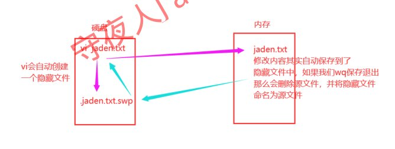
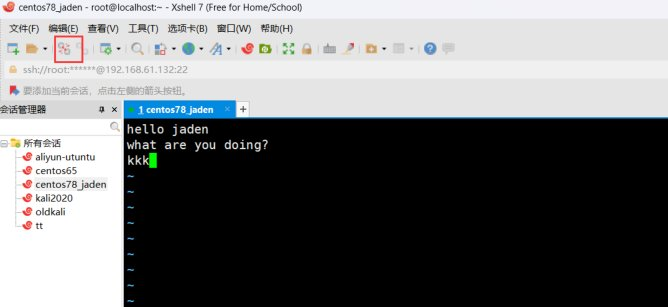
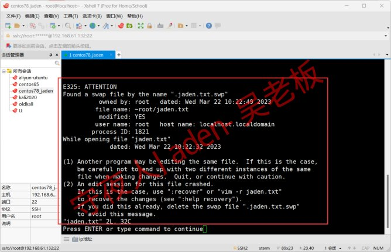
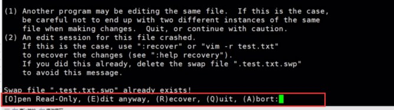

# vim编辑器

来源 PDF：vim编辑器.pdf（原文件位于课程目录，本文件夹不包含 PDF）

> 第 1 页

vi/vim编辑器(守夜人 Jaden（吴老板）)

vi和vim的快捷键是通用的。系统默认是安装了vi的，后面我们会安装一个vim，加强版的vi，功能更

强。

我们先复制一个大文件过来玩，太小的文件很多快捷键玩不出效果。

[root@localhost ~]# cp /etc/services .   # .表示当前目录

[root@localhost ~]# vi services

set number # 显示出行号

我们玩几个常用的即可，不需要研究太多vi的操作。比如有一本书叫做精通vim，没必要学。如果想不起来的可以看看vim键盘图。

## 一、移动光标

左，下，上，右，如果键盘上没有上下左右键，可以h,j,k,l

进入编辑模式有三个按钮：i、a、o， i在光标位置编辑、a是在光标后一位编辑、o是换行编辑，新起一行

ctrl+f  下翻一页

ctrl+b 上翻一页

ctrl+u 上翻半页

ctrl+d 下翻半页

0 跳至行首，不管有无缩进，就是跳到第0个字符

^ 跳至行首的第一个字符

$ 跳至行尾(shift+4)

gg 跳至文首

G 跳至文尾(shift+g)

5gg/5G 调至第5行，或者命令行模式:5回车，也是跳到第5行，所以其实操作命令都不是唯一的守夜人 Jaden（吴老板）

## 二、删除复制

x删除单个字符

10x删除10个字符

dd 删除光标所在行(其实dd是剪切的操作),  #使用u撤销之前的操作，使用ctrl+r恢复

6dd 从光标开始往下删除6行

dw 删除一个单词(word)

小p 粘贴粘贴板的内容到当前行的下面，比如将dd剪切的行黏贴到下面

大P 粘贴粘贴板的内容到当前行的上面

yy 复制行

5yy复制5行，复制的内容可以通过p\P来黏贴

## 三、搜索和替换

> 第 2 页

搜索：

    /pattern 向后搜索字符串pattern  #辅助小n向下和大N向上，一般都是用/来搜索

    ?pattern 向前搜索字符串pattern  #辅助小n向上和大N向下，?搜索用的少

替换：

    :1369s/shell/jaden/g  # 将第1369行的shell替换为jaden，/还可以用#或者@符号来代替：:1369s#shell#jaden#g

    :1369,1379s/shell/jaden/g  # 将1369至1379这10行中的shell替换为jaden

    :1369,$s/shell/jaden/g  # 将1369至文末中的shell替换为jaden

    :%s/old/new/g  #搜索整个文件，将所有的old替换为new

    :%s/old/new/gc #搜索整个文件，将所有的old替换为new，每次都要你确认是否替换(y/n/a/..)，

y表示确认替换一个、n表示不替换、a表示全部替换

## 四、退出编辑器

:w 将缓冲区写入文件，即保存修改到硬盘上，但是不退出vi，如果我们改到一半的时候可以提前保存一下，

以防断电，因为新编辑的数据是在内存中的，而且vi不会自动保存。

:wq 保存修改并退出

:x 保存修改并退出，和wq一样的效果。

:q 退出，如果对缓冲区进行过修改，则会提示

:q! 强制退出，放弃修改

:wq!  强制保存修改并退出

## 五、vi注意问题和原理说明

vi编辑内容原理

守夜人 Jaden（吴老板）

注意，如果内存中的数据没有修改，没什么事儿，如果修改了，并且不小心断开连接了，也就是没有正常退出vi，比如我们看一下：

> 第 3 页

那么这个隐藏文件会一直在硬盘上，当我们再次vi修改jaden.txt的时候，就会看到如下提示信息：

守夜人 Jaden（吴老板）

这是提示你，已经有这个.jaden.txt.swp 文件了。你看到这个提示信息就要考虑一下，是不是自己之前不小心没保存就掉线了，还是说有其他人正在编辑这个文件。如果是自己之前没有保存，那么可以选择删除这个隐藏的swp文件，再编辑就没有这个提示了，这是最简单的方式。或者输入vi -r

jaden.txt 会看到自己之前保存的内容，重新wq! 保存一下，然后再删除.jaden.txt.swp 文件即可，

自己之前的修改也就还在。

vim编辑的时候会提示如下

> 第 4 页

如果是有其他人在编辑这个文件，你就输入O，表示只读模式打开，E是直接编辑，R是恢复文件，Q是退出不编辑了，A是中止操作。其实还有个D指令，直接删除隐藏文件。

## 六、不会vi怎么办

可以把文件拷贝到物理机，通过物理机的记事本或者nodepad++等编辑器修改，修改完去替换原文件即

可。

比如xftp就可以帮我们下载文件。但是如果一个比较大的文件，我们只改动一点内容，就可以学学vi，没必要上传下载文件来操作，耗时。

守夜人 Jaden（吴老板）
