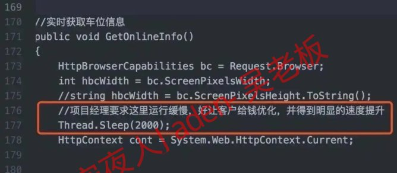

# Linux特殊符号

来源 PDF：Linux特殊符号.pdf（原文件位于课程目录，本文件夹不包含 PDF）

> 第 1 页

Linux特殊符号(守夜人 Jaden（吴老板）)

## 1、# 号

#号：注释、备注、批注，系统自动忽略，不执行。

[root@localhost ~]# sdddddddddddddddddddddddddddddddddddddddd

-bash: sdddddddddddddddddddddddddddddddddddddddd: 未找到命令

[root@localhost ~]#

[root@localhost ~]# # sdddddddddddddddddddddddddddddddddddddddd  # 这就不报错了，因

为系统不执行被#号注释的内容

\# 在linux系统上的指令和配置是通过#号注释的，而开发中，编程语言里面不同的语言也有不同的注释号，

比如//、'''注释内容'''、#、/**/等等

比如下面这个java代码：

## 2、shell命令中的其他符号

守夜人 Jaden（吴老板）

1、 ;命令的分隔符，通过它可以连接多条指令，一起执行

例子：

    [root@localhost ~]# touch 111.txt;chmod 777 111.txt

    [root@localhost ~]# ll 111.txt

-rwxrwxrwx 1 root root 0 9月  12 04:40 111.txt

2、 ..代表上级目录

例子：

    [root@localhost ~]# pwd

    /root

    [root@localhost ~]# cd ..

    [root@localhost /]# pwd

    /

\    # cd ../../../../../../../../，当..很多时，就会到根目录/

3、 .代表当前目录

例子：

    [root@localhost opt]# cp /data/man_db.conf .

> 第 2 页

    [root@localhost opt]# ls

    man_db.conf

4、变量和常量

    变量，值是不固定的，比如：我的女朋友=xxx，这个xxx不是固定的。我的女朋友就是变量。别人记不住你对象名字的时候，就这么问，你对象呢？而不是直呼其名。

    常量，值是固定。圆周率=3.1415926...，固定的值，不会变。

    env命令可以查看系统内置的环境变量：和windows的环境变量类似。系统变量就是让一些在调用的时候比较麻烦或者说寻找的时候路径比较长的功能变得简单化。系统内部处理时，会根据变量的值做出不同的反

应。

        [root@localhost ~]# env

        XDG_SESSION_ID=1

        HOSTNAME=localhost.localdomain # 变量作用：比如HOSTNAME这个变量，它的值比较长，

系统内部程序会经常用到这个值，那么用一个变量存放，以后想用这个值，就用这个变量即可，简单很多，而且只要修改了这个值，其他使用这个变量的地方，值都会跟着变化，方便修改。

        TERM=xterm

        SHELL=/bin/bash

        HISTSIZE=1000  # 这就是为什么历史命令只记录1000的原因。

        SSH_CLIENT=192.168.61.1 50670 22

        SSH_TTY=/dev/pts/0

        USER=root  # 当前登录用户，其他用户登录的时候，这个变量对应的值就变为了其他用户名

        ...

        LANG=zh_CN.UTF-8  # language的简写，装系统的时候，你安装的英文，这里就是en_US，中文就是zh_CN

        ...

\        # 查看某个变量的值 $符号+变量名称：

        [root@localhost ~]# echo $LANG

        zh_CN.UTF-8

\        # 我们改一下语言变量，来看看效果，比如之前命令的参数介绍都是中文的,export用来声明环境

变量、修改环境变量等，如下：

        [root@localhost ~]# usermod --help

        用法：usermod [选项] 登录

守夜人 Jaden（吴老板）

        选项：

          -c, --comment 注释            GECOS 字段的新值

          -d, --home HOME_DIR           用户的新主目录

        ...

        [root@localhost ~]# export LANG=en_US.UTF-8

        [root@localhost ~]# usermod --help  # 全部变英文了

        Usage: usermod [options] LOGIN

        Options:

          -c, --comment COMMENT         new value of the GECOS field

          -d, --home HOME_DIR           new home directory for the user account

        ...

\        # 也就是说，改动环境变量，会对系统有影响，因为系统中使用这个变量的功能都会随着变量的值

而做不同的处理。

5、 ""双引号，换行，解析变量

比如：echo，本来只能输出单行文本内容，加上双引号支持换行输入和输出

    [root@localhost ~]# echo hello

    hello

> 第 3 页

    [root@localhost ~]# echo "hello

\    > jaden

\    > "

    hello

    jaden

    [root@localhost ~]# echo "hello

    jaden

    " > jaden.txt # 还可以输出到某个文件中

    [root@localhost ~]# cat jaden.txt

    hello

    jaden

    有时候比vi用起来方便。

\    # ""能够解析变量，如下

    [root@localhost ~]# echo "$LANG"

    en_US.UTF-8

6、 ''单引号，换行，不解析变量

\    # 单引号不能解析变量，其他功能和双引号类似，如下

    [root@localhost ~]# echo '$LANG'

    $LANG

7、\和/ #这些我们都说过

    \ 转义符，反斜杠

    / 路径分隔符

8、! 历史命令调用，在find命令中是取反的意思。

    [root@localhost ~]# history

    [root@localhost ~]# !47  # 历史指令序号

9、* 通配符，我们将find的之后用到过，可以匹配任意字符

    [root@localhost ~]# ls *.txt # 查看所有.txt结尾的文件

    jaden.txt

守夜人 Jaden（吴老板）

10、$ 调用变量

    例子1：

    [root@localhost ~]# export LANG='en_US.UTF-8'

    [root@localhost ~]# echo $LANG

    en_US.UTF-8

    [root@localhost ~]# stat 111.txt

      File: ‘111.txt’

      Size: 0           Blocks: 0          IO Block: 4096   regular empty file

    Device: fd00h/64768d    Inode: 33575641    Links: 1

    Access: (0777/-rwxrwxrwx)  Uid: (    0/    root)   Gid: (    0/    root)

    Access: 2021-09-12 04:40:28.399177386 +0800

    Modify: 2021-09-12 04:40:28.399177386 +0800

    Change: 2021-09-12 04:40:28.400260737 +0800

     Birth: -

    [root@localhost ~]# export LANG='zh_CN.UTF-8'

    [root@localhost ~]# stat 111.txt

      文件："111.txt"

      大小：0          块：0          IO 块：4096   普通空文件

    设备：fd00h/64768d Inode：33575641    硬链接：1

> 第 4 页

    权限：(0777/-rwxrwxrwx)  Uid：(    0/    root)   Gid：(    0/    root)

    最近访问：2021-09-12 04:40:28.399177386 +0800

    最近更改：2021-09-12 04:40:28.399177386 +0800

    最近改动：2021-09-12 04:40:28.400260737 +0800

    创建时间：-

\    # 还有很多指令的帮助信息即便设置了中文，它的帮助信息都是英文，比如curl

    [root@localhost ~]# curl --help

\    # 因为汉化这个事情，是好多人做的，而且要做很久，但是系统还会更新，还没汉化完，就又更新系统

了，还需重新汉化，所以这样不划算，汉化组就解散了，所以有些指令就不汉化了。而且有时候汉化出来的意思和英语本来的意思不同，因为参与汉化的人有些不是计算机专业的，这就很尴尬。

\    # 使用变量的时候要小心，比如有些人操作变量的时候，删除了根目录，如下

    [root@localhost ~]# jaden=/tmp  # 定义变量

    [root@localhost ~]# echo $jaden # 查看变量值

    /tmp

    [root@localhost ~]# rm -rf $jaden/*  # 利用变量做删除，这是删除/tmp目录下的所有内容

\    # ！！！但是，如果变量名写错了，如下

    [root@localhost ~]# rm -rf $jadn/* # 少写了个e字母，系统做删除的时候，找不到这个变

量，那么会变成如下效果

    [root@localhost ~]# rm -rf /*  # 就删除根目录了！！！！！系统崩溃了就。所以看到删除命

令，就一定要特别的小心。

11、> 输出重定向、>>追加输出重定向、< 输入重新定向、<<追加输入重定向

12、| 管道

13、||

\    # 第一个命令失败，才执行第二个命令，第一个指令成功了，不会执行第二个指令

\    # 指令连接符号，之前说过; 除了它，还有 || 和 &&，分号是两个指令都会执行，哪个出错都不影响

其他的指令。

    [root@localhost ~]# echo 123 || ls

    123

    [root@localhost ~]# ech 123 || ls

    -bash: ech: command not found

守夜人 Jaden（吴老板）

    anaconda-ks.cfg  jaden.txt

14、&&

\    # 和，两个一起执行，如果第一个失败了，两个都不执行，如果第一个成功了，第二个失败了，就执行第

一个，如果两个都成功了，就都执行。

    [root@localhost ~]# echo 123 && ls

    123

    anaconda-ks.cfg  jaden.txt

    [root@localhost ~]# ech 123 && ls

    -bash: ech: command not found

    [root@localhost ~]# echo 123 && lx

    123

    -bash: lx: command not found

15、&

\    # 后台运行

\    # 比如top指令，之前运行top，会占住终端，除非结束top，不然不能执行其他指令

    [root@localhost ~]# top &

    [1] 16567

    [root@localhost ~]# ps -ef |grep top

> 第 5 页

    root      16567   1467  0 16:56 pts/0    00:00:00 top

    root      16569   1467  0 16:57 pts/0    00:00:00 grep --color=auto top

16、~ 代表家目录，不同的用户家目录不同。

    [root@localhost ~]# cd /tmp/

    [root@localhost tmp]# cd ~

    [root@localhost ~]# cd /tmp

    [root@localhost tmp]# cd  # 其实cd什么参数都不加，也是回到家目录

    [root@localhost ~]#

17、` 反引号(Esc 下边的按钮)`

\    # 用来嵌套命令，反引号中的命令先执行

    例子1：

        [root@localhost ~]# mkdir `echo jaden`

        [root@localhost ~]# ls

        anaconda-ks.cfg  jaden  jaden.txt

    例子2：

        [root@localhost opt]# touch test_`date +%T`.txt

        [root@localhost opt]# ls test_04\:56\:22.txt

        test_04:56:22.txt

    例子3：

        [root@localhost ~]# tar zcf /tmp/etc.tar.gz `find /etc -type f -name

"*.conf"`

        tar: Removing leading `/' from member names

        [root@localhost ~]# ls /tmp/

        etc.tar.gz

        [root@localhost ~]# tar tf /tmp/etc.tar.gz  # 查看压缩包里面的文件内容

关于特殊符号，我们就说这么多。

守夜人 Jaden（吴老板）

> 第 6 页

守夜人 Jaden（吴老板）

> 第 7 页

