# linux网络基础

来源 PDF：linux网络基础.pdf（原文件位于课程目录，本文件夹不包含 PDF）

> 第 1 页

linux网络基础(守夜人 Jaden（吴老板）)

## 一、网络的重要性

所有的系统都有网络！

我们的生活已经离不开网络，越来越多的设备接入了互联网。

网络上充斥着各种攻击行为，还有很多是避不开的攻击，所以学习网络安全，必然要学习一下网络。

## 二、网络设备介绍

多数笔记本都是有两种网卡，有线网卡和无线网卡，手机内置无线网卡。

有线网卡：

守夜人 Jaden（吴老板）

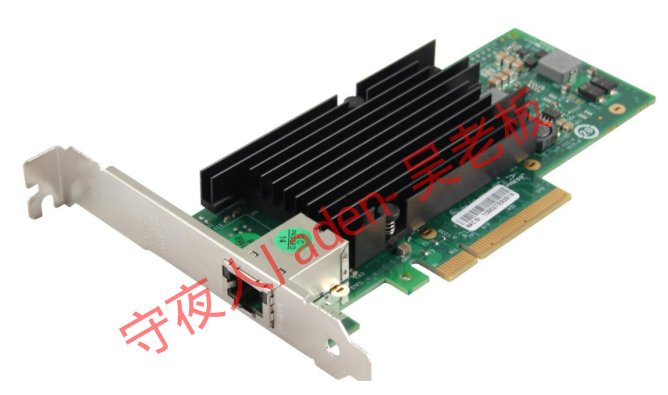

无线网卡：

> 第 2 页

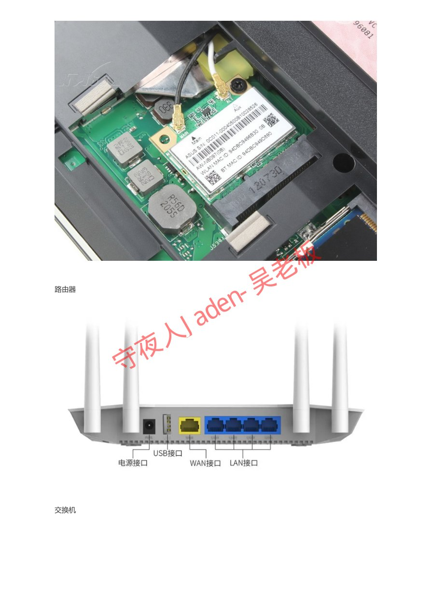

> 第 3 页

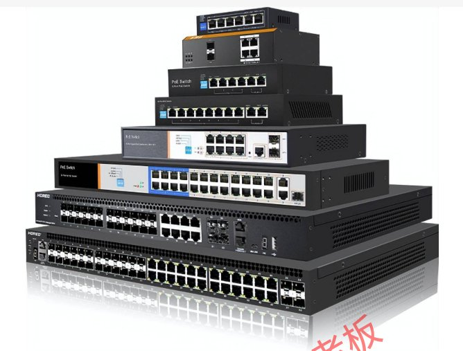

光猫

守夜人 Jaden（吴老板）

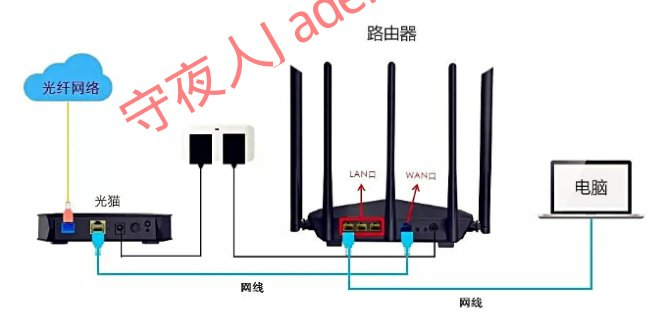

光猫是一种调制解调器，是光调制解调器，主要作用是将光信号转化为电信号，如果入户线是光纤的，那么需要光猫来将光信号转换为电信号，然后连接路由器，其他终端设备连接路由器来上网，很多光猫也带有路由器的功能，但是一般不太好用，所以一般都是建议光猫和路由器一起来使用，各司其职。

如果入户线不是光纤，那么只要有个路由器就可以直接上网了。

光猫图：

> 第 4 页

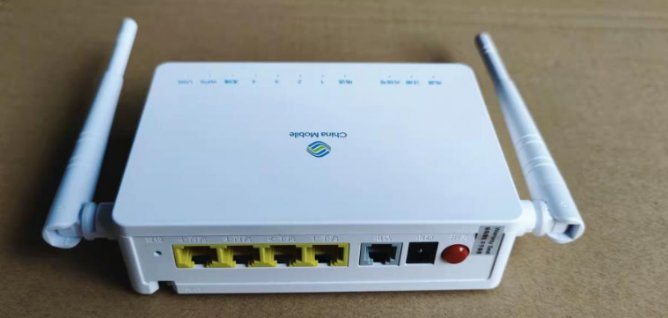

宽带运营商

运营商是指提供网络服务的供应商，如华为、中兴、诺基亚、爱立信等这些通信设备的生产厂家叫生产商，而中国移动、中国联通、中国电信、 中国广电这些公司叫运营商。

设备连接图：

守夜人 Jaden（吴老板）

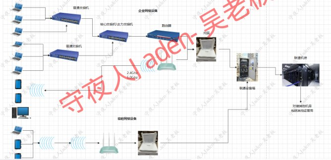

现在的网线基本都是568b规格的，8根线，4根上传4根下载，也叫做双绞线。wifi现在做的也越来越好了，wifi6和wifi6E的速度都很快了，wifi7也快发布了。可以看一下wifi的前世今生。wifi信号其实就是电磁波或者无线电信号。

网络通信问题：

设备带宽：各个设备之间进行网络数据传输，那么如果电脑网卡是千兆网卡，而路由器是百兆路由器，那么上网的最高速度也就是百兆，千兆网卡就浪费了。

通信介质：电磁波、光纤等。

多操作系统：各种操作系统信号兼容问题。

目标：信号发送和信号接收，要解决目标问题。

目标程序：qq对qq，微信对微信等等，需要用网络的程序很多，还要解决多个软件同时使用网络的问题。

保密：传输信号保密问题。

...

> 第 5 页

网络其实有这么多的问题需要解决，才能正常上网，所以网络需要更多的设计，解决这些问题都需要大家各种协商来解决，因此设定很多的规范，大家都遵守这个规范，我们称之为叫做协议，大家都遵守这个协议就能正常交互数据。

协议其实就是大家协商一致的规则。

网络上有很多很多协议，有些协议是全世界都遵守的，叫做通用协议，有些协议是内部通信自行设计

的，叫做私有协议。

## 三、osi 7层模型

参考我的之前的博客吧：https://www.cnblogs.com/clschao/articles/9578922.html

先看网络通信过程：

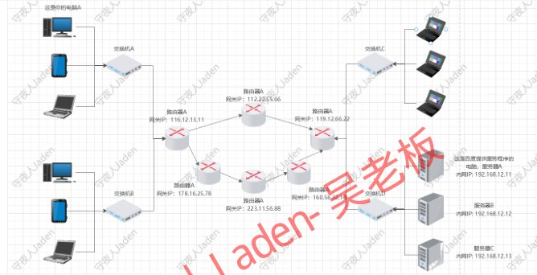

大家制定协议的时候，基本都是遵循的osi七层模型来设计的。

守夜人 Jaden（吴老板）

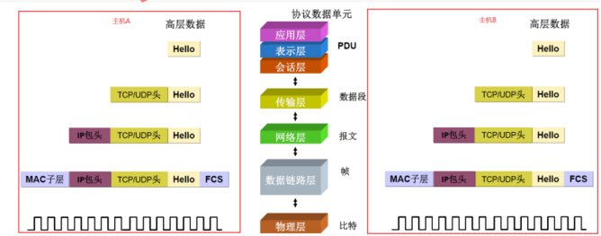

每一层都设计出了很多种协议，来完成特定的工作和数据传输，其实简单理解协议的话，其实就是不同协议需要加工不同的数据格式。

> 第 6 页

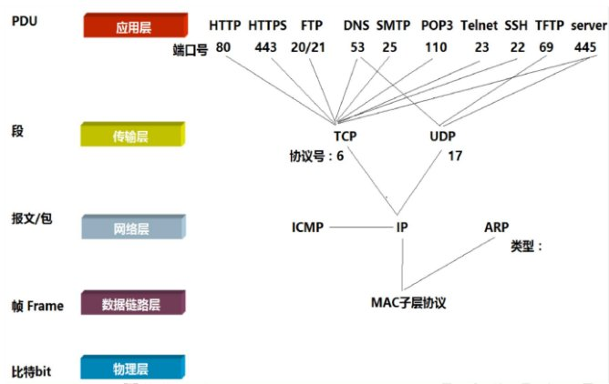

### 1、物理层

物理层 ：解决信号转换的问题，基本都是数字信号，二进制数据控制的电路信号、电磁信号：电信号、

光纤(光信号：光纤网卡可以将电信号转换为光信号)、电磁波。这个基本不需要我们关注，设备厂商就帮我们解决了。

### 2、数据链接层

每块网卡(有线、无线、蓝牙等)每块网卡出厂时都被烧制上一个世界唯一的mac地址，长度为48位2进制，通常由12位16进制数表示（前六位是厂商编号，后六位是流水线号），通过mac地址就可以查询到它对应的厂商。这个mac地址是入网许可证，没有mac地址，就不能上网。看我的无线网卡的mac地守夜人 Jaden（吴老板）

址：

> 第 7 页

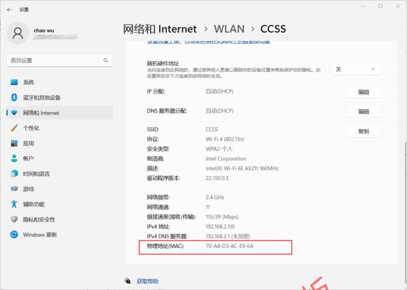

通过mac地址查厂商：

守夜人 Jaden（吴老板）

我的有线网卡mac地址：

> 第 8 页

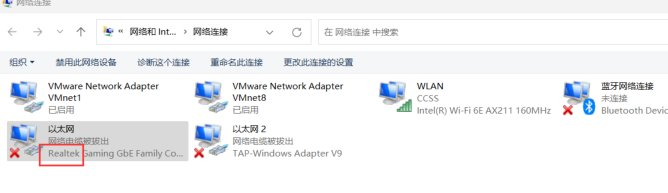

右键点击属性：

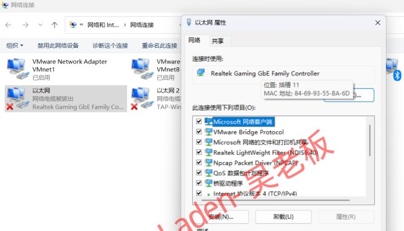

Realtek叫做瑞昱，图标是个小螃蟹，是专门生产网卡和声卡的厂商。

Realtek Gaming GBE Family Controller

Realtek:瑞昱

守夜人 Jaden（吴老板）

Gaming: 专门为游戏本设计的网卡

GBE : 表示我的网卡是千兆网卡，如果没看到这个，说明可能是百兆网卡。

mac地址主要是用来解决网络通信的目标问题的，可以让信号传输的时候找到正确的网卡，不会把数据发乱目标。

### 3、网络层

网络层，主要是用来封装ip地址的，公网ip全世界唯一，私网ip(也叫做内网ip)。

ip地址主要用来做目标定位。公网ip地址有点像酒店地址，私有ip地址像酒店中的各个房间号，每个酒店可能都有这个房间号，但是每个酒店的具体位置肯定是不同的。那么和mac地址有什么区别呢？mac地址有点像人的身份证号，但是我怎么找到这个人呢？要先找到它的地址，这个地址就是ip地址。所有人上网都需要一个公网ip地址。

世界上有个组织专门分配ip地址，这个组织叫做IANA，IANA(The Internet Assigned Numbers

Authority，互联网数字分配机构)，ip、域名等都归它来管理。

> 第 9 页

### 4、传输层

	 传输方式tcp/udp，发送数据包的方式，比如发快递：空运、货车、火车等等。

tcp：可靠的(网络传输要经过很多设备，或者信号不好收不到数据包，tcp发给你发送数据包比较大，那么可能会分多个数据包发送，单个数据包大小为1500B，大数据包拆分成多个小数据包，每个小数据包打上编号，

每发送一个包都要和对方确认，对方只有告诉我收到了，才会继续发送，没收到的话就补发、再发，最终所有的数据包都发送完成之后，多个小数据包根据编号来组成大数据文件，因为要来回确认，所以慢)，速度慢

udp：不可靠的(我就使劲儿给你发，不需要你确认，可能会丢包)，速度快，直播、视频等，局域网用的多一些，比如feiq、vnc等

	 端口概念，英文为port：ssh的22端口、网站的80端口、vnc的5900端口等等，每个需要对外通信的软件，系统都会给他分配一个端口，有些端口是软件自己指定好的。

通过指令可以查看到运行程序的端口的

netstat -ano

netstat -lntup

### 5、应用层

5.1 会话层

会话层会发送一个探测数据包，探测双方网络是否能互通。会话的建立和断开都是由这一层的数据控制

的。

5.2 表示层

用来描述文件的类型，比如我们在网上发送了一个图片、文本、视频等等格式。表示层会在发送的整体二进制数据前面加上文件类型数据标记。数据加密、数据格式声明的数据都是在这一层。

守夜人 Jaden（吴老板）

5.3 应用层

就是我们各类应用软件了，qq、浏览器、微信、网易云等等。

tcp/ip五层协议是用到额最广泛的，只要大家电脑上安装了这个协议，就可以基于这个协议来进行通信

了。

tcp/ip协议栈分为5层协议。应用层(会话层、表示层和应用层这三层合并为了一层)、传输层、网络层、

数据链路层、物理层。

> 第 10 页

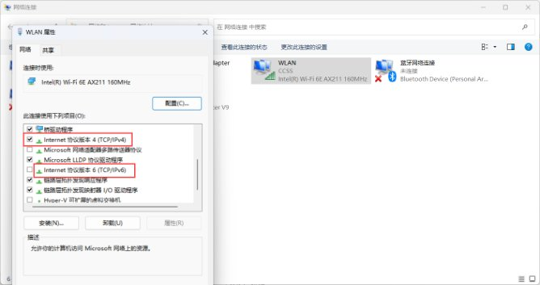

## 四、数据的封装和解封装

像收发快递。

wireshark抓包看效果：

守夜人 Jaden（吴老板）

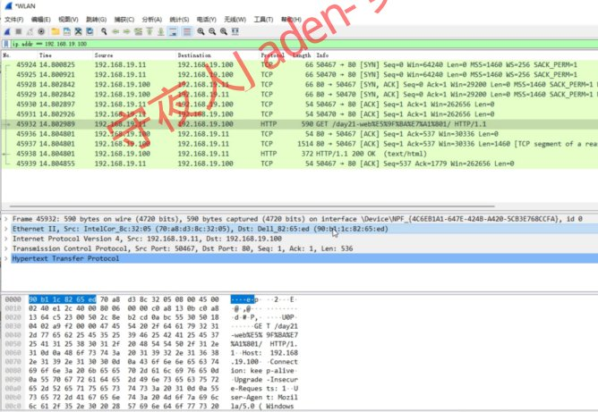

数据包看到了5层协议数据。

应用层---》数据  ，比如5M的图片数据

传输层---》tcp报头+数据  tcp报头+小数据包1 、tcp报头+小数据包2 、tcp报头+小数据包3...

> 第 11 页

网络层---》ip包(ip地址)+tcp报头+数据1、ip包(ip地址)+tcp报头+数据2、ip包(ip地址)+tcp报头+数据3...

数据链接层===》数据帧(mac地址)+ip包+tcp报头+数据1、数据帧(mac地址)+ip包+tcp报头+数据2、数据帧(mac地址)+ip包+tcp报头+数据3...

物理层===》将完整的数据包，由二进制转换成电信号

接收方正好反过来

传输层： tcp报头+小数据包1 、tcp报头+小数据包2 、tcp报头+小数据包3..收集起来，在网卡那里就收集好了，所以网卡是占用一部分内存空间的。

## 五、TCP 三次握手，四次挥手

我们知道网络层，可以实现两个主机之间的通信。但是这并不具体，因为，真正进行通信的实体是在主机中的进程，是一个主机中的一个进程与另外一个主机中的一个进程在交换数据。IP协议虽然能把数据报文送到目的主机，但是并没有交付给主机的具体应用进程。而端口对端口的通信才应该是应用进程之间的通信。

    UDP，在传送数据前不需要先建立连接，远地的主机在收到UDP报文后也不需要给出任何确认。虽然UDP

不提供可靠交付，但是正是因为这样，省去和很多的开销，使得它的速度比较快，比如一些对实时性要求较高的服务，就常常使用的是UDP。对应的应用层的协议主要有DNS,TFTP,DHCP,SNMP,NFS等。

    TCP，提供面向连接的服务，在传送数据之前必须先建立连接，建立连接就是确保双方的网络是通畅的，

数据传送完成后要释放连接，而且每发送一个数据包都要收到确认信息才会发送另外一个数据包。因此TCP是一种可靠的的运输服务，但是正因为这样，不可避免的增加了许多的开销，所以速度相比UDP就慢一些，比如确认，流量控制等。对应的应用层的协议主要有 SMTP,TELNET,HTTP,FTP等.

常用的端口号：

应用程序  
FTP  
TFTP  
TELNET  
SMTP  
DNS  
HTTP  
SSH  
MYSQL

熟知端口  
21,20  
69  
23  
25  
53  
80  
22  
3306

传输层协议  
TCP  
UDP  
TCP  
TCP  
UDP  
TCP  
TCP  
TCP

守夜人 Jaden（吴老板）

TCP是我们重点讲解的协议，因为和安全息息相关。

### 1、TCP三次握手

TCP协议在发送数据包的时候，会发送多种类型的数据包，每种数据包都有特殊的意义，每个中数据包都会在数据包里面添加上特定的标识数据来表示数据包的意义，比如：

SYN  建立链接

ACK  回应标识

FIN  断开链接

PSH  数据包

RST  重置（重传）  网络不稳定的时候会看到好多重发包

URG  紧急指针

TCP建立连接需要三次握手

> 第 12 页

1、TCP服务器进程先创建传输控制块TCB，时刻准备接受客户进程的连接请求，此时服务器就进入了LISTEN

（监听）状态；

2、TCP客户进程也是先创建传输控制块TCB，然后向服务器发出连接请求报文，这是报文首部中的同部位

SYN=1，同时选择一个初始序列号 seq=x ，此时，TCP客户端进程进入了 SYN-SENT（同步已发送状态）状态。TCP规定，SYN报文段（SYN=1的报文段）不能携带数据，但需要消耗掉一个序号。

3、TCP服务器收到请求报文后，如果同意连接，则发出确认报文。确认报文中应该 ACK=1，SYN=1，确认号是ack=x+1，同时也要为自己初始化一个序列号 seq=y，此时，TCP服务器进程进入了SYN-RCVD（同步收到）状态。这个报文也不能携带数据，但是同样要消耗一个序号。

4、TCP客户进程收到确认后，还要向服务器给出确认。确认报文的ACK=1，ack=y+1，自己的序列号

seq=x+1，此时，TCP连接建立，客户端进入ESTABLISHED（已建立连接）状态。TCP规定，ACK报文段可以携带数据，但是如果不携带数据则不消耗序号。

5、当服务器收到客户端的确认后也进入ESTABLISHED状态，此后双方就可以开始通信了。

为什么TCP客户端最后还要发送一次确认呢？

一句话，主要防止已经失效的连接请求报文突然又传送到了服务器，从而产生错误。

如果使用的是两次握手建立连接，假设有这样一种场景，客户端发送了第一个请求连接并且没有丢失，只是因为在网络结点中滞留的时间太长了，由于TCP的客户端迟迟没有收到确认报文，以为服务器没有收到，此时重新向服务器发送这条报文，此后客户端和服务器经过两次握手完成连接，传输数据，然后关闭连接。此时此前滞留的那一次请求连接，网络通畅了到达了服务器，这个报文本该是失效的，但是，两次握手的机制将会让客户端和服务器再次建立连接，这将导致不必要的错误和资源的浪费。

如果采用的是三次握手，就算是那一次失效的报文传送过来了，服务端接受到了那条失效报文并且回复了确认报文，但是客户端不会再次发出确认。由于服务器收不到确认，就知道客户端并没有请求连接。

握手建立连接之后，就开始发送真实数据了。

我们抓包看一下：我抓的是我物理机的无线网卡，打开浏览器，访问百度来查看数据包：

守夜人 Jaden（吴老板）

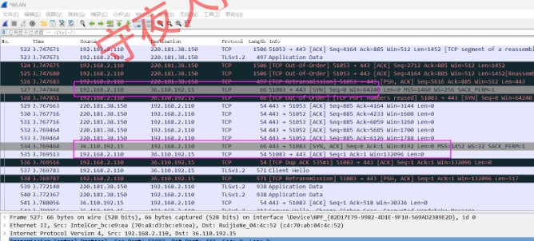

### 2、TCP四次挥手

断开连接需要四次挥手，数据传输完毕后，双方都可释放连接。最开始的时候，客户端和服务器都是处于ESTABLISHED状态，然后客户端主动关闭，服务器被动关闭。服务端也可以主动关闭。

> 第 13 页

1、客户端进程发出连接释放报文，并且停止发送数据。释放数据报文首部，FIN=1，其序列号为seq=u（等于前面已经传送过来的数据的最后一个字节的序号加1），此时，客户端进入FIN-WAIT-1（终止等待1）状态。

TCP规定，FIN报文段即使不携带数据，也要消耗一个序号。

2、服务器收到连接释放报文，发出确认报文，ACK=1，ack=u+1，并且带上自己的序列号seq=v，此时，服务端就进入了CLOSE-WAIT（关闭等待）状态。TCP服务器通知高层的应用进程，客户端向服务器的方向就释放了，这时候处于半关闭状态，即客户端已经没有数据要发送了，但是服务器若发送数据，客户端依然要接受。这个状态还要持续一段时间，也就是整个CLOSE-WAIT状态持续的时间。

3、客户端收到服务器的确认请求后，此时，客户端就进入FIN-WAIT-2（终止等待2）状态，等待服务器发送连接释放报文（在这之前还需要接受服务器发送的最后的数据）。

4、服务器将最后的数据发送完毕后，就向客户端发送连接释放报文，FIN=1，ack=u+1，由于在半关闭状态，服务器很可能又发送了一些数据，假定此时的序列号为seq=w，此时，服务器就进入了LAST-ACK（最后确认）状态，等待客户端的确认。

5、客户端收到服务器的连接释放报文后，必须发出确认，ACK=1，ack=w+1，而自己的序列号是seq=u+1，

此时，客户端就进入了TIME-WAIT（时间等待）状态。注意此时TCP连接还没有释放，必须经过2∗∗MSL（最长报文段寿命）的时间后，当客户端撤销相应的TCB后，才进入CLOSED状态。

6、服务器只要收到了客户端发出的确认，立即进入CLOSED状态。同样，撤销TCB后，就结束了这次的TCP连接。可以看到，服务器结束TCP连接的时间要比客户端早一些。

为什么客户端最后还要等待2MSL？

MSL（Maximum Segment Lifetime），TCP允许不同的实现可以设置不同的MSL值。

第一，保证客户端发送的最后一个ACK报文能够到达服务器，因为这个ACK报文可能丢失，站在服务器的角度看来，我已经发送了FIN+ACK报文请求断开了，客户端还没有给我回应，应该是我发送的请求断开报文它没有收到，于是服务器又会重新发送一次，而客户端就能在这个2MSL时间段内收到这个重传的报文，接着给出回应报文，并且会重启2MSL计时器。

第二，防止类似与“三次握手”中提到了的“已经失效的连接请求报文段”出现在本连接中。客户端发送完最后一个确认报文后，在这个2MSL时间中，就可以使本连接持续的时间内所产生的所有报文段都从网络中消失。这样新的连接中不会出现旧连接的请求报文。

抓包如图

守夜人 Jaden（吴老板）

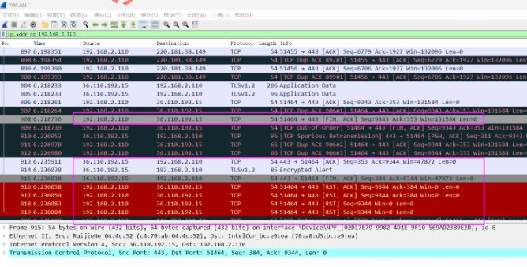

如果看到的是seq=0，那么我们看不出来这个随机值，所以可以将绝对值显示出来，如下设置：

> 第 14 页

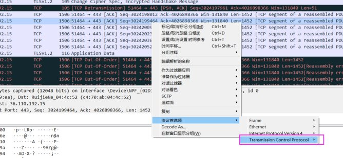

如下

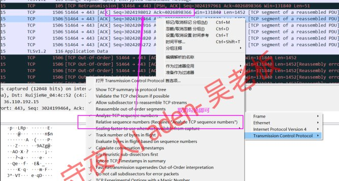

守夜人 Jaden（吴老板）

还可以看一下UDP协议的，比如查询一下DNS看效果

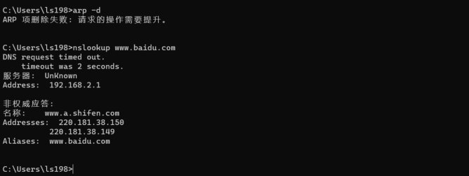

抓包看到的直接就是发送数据包，没有三次握手的数据包。

> 第 15 页

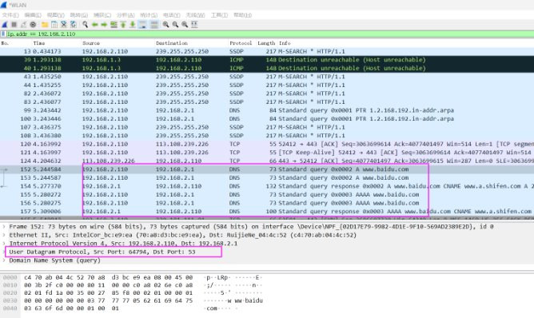

为什么建立连接是三次握手，关闭连接确是四次挥手呢？

1、建立连接的时候， 服务器在LISTEN状态下，收到建立连接请求的SYN报文后，把ACK和SYN放在一个报文里发送给客户端。

2、而关闭连接时，服务器收到对方的FIN报文时，仅仅表示对方不再发送数据了但是还能接收数据，而自己也未必全部数据都发送给对方了，所以己方可以立即关闭，也可以发送一些数据给对方后，再发送FIN报文给对方来表示同意现在关闭连接，因此，己方ACK和FIN一般都会分开发送，从而导致多了一次。

如果已经建立了连接，但是客户端突然出现故障了怎么办？

TCP还设有一个保活计时器，显然，客户端如果出现故障，服务器不能一直等下去，白白浪费资源。服务器每收到一次客户端的请求后都会重新复位这个计时器，时间通常是设置为2小时，若两小时还没有收到客户端的任何数据，服务器就会发送一个探测报文段，以后每隔75分钟发送一次。若一连发送10个探测报文仍然没反应，

守夜人 Jaden（吴老板）

服务器就认为客户端出了故障，接着就关闭连接。

看图，x和y是随机序列号，不是固定的值，所以我用x和y表示了。

> 第 16 页

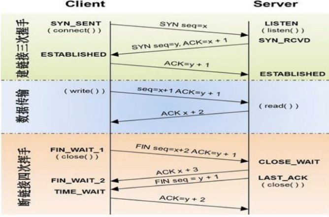

## 六、ip地址划分

查看自己和其他公网ip的地理位置：

守夜人 Jaden（吴老板）

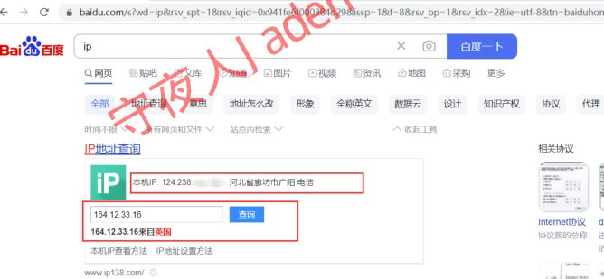

ip地址：看上去是4个点分10进制数字，实际上是32位二进制数

> 第 17 页

二进制范围：00000000.00000000.00000000.00000000 --

11111111.11111111.11111111.11111111

十进制范围：0.0.0.0 -- 255.255.255.255

十六进制：0-9，a-f    a102

总共2^8 * 2^8 * 2^8 * 2^8，也就是2的32次方个数值，大概是将近43亿多个。

1650这个十进制的计算方式可以写为：1*10^3 + 6*10^2 + 5*10^1 + 0*10^0 = 1000 + 600 + 50

\+ 0 = 1650

5这个十进制数字对应的二进制数字为101，转换为10进制的方式：1*2^2 + 0*2^1 + 1*2^0 = 4 + 0 +

1 = 5

同样，10进制可以转换为2进制

ip地址的总数约为43亿个，全球都用，导致ip地址不够用了，大家就想了个办法，将部分ip地址剥离出来给大家作为内部ip来使用，每个公司或者家庭的网络设备都用这些内部ip地址，然后大家共同使用一个公网ip来进行上网。

ip地址就分为内网ip地址和公网ip地址，内网ip地址又叫做私网ip地址，或者保留ip地址。

守夜人 Jaden（吴老板）

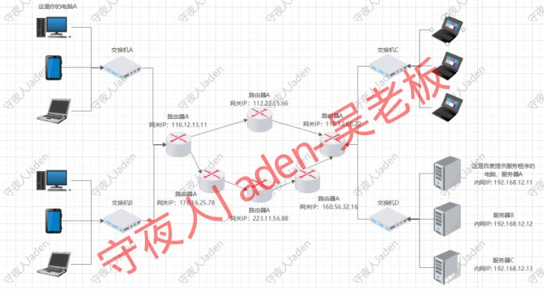

那么只有公网ip地址可以上网，这时候就需要一个技术将内网ip地址转换为公网ip地址的技术，叫做

NAT(全称：Network Address Translation)，网络地址转换技术，这个技术就内置在了路由器上，所有请求数据包出网的时候，也就是发送到公网上的时候，都是从路由器出去的，都会被路由器上的NAT技术将数据包中的内网ip转换为公网ip。有了公网ip，数据包才能发送到网上去，才能实现互联网通信，也就是可以上网了。这样大家就可以共享一个公网ip来进行上网，ip个数不足的情况也明显得到了改善。

因为从所有ip地址中剥离出来的这些内网ip地址，是所有公司或者说所有团体都可以在内部使用的。公网ip在互联网中是全世界唯一的，通过公网ip就能够找到精准的传输目标了。一个公网ip甚至都可以共享给上千万个设备来共享上网使用。

其实，为了科学的使用ip地址，减少浪费，将ip地址根据使用数量级划分为了几类，如下

> 第 18 页

a类  1.0.0.1~126.255.255.254  # 126*2^8   5.0.0.0 -- 5.255.255.255

    第一组：1-126开头的地址是A类

    0<A类<127     公网ip在这个地址段的居多，ping qq.com就可以看到58.250.137.36这就是个A

类地址。

b类  128.0.0.1~191.255.255.254

    128<=B类<192

c类  192.0.0.1~223.255.255.254

\# A类、B类、C类地址为三类主要的IP地址，下面两类我们基本见不到。

d类  组播，VRRP协议，keepalive高可用 224~239

e类  科研 240-255  # 说是保留给科研用的

仔细看的话，可以看到a类和b类中间的127地址段没有划分上，127.0.0.1 - 127.255.255.255整个网段都是特殊地址，127开头的地址可以说是A类的保留地址，用作本地软件环回测试（loopback test）本主机的进程之间的通信而使用的。这个后面我们用到之后再提。

私有ip地址范围：

A类：10.0.0.0~10.255.255.255    # 通过网上的ip地址计算器，就能计算出这个网段有多少个ip地址， A类地址子网掩码是8位

\    # 16777214

B类：172.16.0.0~172.31.255.255   # B类地址子网掩码是16位

C类：192.168.0.0~192.168.255.255  # 这个是我们经常看到的网段，内网中网络设备比较少的场景都用的这个，我们买路由器的时候，路由器上内置的网段多数也是这个网段。 # 65,536

计算这些网段的ip个数：

守夜人 Jaden（吴老板）

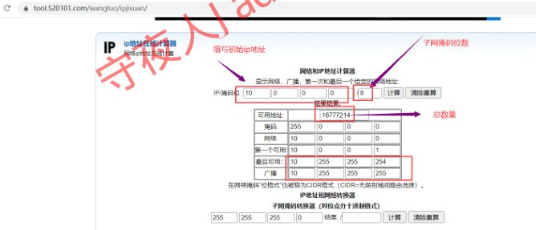

除了内网这些网段的ip地址之外，剩下的都是公网ip。查看一下内网ip的地理位置，会看到如下提示：

> 第 19 页

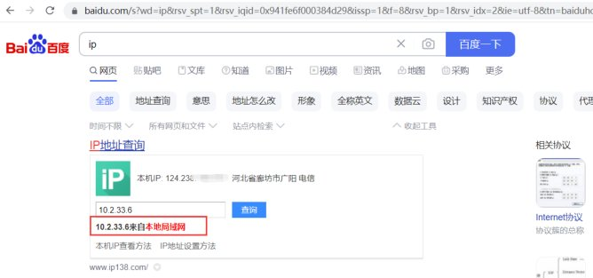

2000年左右的时候就爆出来地址不够用了，到现在20多年了，为了缓解ipv4地址不够用的问题：

解决办法：

    1：ipv6：fe80::2e60:cff:fe9c:a4b3   # 2^128次方的位数，这个数量就相当可观了。

        在这种形式中，128位的IPv6地址被分为8组，每组的16位用4个十六进制字符（0～9，A～F）来表示，组和组之间用冒号（:）隔开。比如IPv6地址2001:db8:130F:0000:0000:09C0:876A:130B，为了书写方便，每组中的前导“0”都可以省略，所以上述地址可写为：

2001:db8:130F:0:0:9C0:876A:130B。

        另外，地址中包含的连续两个或多个均为0的组，可以用双冒号“::”来代替，这样可以压缩IPv6地址书写时的长度，所以上述地址又可以进一步简写为：2001:db8:130F::9C0:876A:130B。

    2: NAT：network address transformation，网络地址转换

    好处：

        a: 节约大量的公网ip地址

        b：减少了网络攻击

ipv6：

守夜人 Jaden（吴老板）

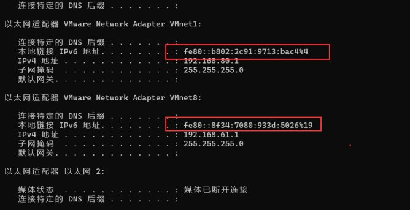

IPv6地址中的百分号是网卡interface标识。这个表示该地址仅限于标号为4的网络接口（一般指网卡或者虚拟网卡）。而在其他网络接口这个地址是无效的。

> 第 20 页

## 七、子网掩码的作用

ip地址分为两个部分

网络部分：标识子网，也就是网络位或者说网段

主机部分：标识主机

　　注意：单纯的ip地址段只是标识了ip地址的种类，从网络部分或主机部分都无法辨识一个ip所处的子

网

　　例：172.16.10.1与172.16.10.2并不能确定二者处于同一子网

所谓"子网掩码"，就是表示子网络特征的一个参数。它在形式上等同于IP地址，也是一个32位二进制数字，它的网络部分全部为1，主机部分全部为0。比如，IP地址172.16.10.1，如果已知网络部分是前24

位，主机部分是后8位，那么子网络掩码就是11111111.11111111.11111111.00000000，写成十进制就是255.255.255.0。

查看本机子网掩码，如下：

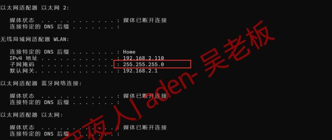

子网掩码：决定了一个网段的大小，网段大小决定了有多少个ip地址可以用，网段越大，ip地址越多。

守夜人 Jaden（吴老板）

ip地址：192.168.2.110  子网掩码：255.255.255.0

上面两个还有一个等效的写法：192.168.2.110/24

如下：

> 第 21 页

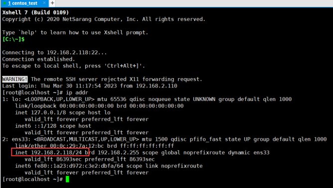

如下写法

192.168.2.118/24

10.0.0.0/8

172.16.0.0/16

\# 怎么确定网段的大小呢，就要看子网掩码，8位、16位、24位等就是代表子网掩码的值的。数字越小的，表

示网段越大。

那么子网掩码是怎么计算网段大小的呢？

首先知道"子网掩码"，我们就能判断，任意两个IP地址是否处在同一个子网络。方法就是将两个IP地址与子网掩码分别进行二进制的AND运算，也叫与运算（两个数位都为1，运算结果为1，否则为0），然后比较结果是否相同，如果是的话，就表明它们在同一个子网络中，否则就不是。

比如，已知IP地址172.16.10.1和172.16.10.2的子网掩码都是255.255.255.0，请问它们是否在同一个守夜人 Jaden（吴老板）子网络？两者与子网掩码分别进行AND运算:

    172.16.10.1：   10101100.00010000.00001010.00000001

    255.255.255.0： 11111111.11111111.11111111.00000000

    两个

    AND运算得网络地址结果：10101100.00010000.00001010.00000000->172.16.10.0

    172.16.10.2：10101100.00010000.00001010.000000010

    255.255.255.0：11111111.11111111.11111111.00000000

    AND运算得网络地址结果：10101100.00010000.00001010.000000001->172.16.10.0

    计算得到的172.16.10.0，就说明这个网段是172.16.10.x。

\    # 255.255.255.0前面的255.255.255对应二进制就是24个1，也就是对应的ip地址的前面24位是不

变的，那么ip地址的这24位就是网络位，剩余的8位是主机位，网络位不变，主机位是可变的，可变的ip数量就是这个网段的ip地址数量，共2的8次方=256个，就可以写为172.16.10.1/24。

\    # 但是172.16.10.0和172.16.10.255都被保留下来不让主机使用，172.16.10.0作为网络号，通过

网络号可以找到这个网络号对应网段的网络了，172.16.10.255是广播地址，这个广播地址我们一会说。也就是可用ip地址个数位256-2=254个。

所以ip协议有两个作用，一个是为每一台计算机分配IP地址，另一个是确定哪些地址在同一个子网络。

> 第 22 页

同一个网段的ip地址，物理线路接通就可以直接相互通信，不同网段的ip地址，即便是物理线路接通，

也不可以直接通信，需要路由器才能相互通信！路由器能够帮我们转发给对应网段的主机。

比如下面两个ip地址:

11111111.11111111.11111111.10000000   255.255.255.128

192.168.100.126/25  ---> ip地址：192.168.100.126  子网掩码：255.255.255.128

192.168.100.129/25  ---> ip地址：192.168.100.129  子网掩码：255.255.255.128

\# 网络位25位，主机位7位，说明网段又小了。那么这两个ip地址能不能直接通信呢？

192.168.100.126 --> 11000000 10101000 01100100 01111110

                    11111111 11111111 11111111 10000000

                    逻辑与计算，结果：

                    192.168.100.0

192.168.100.129 --> 11000000 10101000 01100100 10000001

                    11111111 11111111 11111111 10000000

                    逻辑与计算，结果：

                    192.168.100.1

\                    # 计算结果不同，不在一个网段

我们计算得出是不能通信的。

我们的电脑上的ip地址，默认是DHCP服务程序给自动分配的，如果你想自行手动设置ip地址，可以如下

操作：

网络-->属性-->更改适配器设置-->鼠标右键点击网卡-->属性，选择ipv4设置，如下就可以手动这是固定的ip地址了守夜人 Jaden（吴老板）

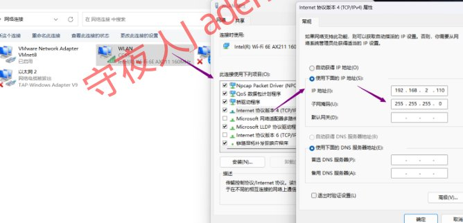

手动设置的ip地址，注意不要和你统一网段中其他的主机的ip地址冲突，不然你和他只能一个可以上

网。

设置子网掩码的时候也要注意，子网掩码不是随便写的值，只能是下面的几个值：

> 第 23 页

11111111    255

11111110    254

11111100    252

11111000    248

11110000    240

11100000    224

11000000    192

10000000    128

00000000    0

我给大家一个小工具，是用来模拟配置网络环境的工具，思科网络设备模拟器，有兴趣的可以自行百度学习一下，工具包我给大家准备了。

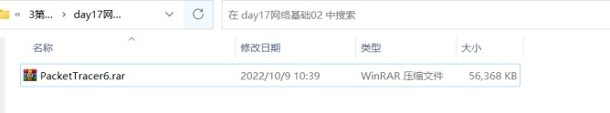

我们不是网络工程师，所以这些东西大家知道一下即可，不需要自行配置或者计算昂，专业的网络工程师你给他一个ip地址和子网掩码，他能在几秒之内给你算出ip地址范围，咱们网络安全人员不需要这样

昂。

## 八、路由器(ikuai)

软件路由器：软路由

硬件路由器：普通路由器

企业路由器：企业级路由器

家用路由器一般比较便宜

守夜人 Jaden（吴老板）

中关村可以看到企业级的：

> 第 24 页

企业级路由器其实配置并不是很高，但是一般都比较贵，我们如果想弄个性价比好的路由器，可以直接买个普通的路由器，或者直接用一台电脑，然后安装一个软路由的系统，就可以得到一个高性能的路由器。接下来我们安装一个免费的ikuai路由器。

### 1、下载

下载地址：https://www.ikuai8.com/component/download/

守夜人 Jaden（吴老板）

如下，下载32位的即可，配置要求比64位的低一些。

> 第 25 页

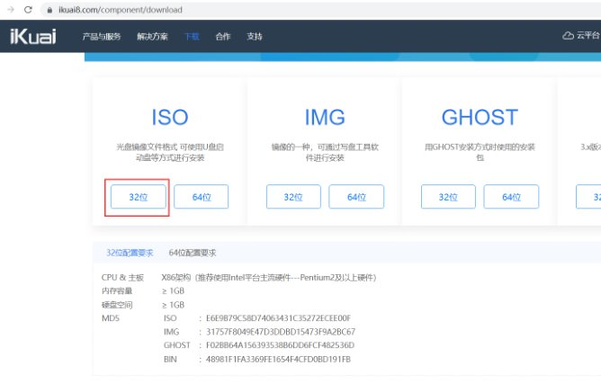

如下

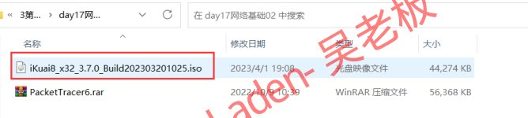

接下来说一下我们要搭建的环境架构：

路由器一般至少要两块网卡，一块网卡NAT模式对应外网，一块网卡是仅主机模式对应内网，准备一台守夜人 Jaden（吴老板）

win10虚拟机，只要一块网卡即可，网卡为仅主机模式。让win10通过ikuai来上网。

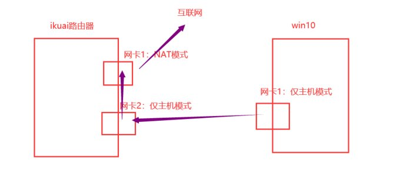

我们说的仅主机模式、NAT模式、桥接模式指的是我们虚拟机上的如下设置

> 第 26 页

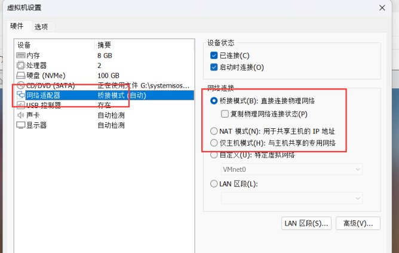

那么接下来安装一个虚拟机，安装ikuai系统。

### 2、创建虚拟机

如下：

守夜人 Jaden（吴老板）

> 第 27 页

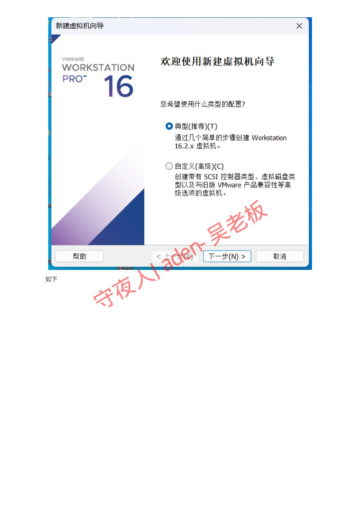

> 第 28 页

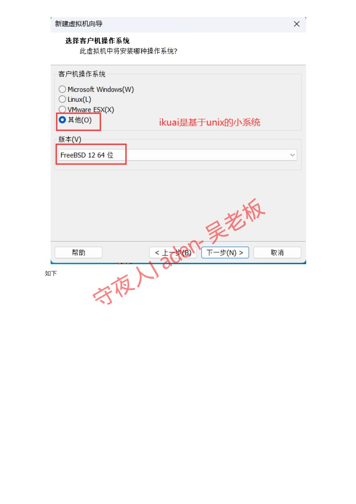

> 第 29 页

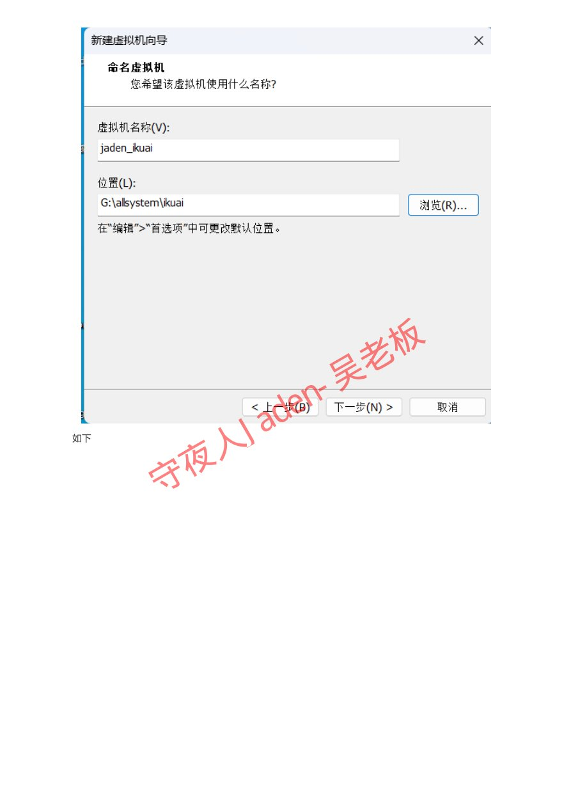

> 第 30 页

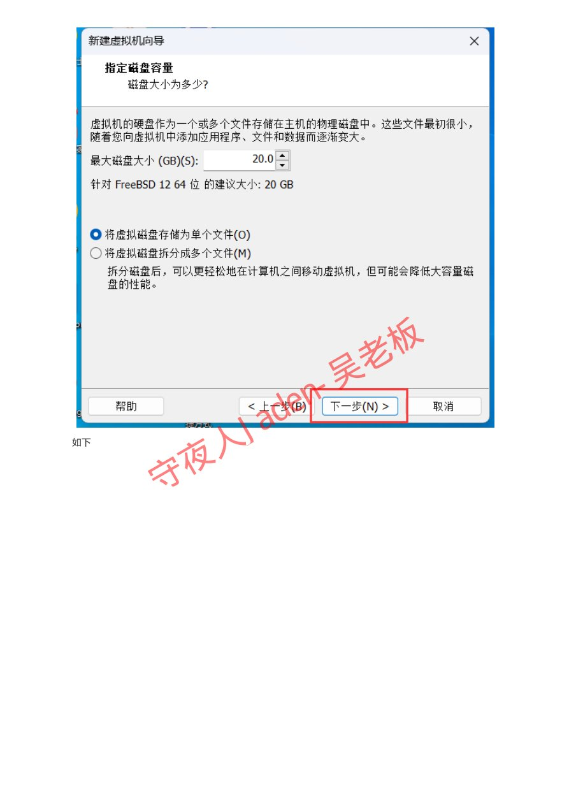

> 第 31 页

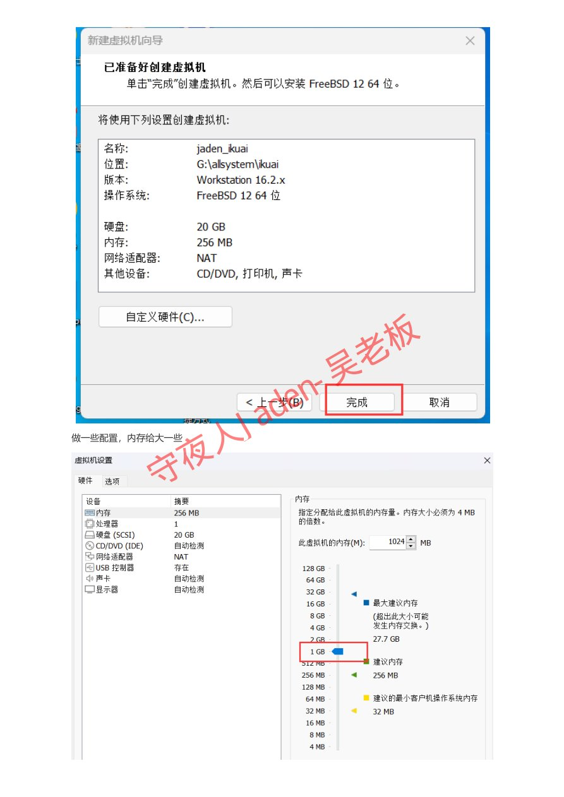

> 第 32 页

再加一个网卡，给一个仅主机模式

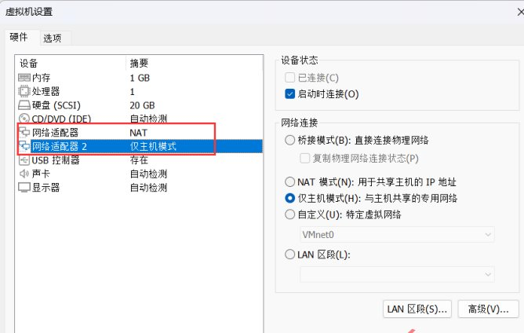

我们需要给ikuai设置一个后台管理站点的访问地址，现在看到lan1是我们的第一块网卡，lan1表示内网网卡，但是我们刚才设置的第一块网卡是NAT的外网网卡，所以我们要去调整一下内外网的网卡顺序，

如下

守夜人 Jaden（吴老板）

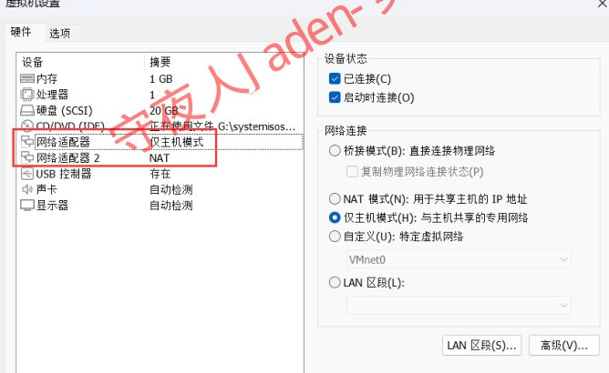

如下，选择我们下载的ikuai的iso镜像

> 第 33 页

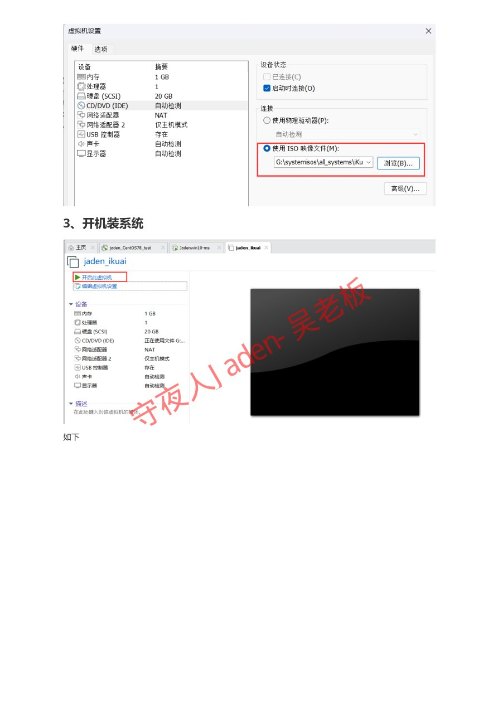

> 第 34 页

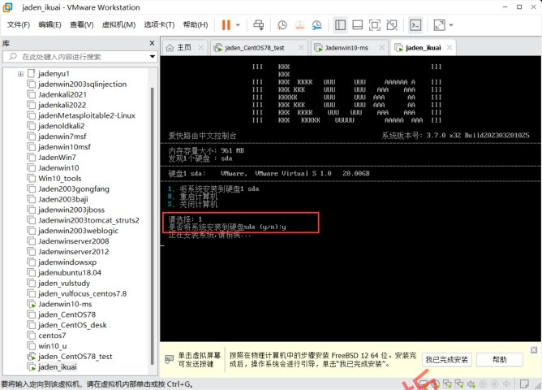

如下，这就安装好了，ikuai已经运行起来了，但是我们还要做一些配置。

守夜人 Jaden（吴老板）

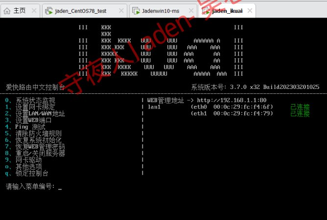

然后在ikuai上设置一下ip地址

> 第 35 页

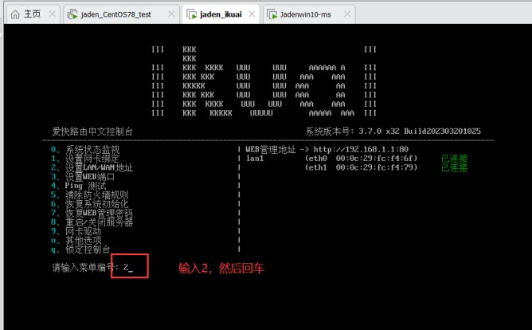

选择设置内网ip和外网ip，我们先设置内网ip，通过内网可以访问ikuai管理平台，在管理平台上可以再设置外网的信息，如下守夜人 Jaden（吴老板）

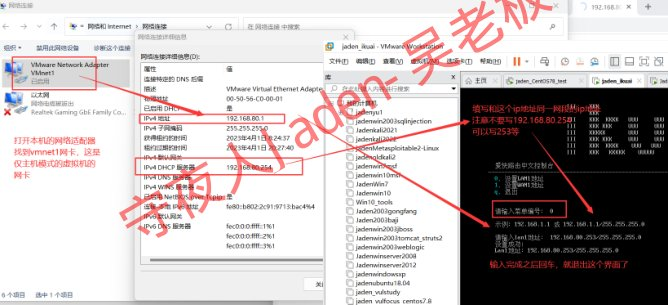

输入q之后，来到如下界面

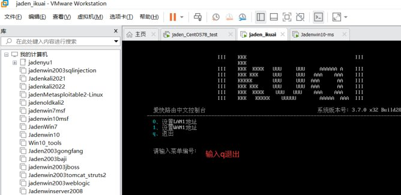

> 第 36 页

如下，可以看到web管理界面的网址了

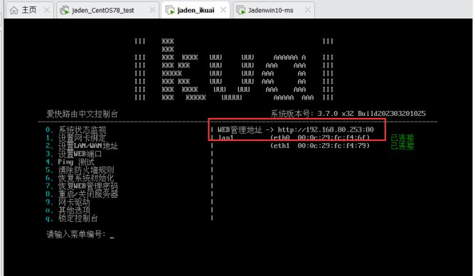

用本机来访问一下这个网址看效果：

守夜人 Jaden（吴老板）

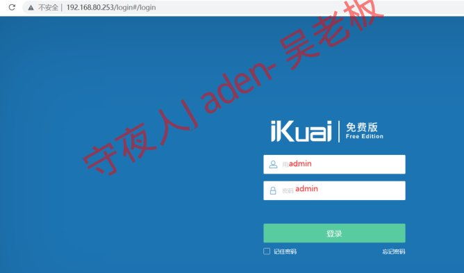

默认的用户名和密码是admin和admin。

登录上去之后会提示我们修改密码，而且密码有复杂度要求，所以我设置一个复杂一点的，比如

123@qq.com

> 第 37 页

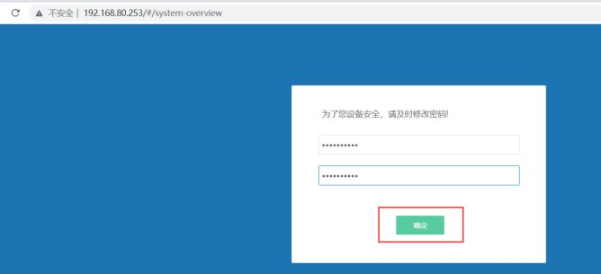

如下

守夜人 Jaden（吴老板）

如下，选择网卡，识别出来的就是我们配置的那个NAT网卡：

如下，等待一会后看到如下效果：

> 第 38 页

然后看状态位置，等待一会之后就看到已连接了，如果没连接上就多刷新几次页面即可。

接下来就可以使用win10来连接ikuai路由器来上网了。

守夜人 Jaden（吴老板）

### 4、准备win10虚拟机

如果没有win10的就安装一个win10虚拟机，我这里随便找了一个win10虚拟机，设置为仅主机模式，然

后开机

> 第 39 页

### 5、配置win10使用ikuai路由器来上网

ikuai默认没有开启dhcp功能，也就是不能给主机自动分配动态ip地址，需要手动给主机配置静态ip地址来上网，如下守夜人 Jaden（吴老板）

如下

> 第 40 页

> 第 41 页

如下，打开浏览器就可以上网了

而且可以登录后台对主机进行上网管理等操作。

守夜人 Jaden（吴老板）

点击最下面的保存，然后如下，就能看到我们设置的规则了

再刷新b站，看不了了

> 第 42 页

这就是ikuai路由器的安装和简单使用了。

配置图解：

守夜人 Jaden（吴老板）

## 九、DNS解析流程

### 1、DNS的定义和由来

dns：全称domain name system域名系统

作用：将域名解析成ip地址

计算机和计算机之间通信是通过ip:端口来实现的。

比如：192.168.19.36:51000 <----> 192.168.19.40:80

服务端的某些服务程序的端口一般是固定的，客户端根据ip和端口进行连接通信，客户端的ip是固定的，但是端口一般是系统随机分配的。

> 第 43 页

ip地址这个东西其实很难记得住，一个两个还行，多了根本记不住。而且如果某个网站的ip地址变了，那么就要重新记忆一下这个ip地址，导致ip地址这个东西其实轻易不能变，变了别人找不到你的网站了。后来就有个人开发了一套程序，这个程序就类似于一个电话本

\# 网站姓名  对应的ip地址

baidu.com    111.22.31.2

bilibili.com 221.22.13.1

...

然后它访问某个网站的时候，就让浏览器自动来读取这个电话本，自动帮他找到名字对应的ip地址来进行访

问。

这个电话本至今还保留着，windows里面就是C:\Windows\System32\drivers\etc\hosts文件。

比如我现在有个网站，如下，这个网站后面会带大家搭建，先看效果，本来这个网站是通过ip地址来访

问的

我们打开这个hosts文件，编辑一条记录，需要管理员权限才能编辑昂，如下

守夜人 Jaden（吴老板）

保存一下，然后通过jaden.com这个名称就可以访问网站了

> 第 44 页

后来他就把这个电话本程序分享了出来，所有人都可以使用它这个程序来访问网站了，再也不用记网站的ip地址了。所以现在我们的电脑上都有了这个电话本程序和他对应的文件hosts，而且在特定的目录下

面。

并且网上有几个专门的网站提供最新的hosts文件，比如8.8.8.8这个网站，我们就可以去这个网站下载最新hosts文件来替换我们自己电脑的hosts文件，那么最新的网站就都可以通过名字来访问了。

但是通过更新hosts文件的方式并不是太好，所有用户都要自行去下载最新的hosts文件来更新，而且也不知道什么时候更新，要经常去下载，并且如果hosts文件比较大，下载也慢，所以就出现了我们说的

dns服务器。

守夜人 Jaden（吴老板）

常用的DNS服务器地址

国内：

    阿里云：

        223.5.5.5

        223.6.6.6

    百度：

        180.76.76.76

    腾讯：

        119.29.29.29

> 第 45 页

    南京信风：

        114.114.114.114  # 广告多，https://www.landiannews.com/archives/18431.html

国外

    谷歌：

        8.8.8.8

如何查看自己使用的DNS服务器地址呢，拿windows来看：

如何自行设置呢？

守夜人 Jaden（吴老板）

DNS的解析我们通过wireshar抓包也可以看到

> 第 46 页

可以看到，我们通过域名访问某个网站，就会先向DNS发起查询域名对应ip地址的请求。如果你写了一个不存在的DNS地址，或者没写DNS地址，那么通过域名是没办法请求到目标网站的，但是ip地址是可以访问到的。

### 2、DNS的解析流程

linux上的dns相关命令: # 下面这几个指令都可以查看DNS解析信息

dig              dig @180.76.76.76 www.hc39.com

nslookup       nslookup www.hc39.com  180.76.76.76

host           host www.baigui.cloud  114.114.114.114

ping  www.baidu.com

\# 示例1：通过nslookup可以查询

yum provides nslookup  # 查找之前可以先清除一下yum的缓存，yum clean all

yum install bind-utils -y

[root@localhost ~]# nslookup www.hc39.com

Server:     192.168.61.2

守夜人 Jaden（吴老板）

Address:    192.168.61.2#53  # 53：表示DNS服务程序的端口为53端口

Non-authoritative answer:

Name:   www.hc39.com

Address: 8.210.129.63

[root@localhost ~]# nslookup www.hc39.com 223.5.5.5

Server:     223.5.5.5

Address:    223.5.5.5#53

Non-authoritative answer:

Name:   www.hc39.com

Address: 8.210.129.63

[root@localhost ~]# nslookup www.hc39.com 180.76.76.76

Server:     180.76.76.76

Address:    180.76.76.76#53

Non-authoritative answer:

Name:   www.hc39.com

Address: 8.210.129.63

\# 通过上面各个DNS服务器的查询结果都是一样的。

> 第 47 页

其实我们上面使用的这些DNS服务器都只是DNS代理服务器，并不是最根儿上的DNS服务器。

顺序

1、找本机的hosts文件 Windows host文件路径： C:\WINDOWS\system32\drivers\etc\hosts

,hosts文件以静态映射的方式提供IP地址与主机名的对照表。

2、浏览器缓存： 浏览器会按照一定的频率缓存DNS记录。浏览器地址栏输入chrome://net-

internals/#dns，就可以查看chormeDNS缓存。

守夜人 Jaden（吴老板）

3、操作系统缓存： 如果浏览器缓存中找不到需要的DNS记录，那就去操作系统中找。cmd命令ipconfig

/displaydns 用于查看操作系统dns缓存。ipconfig /flushdns刷新缓存，之前的记录就没了，只剩下

一些固定的了。

4、路由缓存： 路由器也有DNS缓存。

5、去DNS本地服务器查找，自己公司搭建的或者阿里DNS服务器、百度DNS服务器等等

6、去根域名服务器上找，全世界有13台根域名服务器，其实我们的网址，比如www.hc39.com后面都有个点.，这个.代表根域名的意思，我们可以nslookup www.hc39.com. 发现还是可以查询到的，只不过这个.

默认省略掉了。

7、根域名查不到的话，会直接下发本次请求给本地DNS服务器，并且把.com的顶级域名服务器地址发送给

它，DNS服务器再向.com顶级域名服务器来进行查询。.com\.cn\.cloud等都是顶级域名服务器。

8、如果.com找不到的话，.com顶级域名服务器会给本地DNS服务器下发请求，并且给它hc39.com域名服务器的地址，意思就是说hc39这个域名下放给hc39这个域名所属公司的DNS服务器了，那么就去hc39.com域名服务器进行查询

9、查找到之后再还给你的电脑，你的电脑本地和路由器等都会自动缓存这些记录，下次再访问这个网站的时候，就从缓存中找，不然每次都按照流程找一遍就太慢了。

这就是DNS的解析流程了。其实解析流程不仅仅是上面这种方式，上面的方式是递归查询，还有迭代查询的方式，一般都是两种方式结合查询，这里我就不多提了。知道了上面的流程即可。

> 第 48 页

所有的DNS服务器解析DNS的权利都是由它的上级DNS服务器授权的，最终是根服务器授权，这些权利根服务器是可以回收来自己完成解析的。当年美军攻打伊拉克，让伊拉克在互联网上消失了，就玩了一手DNS解析，将所有伊拉克的网站网址解析到了一个错误的ip地址上，别人都访问不了伊拉克的网站

了。

13个根域名服务器，其中1个为主根服务器在美国，由美国互联网机构Network Solutions运作。其余12

个均为辅根服务器，其中9个在美国，2个在欧洲(位于英国和瑞典)，1个在亚洲(位于日本)。

在与现有IPv4根服务器体系架构充分兼容基础上，"雪人计划"于2016年在全球16个国家完成25台IPv6根服务器架设，事实上形成了13台原有根加25台IPv6根的新格局，为建立多边、民主、透明的国际互联网治理体系打下坚实基础。中国部署了其中的4台，由1台主根服务器和3台辅根服务器组成，打破了中国过去没有根服务器的困境。所以中国现在主推ipv6。

### 3、域名

一是国家和地区顶级域名（country code top-level domains，简称ccTLDs），目前200多个国家都按照ISO3166国家代码分配了顶级域名，例如中国是cn，日本是jp等；

二是国际顶级域名（generic top-level domains，简称gTLDs），例如表示工商企业的 .com域名，表示网络提供商的 .net域名，表示非盈利组织的 .org域名等；

三是新顶级域名（New Generic Top-level Domain，简称New gTLD）如通用的.xyz域名、代表“高端”

的.top域名、代表“红色”的.red域名、代表“人”的.men域名等一千多种。

从技术角度来看，一个完整的域名由顶级域名和下级域名构成，各部分之间用“.”隔开，最后一个“.”的右边被称为顶级域名（TLD，也称为一级域名），“.”左边的部分被称为二级域名，二级域名的左边是三级域名，以此

类推。

为了便于理解和交流，我们通常会把域名分为前缀+后缀，后缀一般就是我们常见的.com/.cn/.cc/.net等等，这些都属于顶级域名，前缀则是由数字、字母自由组成的，用以和其他域名相区分的部分，这部分也是域

名的核心价值所在。举个例子，中科三方的官网为http://www.sfn.cn，这其中.cn为顶级域名，也就是人

们常说的后缀部分，.sfn则是其前缀的二级域名部分，代表的是中科三方这个品牌，最前面的.www则是前缀的三级域名部分，代表的是中科三方的官网。

二级域名的拥有者可以任意定义三级及三级以上的域名，比如小米公司花费两千万买下的http://mi.com这

个二级域名后，他就可以根据其产品和业务再这个二级域名基础上无限定义三级域名或更高级的域名，比如，

守夜人 Jaden（吴老板）

小米云服务：http://i.mi.com，小爱开放平台：http://xiaoai.mi.com，小米iot开发者平台：

http://iot.mi.com，小米金融：http://jr.mi.com等等。一般情况下，除了政府相关网站外，很少有

企业去定义三级以上的域名。

### 4、DNS记录的类型

我在我的阿里云的域名位置给大家看一下，大家可以在阿里云或者腾讯云买个域名，但是域名备案要几个月才能下来，所在暂时不用买了，大家学习一下即可，买了域名还在买个ECS主机，会默认给一个公网ip，我们通过域名解析到这个公网ip就可以通过域名来访问这个主机了，为了方便演示，我在我的ECS

主机上的centos7.8系统上安装并启动了nginx，并且在ECS的安全组策略中添加了80端口的入栈规则，

然后访问80端口可以看到如下效果：

> 第 49 页

做一下域名解析：其实就是DNS域名指向ip地址

守夜人 Jaden（吴老板）

如下，输入www.wulaoban.top，即可访问：

这就配置好了域名和ip的对应关系，也就是我们说的DNS记录，这是个A记录。

做DNS记录的时候，我们看到有多种类型，那么我们来说一下这些类型。

> 第 50 页

类型有这么多，这些都是DNS记录类型，重点了解如下几个即可：

A记录：域名对应一个ipv4的地址，通过dns查询这个域名就能得到对应ip地址  例如：

www.wulaoban.top  --  39.105.145.132

CNAME：也叫做域名别名，它将域名指向另外一个域名，你通过这个域名来进行DNS查询，那么得到的是另外一个域名，DNS查询会基于询问另外一个域名。 比如dig www.qq.com就能看到CNAME记录

MX：邮件记录，我们发邮件给1111@qq.com这个地址，那么首先会去找qq的邮箱服务器，就需要用到这个记录来找到服务器。windows上也自带nslookup指令，查询a记录：nslookup -qt=a qq.com，查询mx记录：nslookup -qt=mx qq.com，会看到几个域名，ping域名就看到ip地址了。qq.com有mx记录，说明

qq这个公司有自己的邮箱。如果某个公司没有自己的邮箱服务器，那么查不到信息。

NS：全称nameserver，可以指定DNS解析服务器的地址，在我们自己的域名解析记录上也可以设置自己DNS

解析服务器，但是需要搭建DNS服务才行。

AAAA：ipv6地址，没啥说的。

nslookup查询示例：

C:\Users\ls198>nslookup -qt=a qq.com

DNS request timed out.

守夜人 Jaden（吴老板）

    timeout was 2 seconds.

服务器:  UnKnown

Address:  192.168.2.1

非权威应答:

名称:    qq.com

Addresses:  61.129.7.47

          183.3.226.35

          123.151.137.18

C:\Users\ls198>nslookup -qt=mx qq.com

DNS request timed out.

    timeout was 2 seconds.

服务器:  UnKnown

Address:  192.168.2.1

非权威应答:

qq.com  MX preference = 10, mail exchanger = mx3.qq.com

qq.com  MX preference = 30, mail exchanger = mx1.qq.com

qq.com  MX preference = 20, mail exchanger = mx2.qq.com

> 第 51 页

C:\Users\ls198>ping mx1.qq.com

正在 Ping mx1.qq.com [113.96.208.206] 具有 32 字节的数据:

来自 113.96.208.206 的回复: 字节=32 时间=49ms TTL=53

来自 113.96.208.206 的回复: 字节=32 时间=47ms TTL=53

来自 113.96.208.206 的回复: 字节=32 时间=49ms TTL=53

来自 113.96.208.206 的回复: 字节=32 时间=48ms TTL=53

113.96.208.206 的 Ping 统计信息:

    数据包: 已发送 = 4，已接收 = 4，丢失 = 0 (0% 丢失)，

往返行程的估计时间(以毫秒为单位):

    最短 = 47ms，最长 = 49ms，平均 = 48ms

C:\Users\ls198>nslookup -qt=mx wulaoban.top  # 没有邮箱地址

服务器:  UnKnown

Address:  192.168.2.1

wulaoban.top

        primary name server = dns19.hichina.com

        responsible mail addr = hostmaster.hichina.com

        serial  = 2022052002

        refresh = 3600 (1 hour)

        retry   = 1200 (20 mins)

        expire  = 86400 (1 day)

        default TTL = 600 (10 mins)

C:\Users\ls198>nslookup -qt=AAAA aliyun.com

DNS request timed out.

    timeout was 2 seconds.

服务器:  UnKnown

Address:  192.168.2.1

非权威应答:

名称:    aliyun.com

守夜人 Jaden（吴老板）

Addresses:  2401:b180:1:60::5

          2401:b180:1:60::6

## 十、ARP协议

ARP（Address Resolution Protocol），工作在网络层和数据链路层中间。osi七层模型中，属于数据链路基层的。

作用：把ip地址解析成mac地址

> 第 52 页

我们抓包看一下效果：准备两个NAT网络模式的主机，比如我的A主机的ip地址为192.168.61.139 ，B

主机的ip地址为192.168.61.135 ，打开wireshark，抓取VMnet8网卡的数据，用B主机ping一下A主机守夜人 Jaden（吴老板）

抓包看到如下效果，如果没看到就重新再抓一下，我们下面抓取到的数据包顺序其实也不太对，应该是先看到Broadcast广播arp请求，

广播的mac地址全是f，交换机就知道你不知道对方的mac地址，那么交换机就发广播了：

> 第 53 页

ICMP协议是ping发送探测数据包采用的协议，ARP是B主机发送给交换机的ARP广播请求，交换机会发一个arp协议的Broadcast广播，问插在交换机上的所有主机，谁是的ip地址是192.168.61.139 ，把

mac地址告诉192.168.61.135 主机。所以其实两台主机想通信，其实还必须要知道对方的mac地址才可以。如果我们ping过之后，arp广播请求也已经发送了，那么再次ping抓包的时候可能就看不到arp广播了，因为arp广播是有缓存时效的，比如windows的arp超时时间Reachable Time是一个介于15秒~45

秒之间的随机值，这个通过修改注册表也是可以改的。为什么会有时效性呢，因为每个主机的ip地址是会发生变化的，比如可以自行指定ip地址，如果arp广播的时效性太长，那么就没办法连通了。

windows下通过arp -a 可以查看arp缓存：

守夜人 Jaden（吴老板）

arp要注意的

a：arp欺骗，广播的时候计算机默认是诚实的，但是如果它不诚实就可以做欺骗。

b：如果局域网规模太大，广播风暴

arp欺骗，属于局域网的一种攻击手段，但是win10及以上的系统基本已经没有用了：看黄色的线

> 第 54 页

现在有很多专门的arp安全工具，比如360的arp防火墙。也叫做局域网防护。

广播风暴：

如果交换机连接的主机太多，那么一次广播就很耗资源，如果广播次数很多，那么就容易造成网络堵

塞。

解决方法：路由器配合ip地址段来进行广播域的划分。路由器的内网ip地址，也就是我们ipconfig查看到的网关ip地址一般是网段的第一个ip或者最后一个ip，比如192.168.19.1或者192.168.19.254。

守夜人 Jaden（吴老板）

## 十一、tcpdump抓包

这个工具我们在前面已经安装过了。这个工具抓到的数据包可以交给wireshark进行分析，为什么linux

下不直接用wireshark呢，因为linux一般不会安装图形化界面，而wireshark工具是需要图形化界面来操作的，所以一般不用在linux上，但是如果你们公司比较牛x，自行将wireshark的功能封装到linux中，

也是可以在linux中非图形化界面的方式来使用。比如奇安信的天眼，就是部署在linux系统上的，内置了

wireshark的功能。

tcpdump是linux上的一个轻量级的抓包工具。支持针对网络层、协议、主机、网络或端口的过滤，并提供and、or、not等逻辑语句来帮助你去掉无用的信息。tcpdump只能抓取流经本机的数据包，一般有三个类型，比如指定地址，指定协议，或者指定网卡。

> 第 55 页

先给我们的虚拟机安装个nginx，然后拍个快照吧，方便一些

yum install epel-release -y

yum install nginx -y

systemctl stop firewalld

systemctl disable firewalld

启动nginx：

    /usr/sbin/nginx

简单使用：

[root@localhost ~]# tcpdump

\# 默认情况下，直接启动tcpdump将监视第一个网络接口(非lo口)上所有流通的数据包，这样抓取的结果会

非常多，而且默认不会显示出来。

[root@localhost ~]# ifconfig  # 先查看网卡名称，因为tcpdump抓包的时候和wireshark一样要

指定网卡

ens33: flags=4163<UP,BROADCAST,RUNNING,MULTICAST>  mtu 1500

...

\# 指定网卡抓取数据包，会将流经这个网卡的数据包全部抓取下来，这样也是太多了，尤其是我们如果是在

xshell上执行这个指令的话，就会看到更多的数据包，刷屏的感觉，是因为xshell是远程连接执行指令，结果要返回给xshell，都是要经过网卡的。

[root@localhost ~]# tcpdump -i ens33 # 指定网卡名称

\# 所以我们用xshell连接来抓包的时候，最好指定端口，比如不抓22端口的，我们抓一下80端口的。

[root@localhost ~]# tcpdump -i ens33 port 80

\# 访问：http://192.168.61.139/  就看到抓取的数据包了

\# 将抓取到的数据包保存到pcap\cap文件中，cap是captured的简写，捕获的意思。

守夜人 Jaden（吴老板）

[root@localhost ~]# tcpdump -i ens33 port 80 -w jaden.pcap # 屏幕上不显示，也不暂定，

我们ctrl+c停止，然后看到目录下就有文件了

[root@localhost ~]# ls

anaconda-ks.cfg  jaden.pcap

\# 把jaden.pcap放到我们的物理机，通过wireshark打开来进行查看分析

\# -nn参数

\# 不加-nn，抓包显示为：20:38:16.924940 IP 192.168.61.1.62552 >

localhost.localdomain.http: Flags...  # 主机名和协议

\# 加了-nn，抓包显示为：21:49:01.908068 IP 192.168.61.1.49721 > 192.168.61.139.80:

Flags  # 主机ip地址和端口号

[root@localhost ~]# tcpdump -i ens33 port 80 -nn

\# [root@localhost ~]# tcpdump -i ens33 port 80 -nn -c 20 #抓取到20个包之后自动停止

\# [root@localhost ~]# tcpdump -i ens33 port 80 -nn -c 20 -S  #-S将seq\ack等随机值显

示完整

\# 指定协议：

\# [root@localhost ~]# tcpdump -i ens33 tcp port 80 -nn -c 20

> 第 56 页

-i 指定网卡的名称

-nn 不把端口解析成应用层协议

-c  指定抓包的数量

-S  不把随机序列和确认序列解析成绝对值

-w  指定数据包保存的位置

先简单学习这么多即可。tcpdump主要是用来抓包分析、解决网络故障等工作。

## 十二、网络工具

网络相关指令有很多，我们先简单看两个。

### 1、nmap

这个工具主要是做信息收集用的，后面安全课程和工作中都用的比较多，也叫做主机安全扫描器， 探测主机存活、端口开放情况所用的工具，这个工具我们后面安全课程中还会细讲，这里先简单说一下：官

网地址为https://nmap.org/

\# centos7上安装nmap

yum install nmap -y

[root@localhost ~]# nmap -v # 默认安装的6.40，不是最新版本，yum经常是下载不了最新版的，有

镜像更新延迟的问题

Starting Nmap 6.40 ( http://nmap.org ) at 2023-04-05 00:13 CST

...

\# 官网下载最新版本的rpm包，然后rpm安装即可

\# rpm -Uvh nmap-7.93-1.x86_64.rpm  # -U表示升级，如果已经安装了低版本就用-Uvh，如果没有

安装老版本，那么-ivh安装

\# 我已经给大家下载好了，在工具包里面

\# 简单使用：

\# 探测ip地址段哪些ip地址是存活的，也就是有主机在线并使用了哪些ip地址

[root@localhost ~]# nmap -sn 192.168.61.0/24

守夜人 Jaden（吴老板）

\# 探测主机哪些端口开放

[root@localhost ~]# nmap -sS 192.168.61.0/24 # ip地址段

[root@localhost ~]# nmap -sS 192.168.61.139  # 单个ip地址

\# 如果你的主机在公网上面，别人通过nmap直接就可以扫描你，如果发现有什么漏洞，直接就可以把你拿下。

### 2、traceroute和tracert

这两个工具是进行路由追踪的，router是路由的意思，路由追踪的意思就是查看一下我们想访问某个网站到底会经历哪些设备地址的跳转。这个用的不是很多。

tracert是windows上自带的工具：

C:\Users\ls198>tracert -d nmap.org # 比如追踪一下nmap.org，这是国外的网站，所以数据包应

该是出国了。

通过最多 30 个跃点跟踪

到 nmap.org [45.33.49.119] 的路由:

> 第 57 页

  1     3 ms   109 ms     6 ms  192.168.2.1  # 路由

  2     *        9 ms     4 ms  192.168.1.1  # 光猫

  3    42 ms    51 ms    12 ms  10.29.0.1    # 电信局域网

  4     *        *        *     请求超时。

  5     *        *      198 ms  27.129.33.225 # 廊坊电信网络机房等

  6     *        *        *     请求超时。

  7     *        *        *     请求超时。

  8     *        *       28 ms  202.97.54.14 # 天津电信

  9   254 ms   197 ms   205 ms  202.97.59.106 # 天津电信

 10     *        *        *     请求超时。

 11   181 ms   181 ms   189 ms  154.54.5.101 # 美国 加利福尼亚州 圣何塞

 12   185 ms   190 ms   183 ms  154.54.3.138 # 美国 加利福尼亚州 圣何塞

 13   185 ms   190 ms   189 ms  38.142.11.154 # 美国 加利福尼亚州 圣何塞

 14     *        *        *     请求超时。

 15   187 ms   195 ms     *     45.33.49.119 # 美国 加利福尼亚州 弗里蒙特

 16  1027 ms   565 ms   179 ms  45.33.49.119 # 美国 加利福尼亚州 弗里蒙特跟踪完成。

traceroute是linux上的工具，需要安装一下

\# 安装

[root@localhost ~]# yum provides traceroute

[root@localhost ~]# yum install traceroute -y

[root@localhost ~]# traceroute -n nmap.org

\# 这个工具不好用，总是查询超时，查不到数据

中国最大的防火墙，是GWF中国长城防火墙，就在国际网络出口位置进行网络进出的控制和监控。大家可以百度看一下GWF的作用。

## 十三、修改网络配置

守夜人 Jaden（吴老板）

### 1、VMware虚拟机的三种网络模式

> 第 58 页

桥接模式(bridged)：也就是将虚拟机的虚拟网络适配器与主机的物理网络适配器进行交接，虚拟机中的虚拟网络适配器可通过主机中的物理网络适配器直接访问到外部网络。简而言之，这就好像在局域网中添加了一台新的、独立的计算机一样。因此，虚拟机也会占用局域网中的一个 IP 地址，并且可以和其他终端进行相互访问。桥接模式网络连接支持有线和无线主机网络适配器。如果你想把虚拟机当做一台完全独立的计算机看待，

并且允许它和其他终端一样的进行网络通信，那么桥接模式通常是虚拟机访问网络的最简单途径。

NAT模式：是Network Address Translation的缩写，意即网络地址转换。NAT 模式也是 VMware 创建虚拟机的默认网络连接模式。使用NAT模式网络连接时，VMware会在主机上建立单独的专用网络，用以在主机和虚拟机之间相互通信。虚拟机向外部网络发送的请求数据 "包裹"，都会交由 NAT 网络适配器加上 "特殊标记" 并以主机的名义转发出去，外部网络返回的响应数据 "包裹"，也是先由主机接收，然后交由 NAT 网络适配器根据 "特殊标记" 进行识别并转发给对应的虚拟机，因此，虚拟机在外部网络中不必具有自己的IP地址。从外部网络来看，虚拟机和主机在共享一个IP地址，默认情况下，外部网络终端也无法访问到虚拟机。

仅主机模式(host-only)：是一种比 NAT 模式更加封闭的网络连接模式，它将创建完全包含在主机中的专用网络。仅主机模式的虚拟网络适配器仅对主机可见，并在虚拟机和主机系统之间提供网络连接。相对于 NAT

模式而言，仅主机模式不具备 NAT 功能，因此在默认情况下，使用仅主机模式网络连接的虚拟机无法连接到

Internet (在主机上安装合适的路由或代理软件，或者在 Windows 系统的主机上使用 Internet 连接共

享功能，仍然可以让虚拟机连接到 Internet 或其他网络)。在同一台主机上可以创建多个仅主机模式的虚拟网络，如果多个虚拟机处于同一个仅主机模式网络中，那么它们之间是可以相互通信的；如果它们处于不同的仅主机模式网络，则默认情况下无法进行相互通信（可通过在它们之间设置路由器来实现相互通信）。

三种模式图解：

NAT和桥接模式：

守夜人 Jaden（吴老板）

仅主机模式下的虚拟机是不能上网的，单纯的是物理机的奴隶，同一个虚拟网络的仅主机模式的虚拟机之间是可以互相通信的。和主机可以通信吗？这个要看网段配置，如果虚拟机和主机在同一个网段是可以通信的，如果不是也不能通信，而且仅主机模式的虚拟机只能和本主机通信，不能和主机同一网络或者公网的其他主机通信。

给虚拟机设定网络模式的配置位置：

> 第 59 页

对应网卡：桥接模式用的VMnet0网卡，不显示，因为它只起一个桥接到物理网卡的作用，这个就是直接找的我们物理机的网卡，所以不用管它。

守夜人 Jaden（吴老板）

NAT模式的网络信息：

VMware -->编辑-->虚拟机网路编辑器：

> 第 60 页

NAT模式网卡网段、网关和掩码等信息：

守夜人 Jaden（吴老板）

> 第 61 页

### 2、给虚拟机配置网卡信息

windows修改配置网卡信息我们前面说过：

现在说一下linux如何配置网卡，我们克隆一个机器出来，然后给它设置两块网卡，注意在关机状态下添加网卡昂，一块NAT模式，一块桥接模式守夜人 Jaden（吴老板）

开机查看ip，如下

> 第 62 页

两个网卡，两个ip地址

NAT的ip地址：192.168.61.140

桥接模式的ip地址：192.168.2.119

在公司当中，其实服务器的ip地址是不能轻易更改的，那么就不能使用dhcp。比如windows的ip地址位置，可以看到dhcp

守夜人 Jaden（吴老板）

关闭dhcp服务器，客户端是可以自行设定的，其实就是指定固定的ip地址：

> 第 63 页

我们看到的是dhcp客户端程序设置位置，其实电脑上有dhcp的服务端，它是用来分配ip地址的。在路由器上就可以看到：

守夜人 Jaden（吴老板）

这个了解一下即可。

那么我们在公司中大家都自行指定ip地址，那么有没有可能会ip地址冲突呢，会的，那么比如在

windows上，你会看到如下提示：

> 第 64 页

dhcp分给你的ip地址也不是长期有效的，有个叫做租期的概念，分给你这个ip地址之后，如果你超过了租期没有使用这个ip地址，那么这个ip地址就可能会分配给别人。

公网ip一般都是静态分配的，不会自动获取，局域网ip地址一般都是自动分配的。

### 3、linux静态ip配置

linux配置ip地址和windows不一样，不是点点点就能搞定的，需要修改配置文件。

我们前面配置了双网卡，我们来改一下第一块网卡ens33的配置，指定为固定ip地址。然后再改一下第二块网卡信息。

守夜人 Jaden（吴老板）

但是当我们查看网卡配置信息的时候，会发现配置文件只有ifcfg-ens33，如下

我们给ens36也弄个配置文件，需要复制一份ifcfg-ens33配置文件，然后改名为ifcfg-ens36。

> 第 65 页

然后修改ifcfg-ens33配置信息：

改为如下内容：配置文件路径/etc/sysconfig/network-scripts/ifcfg-ens33

#默认配置

TYPE="Ethernet"  # 类型：以太网，我们现在用的网络都是以太网，数据链路基层都是以太网协议，没有别的协议。1982年以太网统一了链路层的协议.

PROXY_METHOD="none" # 代理方法，目前无用，删除

BROWSER_ONLY="no" # 只允许浏览器使用，没用，删除

BOOTPROTO="dhcp"  # 获取ip地址的方法，目前是dhcp，改为static，静态指定ip地址。

DEFROUTE="yes" # 默认路由，没用，删除

IPV4_FAILURE_FATAL="no" # 从这一行开始开始，往下数6行，都删掉

IPV6INIT="yes"

IPV6_AUTOCONF="yes"

IPV6_DEFROUTE="yes"

IPV6_FAILURE_FATAL="no"

IPV6_ADDR_GEN_MODE="stable-privacy"

NAME="ens33"  # 名字改为ens36

UUID="15723721-cab7-40f6-bcee-4789906f8661" # 这是唯一标识符，这个没用，删掉

DEVICE="ens33"

ONBOOT="yes"

#修改后的配置

守夜人 Jaden（吴老板）

TYPE="Ethernet"        #以太网类型

BOOTPROTO="static"     #dhcp自动获取 none,static手动配置

NAME="ens33"           #网络的名字

DEVICE="ens33"         #网卡的名字

ONBOOT="yes"           #开机自启

IPADDR=192.168.61.150   #ip地址

NETMASK=255.255.255.0  #子网掩码

\# 其实下面网卡和dns都可以不用配置，因为我有两块网卡，只要有一块网卡有了下面网卡等的配置即可。

\# GATEWAY=192.168.61.2  #网关

\# DNS1=223.5.5.5         #dns1

\# DNS2=180.76.76.76      #dns2

ip地址也不是随便指定的：

> 第 66 页

网络名字和网卡名字：

linux上网络名字和网卡名字相同而已，没什么。

网关的ip地址，因为我们是虚拟机，要找这个虚拟机自己的网卡，看网卡信息中找到网关地址，因为我们第一块网卡是NAT模式的，所以要找VMnet8，如下守夜人 Jaden（吴老板）

打开虚拟网络编辑器，如下

> 第 67 页

网关就是192.168.61.2。

我们在修改一下第二块网卡ens36的网络信息：

#修改后的配置

TYPE="Ethernet"        #以太网类型

BOOTPROTO="static"     #dhcp自动获取 none,static手动配置

NAME="ens36"           #网络的名字

DEVICE="ens36"         #网卡的名字

ONBOOT="yes"           #开机自启

IPADDR=192.168.2.110   #ip地址

NETMASK=255.255.255.0  #子网掩码

\# 其实下面网卡和dns都可以不用配置，因为我有两块网卡，只要有一块网卡有了下面网卡等的配置即可。

GATEWAY=192.168.2.1    #网关  # 这个就看我们物理机的网关ip即可，不管有几块网卡，指定一个网关即可。

DNS1=223.5.5.5         #dns1

DNS2=180.76.76.76      #dns2

守夜人 Jaden（吴老板）

修改完配置文件，重启网络服务生效

systemctl restart network  # 刚改为配置，重启可能会卡住一会，没事，肯定会生效

systemctl stop NetworkManager

systemctl disable NetworkManager

重启网卡之后，ip地址就变成了我们指定的ip地址，xshell连接一下第一个ip地址，就连接上了：

> 第 68 页

## 十四、上不了网排查思路

xshell连不上的原因

有时候大家可能会下载一些安全卫士什么的，优化一下自己的系统，让系统更快一些，结果导致xshell

连接不上了.

检查网卡是否开启了

守夜人 Jaden（吴老板）

检查服务，DHCP是用来发放ip地址的，NAT是用来控制NAT模式虚拟机上网的。

> 第 69 页

还要检查如下几项

1.检查虚拟机的网络适配器，是否连接，是否为nat模式

2.检查VMware Network Adapter VMnet8网卡是否处于禁用状态

3.VMnet8网卡的ip地址是否和虚拟机同一个网段，有时候手动指定它的ip地址会写错

4.检查虚拟机的ip是否有或者是否正常，linux上ip地址冲突，会导致后设置这个ip的主机拿不到这个ip地

址

xshell能连，但是上不了网

\# 如果看到如下报错，多半是GATEWAY关键字名称写错了

[root@network02 ~]# ping baidu.com

ping: baidu.com: 未知的名称或服务

[root@network02 ~]# ping 223.5.5.5

connect: 网络不可达

#GATEWAY地址写错了，或者网关路由器挂了

[root@network02 ~]# ping 223.5.5.5

守夜人 Jaden（吴老板）

PING 223.5.5.5 (223.5.5.5) 56(84) bytes of data.

#能ping通公网ip，ping不通域名，dns地址有问题

[root@network02 ~]# ping www.baidu.com

#[root@network02 ~]# vim /etc/resolv.conf  #这里可以直接修改DNS地址

^C

[root@network02 ~]# ping 223.5.5.5

PING 223.5.5.5 (223.5.5.5) 56(84) bytes of data.

64 bytes from 223.5.5.5: icmp_seq=1 ttl=128 time=14.4 ms

64 bytes from 223.5.5.5: icmp_seq=2 ttl=128 time=6.08 ms

> 第 70 页

物理机上不了网

第一步：检查物理是否正常

第二步：ping网关

第三步:   ping公网ip

第四步：ping www.baidu.com

tracert -d www.qq.com

第五步：ping 自己服务器

还可能是交换机、路由器、光猫等设备坏了。

## 十五、静态路由项目

路由是用来给数据包指路的，比如从国内发送个请求数据包到海外，中间会经过很多的路由器设备，这个线路可能有很多中走法。

整个世界的互联网是一个环形：

守夜人 Jaden（吴老板）

局域网适合用星形：

> 第 71 页

告诉数据包去往目的地该如何走，怎么近怎么走，就需要配置路由了，一般都不需要我们自行维护，所以这个知识点大致了解一下即可。

### 1、路由方式分类

配置路由有两种方式：

动态路由：不需要人工配置，路由器设置好之后，它会自动进行路由线路学习，不需要我们操心。

静态路由：需要人工配置

路由器其实解决的就是不同网段之间主机的通信问题，如果是同一网段的，那么直接一个arp广播就搞定了，不同网段就需要路由器了，我们接下来设计一个环境，通过这个环境来演示一下路由器静态配置。

### 2、静态路由配置示例

守夜人 Jaden（吴老板）

2.1 环境准备

下面我克隆出来了三个虚拟机，如下

jaden_CentOS78_01：

> 第 72 页

jaden_CentOS78_02：双网卡

守夜人 Jaden（吴老板）

jaden_CentOS78_03：

> 第 73 页

物理网络就设置好了，接下来开机设置ip地址。为了演示出来效果，我们都不给这三台主机设置网关地址，只配ip地址和子网掩码。网关是优先级最低的静态路由。

jaden_CentOS78_01：

守夜人 Jaden（吴老板）

保存退出，重启网卡：

> 第 74 页

为了区分这几台主机，我们修改一下主机名，修改完之后，退出重新登陆一下就生效了。

jaden_CentOS78_02：

守夜人 Jaden（吴老板）

第一块网卡：

第二块网卡：

> 第 75 页

改完之后重启网络服务systemctl restart network ，然后查看一下网卡信息，和我们预想的一样：

修改hostname

守夜人 Jaden（吴老板）

退出登录，重新登录一下即可。

jaden_CentOS78_03：

保存退出，重启网络服务，修改hostname，然后如下：

> 第 76 页

环境准备完毕，接下来我们验证一下02主机是否可以连通01和03，如果他们都连通不了，那么回头用01

和03连通肯定是做不到的。

好，02可以ping通01和03.

守夜人 Jaden（吴老板）

通过01直接ping一下03，试试

> 第 77 页

ping不通，显示网络不可达。

现在看上去我们的主机是不能跨ip地址段进行互相访问的，我们设置一个路由规则就可以了。

2.2 设置静态路由规则

直接arp广播就能访问到的叫做直连路由，如下route -n 就能查看到，可以看到我们主机01想访问

192.168.61.0 网段的主机都是直接可达的。

刚才我们使用主机01ping主机03看到报错，网络不可达，就是因为你ping03主机的ip地址时，主机01发现你要找的ip地址不在我这个网段，就会自动查找路由表的记录，上面就是路由表记录，看不到03主机所在网段的路由，所以报错，找不到。

给01主机配置静态路由：

route add -net 172.16.1.0/24 gw 192.168.61.161

\# 添加一条静态路由，访问172.16.1.0这个网段，那么先跳到192.168.61.161这个网关上，通过它去访

问，gw就是设置网关的意思，这里就是设置了一下路由的下一次跳转到哪里。

如下

守夜人 Jaden（吴老板）

先ping一下02的第二块网卡的ip地址，也就是172那个网段的

可以ping通，看到02主机给我回复了数据包，这是因为02主机本身的路由表中就有我们01主机的ip地址

段：

> 第 78 页

但是通过01ping03主机的话，你看，还是ping不通，但是显示的不是网络不可达了：

可以通过tcpdump -i ens33 -nn 来查看一下数据包有没有到，其实数据包都没有到达03主机。因为02

主机的ip地址并不是172.16.1.13 ，所以数据包丢掉了。也就是说02主机其实并没有帮我们做转发，我们需要配置一下转发才行。

2.3 打开转发功能

在02主机上打开转发功能：

echo 'net.ipv4.ip_forward = 1' >> /etc/sysctl.conf

cat /etc/sysctl.conf

sysctl -p # 让配置生效

守夜人 Jaden（吴老板）

然后，我们在02主机上抓个包

> 第 79 页

然后再从01主机ping03主机，看效果

守夜人 Jaden（吴老板）

看到数据包到了02主机，02主机给做了转发到了172.16.1.13 ，但是ping并没有收到回应的数据包。

这是因为03主机不知道该怎么回给01主机，看03的路由表：

> 第 80 页

在03主机上也加上一条静态路由规则

route add -net 192.168.61.0/24 gw 172.16.1.12

如下

守夜人 Jaden（吴老板）

再通过01主机ping一下03主机：

> 第 81 页

可以ping通了。

这就是通过我们虚拟机来模拟了一下静态路由规则的设定方式。

总结：

1、手动配置ip

2、克隆虚拟机

3、添加静态路由规则

    route add -net 172.16.1.0/24  gw 192.168.20.12

    route add -net 192.168.20.0/24 gw 172.16.1.12

4、设置数据包转发

守夜人 Jaden（吴老板）

    echo 'net.ipv4.ip_forward = 1' >>/etc/sysctl.conf

    sysctl -p

5、systemctl restart network  #重启网卡服务就可以还原所有的静态路由，如果你配置错了，就可以重启一下

2.4 数据包发送原理

mac地址只是为了相同网段的主机通信，ip地址是定位主机的。

> 第 82 页

我们抓包看一下，比如通过01主机ping一下03主机，在02主机上抓两块网卡的5个数据包包，然后放到

01主机上去

在03主机上也抓5个数据包放到01主机上

守夜人 Jaden（吴老板）

xshell连接01主机，然后把文件都搞到物理机上，通过wireshark打开看一下，就看到mac地址的变化

了。

> 第 83 页

wireshark打开数据包就看到的ip地址没有变化，一直是mac地址的变化。

Ethernet II, Src: VMware_1f:4e:73 (00:0c:29:1f:4e:73), Dst: VMware_01:0e:9c

(00:0c:29:01:0e:9c)

Ethernet II, Src: VMware_01:0e:a6 (00:0c:29:01:0e:a6), Dst: VMware_ca:8c:81

(00:0c:29:ca:8c:81)

Ethernet II, Src: VMware_01:0e:a6 (00:0c:29:01:0e:a6), Dst: VMware_ca:8c:81

(00:0c:29:ca:8c:81)

守夜人 Jaden（吴老板）

## 十六、使用iptables实现nat上网

### 1、让主机上网

刚才的示例中，我们的02主机其实现在只是做了一个数据包转发功能，但是并不能上网，如下

> 第 84 页

但是当我添加一条路由规则，指向NAT模式的网关时，如下查看网关

守夜人 Jaden（吴老板）

如下配置路由规则

route add -net 0.0.0.0/0 gw 192.168.61.2  # 0.0.0.0/0表示所有网段所有ip地址

如下，可以ping通公网ip了

> 第 85 页

但是ping不同域名，因为DNS没有配置，可以配置个DNS

vim /etc/resolv.conf

填写如下配置

守夜人 Jaden（吴老板）

保存退出，再ping

> 第 86 页

域名也可以ping通了。

### 2、配置NAT让其他主机上网

比如想让03主机上网，我们需要两步，1、在02主机上配置NAT规则  2、将03主机的网关ip指向02主机

2.1 配置iptable的NAT规则

iptables -t nat -F  # 清空一下之前的规则

iptables -t nat -A POSTROUTING -s 172.16.1.0/24 -j MASQUERADE # 配置NAT路由器

-t  nat 指定nat表

-A  POSTROUTING链  数据包离开的时候，做修改

-s  源ip或者源ip段

守夜人 Jaden（吴老板）

-j  MASQUERADE 指定动作为，模拟路由器的外网ip

03主机上清空一下之前的路由规则

systemctl restart network

给03添加静态路由

route add -net 0.0.0.0/0 gw 172.16.1.12

给03主机添加一下DNS规则

vim /etc/resolv.conf

nameserver 223.5.5.5

然后再ping一下百度，如下

> 第 87 页

## 十七、linux的dhcp服务

接下来让我们的linux主机更像一个路由器，一般路由器都具备dhcp服务，我们也可以给我们的linux主机配置上这个服务。

#1.安装dhcp

 yum install dhcp -y

#2.修改dhcp服务端的配置文件

vim /etc/dhcp/dhcpd.conf

守夜人 Jaden（吴老板）

#......

subnet 172.16.1.0 netmask 255.255.255.0 {

  range 172.16.1.100 172.16.1.250;

  option domain-name-servers 119.29.29.29;

  option routers 172.16.1.12;

  default-lease-time 600;

  max-lease-time 7200;

}

\# subnet表示子网范围

\# range表示分配的ip地址范围

\# option routers表示网关

\# default-lease-time表示dhcp的默认租期

\# max-lease-time表示最大租期

#3.启动dhcp服务端

systemctl start dhcpd.service

systemctl enable dhcpd.service # 设置开机自启动

把03的网卡信息改为dhcp自动获取，删除之前配置的ip地址和子网掩码，重启网卡服务，然后再来看03

的ip地址，就看到自动分配的ip地址了。

> 第 88 页

## 十八、防火墙

windows的防火墙，如下

可以看到我关闭了防火墙，那么linux也是有防火墙的，只不过我们之前上来就把防火墙给关闭了，防火墙是干嘛的，是可以对进出我们主机的数据进行控制和拦截等操作的，主要是为了保护我们的主机。

防火墙开启和关闭指令

systemctl start firewalld

systemctl status firewalld

systemctl stop firewalld

守夜人 Jaden（吴老板）

我们可以自行打开防火墙，比如linux的，如下

> 第 89 页

输入nginx，开启nginx服务，如下

守夜人 Jaden（吴老板）

开启防火墙之前是可以访问的，如下

> 第 90 页

开启防火墙之后就不能访问了，如下

守夜人 Jaden（吴老板）

这是因为防火墙默认只能连接22端口。

查看防火墙默认放过了哪些服务：

> 第 91 页

\# 查看开放了哪些端口

firewall-cmd --list-ports

\# 查看开放了哪些服务

firewall-cmd --list-services

\# 还可以查看配置文件

cat /etc/firewalld/zones/public.xml

\# 看一下ssh服务的端口

cat /usr/lib/firewalld/services/ssh.xml

80端口其实并没有开放，想开放某个端口，如下

\# 添加开放端口

firewall-cmd --zone=public --add-port=80/tcp --permanent   # 开放80端口  --

permanent表示永久开启，如果想临时开启，就不要加这个参数了。

\# 关闭开放端口

firewall-cmd --zone=public --remove-port=80/tcp

\# 添加服务，比如添加http服务,http默认端口为80，可以看配置文件：cat

/usr/lib/firewalld/services/http.xml

firewall-cmd --zone=public --add-service=http

\# 删除服务：

firewall-cmd --zone=public --remove-service=http

\# firewall所有服务的定义的位置

/usr/lib/firewalld/services/

加上这个服务就可以访问80端口了。

## 十九、端口映射

守夜人 Jaden（吴老板）

实现：从外网访问内网的服务

其实正常来讲，我们内网中的主机出去上网是没问题的，而且内网主机之间通信也是没有问题，但是如果互联网上某个主机想访问到你内网某个主机提供的服务，是不能直接访问到的，因为内网ip地址在互联网上是找不到的，只能找到你对外的路由器的公网ip地址。这就需要借助到端口映射功能了。

> 第 92 页

### 1、部署内网web网站

借助到一个phpstudy工具，来在windows上搭建一个网站出来，然后通过端口映射功能来完成互联网上其他主机可以访问我们这个内网网站。首先搭建一下：

我们安装一下phpstudy：

安装：

守夜人 Jaden（吴老板）

会提示如下：

> 第 93 页

这是由于windows缺少了phpstudy这个软件运行所需要的依赖库文件，我们给windows安装一下依赖即可，windows上叫做运行库，将我给大家准备的如下文件拷贝到win10上安装一下即可：

守夜人 Jaden（吴老板）

安装

> 第 94 页

> 第 95 页

然后这样就可以了，点击运行phpstudy

守夜人 Jaden（吴老板）

如下

> 第 96 页

查看一下win10的ip地址，然后浏览器访问一下，如下

守夜人 Jaden（吴老板）

看到这个界面表示ok了。

现在我再打开一个虚拟机，网络模式为桥接模式的win10虚拟机

> 第 97 页

访问这个内网ip地址的网站：

守夜人 Jaden（吴老板）

访问不通，这是因为现在桥接模式的虚拟机和刚才web网站虚拟机不在同一个网段，web网站虚拟机时仅主机模式的.

### 2、路由上设置端口映射

那么好了，仅主机模式的web网站虚拟机是通过ikuai路由器上网的，那么我们就可以在ikuai上设置一个端口映射，这样，其他网段的ip主机就可以通过ikuai的公网ip地址加端口来访问web主机的网站服务了。一般路由器都有这样的端口映射功能：

> 第 98 页

如下

守夜人 Jaden（吴老板）

那么在我们自己的主机上访问一下

正常访问路由器的公网ip是访问不通的，因为ikuai路由的公网ip现在是禁止访问的，只能内网访问，但是我们访问公网ip加端口，如下

这就可以访问了，这就是端口映射的作用，直接将公网ip的某个端口映射到内网ip的某个端口，通过公网ip直接就能访问到内网ip的服务了。

> 第 99 页

关于ikuai路由的功能详解，在官网就能看到：https://www.ikuai8.com/zhic/ymgn/lyym.html

## 二十、Vlan

这个知识点我们就讲解纯知识了，因为这个东西想要实体搞的话，就需要找一个支持Vlan的交换机，还需要配置一下Vlan才行，普通交换机叫做网管交换机、也叫傻瓜交换机，但是现在网管交换机已经具备一些高级功能了。插上电、插上网线，网就通了，不需要做任何配置。还有一种交换机可以被控制的，

叫做程控交换机，这种交换机一般比较贵。

二层交换机：只能进行mac地址控制。

三层交换机：可以配置ip地址，带路由功能，但是不带拨号上网功能。

四层交换机：连传输层都可以进行控制

那么Vlan指的是什么：通过逻辑隔离的手段完成一个交换机划分多个子网。

守夜人 Jaden（吴老板）

这个我们使用cisco模拟器来演示一下吧，我给大家准备好了：

> 第 100 页

### 1、安装Cisco Packet

大家可以安装到物理机上或者找个win10虚拟机安装一下也可以：

如下

守夜人 Jaden（吴老板）

如下

> 第 101 页

> 第 102 页

> 第 103 页

> 第 104 页

安装完毕，重启一下电脑。

### 2、搭建vlan环境

2.1 创建硬件环境

守夜人 Jaden（吴老板）

提示如下

> 第 105 页

如下

守夜人 Jaden（吴老板）

一直点击确定即可。

弄一个交换机和两个电脑，连接一下，给两个电脑配置相同网段的ip地址，只需要配ip地址和子网掩码

即可。

> 第 106 页

> 第 107 页

> 第 108 页

用第一个主机ping一下第二个主机，可以看到网络是通畅的。

守夜人 Jaden（吴老板）

他们两个接在一个交换机上面，默认都是通畅的。

2.2 配置交换机

> 第 109 页

如下

守夜人 Jaden（吴老板）

接下来通过指令来控制Vlan，默认连接到同一个交换机的都是同一个子网，互相之间是可以访问的，现在要做的就是要划分Vlan，虚拟子网，让同一个交换机上的多个主机划分到不同的虚拟子网中进行隔

离。

> 第 110 页

\# 1、先进入配置模式

configure terminal

\# 2、新建vlan，写个编号

vlan 100

\# 3、给vlan设定一个名字

name vlan100

\# 4、end退出配置模式，进入特权模式

end

\# 重复上述步骤，再创建一个vlan200

\# 查看有哪些vlan

show vlan

查看电脑插入交换机时的网口

守夜人 Jaden（吴老板）

将这两个网口划分到不同vlan中：

\# 1、先进入配置模式

configure terminal

\# 2、进入0/1网口编辑模式

interface fastEthernet 0/1

\# 3、将网口1加入到vlan100

switchport mode access

swithport access vlan 100

\# 4、退出网口编辑模式

exit

\# 5、进入0/2网口编辑模式

interface fastEthernet 0/2

\# 6、将网口2加入到vlan200

switchport mode access

swithport access vlan 200

\# 7、退出网口编辑模式

exit 或者end 退出

\# 在特权模式下，查看vlan信息

show vlan

> 第 111 页

如图

然后网口1和网口2不在一个vlan虚拟子网中，那么互相就不能ping通了，如下

守夜人 Jaden（吴老板）

## 二十一、VPN

VPN全称Virtual Private Network，是虚拟专用网络的意思。

> 第 112 页

它是用来帮我们打通互联网和内网之前的隧道用的。让我们在互联网上的主机，直接可以连接到内网中的主机进行控制。比端口映射要方便很多，端口映射主要是用来将特定的服务放到互联网上使用，如果想连接到所有内网主机，就需要给每个主机做一个端口映射，也不够方便，而VPN主要是用来控制内网服务器的。并且VPN传输数据都是加密的，很安全。

关于VPN服务的搭建，我们不用管，都是运维人员的活儿，大家工作的时候，一般都是在自己电脑上安装个VPN客户端工具，直接连接VPN服务端来操作即可，很简单，关于VPN的部署过程我们找个文章简

单看一下即可：https://cloud.tencent.com/developer/article/1896919

守夜人 Jaden（吴老板）

## 二十二、文字编码

> 第 113 页

\# 我们要将生活中现实的情况转换到计算机的世界，叫做建模，比如我们常用的文字，要进入到计算机中使

用，下面这些编码就是用来表示文字的。

ASCII码 #每个数字和字母都占1个字节，不支持中文，00000000000000--11111111总共可以涵盖256种符号，包含大小写英文、特殊符号等

GB2312 #每个数字和字母都占1个字节，中文占2个字节，但是可以涵盖的应为只有6700多个

GBK  #升级版的GB2312，涵盖的中文2w多个和800多个特殊符号，中文基本全部涵盖了

Unicode #其他国家也有自己的文字，每个国家都需要自己的编码，并且这些国家都需要互联网通信，这怎么

搞，那么就有一个组织将全世界的文字编码全部收集起来了，然后重新编码，这个编码叫做万国码，

Unicode。两个字节表示不了全世界的那么多国家的语言了，所以变成了4个字节来容纳这些文字编码。

utf-8  #在这种情况下，老美不愿意，我们自己的编码占用一个字节，现在硬盘空间莫名其妙的大了4倍，这就不太合理。

于是基于万国码推出了可变长编码，utf-8：一个英文一个字节，一个汉字三个字节。现在全世界用的最多的编码形式。

运行到内存中的程序数据编码都是万国码，所以什么语言的数据都不会乱码，但是我们如果非要自己指定gbk

等编码，那么就可能要出现乱码了。

可以看一下编码：

守夜人 Jaden（吴老板）

转换为GB2312，看效果

这是因为：

> 第 114 页

窗前明月光

utf-8: 每个汉字三个字节，比如窗：11010011 10101010 11100101，前：11111000 10010010

10001001

转换为GK2312之后，11010011 10101010 11100101 11111000 10010010 10001001，两个字节一个汉字就显示出上面的文字了

GB2312用UTF-8打开，比如你好两个字，显示就是如下内容，4个十六进制数。

再比如来个日文：

utf-8

GB2312，虽然打开之后也是进入了内存，但是我们自己指定了GB2312编码，所以就不会用内存默认的

unicode编码，就乱码了。

守夜人 Jaden（吴老板）

## 二十三、WIFI密码防护

### 1、kali系统安装

我们使用kali来玩一下这个示例，kali系统我们安装一下，创建默认用户名和密码为jaden\123

kali下载地址：https://mirrors.ustc.edu.cn/kali-images/，我在工具文件夹中也给大家放了，如下：

> 第 115 页

安装完成之后给root用户设置个密码，比如123

### 2、wifi密码破解示例

接下来我用之前的kali2022来给大家演示一下

守夜人 Jaden（吴老板）

kali默认是没有开启ssh服务的，所以无法用xshell连接上，需要开启一下ssh服务

systemctl start ssh

systemctl enable ssh

\# centos上服务叫sshd

\# debian系列上叫做ssh

> 第 116 页

给kali虚拟机插上无线网卡，但是并不是所有的无线网卡kali都支持，只有特定的一些能够直接支持，如果不支持，那么需要我们手动给kali主机安装无线网卡的相应的驱动程序才行，我在淘宝上买的这个无线网卡是tplink的，免驱动的，直接插到kali上就能使用，大家可以看到我这个网卡其实比较老了，但是还能用：

插上无线网卡之后，VMware会提示如下：

守夜人 Jaden（吴老板）

如下

> 第 117 页

接下来看一下kali，多了wifi网络，可以看到可用网路有哪些，注意我们kali不要连接wifi昂。

守夜人 Jaden（吴老板）

表示我们的kali可以识别到wifi了。接下来进行wifi破解过程。

先用xshell连接上kali，方便操作，注意xshell远程连接kali，kali主机默认是不允许用root用户远程登录的，所以要使用我们安装系统的时候创建的普通用户，或者再创建一个其他的用户，然后切换到root，

如下

> 第 118 页

这样就可以了。

wifi破解：

1、开启无线网卡监听模式，默认网卡只监听自己网卡流经的数据包，不是自己网卡的不收，开启监听之后什么数据包都接收

airmon-ng start wlan0

查看网卡监听状态

airmon-ng

\# 看到网卡名字是wlan0mon

2、扫描范围，扫描有哪些wifi信号，看下图

airodump-ng wlan0mon

3、抓wifi握手包，我们刚开始接触这个wifi的时候，会自动带着账号密码来和wifi进行握手，通过之后就守夜人 Jaden（吴老板）给我们一个令牌，以后每次发数据包就带上这个令牌就行了，如果断开连接，服务端就会把令牌回收，我们再去连接的话就要再带着账号密码进行握手。

airodump-ng --bssid CA:4B:18:D4:E8:6F -c 11 -w jaden wlan0mon

\# -c是选择频道，我抓下面的荣耀 magicwifi的包，它的频道是11，-w是将抓到的数据包保存起来，保存

到当前目录下的jaden文件中

4、破解密码

aircrack-ng -w 1pass00.txt jaden-01.cap  # 前面抓过包，可能不是jaden-01.txt，也可能是

02、03等，找数字最大的那个cap文件即可。

看到扫描到的wifi信号如下，PWR那一列数据越接近0，表示信号越好，-65以上的就不用连了，信号太弱，Beacons值越高表示连接它的人设备越多：第一列BSSID是无线WiFi设备的mac地址。CH列表示频道、信道channel的意思，尽量不要和周围的wifi频道冲突，冲突了会减弱双方的信号。MB是wifi的网速，低于150就比较弱了。ENC是加密算法，使用的算法是WPA2，主流的算法。CIPHER和AUTH也是和加密有关的，不用管。ESSID是wifi的名称。

> 第 119 页

比如，我来破解一下荣耀 magic3的wifi密码，不一定能成功昂。

抓握手包，如果这个wifi没有人断开连接重新连的话，不容易抓到握手包，抓到握手包的时候下面会提示，抓不到就一直抓：我用另外一个手机连接一下这个wifi，就可以抓到握手包了，如果你连接一次没有抓到，那么就断开连接多连接几次：

守夜人 Jaden（吴老板）

抓到握手包之后，就可以ctrl+c停止这个抓包的行为了。如下就可以看到我们抓取到的数据包文件了

> 第 120 页

wifi密码可以通过爆破的形式来破解，这就要借助密码字典了，关于爆破我回头会给大家详说，现在简单体验一下吧：

密码字典我给大家准备了一个：

守夜人 Jaden（吴老板）

上传到kali上，然后通过这个密码字典来爆破一下，现在的wifi密码至少8位，所以我们准备密码本的时候最少准备8位以上的密码本来进行爆破

如下

> 第 121 页

看到密码确实破解出来了，这是因为密码本中有这个密码才能破解出来，如果密码本中没有这个密码，

就破解不出来的，所以wifi密码要设置的尽量复杂，别让别人轻易就破解出来。

守夜人 Jaden（吴老板）
