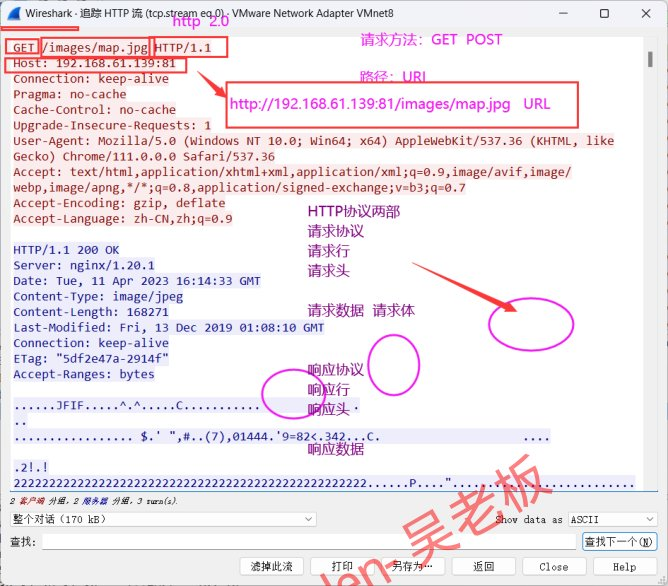
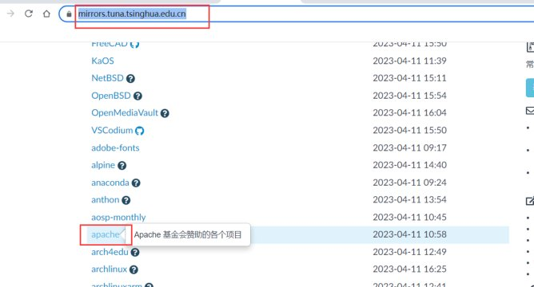
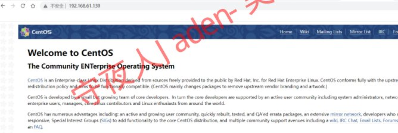
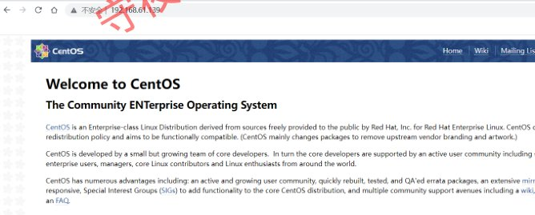
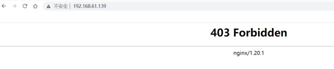
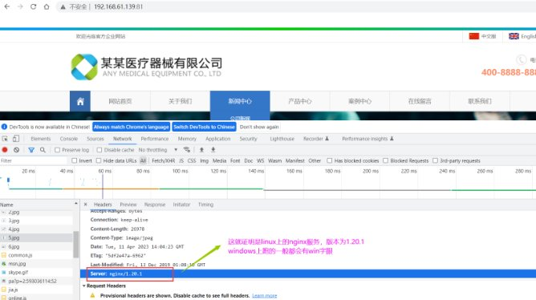

# web服务

来源 PDF：web服务.pdf（原文件位于课程目录，本文件夹不包含 PDF）

> 第 1 页

web服务(守夜人 Jaden（吴老板）)

## 一、web介绍

web全称：World Wide Web，全球广域网，也称为万维网。

web项目分为如下架构：

C/S架构：全称客户端服务端架构，英文Client/Server。qq、微信、京东app、各种游戏app或者电脑游戏应用等等。服务端主要负责加工处理数据，客户端主要用来展示数据。有些数据是存储在服务端的，

比如商品信息，我们换个电脑查看，商品信息还在，有些数据是存储在客户端的，比如聊天记录，我们换个电脑在登录qq，如果不做同步，就没有聊天记录了。

B/S架构：是C/S架构的一种，只是单独拿出来说，浏览器/服务端架构，英文Browser/Server，京东网站、淘宝网站等等，基于浏览器访问的网站都是B/S架构。这种架构的网站非常多，因为成本也比较便宜，不是每个公司都会开发自己的客户端程序，而且如果每个公司都制作自己客户端程序，我们的手机或者电脑要安装很多的客户端，其实很难受，而浏览器就提供了一个统一的入口，我们只需要下载一个浏览器软件，比如谷歌浏览器、火狐浏览器、360浏览器等等，只要打开一个标签页，输入一个网址就能访问一个网站，那么相当于我们一个软件就访问了多个公司的网站，很方便，这就是统一入口的意

思。

web发展了几个阶段：

web 1.0阶段：纯静态页面，不能交互，只是用来展示一些内容给大家看。客户端页面使用的HTML语言

开发的。

web 2.0阶段：支持用户上传信息，交互，购物。服务端后台开发语言有：php、java、ruby、python

等 ，刚开始使用后端开发语言就是为了用它来生成动态页面的，比如一些动态数据的展示等。php、

java是早先用的最多的。

web 3.0阶段：移动互联网，衣食住行，出门只带个手机就行。服务端后台开发语言有：php、java、

ruby、python等

守夜人 Jaden（吴老板）

## 二、http协议介绍

超文本传输协议 （Hyper Text Transfer Protocol，HTTP），1990年问世，发明者是蒂姆-伯纳斯-李。

1991年linux内核才发布出来，也是因为有互联网才让linux迅速传播开来。1994年Intel的奔腾处理器才刚开始发布。

过程：想要展示的画面 --> html文字 --> 服务端 --> 互联网 --> 客户端电脑浏览器 --> 解析HTML

--> 展示画面

\# 软件应用在互联网上数据传输要按照一定的标准格式来加工数据，这个格式就是HTTP协议。

我们可以抓包来看，比如抓一个css文件请求。

http://192.168.61.139:81/images/code.jpg

> 第 2 页

请求头：

GET /index.html HTTP/1.1

User-Agent: curl/7.29.0

Host: 192.168.18.200

守夜人 Jaden（吴老板）

Accept: /

请求起始行

GET /index.html HTTP/1.1

#第一个字段 http请求方法

#请求的URI  /index.html，请求URL：http://192.168.18.200:80/index.html

#HTTP的版本号   #版本有0.9 1.0 1.1  2.0

请求头部  #协商

#User-Agent: 客户端的浏览器信息

#Host  服务器的ip地址或者域名

#Accept

#Accept-Language: zh-CN,zh;q=0.9

请求空行  #隔断

> 第 3 页

请求主体  #提交的信息

log=111111&pwd=111111&wp-

submit=%E7%99%BB%E5%BD%95&redirect_to=https%3A%2F%2Fjaden.com%2Fwp-

admin%2F&testcookie=1

响应头

响应起始行

HTTP/1.1 200 OK

#第一个字段http版本

#数字 200 状态码  #常用状态码 https://www.cnblogs.com/gitnull/p/9532129.html

#对前面状态码的解释

响应头部  #显示服务端的信息

Date: Wed, 04 Aug 2021 02:22:11 GMT

Server: Apache/2.4.6 (CentOS) PHP/5.4.16

Last-Modified: Fri, 04 May 2018 08:13:44 GMT

ETag: "a49-56b5ce607fe00"

Accept-Ranges: bytes

Content-Length: 2633

Content-Type: text/html; charset=UTF-8

响应空行   #隔断

响应主体  #具体文件(html,图片,视频,exe)

http请求方法

GET   #最常用

POST  #提交信息

HEAD

守夜人 Jaden（吴老板）

PUT

trace

OPTIONS

DELETE

CONNECT #部分正向代理服务器使用的

http版本

0.9

1.0  支持请求方法

1.1  支持请求方法更多，支持长连接

2.0  https复用连接，提高了速度

http状态码

> 第 4 页

#常用状态码

200 ok

301 永久跳转  被浏览器记住

302 临时跳转  b被浏览器记住

403 权限拒绝

404 文件找不到

500 服务器内部错误

502 错误的网关

504 网关超时

## 三、html介绍

HTML的英文全称是 Hyper Text Markup Language，即超文本标记语言。

html语言写在html扩展名的文件中,index.html

html4   html  - h4

html5  -- h5

css: 全称Cascading Style Sheets(层叠样式表)，排版布局，.css文件

js: 全称javascript，特效，.js文件

超链接：网页跳转。

flash展示特效，视频播放，小游戏，很多网站已经不支持flash，因为不安全的漏洞太多，现在基本都是

html5来支持视频播放，小游戏。

phpstudy演示一下。

## 4、nginx安装和配置

守夜人 Jaden（吴老板）

apache、nginx等是叫做web服务应用软件，其实就是web服务端程序，也叫做web服务器软件，英文为web server。

apache是一个web服务器软件的名字，最开始只是用来做web服务程序用的，但是发展下来，apache

成立了一个软件基金会，这个基金会下面发展出来了很多很多的软件，然后最开始的apache软件改了个名字，叫做httpd，变成了现在apache金基会里面的一个软件。

https://mirrors.tuna.tsinghua.edu.cn/

> 第 5 页

点击进去可以看到很多软件，包括httpd、tomcat等等。

apache这个webserver出来的比较早，早期的时候市场份额占有量很大，后来被后起之秀nginx抢占了很多市场份额，甚至已经被nginx超越了，nginx成了现在最常用的webserver，也就是web服务器软件。如果nginx爆出了漏洞没那么影响范围就太大了，世界上有上千万个网站都用的是nginx搭建的网站，所以这个软件的安全性就很重要了。

webserver这种web服务软件其实大致都是差不多，我们学会一个，基本其他的也就会了，我们来玩一下nginx。

### 1、nginx安装

我们克隆一个之前的虚拟机，克隆一下优化之后的系统即可，然后安装一下nginx，虚拟机给1G内存即可，这个软件占用资源少、效率高，nginx是俄罗斯人在2002年开发的。

\# 可以改一下主机名，方便我们记忆：hostnamectl set-hostname web01

安装方法1：

守夜人 Jaden（吴老板）

使用epel源安装

\# yum repolist #查看当前系统的yum仓库有哪些软件包

yum install epel-release -y  # 安装yum的扩展包

yum install nginx -y

systemctl start nginx.service

systemctl enable nginx.service

\# netstat -lntup  # 查看端口占用情况

\# 可以看到nginx默认占用了80端口

\# 安装完之后，如果我们继续安装一个apache的httpd，还是可以安装上的

\# yum install httpd -y

\# 但是当我们启动httpd的时候会报错

\# systemctl start httpd

\# 查看它的状态

\# systemctl status httpd  # 可以看到启动失败了

[root@web01 ~]# systemctl status httpd

● httpd.service - The Apache HTTP Server

   Loaded: loaded (/usr/lib/systemd/system/httpd.service; disabled; vendor

preset: disabled)

   Active: failed (Result: exit-code) since 二 2023-04-11 20:20:47 CST; 17s ago

     Docs: man:httpd(8)

> 第 6 页

           man:apachectl(8)

  Process: 1819 ExecStart=/usr/sbin/httpd $OPTIONS -DFOREGROUND (code=exited,

status=1/FAILURE)

 Main PID: 1819 (code=exited, status=1/FAILURE)

4月 11 20:20:28 web01 systemd[1]: Starting The Apache HTTP Server...

\# 不能监听80端口，因为已经被80端口给占用了。所以一旦80端口被某个其他服务占用了，那么我们就不能

以80端口来启动其他的服务，所以想其他其他的服务，就要改服务默认的端口号

4月 11 20:20:47 web01 httpd[1819]: AH00558: httpd: Could not reliably determine

the server's fully ...ssage

4月 11 20:20:47 web01 httpd[1819]: (98)Address already in use: AH00072:

make_sock: could not bind t...:]:80

4月 11 20:20:47 web01 httpd[1819]: (98)Address already in use: AH00072:

make_sock: could not bind t....0:80

4月 11 20:20:47 web01 httpd[1819]: no listening sockets available, shutting down

4月 11 20:20:47 web01 httpd[1819]: AH00015: Unable to open logs

4月 11 20:20:47 web01 systemd[1]: httpd.service: main process exited,

code=exited, status=1/FAILURE

4月 11 20:20:47 web01 systemd[1]: Failed to start The Apache HTTP Server.

4月 11 20:20:47 web01 systemd[1]: Unit httpd.service entered failed state.

4月 11 20:20:47 web01 systemd[1]: httpd.service failed.

Hint: Some lines were ellipsized, use -l to show in full.

我们安装的centos版的nginx，所以访问nginx的默认初始页面，效果如下

守夜人 Jaden（吴老板）

接下来看一下nginx的一些配置，nginx所有的修改都需要修改配置文件来进行控制。

### 2、nginx配置

修改配置之前，一般都需要我们备份一下配置文件，以防改错了，那么nginx也帮你考虑到了，所以提前给我们准备了一个备份文件，如下

[root@web01 ~]# ll /etc/nginx/

总用量 68

drwxr-xr-x 2 root root    6 11月 11 00:58 conf.d

drwxr-xr-x 2 root root    6 11月 11 00:58 default.d

-rw-r--r-- 1 root root 1077 11月 11 00:58 fastcgi.conf

-rw-r--r-- 1 root root 1077 11月 11 00:58 fastcgi.conf.default  # fastcgi.conf的备

份文件

-rw-r--r-- 1 root root 1007 11月 11 00:58 fastcgi_params

> 第 7 页

-rw-r--r-- 1 root root 1007 11月 11 00:58 fastcgi_params.default # fastcgi_params

的备份文件

-rw-r--r-- 1 root root 2837 11月 11 00:58 koi-utf

-rw-r--r-- 1 root root 2223 11月 11 00:58 koi-win

-rw-r--r-- 1 root root 5231 11月 11 00:58 mime.types

-rw-r--r-- 1 root root 5231 11月 11 00:58 mime.types.default # mime.types的备份文件

-rw-r--r-- 1 root root 2336 11月 11 00:58 nginx.conf  # nginx的主配置文件，nginx每次

启动都会加载它。

-rw-r--r-- 1 root root 2656 11月 11 00:58 nginx.conf.default # nginx.conf的备份文件

-rw-r--r-- 1 root root  636 11月 11 00:58 scgi_params

-rw-r--r-- 1 root root  636 11月 11 00:58 scgi_params.default # scgi_params的备份

文件

-rw-r--r-- 1 root root  664 11月 11 00:58 uwsgi_params

-rw-r--r-- 1 root root  664 11月 11 00:58 uwsgi_params.default # uwsgi_params的备

份文件

-rw-r--r-- 1 root root 3610 11月 11 00:58 win-utf

所以其实我们不用自行进行备份了。

\# 先过滤一下配置文件，因为里面的#号，空行等太多了，带#号的都是注释不用的，所以可以去掉

cd /etc/nginx/

grep -Ev '#|^$' nginx.conf.default > nginx.conf

\# 编辑配置文件

vim nginx.conf

#删除17-20行,剩下的就是最小配置了

\# 注意配置文件的语法格式，每行结尾必须是英文的分号。

worker_processes  1;   #启动nginx时工作进程的数量，可以加大这个数字来提高nginx的处理请求的

效率，但是这个数字也不能太大，因为进程是消耗系统内存资源的。调整一下这个数字，然后通过free指令可以查看一下内存容量的变化。建议和CPU核数一致就行

\# worker_processes  2;  # 改完配置文件都需要重启nginx才生效，systemctl restart

nginx.service

events {

守夜人 Jaden（吴老板）

    worker_connections  1024;     #连接数量，每个进程可以处理1024连接

}

http {                            #http模块

    include       mime.types;     #include是包含的意思，这行的意思是，nginx启动的时候加

载nginx.conf主配置文件的时候，加载到这一行的时候，先包含加载一下mime.types文件里面的配置，这个文件主要是用来标识支持哪些多媒体格式，这个文件在nginx.conf所在目录

    default_type  application/octet-stream;  #如果不能识别的文件，那么默认以八进制数据流

的方式来打开文件

\    # 下面这两个配置也可以删掉，现在不太适合讲，后面再讲

\    # sendfile        on;

\    # keepalive_timeout  65;

    charset utf-8;                          #设置字符集，这是我多加的一个配置，默认没

有，比如vim jaden.html写入一些中文，去掉和加上这个配置看看效果

    server {                                #一个网站，一个nginx可以运行多个网站，添加

这个配置项即可

        listen       80;                    #监听端口，可以修改，比如改个81看看效果，再

启动apache看看80效果

        server_name  localhost;             #网站的域名，现在没有配置域名，默认就是

localhost，比如后面可以配置www.wulaoban.top

        location / {                        #目录，必须要有个location

> 第 8 页

            root   html;                    #root是站点根目录的意思，值为html表示一个

相对路径，绝对路径是/usr/share/nginx/html，也可以改昂，比如改成绝对路径root

/usr/share/nginx/html，或者改为其他路径root /web

            #root /web # 改为这个试一下，别忘了去根目录下创建一个web目录，给web目录一些文件

看看效果，比如那个医疗的网站，http://192.168.61.139:81/yiliao/，还可以直接把医疗的目录内容

直接拷贝到/web目录中，就不用每次访问都/yiliao/了

\            # [root@web01 web]# mv yiliao/* .

\            # 在访问：http://192.168.61.139:81/

            index  index.html index.htm;    #默认首页，访问网址根路径的时候，自动访问站

点根目录下面的index或者index.html或者index.htm文件，如果没有这几个名字的文件呢？访问的时候就会提示403，需要在网址上手动指定文件名称，这几个文件名称也是可以改的，比如改为jaden.html。

        }

    }

\    # 第二个网站：

    #server {

\    #    listen       81;

\    #    server_name  localhost;

\    #    location / {

\    #        root   html;

\    #        index  index.html index.htm;

\    #    }

    #}

}

\# 修改完配置文件之后，可以检查一下配置文件的语法是否ok

[root@web01 nginx]# nginx -t

nginx: the configuration file /etc/nginx/nginx.conf syntax is ok

nginx: configuration file /etc/nginx/nginx.conf test is successful

\# 百度是php语言开发的：下面两个方式访问效果一样，baidu的首页其实是index.php

\# https://www.baidu.com/

\# https://www.baidu.com/index.php

守夜人 Jaden（吴老板）

查看nginx进程

[root@web01 nginx]# ps -ef | grep nginx

root       1725      1  0 20:16 ?        00:00:00 nginx: master process

/usr/sbin/nginx # master process是主进程的意思，也叫做管理进程，它是用来管理nginx整个运行

的，nginx的其他子进程如果死掉了，它会自动在启动其他的子进程，比如尝试kill 下面的子进程，你会发现另外一个进程又自动启动了。真正干活的进程是下面的worker process进程，叫做工作进程，有请求来了都是它处理的

nginx      1727   1725  0 20:16 ?        00:00:00 nginx: worker process # 可以看到

nginx是以nginx用户身份启动的

root       1869   1552  0 20:35 pts/0    00:00:00 vim nginx.conf

root       1898   1872  0 20:35 pts/1    00:00:00 grep --color=auto nginx

查看mime.types，nginx支持的多媒体类型文件

vim mime.types

默认nginx的站点根目录(存放网站代码的目录，也叫做网站的物理路径、真实路径等)在如下位置

> 第 9 页

[root@web01 nginx]# cd /usr/share/nginx/html/

[root@web01 nginx]# ls

404.html  50x.html  en-US  icons  img  index.html  nginx-logo.png  poweredby.png

我们通过浏览器网址访问nginx启动的网站页面时，默认nginx都会在这个目录中去寻找用户访问的页面对应的HTML文件。

http://192.168.61.139/  --- index.html

http://192.168.61.139/img/centos-logo.png  --- img/centos-logo.png

比如我们放一个mp4格式的文件上来，直接访问文件名称就可以播放

http://192.168.61.139/jaden.mp4   # 这是因为nginx的配置文件mime.types中看到，支持mp4，

如果删掉了配置文件中mp4那一行数据，那么就不支持mp4格式文件的预览了，也就是不能直接在浏览器上播放

mp4视频了，而是直接下载，但是现在浏览器做的功能比较强大了，有些浏览器也会自动帮我们播放mp4的视频。如果是nginx不能识别的文件格式、并且浏览器也不能识别这种文件格式，比如xx.jaden，那么访问一下会直接下载这个文件。

#再比如，如果是nginx支持，但是浏览器不支持的文件格式，比如htc格式的文件，nginx能识别，但是浏览

器不支持，那么浏览器会尝试用txt的方式来打开这个文件，如果是一些视频或者图片，那么就在浏览器上看到一堆乱码。 如果nginx和浏览器都不支持的，基本就会看到直接下载。

如果我们删除了/usr/share/nginx/html/ 目录中的全部文件和目录，如下

[root@web01 nginx]# cd /usr/share/nginx/html/

[root@web01 html]# rm -rf *

访问一下，怎么还能看到这个页面，这是浏览器做的缓存，将你的页面已经缓存到你自己电脑本地了，

一访问还是访问的本地缓存的页面。

守夜人 Jaden（吴老板）

可以多刷新几次，或者ctrl+f5强制刷新访问，也就是让浏览器不要访问缓存，直接去拿最新的页面，但是什么页面都没有了，效果如下，看到403数字和英文单词Forbidden，不允许访问的意思。

> 第 10 页

如何看某个网站是运行在linux上，如下，右键点击检查，或者f12，或者找到浏览器设置，打开开发者工具就看到如下窗口了。

守夜人 Jaden（吴老板）

> 第 11 页

