# Tomcat

来源 PDF：Tomcat.pdf（原文件位于课程目录，本文件夹不包含 PDF）

> 第 1 页

Tomcat(守夜人 Jaden（吴老板）)

web服务程序，也叫webserver，有IIS、apache、nginx、tomcat等等开发语言：c、c++、java、python、ruby、perl、go、php...

IIS是windows上专用的webserver，是C++语言开发的。

nginx和apache都是C语言开发的，每个平台都有相应的版本可供使用。

tomcat是java语言开发的，可以跨平台使用。

## 一、编程语言和运行平台

编译型语言：

C语言，是编译型语言的老大，但是c语言开发的程序是需要绑定平台的，平台=操作系统+硬件(主要是CPU)。

nginx是c语言开发的：软件(可执行文件)=源代码+编译(不同平台有不同的编译器)。

    nginx的各版本：https://nginx.org/en/download.html

    平台linux+x86版CPU：

    需要安装nginx的x86版本，x86再细分的话分为32位和64位的版本。

    比如nodepad++分32位和64位版本。

    再比如老版本的centos，centos7版本之前吧，都还分32位和64位，7及之后版本都只有64位了

    https://mirrors.tuna.tsinghua.edu.cn/centos-vault/，i386是32位的，x86_64是

64位的。

    平台linux+arm版CPU：

    arm分的更细：v6、v7、v8、v9架构，v系列架构都是32位和64位都集成了，但是这几个架构的软件不能通用。

    苹果是模改的arm架构，他有个特点是它新出的64位系统，对32位的兼容性不好，打开32位的软件就发热卡顿，苹果直接就给下架了

    windows+x86，32位和64位都有

    windows+arm

守夜人 Jaden（吴老板）

    所以c语言的特点就是开发的软件需要看平台：操作系统+cpu架构

    那么出现了编译器，如果是想在相应平台上运行的代码，需要这个平台的编译器编译一下才能运行。不同平台需要不同的编译。想让自己的软件支持的平台越多，需要编译的次数就越多，很烦，所有有些软件只支持部分平台。

    再比如这个普罗米修斯这个软件：https://prometheus.io/download/，这里可以看到这个软件都

很多的不同平台的不同版本

java，不需要绑定平台，开发的项目和软件都是跨平台的。

    一次编译，各平台都可以运行。为什么呢？

Java和C：不同平台安装不同平台的java虚拟机，java虚拟机叫做JVM，后面再解释。

> 第 2 页

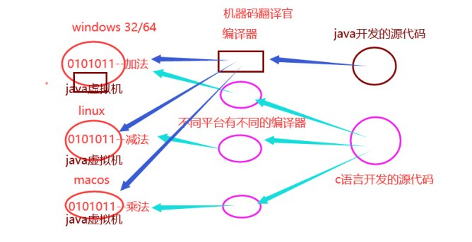

java后来发展出来了JIT技术，及时编译技术，并不需要提前编译好之后再拿去运行，而是运行时编译，

边运行边编译。

这个及时编译技术广泛的应用在后来的一些高级语言中，比如python、php、ruby、perl等开发语言，

一边编译一边运行。

c和java都属于静态编译，整体编译完全部代码之后才能够运行。

python、php、ruby、perl属于动态编译语言，不需要提前编译，一边运行着一边编译着。

静态编译的语言的运行效率高，不需要等待编译了，因为已经编译好了，直接就可以运行，动态的是一边运行一边编译，运行效率就慢。

android的软件早先用的是及时编译技术，所以导致软件安装的比较快，但是打开的时候就比较慢。后来改成了静态编译的方式，ios一直是静态编译的方式。但是有个点是，编译之后的软件包比源代码软件包的体积要大一些。

守夜人 Jaden（吴老板）

所以有个android虚拟机的概念，就是用来运行编译之后的java代码的，andriod4.4版本之前虚拟机叫做

Dalvik虚拟机，后来被ART虚拟机替换掉了。

## 二、JVM介绍

JVM是Java Virtual Machine（Java虚拟机）的缩写

Java虚拟机本质是就是一个程序，当它在命令行上启动的时候，就开始执行保存在某字节码文件中的指令。Java语言的可移植性正是建立在Java虚拟机的基础上。任何平台只要装有针对于该平台的Java虚拟机，字节码文件（.class）就可以在该平台上运行。这就是“一次编译，多次运行”。

## 三、Tomcat介绍

a.什么是Tomcat

Tomcat和我们此前学习的 Nginx 类似，也是一个Web服务器。

b.Tomcat与Nginx有什么区别？

tomcat是一个java版的web服务器

> 第 3 页

Nginx仅支持静态资源，而Tomcat则支持Java开发的jsp动态资源和静态资源，比如http://www.e-hifar

ms.com/index.jsp网站就是jsp结尾的文件。但是Tomcat处理静态资源比Nginx慢。

Nginx适合做前端负载均衡，而Tomcat适合做后端应用服务处理。

通常情况下，企业会使用 Nginx+tomcat 结合使用，由Nginx处理静态资源，Tomcat处理动态资源，就类似于Nginx+phpfpm一样。

## 四、Tomcat快速安装

### 1、java介绍

\# java是sun公司开发，后来sun公司被甲骨文oracle公司收购了，所以现在java属于oracle公司。每个

android上面都是跑的java虚拟机，运行着各种java项目。

\# jvm：Java Virtual Machine，加成jvm，叫做java虚拟机

\# jre：Java Runtime Environment，简称JRE，叫做java运行环境，jre里面包含jvm。

\# jdk：Java Development Kit，简称jdk，叫做java开发工具包，包含jre和很多开发时会用到的辅助

软件

\# 如果只是单纯想运行java的项目，就安装jre即可，如果想开发java项目或者配合一些其他工具软件来使

用，那就需要安装jdk，大家一般都会安装jdk。

\# jdk有很多版本：早先jdk6比较流行，但是漏洞比较多，jdk6，官方叫做jdk1.6，后来有了jdk7，官方

叫做1.7，直接jdk8，jdk9、jdk10...，最新版本现在是jdk20了，看官网：

https://www.oracle.com/java/technologies/downloads/，jdk8、11、17都是LTS长期技术支持

版本，很多公司都喜欢用这种长期支持版本。老项目还有一些用的jdk6\7等，jdk本身漏洞就比较多。

### 2、Tomcat安装

安装方法1:  推荐

我们就使用这个方法来安装吧：tomcat的运行需要java环境，所以先安装jdk。

把如下两个安装包放到虚拟机上，这两个包我都给大家准备好了。

守夜人 Jaden（吴老板）

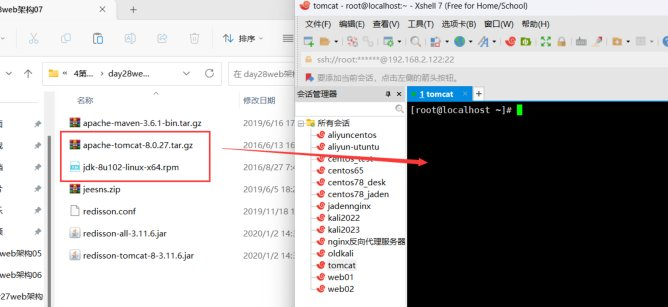

按照下面的步骤进行安装

> 第 4 页

\# 这个方法适用于redhat系列的系统

\# 我们克隆一个优化好之后的centos7.8虚拟机来安装吧

rpm -ivh jdk-8u102-linux-x64.rpm  #8u102表示jdk8，u表示更新，102表示是第102次更新，每次

更新都是在补漏洞

mkdir /app -p

tar xf apache-tomcat-8.0.27.tar.gz -C /app  #apache-tomcat-8.0.27.tar.gz是编译好的

tomcat程序了。

/app/apache-tomcat-8.0.27/bin/startup.sh  # 解压之后，执行这个指令就能启动了

tomcat就安装好了，直接浏览器访问即可：tomcat的默认端口是8080，记住昂，我们安装的是8.0.72

版本，tomcat属于apache基金会的软件，所以前面会带有apache字眼。

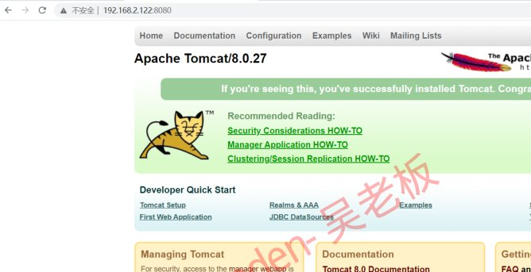

查看进程：

[root@localhost ~]# ps -ef |grep tomcat

root       1781      1  1 11:32 pts/0    00:00:02 /usr/bin/java -

守夜人 Jaden（吴老板）

Djava.util.logging.config.file=/app/apache-tomcat-8.0.27/conf/logging.properties

-Djava.util.logging.manager=org.apache.juli.ClassLoaderLogManager -

Djava.endorsed.dirs=/app/apache-tomcat-8.0.27/endorsed -classpath /app/apache-

tomcat-8.0.27/bin/bootstrap.jar:/app/apache-tomcat-8.0.27/bin/tomcat-juli.jar -

Dcatalina.base=/app/apache-tomcat-8.0.27 -Dcatalina.home=/app/apache-tomcat-

8.0.27 -Djava.io.tmpdir=/app/apache-tomcat-8.0.27/temp

org.apache.catalina.startup.Bootstrap start

root       1917   1499  0 11:34 pts/0    00:00:00 grep --color=auto tomcat

\# 可以看到，系统调用的java来运行的tomcat

安装方法2:

这种方法比较繁琐，需要配置环境变量，将java配置到环境变量中，不然没办法运行java。方法1自动帮我们配置了。

> 第 5 页

#这个方法适用于debian和ubuntu等其他linux发行版，其实所有的linux系统都可以用下面的方式安装

tar xf jdk-8u60-linux-x64.tar.gz -C /app/

ln -s /app/jdk1.8.0_60 /app/jdk

sed -i.ori '$a export JAVA_HOME=/app/jdk\nexport

PATH=$JAVA_HOME/bin:$JAVA_HOME/jre/bin:$PATH\nexport

CLASSPATH=.$CLASSPATH:$JAVA_HOME/lib:$JAVA_HOME/jre/lib:$JAVA_HOME/lib/tools.jar'

 /etc/profile

source /etc/profile

mkdir /app/

tar xf apache-tomcat-8.0.27.tar.gz -C /app

/app/apache-tomcat-8.0.27/bin/startup.sh

### 3、windows安装jdk并配置环境变量

我给大家演示一下windows上安装jdk，配置环境变量的过程，linux也是这样的过程，只不过需要指令来添加环境变量，其实比windows操作还简单，但是达到的效果是一样的。

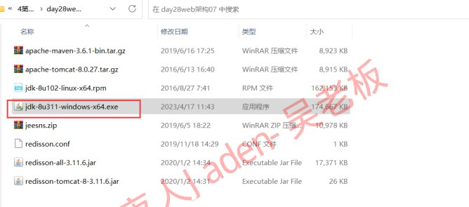

放到某个win10虚拟机上安装玩一下吧，安装前做好先拍个快照。

守夜人 Jaden（吴老板）

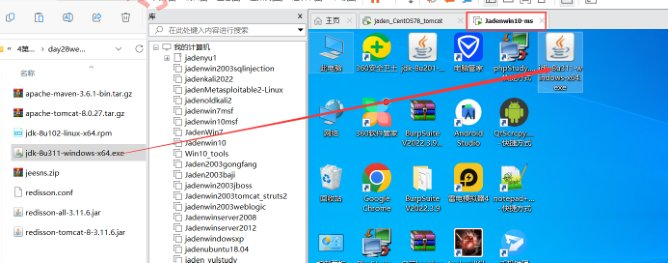

安装位置可以自行调整，我在c盘java目录中创建了个文件夹叫做jdk，作为jdk的安装目录。还创建了个

jre目录，作为jre的安装目录。

> 第 6 页

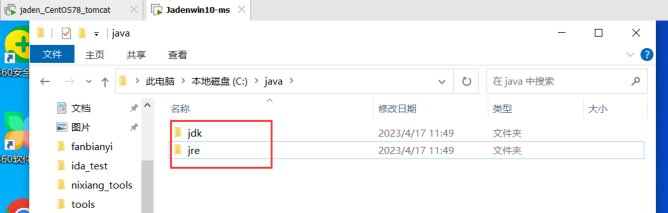

然后安装即可，一路下一步，会看到提示安装jre，jdk是包含jre的。

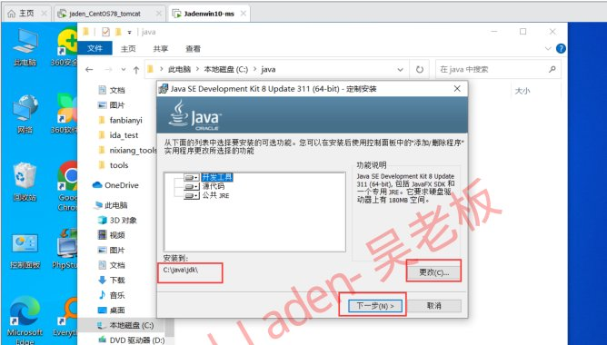

jre，下面是单独安装一个jre，其实jdk的安装目录中已经包含了jre，但是我们也继续安装一下吧守夜人 Jaden（吴老板）

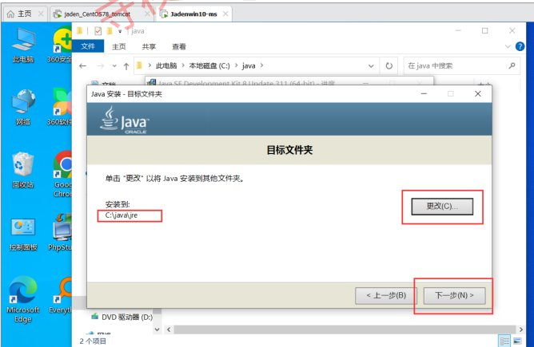

如下，就安装完了，点击关闭即可

> 第 7 页

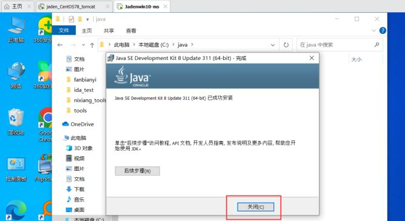

配置环境变量

我的电脑--属性--高级系统设置--环境变量

环境变量分为两种：

系统环境变量：配置在这里，那么所有用户都可以使用

用户环境变量：配置在这里，那么只有当前用户可以使用

我们在系统环境变量中添加：

守夜人 Jaden（吴老板）

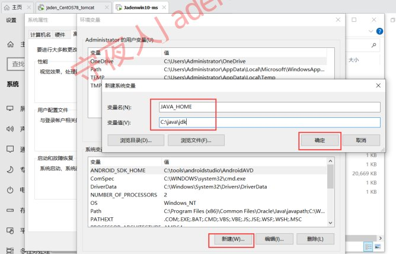

在配置系统环境变量中的path：

> 第 8 页

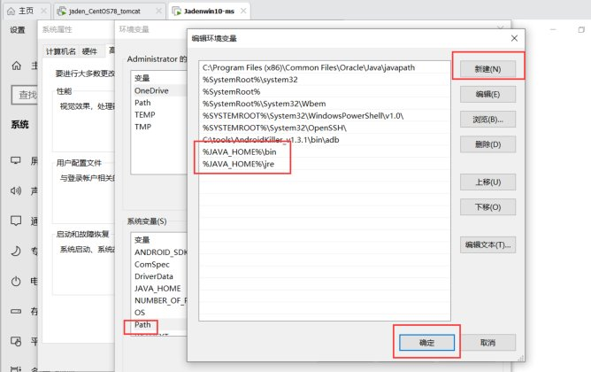

这样就ok了，检查一下：看到如下效果表示配置好了，看到1.8.0_311了吗，就是我们安装的时候那个版本8u311。

守夜人 Jaden（吴老板）

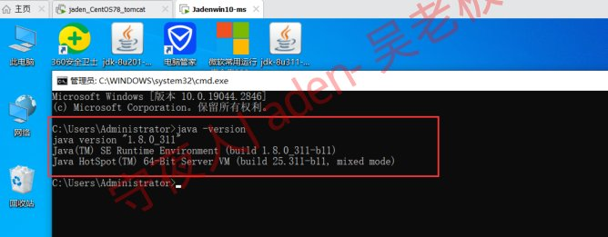

查看环境变量的值：

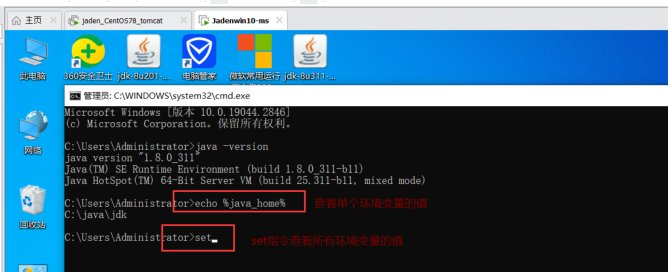

linux上查看单个变量的值echo $LANG ，查看所有变量的值env 。

> 第 9 页

## 五、tomcat目录结构介绍

[root@tomcat apache-tomcat-8.0.27]# ll  # 和linux目录有点类似

total 92

drwxr-xr-x 2 root root  4096 Aug  3 03:05 bin  #主要包含启动、关闭tomcat脚本和脚本依赖

文件  非常重要

drwxr-xr-x 3 root root   198 Aug  3 03:05 conf #tomcat配置文件目录，里面都是xml格式的

配置文件    非常重要

drwxr-xr-x 2 root root  4096 Aug  3 03:05 lib  #tomcat运行需要加载的jar包，都是一些关

键插件    非常重要

-rw-r--r-- 1 root root 57011 Sep 28  2015 LICENSE #license文件，不重要

drwxr-xr-x 2 root root   197 Aug  3 03:15 logs  #在运行过程中产生的日志文件   非常重要

-rw-r--r-- 1 root root  1444 Sep 28  2015 NOTICE #不重要

-rw-r--r-- 1 root root  6741 Sep 28  2015 RELEASE-NOTES #版本特性，不重要

-rw-r--r-- 1 root root 16204 Sep 28  2015 RUNNING.txt   #帮助文件，不重要

drwxr-xr-x 2 root root    30 Aug  3 03:05 temp    #存放临时文件

drwxr-xr-x 7 root root    81 Sep 28  2015 webapps #站点目录   非常重要

drwxr-xr-x 3 root root    22 Aug  3 03:05 work    #tomcat运行时产生的缓存文件

[root@192 etc]# ls /app/apache-tomcat-8.0.27/

bin  conf  lib  LICENSE  logs  NOTICE  RELEASE-NOTES  RUNNING.txt  temp  webapps

work

[root@192 etc]# ls /app/apache-tomcat-8.0.27/bin/

bootstrap.jar       commons-daemon-native.tar.gz  digest.sh         startup.bat

        tool-wrapper.sh

catalina.bat        configtest.bat                setclasspath.bat  startup.sh

         version.bat

catalina.sh         configtest.sh                 setclasspath.sh   tomcat-

juli.jar       version.sh

catalina-tasks.xml  daemon.sh                     shutdown.bat      tomcat-

native.tar.gz

commons-daemon.jar  digest.bat                    shutdown.sh       tool-

wrapper.bat

守夜人 Jaden（吴老板）

\# bin目录中的jar文件是tomcat启动时自动加载的一些关键文件。

\# .jar结尾的文件：java源代码打包出来之后都是.jar结尾的文件，叫做jar包，jar包就是 Java

Archive File，顾名思义，它的应用是与 Java 息息相关的，是 Java 的一种文档格式，是一种与平台无

关的文件格式，可将多个文件合成一个文件。jar 包与 zip 包非常相似——准确地说，它就是 zip 包，所以叫它文件包。jar 与 zip 唯一的区别就是在 jar 文件的内容中，包含了一个 META-INF/MANIFEST.MF

文件，该文件是在生成 jar 文件的时候自动创建的，作为jar里面的"详情单"，包含了该Jar包的版本、创建人和类搜索路径Class-Path等信息，当然如果是可执行Jar包，会包含Main-Class属性，表明Main方法入口，尤其是较为重要的Class-Path和Main-Class。jar 包是通过 JavaSE 程序打成的包，一般是为了将一些公共的java功能代码打包成一个jar包，那么其他项目直接引用这个jar包就能使用这个功能。

\# .xml结尾的文件：和html很类似，也是一种标签语言

## 六、java项目部署的2种方式

类似于tomcat的这种webserver还有jboss、weblogic等等。区别是tomcat是开源的，jboss、weblogic

都是商业产品，weblogic是oracle公司开发的。

> 第 10 页

### 5.1 使用war包部署zrlog

zrlog是个博客网站，我们可以下载来部署一下，这个网站会用到数据库。

jar包除了可以打包一些java编写的特定功能的插件之外，在项目部署方面用的也比较多，用jar包做项目部署的时候，一般jar包中会直接打包上webserver的程序，比如tomcat，所以直接运行jar包，项目就运行起来了，不需要去安装tomcat之类的webserver。jar 包是通过 JavaSE 程序打成的包。

war包是在网站项目部署的时候用的比较多，它也是打包的java源代码程序，但是里面是站点源代码，不包含webserver程序。war包是

https://www.zrlog.com/，可以自行下载war包。war 包是 JavaWeb 程序打的包。

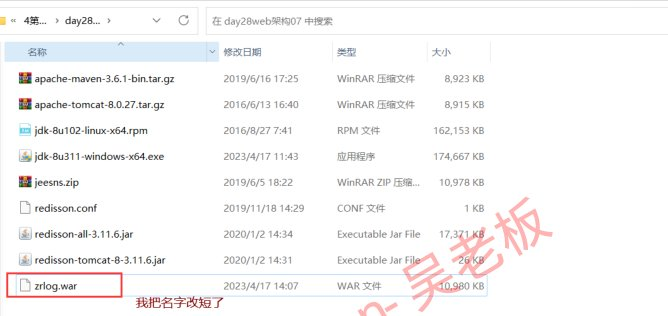

部署一下上面这个文件。注意，如果你的tomcat服务器重新启动过，执行这个指令来启动

tomcat /app/apache-tomcat-8.0.27/bin/startup.sh

[root@192 etc]# cd /app/apache-tomcat-8.0.27/webapps/

[root@192 webapps]# ls

docs  examples  host-manager  manager  ROOT

[root@192 webapps]# rz -E

守夜人 Jaden（吴老板）

rz waiting to receive.

[root@192 webapps]# ls  # war包上传过来之后，tomcat会自动帮我们解压war包，如果你ls查看不

到，稍等一会就看到了，解压出来的zrlog目录

docs  examples  host-manager  manager  ROOT  zrlog  zrlog.war

\# 然后就可以直接访问网站了

效果如下

> 第 11 页

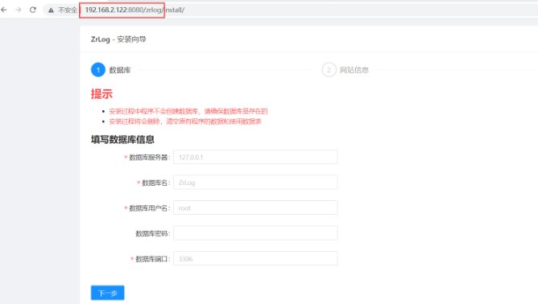

但是需要我们填写一些数据库的信息，我们还没有，需要安装并创建数据库。

yum install mariadb-server -y

[root@localhost webapps]# systemctl start mariadb.service

[root@localhost webapps]# systemctl enable mariadb.service

[root@localhost webapps]# mysql_secure_installation # 做一下安全初始化吧，连接起来更顺

畅

\# 安全初始化的过程中设置一个root密码吧，我设置的是123456，剩下的一路y即可

\# 连接一下看效果：

[root@localhost webapps]# mysql -u root -p123456

\# 创建数据库

MariaDB [(none)]> create database zrlog;

Query OK, 1 row affected (0.00 sec)

MariaDB [(none)]> show databases;

+--------------------+

守夜人 Jaden（吴老板）

| Database           |

+--------------------+

| information_schema |

| mysql              |

| performance_schema |

| zrlog              |

+--------------------+

4 rows in set (0.00 sec)

MariaDB [(none)]>  exit

然后回到网站进行初始化：

> 第 12 页

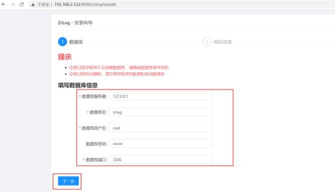

如下，设置后台管理系统的账号：

守夜人 Jaden（吴老板）

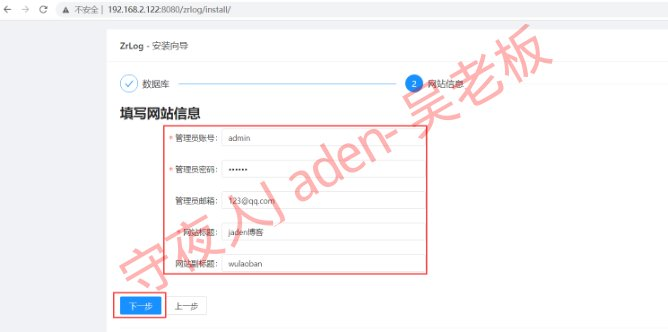

如下

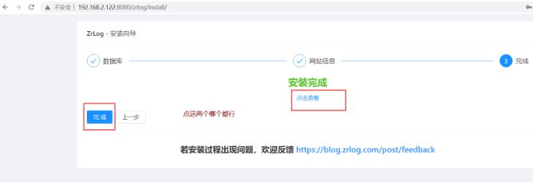

安装好了，点击查看，如下：

> 第 13 页

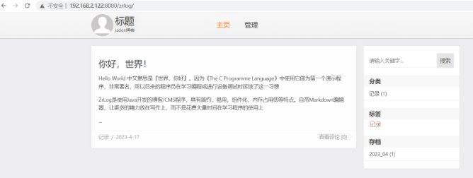

点击管理，如下：

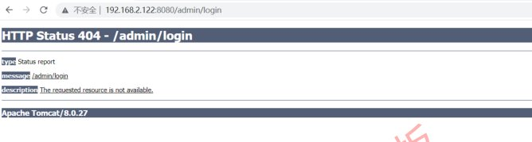

看到了报错页面，报错的原因就是，这个项目在打包成war的时候，就没有想到我们没有直接把war包里面的内容全部解压到网站根目录下，而是放在了zrlog文件夹里面，也就是说少了一层目录，我们自己在网址上多补充一个目录，看看效果守夜人 Jaden（吴老板）

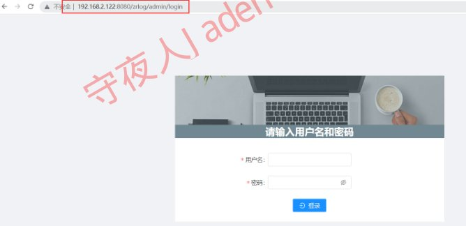

这就可以了，但是这也不是办法，所以我们解决一下。

\# 如果只用tomcat部署一个网站的话，就按照下面这种操作：

\# 先停掉tomcat

[root@localhost webapps]# /app/apache-tomcat-8.0.27/bin/shutdown.sh

\# 调整网站根目录中的内容，其实站点根目录下面的ROOT文件夹是存放代码的目录，没用的先删除掉

[root@localhost webapps]# rm -rf docs/ examples/ host-manager/ logs/ manager/

zrlog.war

\# 查看ROOT目录中的内容：

[root@localhost webapps]# ls ROOT/

asf-logo.png       bg-middle.png    bg-upper.png  index.jsp          tomcat.gif

     tomcat.svg

> 第 14 页

asf-logo-wide.gif  bg-nav-item.png  build.xml     RELEASE-NOTES.txt  tomcat.png

     WEB-INF

bg-button.png      bg-nav.png       favicon.ico   tomcat.css         tomcat-

power.gif

\# 删除ROOT中的内容，然后将zrlog目录中的内容全部移动到ROOT目录中

[root@localhost webapps]# rm -rf ROOT/*

[root@localhost webapps]# ls ROOT/

[root@localhost webapps]# mv zrlog/* ROOT/

\# 删除没用的zrlog目录

[root@localhost webapps]# rm -rf zrlog

[root@localhost webapps]# ls

ROOT

[root@localhost webapps]# ls ROOT/

admin  assets  error  favicon.ico  include  install  META-INF  WEB-INF

#改完之后，启动tomcat

[root@localhost webapps]# /app/apache-tomcat-8.0.27/bin/startup.sh

再访问网站，直接ip地址加端口就可以访问了，再访问后台

守夜人 Jaden（吴老板）

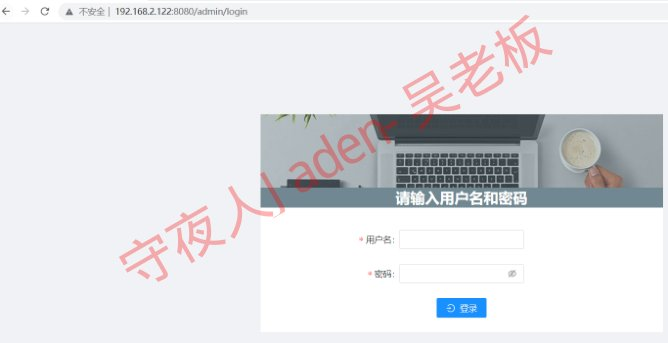

登录进去：

> 第 15 页

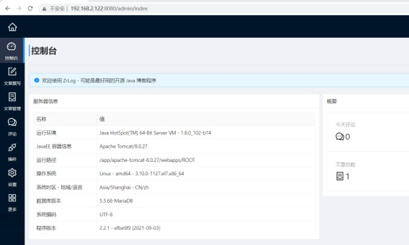

后期有些php项目也是这样，放到站点根目录下才能正常运行，这都是开发人员的水平问题。

### 5.2 使用jar部署小说网站

下载个打包为jar包的web项目代码来部署一下吧。

https://github.com/hectorqin/reader/releases/tag/v2.6.2，下载这个项目，如下，不下载最新的，最

新的需要授权才能下载。

守夜人 Jaden（吴老板）

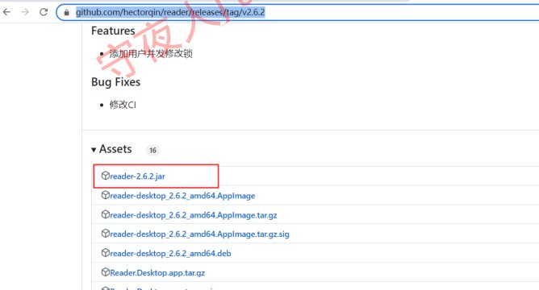

如下

> 第 16 页

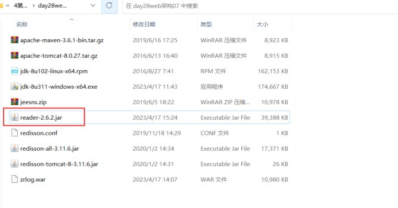

然后可以看一下官方文档，里面有部署教程：

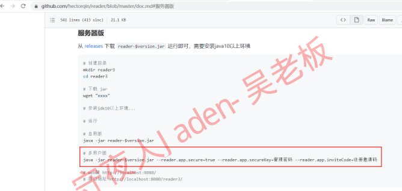

守夜人 Jaden（吴老板）

开始部署

\# 先关闭tomcat，不然有冲突，因为这个jar运行起来之后使用的也是8080端口

[root@localhost webapps]# /app/apache-tomcat-8.0.27/bin/shutdown.sh

cd /opt/  # 随便找个目录，比如就opt吧

#上传刚才下载的jar包到opt目录下

\# 然后执行如下指令：java -jar reader-$version.jar --reader.app.secure=true --

reader.app.secureKey=管理密码 --reader.app.inviteCode=注册邀请码

\# 指令稍作调整，管理员密码：12345678，注册邀请码8888，reader-$version.jar改为我们下载的包

名reader-2.6.2.jar，默认的管理员名称为default

java -jar reader-2.6.2.jar --reader.app.secure=true --

reader.app.secureKey=12345678 --reader.app.inviteCode=8888

\# java -jar reader-2.6.2.jar #直接运行这个指令是单用户模式启动网站。

## 六、maven编译java源代码

我找一个源代码给大家，用这个来演示吧：

> 第 17 页

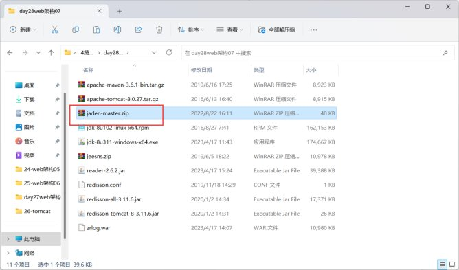

上传到我们的tomcat服务器上。

cd /opt/

unzip 解压一下

cd jaden-master

tree

vim pom.xml #这个配置文件中有指定，打包的时候打包成war包还是jar包

\# <packaging>war</packaging>  # 这里写的是打一个war包

\# 需要安装编译器才能打包，打包指令为mvn，是maven的缩写。

maven编译

\# 安装maven编译器

wget http://mirrors.tuna.tsinghua.edu.cn/apache/maven/maven-

3/3.6.3/binaries/apache-maven-3.6.3-bin.tar.gz

守夜人 Jaden（吴老板）

tar xf apache-maven-3.6.3-bin.tar.gz -C /usr/local/ # -C是解压到某个目录

ln -s /usr/local/apache-maven-3.6.3 /usr/local/maven # 给maven创建一个短一点的路径，

文件名称太长了，ln -s是创建软链接的意思，也就是快捷方式的意思。

vim /etc/profile

#文件结尾添加两行G

export M2_HOME=/usr/local/maven

export PATH=${M2_HOME}/bin:$PATH

:wq

source /etc/profile

#验证

mvn -v

\# cd到源代码目录

cd jaden-master  # 确保该目录下有pom.xml配置文件

#打包命令

mvn clean package

> 第 18 页

#打包的时间一般都比较长，因为会下载各种打包需要的依赖文件。

\# 打包完成之后多了一个target目录，在target目录中可以看到SpringBootWeb.war这个打包好的war

包。

\# 把SpringBootWeb.war移动到tomcat的webapps目录中，改个短一些的名字，比如叫做jaden.war

\# 启动tomcat

\# 然后访问一下就看到网站效果了。

\# java代码的打包工具有：maven、gradle、ant等，前两个用的居多。

## 七、将web网站打包成app

将web网站打包成客户端的app，比如apk、ipa(ios的app)。只要我们有个网站就可以做这个事情。

教大家一下，如果用浏览器模仿手机端来访问网站：

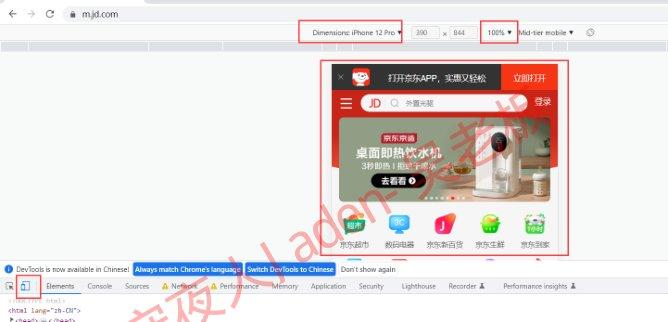

守夜人 Jaden（吴老板）

那么其实可以感觉得到，原来京东这个网站是可以在手机上直接访问的，而且由于是手机访问，和pc端访问时的页面效果不同。

那么我们可以通过打包，将pc端的网站打包为移动端的app，看上去是app，其实还是个网站。需要我们的网站是运行在公网上的才可以玩昂。

比如将我们之前的smallboll小游戏部署一下，然后打包一下，打包我们可以借助网上在线的一键打包工具即可，有些是收费的，有免费试用的。

不管网页是纯HTML、php、jsp等开发的，都是可以打包成app的。现在有大量的app其实都是这么生成的，这叫做给网站套个壳，就编程apk了，那么本质上它还是个网站。

等后面讲到app渗透的时候，我在给大家讲解现在市面上的各种app是什么样子的，都是如何检测安全性

的。

打包站点网址：https://appdabao.yimenapp.com/

> 第 19 页

